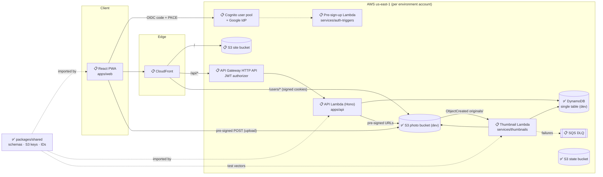
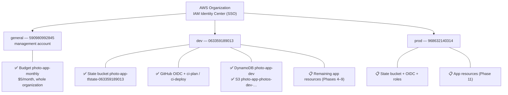
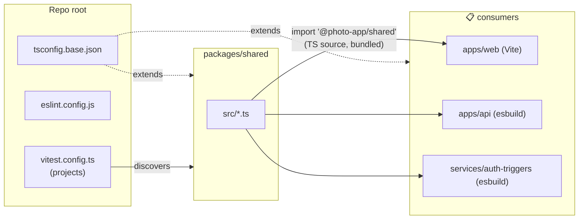
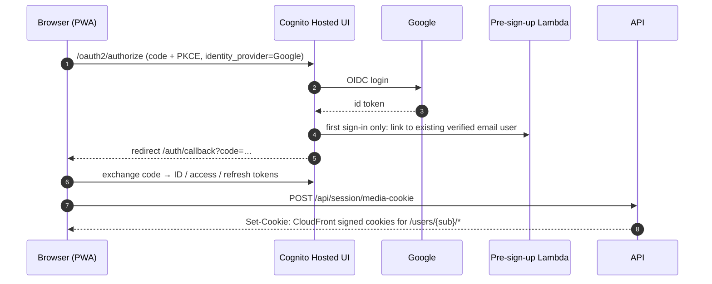
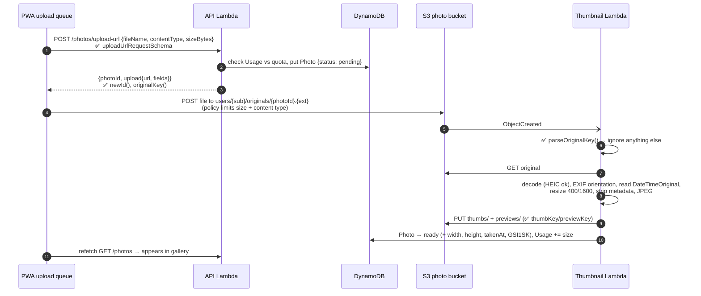
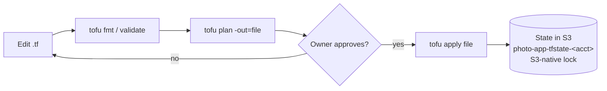

# Photo App — Architecture

> **Living document.** It describes the system **as it is built**, and marks what is still planned.
> - Requirements and the target design live in [`docs/SPECIFICATION.md`](docs/SPECIFICATION.md); task tracking lives in [`PROGRESS.md`](PROGRESS.md).
> - **Update this file in the same change as any implementation:** flip status markers, add the new objects/resources/flows, and add a line to the [changelog](#16-document-changelog).
> - Where the implementation deviates from the spec, say so here and record the decision in `PROGRESS.md`.
>
> Status markers: ✅ implemented · 🚧 partially implemented · 📋 planned (designed, not built)

| | |
|---|---|
| **Last updated** | 2026-10-19 |
| **Reflects** | Phase 0 (repo), Phase 1 (AWS bootstrap: dev + management), Phase 2 (`packages/shared`), Phase 3 (database + storage, deployed in dev) |

---

## Table of contents

1. [Implementation status at a glance](#1-implementation-status-at-a-glance)
2. [System overview](#2-system-overview)
3. [Technology stack](#3-technology-stack)
4. [AWS accounts & environments](#4-aws-accounts--environments)
5. [Repository structure](#5-repository-structure)
6. [Build & toolchain model](#6-build--toolchain-model)
7. [Shared package — domain objects & contracts](#7-shared-package--domain-objects--contracts)
8. [Data model (storage)](#8-data-model-storage)
9. [API surface](#9-api-surface)
10. [Data workflows](#10-data-workflows)
11. [Security model](#11-security-model)
12. [Infrastructure (OpenTofu)](#12-infrastructure-opentofu)
13. [CI/CD](#13-cicd)
14. [Frontend & PWA](#14-frontend--pwa)
15. [Deviations from the specification](#15-deviations-from-the-specification)
16. [Document changelog](#16-document-changelog)

---

## 1. Implementation status at a glance

| Component | Path | Status | Notes |
|---|---|---|---|
| Monorepo & tooling | root | ✅ | pnpm workspaces, TS base config, ESLint, Prettier, Vitest, ruff/pytest |
| Shared contracts | `packages/shared` | ✅ | Constants, IDs, S3 keys, Zod API schemas, 44 tests |
| AWS bootstrap — dev | `infra/bootstrap` (ws `dev`) | ✅ | State bucket, GitHub OIDC, CI roles |
| AWS bootstrap — management | `infra/bootstrap` (ws `general`) | ✅ | Organization-wide $5/month budget |
| AWS bootstrap — prod | `infra/bootstrap` (ws `prod`) | 📋 | Code ready, plan clean, not applied |
| Environment roots | `infra/envs/{dev,prod}` | 🚧 | Database + storage **deployed in dev**; prod validated only |
| Infra modules: database, storage | `infra/modules/{database,storage}` | ✅ (dev) | Offline `tofu test` suites (7 runs) |
| Infra modules: auth, api, thumbnails, frontend | `infra/modules/*` | 📋 | |
| API Lambda | `apps/api` | 📋 | Folder skeleton only |
| Thumbnail Lambda | `services/thumbnails` | 🚧 | Python project + deps + smoke test; no handler yet |
| Auth trigger Lambda | `services/auth-triggers` | 📋 | Folder skeleton only |
| Web app / PWA | `apps/web` | 📋 | Folder skeleton only |
| CI/CD workflows | `.github/workflows` | 📋 | AWS-side roles exist (dev); no workflows yet |

---

## 2. System overview

A private, multi-user photo library (in the spirit of Google Photos). Serverless on AWS: no always-on compute, idle cost ≈ storage only. Everything is infrastructure as code.

### 2.1 Target component diagram



### 2.2 Architectural principles

| Principle | How it shows up |
|---|---|
| Photo bytes never pass through the API | Uploads use pre-signed S3 POST; downloads use pre-signed GET; viewing goes through CloudFront |
| Identity only from the token | Backend user ID = Cognito `sub` from the validated JWT, never from path/body |
| One source of truth per contract | S3 key format, API schemas and limits live in `packages/shared`; Python mirrors keys via shared test vectors |
| Async, idempotent processing | Thumbnails generated by an S3-event Lambda that ignores everything except well-formed originals |
| Isolation at every level | Separate AWS accounts per environment, per-user S3 prefix, per-user DynamoDB partition |
| Pay-per-use | Lambda, HTTP API, DynamoDB on-demand, S3; no NAT, no always-on instances |

---

## 3. Technology stack

Versions are what is **installed/locked today**; 📋 rows are chosen but not yet installed.

### 3.1 Languages & runtimes

| Item | Version | Where | Status |
|---|---|---|---|
| Node.js | 22.23 (`.nvmrc` = 22; matches Lambda `nodejs22.x`) | all TS code | ✅ |
| TypeScript | 6.0.3 (pinned `~6.0`, see §15) | all TS code | ✅ |
| Python | 3.13.16 (`.python-version`; matches Lambda `python3.13`) | `services/thumbnails` | ✅ |
| pnpm | 10.18.0 (via corepack, `packageManager`) | workspace manager | ✅ |
| uv | 0.13.1 | Python env/deps (`uv.lock`) | ✅ |
| OpenTofu | 1.13.1 (configs require ≥ 1.10) | `infra/` | ✅ |
| AWS provider | 6.69.1 (constraint `~> 6.0`, lock files committed) | `infra/` | ✅ |
| AWS CLI | 2.38.1 (SSO profiles) | local ops | ✅ |

### 3.2 Libraries

| Library | Version | Used by | Purpose | Status |
|---|---|---|---|---|
| zod | 4.6.7 | `packages/shared` | API request/response schemas, runtime validation | ✅ |
| ulid | 3.0.2 | `packages/shared` | Time-sortable IDs for photos/albums | ✅ |
| Pillow | 13.0.0 | `services/thumbnails` | Image decode/resize/encode | ✅ installed |
| pillow-heif | 1.8.1 | `services/thumbnails` | HEIC/HEIF decoding | ✅ installed |
| boto3 | 1.43.114 (dev only) | `services/thumbnails` | AWS SDK; provided by Lambda runtime, not packaged | ✅ installed |
| Hono | — | `apps/api` | Lightweight router inside one Lambda (D-1) | 📋 |
| AWS SDK v3 | — | `apps/api`, `services/auth-triggers` | DynamoDB, S3, Cognito, CloudFront signer | 📋 |
| React + Vite | — | `apps/web` | SPA | 📋 |
| TanStack Router / Query / Virtual | — | `apps/web` | Routing, server state, virtualized grid | 📋 |
| oidc-client-ts | — | `apps/web` | Cognito login with PKCE (D-2, leaning) | 📋 |
| vite-plugin-pwa (Workbox) | — | `apps/web` | Manifest + service worker | 📋 |

### 3.3 Dev tooling

| Tool | Version | Purpose | Status |
|---|---|---|---|
| ESLint (flat config) + typescript-eslint | 10.13 / 8.71 | Lint all TS from the root | ✅ |
| eslint-config-prettier | 10.1 | Turn off formatting rules that clash with Prettier | ✅ |
| Prettier | 3.9 | Formatting (Markdown excluded) | ✅ |
| Vitest | 5.0.5 | Unit tests, one project per package | ✅ |
| ruff | 0.17.1 | Python lint + format | ✅ |
| pytest | 9.1.1 | Python tests | ✅ |
| esbuild | — | Bundle Lambdas | 📋 |
| `tofu test` + `mock_provider` | OpenTofu 1.13 | Offline infra module tests | ✅ |

---

## 4. AWS accounts & environments

### 4.1 Topology ✅



| Aspect | Value |
|---|---|
| Region | `us-east-1` for everything (also where CloudFront requires its ACM cert) |
| Human access | IAM Identity Center SSO, `AdministratorAccess` permission set; CLI profiles `dev`, `prod`, `general` |
| Machine access | GitHub Actions via OIDC roles (§13); no long-lived keys |
| Isolation | dev and prod are separate accounts: separate state, IAM, data and blast radius |
| Management account | Billing only (budget); no workloads |
| Wrong-account protection | Every provider block sets `allowed_account_ids`; bootstrap also checks workspace == environment |

### 4.2 Resource lifecycle policy

| Category | Examples | Lifetime |
|---|---|---|
| Bootstrap (permanent) | State buckets, budget, OIDC provider, CI roles | Kept; state buckets also have `prevent_destroy` |
| App resources during development | Tables, buckets, Lambdas, Cognito… | Created on explicit approval, destroyed after testing |

Creating any AWS resource requires the owner's explicit approval of the plan, per account.

---

## 5. Repository structure

Actual tree (generated files and `.gitkeep` placeholders omitted). Status per folder.

```
Photo-app/
├── ARCHITECTURE.md              ✅ this document
├── PROGRESS.md                  ✅ implementation plan, status, decisions, session log
├── CLAUDE.md                    ✅ working rules for Claude Code sessions
├── README.md                    ✅ quick start, commands, AWS/infra overview
├── package.json                 ✅ workspace root: scripts + dev tooling (type: module)
├── pnpm-workspace.yaml          ✅ apps/*, packages/*, services/auth-triggers
├── pnpm-lock.yaml               ✅
├── tsconfig.base.json           ✅ strict TS settings every package extends
├── eslint.config.js             ✅ single flat config for the whole repo
├── vitest.config.ts             ✅ discovers {apps,packages,services}/*/vitest.config.ts
├── .prettierrc.json / .prettierignore / .editorconfig / .gitignore   ✅
├── .nvmrc (22) / .python-version (3.13)                              ✅
├── .claude/settings.json        ✅ project Claude Code plugins (TS/Python LSP, aws-core, github, security-guidance)
│
├── docs/
│   └── SPECIFICATION.md         ✅ requirements & target design (v0.2)
│
├── packages/
│   └── shared/                  ✅ @photo-app/shared (source-only, see §6)
│       ├── src/
│       │   ├── index.ts         re-exports everything
│       │   ├── constants.ts     limits, content types, TTLs, image sizes
│       │   ├── ids.ts           ULID generation & ID validators
│       │   ├── s3Keys.ts        S3 key builders/parser
│       │   ├── schemas/         Zod: common, errors, photos, albums, account
│       │   └── *.test.ts        Vitest suites
│       └── test-vectors/
│           └── s3-keys.json     cross-language key contract (TS + Python)
│
├── apps/
│   ├── web/                     📋 React PWA (routes/, queries/, components/, upload/, auth/, api/)
│   └── api/                     📋 API Lambda (src/handlers, src/lib, test/)
│
├── services/
│   ├── thumbnails/              🚧 Python Lambda
│   │   ├── pyproject.toml       ✅ uv project, ruff + pytest config
│   │   ├── uv.lock              ✅
│   │   ├── src/thumbnails/      🚧 package (handler 📋)
│   │   └── tests/               🚧 smoke test only
│   └── auth-triggers/           📋 Cognito pre-sign-up Lambda (TS)
│
├── infra/
│   ├── bootstrap/               ✅ one-time per-account setup (local state, workspaces)
│   │   ├── main.tf              state bucket + settings
│   │   ├── github-oidc.tf       OIDC provider + CI roles
│   │   ├── budget.tf            organization budget
│   │   ├── {dev,prod,general}.tfvars
│   │   └── README.md
│   ├── envs/
│   │   ├── dev/                 🚧 backend, provider, main.tf (database + storage), env.tfvars; database + storage deployed
│   │   └── prod/                🚧 same wiring with prod settings; validated only
│   └── modules/
│       ├── database/            ✅ DynamoDB single table (+ tests/)
│       ├── storage/             ✅ photo bucket (+ tests/)
│       └── auth/ api/ thumbnails/ frontend/   📋
│
└── .github/workflows/           📋 ci.yml, deploy.yml
```

---

## 6. Build & toolchain model ✅



| Decision | Detail |
|---|---|
| **Source-only shared package** | `@photo-app/shared` exports `./src/index.ts` directly. No build step: Vite, esbuild and Vitest all compile TS, and every consumer is bundled. |
| **Typecheck per package** | Each package has `tsc` (with `noEmit` from the base config) as `typecheck`; root runs `pnpm -r typecheck`. |
| **Lint/format/test at root** | One ESLint flat config, one Prettier config, one Vitest run with auto-discovered projects (each package adds a `vitest.config.ts` with a `name`). |
| **Module resolution** | `moduleResolution: bundler`, `verbatimModuleSyntax`, extensionless relative imports. |
| **Python** | `services/thumbnails` is an independent uv project (`uv_build` backend, src layout). boto3 is dev-only because the Lambda runtime ships it. Root scripts `lint:py` / `test:py` call uv. |
| **IaC** | OpenTofu; provider lock files are committed; `tofu fmt` enforced. |

Root commands: `pnpm lint`, `pnpm format[:check]`, `pnpm typecheck`, `pnpm test`, `pnpm build`, `pnpm lint:py`, `pnpm test:py`, `pnpm test:infra` (runs `tofu test` in every module with a `tests/` folder; fails on any failure).

---

## 7. Shared package — domain objects & contracts ✅

`packages/shared` is the contract between frontend, API and (via test vectors) the Python service.

### 7.1 Constants (`constants.ts`)

| Constant | Value | Spec ref |
|---|---|---|
| `CONTENT_TYPE_EXTENSIONS` | `image/jpeg→jpg`, `image/png→png`, `image/heic→heic`, `image/heif→heif`, `image/webp→webp` | FR-UP-2 |
| `ALLOWED_CONTENT_TYPES` / `ORIGINAL_EXTENSIONS` | derived from the map above | FR-UP-2 |
| `MAX_UPLOAD_BYTES` | 50 MiB | FR-UP-3 |
| `MAX_FILE_NAME_LENGTH` | 255 | — |
| `PAGE_LIMIT_DEFAULT` / `PAGE_LIMIT_MAX` | 60 / 200 | §9 |
| `MAX_ALBUM_NAME_LENGTH` | 100 | — |
| `MAX_PHOTOS_PER_ALBUM_REQUEST` | 100 | — |
| `UPLOAD_URL_TTL_SECONDS` | 900 (15 min) | §9 |
| `DOWNLOAD_URL_TTL_SECONDS` | 300 (5 min) | §9 |
| `SHARED_IMAGE_URL_TTL_SECONDS` | 900 (15 min) | §9 |
| `MEDIA_COOKIE_TTL_SECONDS` | 28 800 (8 h) | §9 |
| `THUMB_MAX_EDGE` / `PREVIEW_MAX_EDGE` | 400 / 1600 px | §10 |

Per-environment settings (e.g. default quota 2 GB dev / 10 GB prod) are deployment config, not shared constants.

### 7.2 Identifiers (`ids.ts`)

| Object | Format | Validator | Generated by |
|---|---|---|---|
| `photoId`, `albumId` | ULID, 26 chars Crockford base32, **uppercase**, first char `0–7` (`ULID_REGEX`) | `isId()` | `newId()`: monotonic ULID, so IDs created in the same millisecond still sort by creation |
| `userId` | Cognito `sub`, **lowercase** UUID (`USER_ID_REGEX`) | `isUserId()` | Cognito |

### 7.3 S3 keys (`s3Keys.ts`)

| Function | Returns | Behaviour |
|---|---|---|
| `originalKey(userId, photoId, ext)` | `users/{userId}/originals/{photoId}.{ext}` | Throws on invalid IDs |
| `thumbKey(userId, photoId)` | `users/{userId}/thumbs/{photoId}.jpg` | Throws on invalid IDs |
| `previewKey(userId, photoId)` | `users/{userId}/previews/{photoId}.jpg` | Throws on invalid IDs |
| `userPrefix(userId)` | `users/{userId}/` | Scope of the user's media cookie |
| `extensionFor(contentType)` | `jpg` / `png` / `heic` / `heif` / `webp` | — |
| `parseOriginalKey(key)` | `{userId, photoId, ext}` or `null` | Strict: anything that is not a well-formed original → `null` (thumbnail loop protection) |

**Cross-language contract:** `test-vectors/s3-keys.json` holds 5 valid key sets and 17 invalid original keys (wrong folder, uppercase UUID, lowercase/invalid ULID, `.jpeg`/`.JPG`, nested paths, leading slash, double extension, empty…). Vitest runs against it now; the Python mirror (📋 task 6.6) must run against the same file.

### 7.4 API schemas (`schemas/`)

All request/response bodies of §9 as Zod schemas with inferred TS types.

**Common (`common.ts`)**

| Schema | Shape |
|---|---|
| `idSchema` | string matching `ULID_REGEX` |
| `userIdSchema` | UUID |
| `isoDateTimeSchema` | ISO-8601 date-time |
| `cursorSchema` | opaque string, 1–2048 chars (encoded DynamoDB `LastEvaluatedKey`) |
| `pageQuerySchema` | `{ cursor?, limit = 60 (coerced, 1–200) }` |
| `pageSchema(item)` / `Page<T>` | `{ items: T[], nextCursor: string \| null }` |

**Errors (`errors.ts`)**: every non-2xx body is `{ error: { code, message } }`.

| `ErrorCode` | Meaning |
|---|---|
| `UNAUTHORIZED` | Missing/invalid token |
| `NOT_FOUND` | Missing **or not yours** (NFR-SEC-2: never 403) |
| `VALIDATION_ERROR` | Request failed schema validation |
| `QUOTA_EXCEEDED` | Upload would exceed quota (FR-UP-7) |
| `UNSUPPORTED_MEDIA_TYPE` | Content type not allowed |
| `PAYLOAD_TOO_LARGE` | Over 50 MB |
| `CONFLICT` | State conflict |
| `SHARE_TARGET_NOT_FOUND` | No registered user with that email |
| `RATE_LIMITED` | Throttled |
| `INTERNAL_ERROR` | Unexpected failure |

**Photos (`photos.ts`)**

| Schema | Shape |
|---|---|
| `photoStatusSchema` | `pending` \| `ready` \| `failed` |
| `contentTypeSchema` | enum of `ALLOWED_CONTENT_TYPES` |
| `photoSchema` / `Photo` | `photoId, status, fileName, contentType, sizeBytes, width\|null, height\|null, takenAt, uploadedAt, thumbUrl\|null, previewUrl\|null`. URLs are null until `ready`. |
| `photoSortSchema` | `taken-desc` (default) \| `taken-asc` |
| `listPhotosQuerySchema` | page query + `sort` |
| `photoPageSchema` | `Page<Photo>` |
| `uploadUrlRequestSchema` | `{ fileName (trimmed, 1–255), contentType, sizeBytes (1 … 50 MiB) }` |
| `uploadUrlResponseSchema` | `{ photoId, upload: { url, fields: Record<string,string> } }` (pre-signed POST) |
| `downloadUrlResponseSchema` | `{ url, expiresAt }` |

**Albums & sharing (`albums.ts`)**

| Schema | Shape |
|---|---|
| `albumSchema` / `Album` | `albumId, name, createdAt, coverPhotoId\|null, coverThumbUrl\|null, photoCount` |
| `albumListSchema` | `{ items: Album[] }` (not paginated) |
| `createAlbumRequestSchema` | `{ name }`, trimmed, 1–100 |
| `updateAlbumRequestSchema` | `{ name?, coverPhotoId?: id \| null }`, at least one field; `null` clears cover |
| `addAlbumPhotosRequestSchema` | `{ photoIds: id[1..100] }` |
| `albumShareSchema` | `{ userId, email, sharedAt }` |
| `albumShareListSchema` | `{ items: AlbumShare[] }` |
| `createShareRequestSchema` | `{ email }`, trimmed + lowercased **before** validation |
| `sharedAlbumSchema` | `Album` + `ownerId, sharedAt` |
| `sharedAlbumPageSchema` | `Page<SharedAlbum>` |

**Account (`account.ts`)**

| Schema | Shape |
|---|---|
| `usageSchema` | `{ bytesUsed, photoCount, quotaBytes }` |
| `meResponseSchema` | `{ userId, email, name\|null, usage }` |
| `mediaCookieResponseSchema` | `{ expiresAt }` (cookies themselves via `Set-Cookie`) |

### 7.5 Tests

| Suite | Covers |
|---|---|
| `s3Keys.test.ts` | builders and parser against the shared vectors; invalid IDs throw; `extensionFor` |
| `ids.test.ts` | 1000 IDs valid/unique/sorted; embedded timestamp; validators |
| `schemas/schemas.test.ts` | defaults & coercion, limits, pending photo shape, album rules, email normalisation, error envelope |

---

## 8. Data model (storage) 🚧

Key format implemented in `s3Keys.ts`; table and bucket defined in `infra/modules/{database,storage}` (§12.3) and **deployed in dev** (empty; nothing writes to them yet).

### 8.1 Photo bucket (per environment)

```
users/{userId}/originals/{photoId}.{ext}   untouched upload        INTELLIGENT_TIERING
users/{userId}/thumbs/{photoId}.jpg        ≤ 400 px, no metadata   STANDARD, immutable cache
users/{userId}/previews/{photoId}.jpg      ≤ 1600 px, no metadata  STANDARD, immutable cache
```

Bucket `photo-app-photos-{env}-{account-id}`. The API sets the originals' storage class (INTELLIGENT_TIERING) in the pre-signed POST, because lifecycle filters cannot match `users/*/originals/`.

### 8.2 DynamoDB single table `photo-app-{env}`

On-demand, `PK`/`SK` strings, one GSI `GSI1` (`GSI1PK`/`GSI1SK`, projection ALL), AWS-owned encryption key.

| Entity | PK | SK | GSI1PK | GSI1SK | API object |
|---|---|---|---|---|---|
| Photo | `USER#{userId}` | `PHOTO#{photoId}` | `USER#{userId}` | `TAKEN#{takenAt}#{photoId}` | `Photo` |
| Album | `USER#{ownerId}` | `ALBUM#{albumId}` | — | — | `Album` |
| Album membership | `ALBUM#{albumId}` | `PHOTO#{photoId}` | — | — | — |
| Album share | `ALBUM#{albumId}` | `SHARE#{userId}` | `SHAREDWITH#{userId}` | `ALBUM#{albumId}` | `AlbumShare`, `SharedAlbum` |
| Usage | `USER#{userId}` | `USAGE` | — | — | `Usage` |

Access patterns and the "can user X see photo P" rule: see spec §8.2.

---

## 9. API surface 📋

Contracts exist (✅ in `packages/shared`); handlers do not yet. Base path `/api`, bearer = Cognito access token.

| Method | Path | Request schema | Response schema |
|---|---|---|---|
| `POST` | `/session/media-cookie` | — | `mediaCookieResponseSchema` |
| `GET` | `/me` | — | `meResponseSchema` |
| `POST` | `/photos/upload-url` | `uploadUrlRequestSchema` | `uploadUrlResponseSchema` |
| `GET` | `/photos` | `listPhotosQuerySchema` (query) | `photoPageSchema` |
| `GET` | `/photos/{photoId}` | — | `photoSchema` |
| `GET` | `/photos/{photoId}/download-url` | — | `downloadUrlResponseSchema` |
| `DELETE` | `/photos/{photoId}` | — | 204 |
| `GET` | `/albums` | — | `albumListSchema` |
| `POST` | `/albums` | `createAlbumRequestSchema` | `albumSchema` |
| `PATCH` | `/albums/{albumId}` | `updateAlbumRequestSchema` | `albumSchema` |
| `DELETE` | `/albums/{albumId}` | — | 204 |
| `GET` | `/albums/{albumId}/photos` | `pageQuerySchema` (query) | `photoPageSchema` |
| `POST` | `/albums/{albumId}/photos` | `addAlbumPhotosRequestSchema` | 204 |
| `DELETE` | `/albums/{albumId}/photos/{photoId}` | — | 204 |
| `GET` | `/albums/{albumId}/shares` | — | `albumShareListSchema` |
| `POST` | `/albums/{albumId}/shares` | `createShareRequestSchema` | `albumShareSchema` |
| `DELETE` | `/albums/{albumId}/shares/{userId}` | — | 204 |
| `GET` | `/shared-albums` | `pageQuerySchema` (query) | `sharedAlbumPageSchema` |
| `GET` | `/health` | — | 📋 defined with the API (task 5.5) |

Errors on every route: `apiErrorSchema`. Status codes for success bodies (201 vs 200, 204) are finalised with the handlers.

---

## 10. Data workflows

Status per step is marked inline. ✅ steps are pieces that already exist and will be used by the flow.

### 10.1 Login 📋



### 10.2 Upload & processing 📋 (contracts ✅)



Failure paths: corrupt/unsupported → `status: failed`, no retry; transient → 2 async retries → SQS DLQ.

### 10.3 Viewing 📋

1. `GET /api/photos?cursor&limit&sort` returns `Photo` metadata (with `width`/`height` so tiles reserve space).
2. Own images load from CloudFront `/users/{sub}/thumbs|previews/{photoId}.jpg`, authorised by the media cookie, cached at the edge and by the service worker (thumbs only).
3. Images from albums shared with me come back as per-image CloudFront signed URLs (15 min).

### 10.4 Download 📋

`GET /photos/{id}/download-url` → ownership or share check → 5-min pre-signed GET with `Content-Disposition: attachment; filename="<original name>"` → browser downloads straight from S3.

### 10.5 Delete 📋

`DELETE /photos/{id}` → ownership check → delete original/thumb/preview objects → delete Photo item and all album memberships → decrement Usage.

### 10.6 Albums & sharing 📋

Owner creates albums (`Album` item under their partition), adds photos (membership items under the album partition), shares by email (API resolves the email to a Cognito `sub` → share item with `GSI1PK = SHAREDWITH#{sub}`). Recipients list via GSI1 and read photos through signed URLs. Read-only for recipients.

### 10.7 Infrastructure change flow ✅



Bootstrap uses local state per workspace instead of S3.

---

## 11. Security model

| Control | Status | Implementation |
|---|---|---|
| Environment isolation | ✅ | Separate AWS accounts; providers pinned with `allowed_account_ids` |
| No long-lived CI credentials | ✅ (dev) | GitHub OIDC provider + roles with `aud`/`sub` conditions |
| CI cannot read user data | ✅ (dev) | `ci-plan` explicitly denies `s3:GetObject*` outside the state bucket and DynamoDB item reads |
| State protection | ✅ (dev) | Versioning, SSE-S3, ACLs disabled, public access blocked, TLS-only policy, `prevent_destroy` |
| State client-side encryption | 📋 deferred | Task 12.5 (state will contain the Google client secret) |
| Cost guardrail | ✅ | Organization budget $5/month with email alerts |
| Strict input validation | ✅ contracts | Zod schemas: allowed types, size cap, ID formats, trimmed names, normalised emails |
| Key-format hardening | ✅ | Builders reject invalid IDs (no path injection); parser accepts only exact originals |
| Tenant isolation (NFR-SEC-1/2) | 📋 | User ID only from JWT `sub`; foreign resources → 404 |
| Private photo bucket (NFR-SEC-3/4) | ✅ (dev) | Public access block, ACLs off, SSE-S3, TLS-only policy, CORS limited to app origins |
| Data deletion guard | ✅ code (prod settings) | Table deletion protection + no `force_destroy` by default; only dev opts out |
| CloudFront OAC / signed URLs (NFR-SEC-3) | 📋 | Phase 7 |
| Metadata stripping on derived images (NFR-SEC-5) | 📋 | |
| Least-privilege Lambda roles (NFR-SEC-7) | 📋 | |
| Throttling / WAF (NFR-SEC-9) | 📋 | |
| `ci-deploy` least privilege | 📋 | Currently `AdministratorAccess`, restricted by *who* (main / prod env); task 12.6 |

---

## 12. Infrastructure (OpenTofu)

### 12.1 Bootstrap — `infra/bootstrap` ✅ (dev, general) · 📋 (prod)

Local state, one workspace per account (`terraform.tfstate.d/<ws>/`, git-ignored). Toggled per account by tfvars: `create_state_bucket`, `budget`, `github_oidc`.

| Resource (address) | Name in AWS | dev | general | prod |
|---|---|---|---|---|
| `aws_s3_bucket.state` | `photo-app-tfstate-<account-id>` | ✅ | — | 📋 |
| `aws_s3_bucket_ownership_controls.state` | BucketOwnerEnforced (ACLs off) | ✅ | — | 📋 |
| `aws_s3_bucket_public_access_block.state` | all four blocks on | ✅ | — | 📋 |
| `aws_s3_bucket_versioning.state` | Enabled | ✅ | — | 📋 |
| `aws_s3_bucket_server_side_encryption_configuration.state` | AES256 (SSE-S3) | ✅ | — | 📋 |
| `aws_s3_bucket_lifecycle_configuration.state` | old versions expire after 90 d (keep newest 10); abort multipart after 2 d | ✅ | — | 📋 |
| `aws_s3_bucket_policy.state` | deny non-TLS | ✅ | — | 📋 |
| `aws_iam_openid_connect_provider.github` | `token.actions.githubusercontent.com`, aud `sts.amazonaws.com` | ✅ | — | 📋 |
| `aws_iam_role.ci_plan` | `photo-app-ci-plan`; trust `repo:EdgarA28/Photo-app:*` | ✅ | — | 📋 |
| `aws_iam_role_policy_attachment.ci_plan_readonly` | `ReadOnlyAccess` | ✅ | — | 📋 |
| `aws_iam_role_policy.ci_plan` | inline `state-access`: state read, `*.tflock` write, data-read denies | ✅ | — | 📋 |
| `aws_iam_role.ci_deploy` | `photo-app-ci-deploy`; trust dev `ref:refs/heads/main`, prod `environment:prod`; 1 h sessions | ✅ | — | 📋 |
| `aws_iam_role_policy_attachment.ci_deploy_admin` | `AdministratorAccess` (to be scoped down) | ✅ | — | 📋 |
| `aws_budgets_budget.monthly` | `photo-app-monthly`, $5, alerts 80 %/100 % actual, 100 % forecast | — | ✅ | — |

Outputs: `state_bucket`, `ci_plan_role_arn`, `ci_deploy_role_arn`.

Tags on everything: `Project=photo-app`, `Environment=<ws>`, `ManagedBy=opentofu`, `Stack=bootstrap`.

### 12.2 Environment roots — `infra/envs/{dev,prod}` 🚧

| File | Content |
|---|---|
| `versions.tf` | OpenTofu ≥ 1.10, AWS `~> 6.0`, S3 backend: bucket `photo-app-tfstate-<acct>`, key `<env>/terraform.tfstate`, `use_lockfile = true`, `encrypt = true` |
| `providers.tf` | region var (default `us-east-1`), `allowed_account_ids`, default tags (`Project`, `Environment`, `ManagedBy`); credentials from `AWS_PROFILE` locally / OIDC in CI |
| `variables.tf` | `region`; `app_origins` (web app origins → S3 CORS; later Cognito callbacks) |
| `main.tf` | `module "database"`, `module "storage"` with per-env settings (below) |
| `outputs.tf` | `table_name`, `photo_bucket_name` |
| `env.tfvars` | Non-secret settings, committed. Run with `-var-file=env.tfvars` |

| Setting | dev | prod |
|---|---|---|
| Table | `photo-app-dev` | `photo-app-prod` |
| PITR | off | on |
| Table deletion protection | off (disposable) | on |
| Photo bucket | `photo-app-photos-dev-063359189013` | `photo-app-photos-prod-968632140314` |
| Bucket versioning | off (`Suspended`) | on, previous versions expire after 30 d |
| `force_destroy` | on (disposable) | off |
| `app_origins` | `http://localhost:5173` | placeholder until the domain is chosen (D-4) |

dev: **deployed 2026-10-19** (9 resources; test resources, destroyed when testing is done). prod: validated with `-backend=false` only.

### 12.3 Modules — `infra/modules`

Each module has `versions.tf`, `variables.tf`, `main.tf`, `outputs.tf` and offline tests in `tests/*.tftest.hcl` (`mock_provider "aws"`).

**`database` ✅**

| Resource | Detail |
|---|---|
| `aws_dynamodb_table.main` | `PAY_PER_REQUEST`; `PK` (hash) / `SK` (range); `GSI1` via `key_schema` blocks (`GSI1PK` HASH, `GSI1SK` RANGE), projection ALL; PITR = `point_in_time_recovery`; `deletion_protection_enabled` = `deletion_protection` (default true); SSE with AWS-owned key |

Inputs: `table_name`, `point_in_time_recovery` (false), `deletion_protection` (true). Outputs: `table_name`, `table_arn`, `gsi1_name`.
Tests: on-demand + key schema + GSI1; safe defaults; PITR when requested.

**`storage` ✅**

| Resource | Detail |
|---|---|
| `aws_s3_bucket.photos` | `photo-app-photos-{env}-{account-id}`, `force_destroy` from input (default false) |
| `aws_s3_bucket_ownership_controls.photos` | BucketOwnerEnforced (ACLs off) |
| `aws_s3_bucket_public_access_block.photos` | all four blocks (NFR-SEC-3) |
| `aws_s3_bucket_server_side_encryption_configuration.photos` | AES256 (NFR-SEC-4) |
| `aws_s3_bucket_versioning.photos` | `Enabled` or `Suspended` |
| `aws_s3_bucket_lifecycle_configuration.photos` | abort incomplete multipart after 2 d; with versioning: expire noncurrent versions after N days + clean expired delete markers |
| `aws_s3_bucket_cors_configuration.photos` | origins = `cors_allowed_origins`; methods POST/GET/HEAD; headers `*`; expose `ETag`; max age 1 h |
| `aws_s3_bucket_policy.photos` | deny non-TLS (CloudFront OAC statement added in Phase 7) |

Inputs: `environment`, `cors_allowed_origins`, `versioning` (false), `noncurrent_version_expiration_days` (30), `force_destroy` (false). Outputs: `bucket_name`, `bucket_arn`, `bucket_regional_domain_name`.
Tests: name format, private + encrypted, `force_destroy` default, CORS origins/methods, versioning off/on with matching lifecycle rules.
Not here by design: the S3 → Lambda event notification (one per bucket; `thumbnails` module) and CloudFront read access (Phase 7).

**Planned 📋**

| Module | Will contain |
|---|---|
| `auth` | Cognito user pool, domain, Google IdP, app client, pre-sign-up trigger |
| `api` | HTTP API, JWT authorizer, API Lambda, IAM, throttling, logs |
| `thumbnails` | Python Lambda, IAM, S3 notification, DLQ, logs |
| `frontend` | Site bucket, CloudFront (OAC, behaviors, SPA fallback), key group, ACM, optional WAF |

---

## 13. CI/CD

| Piece | Status | Detail |
|---|---|---|
| AWS roles for GitHub (dev) | ✅ | `arn:aws:iam::063359189013:role/photo-app-ci-plan`, `arn:aws:iam::063359189013:role/photo-app-ci-deploy` |
| AWS roles for GitHub (prod) | 📋 | Applied with prod bootstrap |
| Repo | ✅ | `github.com/EdgarA28/Photo-app`, default branch `main` |
| GitHub secrets / `prod` environment | 📋 | Phase 10 |
| `ci.yml` (lint, typecheck, tests, build, `tofu plan`) | 📋 | Phase 10 |
| `deploy.yml` (build, apply, upload site, invalidate, smoke test) | 📋 | Phase 10 |

---

## 14. Frontend & PWA 📋

Not started. Target design: spec §12 (TanStack Router file routes with an authenticated layout, TanStack Query with an IndexedDB-persisted cache, TanStack Virtual grid, IndexedDB upload queue with 3 concurrent uploads, vite-plugin-pwa with precached shell and CacheFirst thumbnails). Will import all API types and validation from `@photo-app/shared`.

---

## 15. Deviations from the specification

| Topic | Spec | Implementation | Why |
|---|---|---|---|
| Region | was `eu-central-1` | `us-east-1` (spec updated to v0.2) | Owner's choice; also the CloudFront ACM region |
| Accounts | dev/prod separated by state key | Separate AWS accounts + management account | Already existed; stronger isolation |
| State encryption | KMS client-side encryption | Deferred (SSE-S3 only for now) | Owner's decision; task 12.5 |
| Budget | $5 and $20 alerts | One org-wide $5/month budget | Owner's decision |
| TypeScript | latest | Pinned `~6.0` | typescript-eslint 8.x doesn't support TS 7 yet |
| `ci-deploy` permissions | "deploy permissions" | `AdministratorAccess` for now | Resource set not known yet; task 12.6 |

---

## 16. Document changelog

| Date | Change |
|---|---|
| 2026-10-19 | Created: reflects Phases 0, 1 (dev + management) and 2. |
| 2026-10-19 | Phase 3: `database` and `storage` modules (+ offline tests), env wiring and per-env settings; `pnpm test:infra`. Deployed in dev. |
