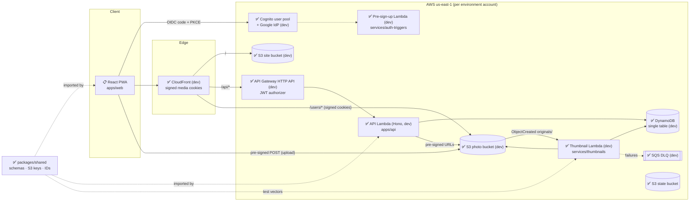
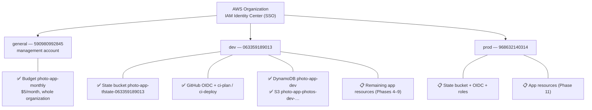
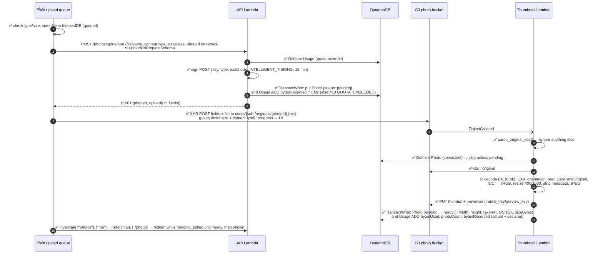
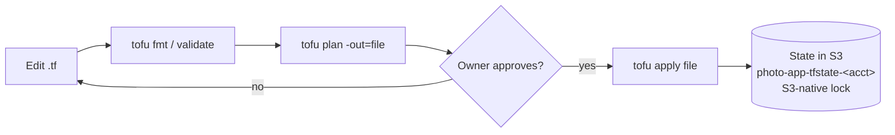
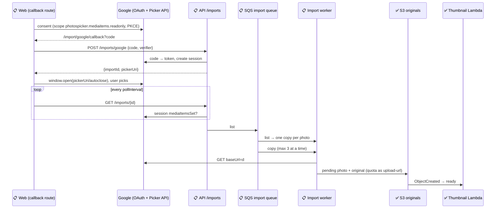

# Photo App — Architecture

> **Living document.** It describes the system **as it is built**, and marks what is still planned.
> - Requirements and the target design live in [`docs/SPECIFICATION.md`](docs/SPECIFICATION.md); task tracking lives in [`PROGRESS.md`](PROGRESS.md).
> - **Update this file in the same change as any implementation:** flip status markers, add the new objects/resources/flows, and add a line to the [changelog](#16-document-changelog).
> - Where the implementation deviates from the spec, say so here and record the decision in `PROGRESS.md`.
>
> Status markers: ✅ implemented · 🚧 partially implemented · 📋 planned (designed, not built)

| | |
|---|---|
| **Last updated** | 2026-10-28 |
| **Reflects** | Phase 0 (repo), Phase 1 (AWS bootstrap: dev + management), Phase 2 (`packages/shared`), Phase 3 (database + storage, deployed in dev), Phase 5.1–5.3 (API skeleton, not deployed), Phase 6.1–6.7 (thumbnail code, not deployed) |

---

## Table of contents

1. [Implementation status at a glance](#1-implementation-status-at-a-glance)
2. [System overview](#2-system-overview)
3. [Technology stack](#3-technology-stack)
4. [AWS accounts & environments](#4-aws-accounts--environments)
5. [Repository structure](#5-repository-structure)
6. [Build & toolchain model](#6-build--toolchain-model)
7. [Shared package — domain objects & contracts](#7-shared-package--domain-objects--contracts)
8. [Data model (storage)](#8-data-model-storage)
9. [API surface](#9-api-surface)
10. [Data workflows](#10-data-workflows)
11. [Security model](#11-security-model)
12. [Infrastructure (OpenTofu)](#12-infrastructure-opentofu)
13. [CI/CD](#13-cicd)
14. [Frontend & PWA](#14-frontend--pwa)
15. [Deviations from the specification](#15-deviations-from-the-specification)
16. [Document changelog](#16-document-changelog)

---

## 1. Implementation status at a glance

| Component | Path | Status | Notes |
|---|---|---|---|
| Monorepo & tooling | root | ✅ | pnpm workspaces, TS base config, ESLint, Prettier, Vitest, ruff/pytest |
| Shared contracts | `packages/shared` | ✅ | Constants, IDs, S3 keys, Zod API schemas, 44 tests |
| AWS bootstrap — dev | `infra/bootstrap` (ws `dev`) | ✅ | State bucket, GitHub OIDC, CI roles |
| AWS bootstrap — management | `infra/bootstrap` (ws `general`) | ✅ | Organization-wide $5/month budget |
| AWS bootstrap — prod | `infra/bootstrap` (ws `prod`) | 📋 | Code ready, plan clean, not applied |
| Environment roots | `infra/envs/{dev,prod}` | 🚧 | Database + storage + auth + thumbnails **deployed in dev**; prod validated only |
| Infra modules: database, storage | `infra/modules/{database,storage}` | ✅ (dev) | Offline `tofu test` suites (7 runs) |
| Infra module: auth | `infra/modules/auth` | ✅ (dev) | User pool, prefix domain (managed login), PKCE web client (4.1), optional Google IdP (4.4), optional pre sign-up trigger Lambda (4.6) + 11 offline test runs; **deployed in dev** (with Google + trigger) |
| Infra module: thumbnails | `infra/modules/thumbnails` | ✅ (dev) | Lambda, IAM, S3 notification, retries + SQS DLQ, logs (6.9) + 4 offline test runs; **deployed in dev** |
| Infra module: api | `infra/modules/api` | ✅ (dev) | HTTP API, Cognito JWT authorizer, API Lambda, IAM, throttling, access + Lambda logs (5.4) + 7 offline test runs; **deployed in dev**. Daily purge Lambda + EventBridge rule (`purge.tf`): trash purge (FR-DEL-3) ✅ in dev; 🚧 stale-pending sweep (6.11, + `s3:GetObject` originals / `s3:ListBucket`): code + tests done, deploys with the next `main` merge |
| Infra module: frontend | `infra/modules/frontend` | 🚧 (dev) | 7.1: site bucket, CloudFront (OAC, `/api/*`, `/users/*`, SPA rewrite function); 7.2: media signing key, key group trusted by `/users/*`, private key in SSM; 7 offline test runs + function unit tests; **deployed in dev**. 7.3: the API issues the media cookies, so own images load in the app |
| API Lambda | `apps/api` | 🚧 | Skeleton (5.1–5.3) + routes `GET /me`, `POST /photos/upload-url` (incl. retry), `GET /photos`, `GET /photos/{id}`, `GET /photos/{id}/download-url`, `DELETE /photos/{id}`, album CRUD, album photos, sharing, recipient read access and usernames (5.5, 5.6, 5.6a/b, 5.7–5.13, 5.15); 223 tests (incl. DynamoDB Local). Media cookies and signed URLs (Phase 7) not yet; **deployed in dev** behind API Gateway (5.4), checked with a real access token |
| Thumbnail Lambda | `services/thumbnails` | 🚧 | Handler, image pipeline, S3-key mirror, orphan cleanup + 76 pytest tests (6.1–6.7, 6.12); arm64 package `build.sh` → `dist/` (6.8); not deployed yet (6.9–6.10) |
| Auth trigger Lambda | `services/auth-triggers` | ✅ (dev) | Pre sign-up handler (Google → native account linking, refuses duplicate email sign-ups) + 24 tests (4.5); **deployed in dev** (4.6), linking verified manually |
| Web app / PWA | `apps/web` | 🚧 | 8.1 scaffold: Vite + React, file routes of spec §12.1 (placeholder pages), Query client, Zod-validated gallery search, `/api` dev proxy. 8.2 Tailwind CSS 4 + shadcn/ui (D-3). 8.3 login (oidc-client-ts, PKCE, refresh, guard, logout). 8.4 API client (bearer, Zod, 401 retry); settings shows `GET /me`. 8.5 app shell (side rail / bottom tab bar, full-screen viewer, system dark mode). 8.6 gallery (infinite query, virtualized justified rows, album/sort filters in the URL). 8.7 processing/failed tiles + polling while photos process. 8.8 full-screen viewer (preview, prev/next through the gallery list, arrow keys, Escape, swipe). 8.9 download original + delete with confirmation in the viewer. 8.10 upload queue (IndexedDB, picker / drag & drop / camera, 3 parallel, progress, automatic retry, one uploading tab, gallery tiles + nav badge). 8.11 albums (list, create, rename, delete, album view, select mode, add/remove photos, cover; album actions in the viewer). 8.12 sharing (share dialog by email or @username, revoke, "Shared with me", read-only shared album view, "Shared by" in the viewer). 8.13 settings (account, quota bar, username set/change, logout clearing the upload queue and Query cache). 8.14 storage-full handling (space warning, grouped banner, Retry all), session-expired and offline messages. 8.15 "choose a username" prompt after login. **Phase 8 complete.** Thumbnails and previews show once Phase 7 serves them. 9.1 web app manifest + icons (installable metadata). 9.2 service worker caching: precached shell, offline navigation fallback, CacheFirst thumbnails. 9.4 service worker registered (`registerType: 'prompt'`) with an "Update available" prompt and hourly update checks. 9.3 Query cache saved to IndexedDB per user and restored on start; offline start with the stored session's `sub`. 9.5 Background Sync: the service worker uploads the queue after the app is closed or frozen (Chromium); refresh token now in IndexedDB. 9.6 Android share target: photos shared to the app land in the upload queue |
| Thumbnail queue (SQS) | `infra/modules/thumbnails`, `services/thumbnails` | 📋 | Planned (13.6, spec v0.30 §10, B-11): S3 → SQS `photo-app-{env}-thumbnails` → thumbnail Lambda (event source mapping, maximum concurrency 5, redrive to the existing DLQ); today S3 invokes the Lambda directly |
| Import from Google Photos | `apps/api` (routes + worker), `infra/modules/api`, `apps/web` | 📋 | Planned (13.5, spec v0.24 §6.9): Picker API, `/imports` routes, SQS import queue + DLQ, import worker Lambda; nothing built yet (§10.8) |
| CI/CD workflows | `.github/workflows` | 🚧 | `ci.yml` (10.1: checks, build, dev `tofu plan` + PR comment); `deploy.yml` (10.2: dev deploy after CI passes on `main`; running since `87fbe5c`) |

---

## 2. System overview

A private, multi-user photo library (in the spirit of Google Photos). Serverless on AWS: no always-on compute, idle cost ≈ storage only. Everything is infrastructure as code.

### 2.1 Target component diagram



### 2.2 Architectural principles

| Principle | How it shows up |
|---|---|
| Photo bytes never pass through the API | Uploads use pre-signed S3 POST; downloads use pre-signed GET; viewing goes through CloudFront |
| Identity only from the token | Backend user ID = Cognito `sub` from the validated JWT, never from path/body |
| One source of truth per contract | S3 key format, API schemas and limits live in `packages/shared`; Python mirrors keys via shared test vectors |
| Async, idempotent processing | Thumbnails generated by an S3-event Lambda that ignores everything except well-formed originals |
| Isolation at every level | Separate AWS accounts per environment, per-user S3 prefix, per-user DynamoDB partition |
| Pay-per-use | Lambda, HTTP API, DynamoDB on-demand, S3; no NAT, no always-on instances |

---

## 3. Technology stack

Versions are what is **installed/locked today**; 📋 rows are chosen but not yet installed.

### 3.1 Languages & runtimes

| Item | Version | Where | Status |
|---|---|---|---|
| Node.js | 22.23 (`.nvmrc` = 22; matches Lambda `nodejs22.x`) | all TS code | ✅ |
| TypeScript | 6.0.3 (pinned `~6.0`, see §15) | all TS code | ✅ |
| Python | 3.13.16 (`.python-version`; matches Lambda `python3.13`) | `services/thumbnails` | ✅ |
| pnpm | 10.18.0 (via corepack, `packageManager`) | workspace manager | ✅ |
| uv | 0.13.1 | Python env/deps (`uv.lock`) | ✅ |
| OpenTofu | 1.13.1 (configs require ≥ 1.10) | `infra/` | ✅ |
| AWS provider | 6.69.1 (constraint `~> 6.0`, lock files committed) | `infra/` | ✅ |
| AWS CLI | 2.38.1 (SSO profiles) | local ops | ✅ |

### 3.2 Libraries

| Library | Version | Used by | Purpose | Status |
|---|---|---|---|---|
| zod | 4.6.7 | `packages/shared` | API request/response schemas, runtime validation | ✅ |
| ulid | 3.0.2 | `packages/shared` | Time-sortable IDs for photos/albums | ✅ |
| Pillow | 13.0.0 | `services/thumbnails` | Image decode/resize/encode, EXIF, ICC → sRGB (LittleCMS) | ✅ |
| pillow-heif | 1.8.1 | `services/thumbnails` | HEIC/HEIF decoding (libheif 1.23, libde265) | ✅ |
| boto3 | 1.43.114 (dev only) | `services/thumbnails` | AWS SDK; provided by Lambda runtime, not packaged | ✅ |
| Hono | 4.13.13 | `apps/api` | Lightweight router inside one Lambda (D-1) | ✅ |
| @hono/aws-lambda | 1.0.0 | `apps/api` | Lambda adapter (API Gateway HTTP API event → Request); replaces the deprecated `hono/aws-lambda` | ✅ |
| AWS SDK v3 (`client-dynamodb`, `lib-dynamodb`) | 3.1155.0 | `apps/api` | DynamoDB via the DocumentClient; bundled (not the runtime copy) | ✅ |
| AWS SDK v3 (`client-cognito-identity-provider`) | 3.1155.0 | `apps/api`, `services/auth-triggers` | API: profile lookup by `sub` (`ListUsers`) for `GET /me`, email lookup for sharing (5.12). Trigger: `ListUsers` by email + `AdminLinkProviderForUser` (4.5) | ✅ |
| AWS SDK v3 (`client-s3`, `s3-presigned-post`, `s3-request-presigner`) | 3.1155.0 | `apps/api` | Pre-signed upload POST (5.6), pre-signed download GET (5.8), `DeleteObjects` (5.9). All `@aws-sdk/*` packages are kept on one version: mixed versions pull in two `@smithy/core` copies and the client types stop matching | ✅ |
| AWS SDK v3 `@aws-sdk/cloudfront-signer`, `@aws-sdk/client-ssm` | 3.1155 | `apps/api` | Media cookies (7.3): custom-policy signed cookies (SHA-256); signing key from SSM. Signed URLs for shared albums: 📋 7.4 | ✅ (cookies) |
| React + React DOM | 19.3.1 | `apps/web` | UI | ✅ |
| TanStack Router (+ `@tanstack/router-plugin`) | 1.170.46 (plugin 1.168.48) | `apps/web` | File-based routes, generated `src/routeTree.gen.ts` (committed so `tsc` works without a build), automatic route code splitting, Zod search validation (Standard Schema) | ✅ |
| TanStack Query | 5.104.5 | `apps/web` | Server state; `staleTime` 10 min (§12.2) | ✅ (client only) |
| Tailwind CSS (+ `@tailwindcss/vite`) | 4.3.3 | `apps/web` | Utility CSS, theme tokens as CSS variables in `src/index.css` (D-3) | ✅ |
| shadcn/ui (CLI + `shadcn/tailwind.css`) | 4.22.1, style `radix-nova`, base color neutral | `apps/web` | Components copied into `src/components/ui/` by `shadcn add` (we own the code); built on `radix-ui` 1.8.1, variants with `class-variance-authority` 0.7.1, class merging with `cn` 0.5.0 (shadcn's clsx + tailwind-merge replacement), `tw-animate-css` 1.4.0, icons `lucide-react` 1.61.0, font Geist (`@fontsource-variable/geist`, self-hosted) | ✅ |
| TanStack Virtual (`@tanstack/react-virtual`) | 3.14.20 | `apps/web` | Virtualized gallery grid (8.6): window virtualizer over justified rows | ✅ |
| MapLibre GL JS (`maplibre-gl`) | 6.14.0 | `apps/web` | Photo map (13.2h): vector map, GeoJSON clustering, HTML markers; its worker is bundled by Vite (`?worker&url`, `worker.format: "es"`) and served from the app's origin. Tiles: OpenFreeMap (`positron` / `dark` styles, no key). Types for `geojson` via `@types/geojson` 7946.0.16 | ✅ |
| oidc-client-ts | 3.5.0 | `apps/web` | Cognito login: authorization code + PKCE (S256), state, token exchange, refresh-token renewal, revocation (D-2) | ✅ |
| vite-plugin-pwa (Workbox) | 2.0.0 | `apps/web` | Manifest + icon links (9.1), builds our service worker `src/sw.ts` (`injectManifest` since 9.5, was `generateSW`) and injects the precache list, `registerType: 'prompt'` + `useRegisterSW` from `virtual:pwa-register/react` (9.4) | ✅ |
| workbox-precaching / -routing / -strategies / -expiration / -cacheable-response / -core | 7.4.1 | `apps/web` (dev) | Bundled into `sw.js`: precache + navigation fallback, CacheFirst thumbnails (9.2, rewritten by hand for 9.5) | ✅ |
| workbox-window | 7.4.1 | `apps/web` | Runtime of `useRegisterSW` (registration, waiting-worker detection, `SKIP_WAITING` message) (9.4) | ✅ |
| TanStack Query persistence (`@tanstack/query-persist-client-core` + `@tanstack/query-async-storage-persister`) | 5.104.5 (= react-query) | `apps/web` | Saves/restores the Query cache (9.3): `persistQueryClientRestore` / `persistQueryClientSubscribe`, throttled persister on our IndexedDB key-value store | ✅ |
| @vite-pwa/assets-generator | 2.0.0 | `apps/web` | PWA icons from `public/logo.svg` at dev/build time (sharp), driven by `pwa-assets.config.ts` (9.1) | ✅ |

### 3.3 Dev tooling

| Tool | Version | Purpose | Status |
|---|---|---|---|
| ESLint (flat config) + typescript-eslint | 10.13 / 8.71 | Lint all TS from the root | ✅ |
| eslint-config-prettier | 10.1 | Turn off formatting rules that clash with Prettier | ✅ |
| Prettier | 3.9 | Formatting (Markdown excluded) | ✅ |
| Vitest | 5.0.5 | Unit tests, one project per package | ✅ |
| ruff | 0.17.1 | Python lint + format | ✅ |
| pytest | 9.1.1 | Python tests | ✅ |
| moto (`s3`, `dynamodb`) | 5.2.4 | In-memory S3/DynamoDB for thumbnail handler tests | ✅ |
| esbuild | 0.28.2 | Bundle Lambdas (`apps/api/build.mjs` → `dist/index.mjs`, ESM, node22, minified + source map) | ✅ (API) |
| Vite + `@vitejs/plugin-react` | 8.3.4 / 6.1.2 | Web dev server (port 5173, strict) and build | ✅ |
| jsdom + Testing Library (`@testing-library/react`) | 30.1.3 / 16.3.3 | Web component/route tests | ✅ |
| fake-indexeddb | 6.2.6 | Upload store tests (jsdom has no IndexedDB; its `Blob` doesn't survive the fake's structured clone, so stored items there carry no file) | ✅ |
| eslint-plugin-react-hooks / react-refresh | 7.1.1 / 0.5.7 | React lint rules for `apps/web` | ✅ |
| prettier-plugin-tailwindcss | 0.8.1 | Sorts Tailwind classes (also inside `cn()` / `cva()`) | ✅ |
| DynamoDB Local (Docker `amazon/dynamodb-local:3.3.1`) | 3.3.1 | Repository tests; started by `apps/api/test/dynamodb-local.ts`, or `DYNAMODB_ENDPOINT` | ✅ |
| `tofu test` + `mock_provider` | OpenTofu 1.13 | Offline infra module tests | ✅ |

---

## 4. AWS accounts & environments

### 4.1 Topology ✅



| Aspect | Value |
|---|---|
| Region | `us-east-1` for everything (also where CloudFront requires its ACM cert) |
| Human access | IAM Identity Center SSO, `AdministratorAccess` permission set; CLI profiles `dev`, `prod`, `general` |
| Machine access | GitHub Actions via OIDC roles (§13); no long-lived keys |
| Isolation | dev and prod are separate accounts: separate state, IAM, data and blast radius |
| Management account | Billing only (budget); no workloads |
| Wrong-account protection | Every provider block sets `allowed_account_ids`; bootstrap also checks workspace == environment |

### 4.2 Resource lifecycle policy

| Category | Examples | Lifetime |
|---|---|---|
| Bootstrap (permanent) | State buckets, budget, OIDC provider, CI roles | Kept; state buckets also have `prevent_destroy` |
| App resources during development | Tables, buckets, Lambdas, Cognito… | Created on explicit approval, destroyed after testing |

Creating any AWS resource requires the owner's explicit approval of the plan, per account.

---

## 5. Repository structure

Actual tree (generated files and `.gitkeep` placeholders omitted). Status per folder.

```
Photo-app/
├── ARCHITECTURE.md              ✅ this document
├── PROGRESS.md                  ✅ implementation plan, status, decisions, session log
├── CLAUDE.md                    ✅ working rules for Claude Code sessions
├── README.md                    ✅ quick start, commands, AWS/infra overview
├── package.json                 ✅ workspace root: scripts + dev tooling (type: module)
├── pnpm-workspace.yaml          ✅ apps/*, packages/*, services/auth-triggers
├── pnpm-lock.yaml               ✅
├── tsconfig.base.json           ✅ strict TS settings every package extends
├── eslint.config.js             ✅ single flat config for the whole repo
├── vitest.config.ts             ✅ discovers {apps,packages,services}/*/vitest.config.ts
├── .prettierrc.json / .prettierignore / .editorconfig / .gitignore   ✅
├── .nvmrc (22) / .python-version (3.13)                              ✅
├── .claude/settings.json        ✅ project Claude Code plugins (TS/Python LSP, aws-core, github, security-guidance)
│
├── docs/
│   ├── SPECIFICATION.md         ✅ requirements & target design (v0.3)
│   └── SCALING.md               📋 scaling analysis, cost model & backlog for millions of users (reference)
│
├── packages/
│   └── shared/                  ✅ @photo-app/shared (source-only, see §6)
│       ├── src/
│       │   ├── index.ts         re-exports everything
│       │   ├── constants.ts     limits, content types, TTLs, image sizes
│       │   ├── ids.ts           ULID generation & ID validators
│       │   ├── s3Keys.ts        S3 key builders/parser
│       │   ├── schemas/         Zod: common, errors, photos, albums, account
│       │   └── *.test.ts        Vitest suites
│       └── test-vectors/
│           └── s3-keys.json     cross-language key contract (TS + Python)
│
├── apps/
│   ├── web/                     🚧 React PWA (Phase 8 done: 8.1–8.15; Phase 9 done except the iOS test of 9.7)
│       ├── index.html / vite.config.ts   Vite: router plugin, React, Tailwind, PWA (manifest, 9.1), port 5173, `/api` proxy (API_PROXY_TARGET); index.html has the per-scheme `theme-color` metas and the launch splash (8.25a)
│       ├── pwa-assets.config.ts          icon generation (9.1): minimal-2023 preset with padding off → favicon.ico, pwa-64/192/512, maskable-icon-512, apple-touch-icon-180 (not committed)
│       ├── public/logo.svg               icon source: viewfinder corners + dot in `--safelight` amber on the dark `--background`, full-bleed, content inside the maskable safe zone
│       ├── scripts/dev-env.sh            `pnpm env:dev`: writes .env.development.local (VITE_COGNITO_*, VITE_GOOGLE_LOGIN, API_PROXY_TARGET) from tofu outputs
│       ├── scripts/upload-site.sh        site upload with §14.2 Cache-Control + CloudFront invalidation (deploy.yml, or by hand)
│       ├── src/main.tsx, App.tsx         entry: loadConfig → createAuth → router; ConfigProvider + QueryClientProvider + RouterProvider
│       ├── src/config.ts, configContext.ts   VITE_* config (Zod-validated, issuer derived from the pool ID); React context
│       ├── src/auth/                     auth.ts (Auth service on oidc-client-ts), sessionStore.ts (memory + refresh token and `sub` in IndexedDB, moved from localStorage on read), sessionDb.ts (IndexedDB `photo-app-session`, `readStoredSession` for the service worker, 9.5), redirect.ts (safeRedirect), logout.ts (logout + clear device data, 8.13; + thumbnail cache, 9.2)
│       ├── src/pwa/UpdatePrompt.tsx      registers the service worker (`useRegisterSW`), hourly update check while online, "Update available" toast with Later / Reload (9.4); rendered in App.tsx outside the router
│       ├── src/pwa/thumbnailCache.ts     service worker thumbnail route (9.2): cache name + limits, `isThumbnailRequest`, `thumbnailCacheKey` (query dropped), `onlyImages`; used by src/sw.ts
│       ├── src/sw.ts                     the service worker (9.5, `injectManifest`): `SKIP_WAITING` (9.4), precache + navigation fallback, CacheFirst thumbnails (9.2), `sync` → `uploadInBackground`, POST `/share-target` → `receiveShare` (9.6)
│       ├── src/pwa/shareTarget.ts        Android share target (9.6): `receiveShare` checks (type, size, ≤ 100 files / 1 GiB) and copies the POSTed files into the share inbox, **replacing** what waited (9.8), 303 → `/upload?shared=received|failed[&skipped=N]`
│       ├── src/pwa/backgroundUploads.ts  Background Sync upload run (9.5): lock / takeover, 3 parallel, `working` messages, time budget, retry by rejecting
│       ├── src/pwa/workerAuth.ts         access tokens in the service worker from the stored refresh token (Cognito `/oauth2/token`, 9.5)
│       ├── src/settings/                 QuotaBar.tsx, UsernameSection.tsx (8.13); UsernameForm.tsx (shared field), UsernamePrompt.tsx + usernamePromptStore.ts (8.15)
│       ├── src/router.tsx                createQueryClient (staleTime, retry policy) / createAppRouter (context: queryClient, auth, api, uploads)
│       ├── src/routes/                   file routes (§12.1): index → /gallery, login, auth/callback, _authenticated/{gallery, photos/$photoId, albums/, albums/$albumId, map, upload, settings, trash}
│       ├── src/routeTree.gen.ts          generated by the router plugin (committed)
│       ├── components.json               shadcn/ui config (style radix-nova, aliases @/components, @/lib, @/hooks)
│       ├── src/index.css                 Tailwind + shadcn theme (light `:root`, dark under `prefers-color-scheme`, `--safelight` accent)
│       ├── src/components/ui/            shadcn/ui components (generated by `shadcn add`, then ours): button, select, alert-dialog, dialog, dropdown-menu, input, label
│       ├── src/components/               app-nav.tsx (SideNav + BottomNav, 8.5), viewfinder.tsx (corner-mark motif)
│       ├── src/lib/utils.ts              `cn` re-export (shadcn alias target)
│       ├── src/api/                      client.ts (bearer + JSON + Zod + 401 retry), api.ts (one function per route), errors.ts (ApiRequestError, user messages)
│       ├── src/queries/remoteChanges.ts  `useRemoteChanges`: poll `GET /me` every 30 s while visible, refresh photo lists/albums when usage changes (changes from other devices)
│       ├── src/queries/persistedCache.ts Query cache in IndexedDB (9.3): `createPersistedQueryCache` (start per user / clear), `createIdbKeyValue`, max age 30 d, `QUERY_GC_TIME_MS`
│       ├── src/queries/                  Query option factories: me.ts (meQuery, useSetUsername), photos.ts (galleryQuery, infinite; photoQuery; processing poll; removePhotoFromCache; refreshAfterUpload), albums.ts (albumsQuery + album mutation hooks, `batches`), shares.ts (sharesQuery, sharedAlbumsQuery, share/revoke hooks), places.ts (placesQuery, photoLocationsQuery), trash.ts (trashQuery, daysLeft, restore / delete forever / empty hooks; FR-DEL-3)
│       ├── src/albums/                   AlbumNameForm, AlbumDialogs (create / rename / delete), AddToAlbumDialog (8.11); ShareDialog, shareTarget.ts (email vs username), sharedBy.ts (8.12)
│       ├── src/map/                      PhotoMap.tsx (MapLibre map, clusters, strip for photos at one spot), markers.ts (thumbnail pin element), style.ts (OpenFreeMap style URL, light/dark)
│       ├── src/viewer/                   ZoomableImage.tsx (viewer zoom gestures), zoomMath.ts (fit/clamp/zoom-at), useOriginal.ts (full-resolution original for deep zoom)
│       ├── src/gallery/                  justify.ts (justified-row layout), months.ts (month sections by local date taken), PhotoGrid.tsx (virtualized grid + tiles + month headings, select mode), useDragSelect.ts (press and slide on the tiles picks photos, starting select mode), SelectButton.tsx (Select / Unselect all), search.ts (`gallerySearchSchema`, shared by gallery and viewer), useSelection.ts + SelectionBar.tsx (select mode, 8.11)
│       ├── src/lib/format.ts             formatBytes
│       ├── src/lib/idb.ts                IndexedDB request/transaction promises (upload store, session DB)
│       ├── src/lib/download.ts           startDownload (click a temporary link to an `attachment` URL)
│       ├── src/upload/                   upload queue (8.10): folders.ts (folder pick + drop walk, 13.1a), queue.ts (worker, retries, lock, channel, Background Sync request), attempt.ts (one upload attempt + failure handling, shared with the service worker, 9.5), shareInbox.ts (IndexedDB inbox for shared photos, 9.6), SharedPhotos.tsx (Upload / Discard card for shared photos, 9.6), store.ts (IndexedDB), s3Post.ts (XHR POST + progress; fetch POST for the service worker), validate.ts, useUploads.ts (hooks), UploadPicker/UploadList/GalleryUploads/BlobImage.tsx, QuotaNotices.tsx (8.14)
│       └── test/                         Vitest + jsdom (`render.tsx` = whole app at a URL, the app's query retry rules without their 1 s + 2 s pauses; `setup.ts` stubs layout: 1000 px widths, ResizeObserver, Radix pointer APIs): routes, gallery, viewer, justify (fake Auth + Api), auth (real oidc-client-ts, mocked Cognito endpoints), client (mocked fetch), api routes, config, redirect, format, upload queue (memory store + controllable S3 POST), upload store (fake-indexeddb), S3 POST (fake XHR), upload page/gallery/nav, albums (list, view, dialogs, select mode, addTo, viewer actions), sharing (field parsing, share dialog, revoke, Shared with me, read-only view, viewer), settings (quota levels, username, logout), username prompt (when shown, Later remembered per account, 409)
│   └── api/                     🚧 API Lambda
│       ├── build.mjs            esbuild bundle → dist/index.mjs (handler `index.handler`)
│       ├── src/index.ts         Lambda entry: config, clients, repositories, routes, @hono/aws-lambda `handle`
│       ├── src/app.ts           Hono app: /api base path, body limit, /health, requireUser, error envelope
│       ├── src/env.ts           Hono env type (Lambda event binding, `userId` variable)
│       ├── src/lib/             auth.ts (JWT sub), errors.ts (AppError, orNotFound), validation.ts (Zod), log.ts, config.ts, users.ts (Cognito directory: profile by sub, user by email), storage.ts (photo bucket: pre-signed POST, pre-signed download GET, object deletes, server-side copy, `exists`), trash.ts (delete forever, empty trash, `purgeExpired`; FR-DEL-3), pending.ts (`sweepStalePending`, 6.11), save.ts (save shared photos to my gallery; FR-SHR-10)
│       ├── src/repo/            DynamoDB layer: keys, cursor, db helpers, photos, albums, memberships, shares, usage, usernames
│       ├── src/purge.ts         Daily maintenance Lambda entry (`purge.handler` in dist/purge.mjs): trash purge `purgeExpired` (FR-DEL-3), then stale-pending sweep `sweepStalePending` (6.11, `lib/pending.ts`)
│       ├── src/routes/          index.ts (Deps, registerRoutes), me.ts, photos.ts, albums.ts, shares.ts, places.ts, trash.ts (FR-DEL-3), access.ts (shared-album access checks), present.ts (record → API object)
│       └── test/                Vitest: app/middleware, cursor, config/directory, repositories and routes on DynamoDB Local, tenant-isolation suite (all routes)
│
├── services/
│   ├── thumbnails/              🚧 Python Lambda
│   │   ├── pyproject.toml       ✅ uv project, ruff + pytest config
│   │   ├── uv.lock              ✅
│   │   ├── build.sh             ✅ package for Lambda (6.8): aarch64 wheels from uv.lock + src → dist/ (git-ignored), ~42 MB unpacked (incl. the 3.3 MB place list)
│   │   ├── scripts/             ✅ build_places.py (GeoNames → data/places.tsv.gz), backfill_album_order.py (8.16), backfill_places.py (13.2d)
│   │   ├── src/thumbnails/      ✅ package
│   │   │   ├── handler.py       Lambda entry `thumbnails.handler.handler` (S3 event → Processor)
│   │   │   ├── processor.py     S3 get/put, DynamoDB status + Usage transaction, error policy
│   │   │   ├── imaging.py       pure pipeline: decode, orient, EXIF date + GPS, resize, strip, JPEG
│   │   │   ├── places.py        offline reverse geocoding: nearest town (population-weighted reach, ≤ 50 km) + region + country
│   │   │   ├── data/places.tsv.gz  162k GeoNames towns (CC BY 4.0), countries, regions; built by scripts/build_places.py
│   │   │   └── s3_keys.py       mirror of packages/shared s3Keys.ts
│   │   └── tests/               ✅ pytest: key vectors, imaging, handler on moto; fixtures generated in conftest.py
│   └── auth-triggers/           ✅ Cognito pre sign-up Lambda (TS): src/index.ts (handler), preSignUp.ts (decisions), directory.ts (Cognito: ListUsers, AdminLinkProviderForUser), log.ts (objects for the Lambda JSON log format); test/; build.mjs (esbuild → dist/index.mjs ~0.5 MB + source map; zipped by the `auth` module)
│
├── infra/
│   ├── bootstrap/               ✅ one-time per-account setup (local state, workspaces)
│   │   ├── main.tf              state bucket + settings
│   │   ├── github-oidc.tf       OIDC provider + CI roles
│   │   ├── budget.tf            organization budget
│   │   ├── {dev,prod,general}.tfvars
│   │   └── README.md
│   ├── envs/
│   │   ├── dev/                 🚧 backend, provider, main.tf (database + storage + auth), env.tfvars; all three deployed
│   │   └── prod/                🚧 same wiring with prod settings; validated only
│   └── modules/
│       ├── database/            ✅ DynamoDB single table (+ tests/)
│       ├── storage/             ✅ photo bucket (+ tests/)
│       ├── auth/                ✅ Cognito user pool, domain, web client, Google IdP, pre sign-up trigger (+ tests/)
│       ├── thumbnails/          ✅ thumbnail Lambda, IAM, S3 notification, DLQ (+ tests/)
│       ├── api/                 ✅ HTTP API, JWT authorizer, API Lambda, IAM, throttling; purge.tf: daily Lambda (trash purge FR-DEL-3 + stale-pending sweep 6.11) + daily rule (+ tests/)
│       └── frontend/            🚧 site bucket, CloudFront, SPA rewrite function (functions/), media signing keys (media-keys.tf) (+ tests/)
│
└── .github/workflows/           🚧 ci.yml ✅ (checks + dev plan), deploy.yml 🚧 (dev ✅; prod job 10.3 📋)
```

---

## 6. Build & toolchain model ✅


| Decision | Detail |
|---|---|
| **Source-only shared package** | `@photo-app/shared` exports `./src/index.ts` directly. No build step: Vite, esbuild and Vitest all compile TS, and every consumer is bundled. |
| **Typecheck per package** | Each package has `tsc` (with `noEmit` from the base config) as `typecheck`; root runs `pnpm -r typecheck`. |
| **Lint/format/test at root** | One ESLint flat config, one Prettier config, one Vitest run with auto-discovered projects (each package adds a `vitest.config.ts` with a `name`). |
| **Module resolution** | `moduleResolution: bundler`, `verbatimModuleSyntax`, extensionless relative imports. |
| **Python** | `services/thumbnails` is an independent uv project (`uv_build` backend, src layout). boto3 is dev-only because the Lambda runtime ships it. Root scripts `lint:py` / `test:py` call uv. Packaging (`build.sh`, root `build:py`): `uv export --frozen --no-dev` → `uv pip install --target dist --python-platform aarch64-manylinux_2_28 --only-binary :all: --require-hashes`, plus `src/thumbnails`, plus hash-based `.pyc` (`compileall --invalidation-mode unchecked-hash`). Only prebuilt wheels, so it builds on any host; `PLATFORM=x86_64-manylinux_2_28` builds a local copy for smoke tests. |
| **IaC** | OpenTofu; provider lock files are committed; `tofu fmt` enforced. |

Root commands: `pnpm lint`, `pnpm format[:check]`, `pnpm typecheck`, `pnpm test`, `pnpm build`, `pnpm lint:py`, `pnpm test:py`, `pnpm build:py`, `pnpm test:infra` (runs `tofu test` in every module with a `tests/` folder with exported `TF_VAR_*` unset, so a sourced `dev.env` can't change test inputs; fails on any failure).

---

## 7. Shared package — domain objects & contracts ✅

`packages/shared` is the contract between frontend, API and (via test vectors) the Python service.

### 7.1 Constants (`constants.ts`)

| Constant | Value | Spec ref |
|---|---|---|
| `CONTENT_TYPE_EXTENSIONS` | `image/jpeg→jpg`, `image/png→png`, `image/heic→heic`, `image/heif→heif`, `image/webp→webp` | FR-UP-2 |
| `ALLOWED_CONTENT_TYPES` / `ORIGINAL_EXTENSIONS` | derived from the map above | FR-UP-2 |
| `MAX_UPLOAD_BYTES` | 50 MiB | FR-UP-3 |
| `MAX_FILE_NAME_LENGTH` | 255 | — |
| `PAGE_LIMIT_DEFAULT` / `PAGE_LIMIT_MAX` | 60 / 200 | §9 |
| `MAX_ALBUM_NAME_LENGTH` | 100 | — |
| `MAX_PHOTOS_PER_ALBUM_REQUEST` | 100 | — |
| `USERNAME_MIN_LENGTH` / `USERNAME_MAX_LENGTH` | 3 / 30 | FR-ACC-3 |
| `USERNAME_HOLD_DAYS` | 30 | D-8 |
| `RESERVED_USERNAMES` | admin, administrator, anonymous, api, help, mail, me, null, photo.app, photo_app, photoapp, root, security, support, system, undefined, www | FR-ACC-3 |
| `TRASH_RETENTION_DAYS` | 15 | FR-DEL-3 |
| `PHOTO_LINK_TTL_SECONDS` / `MAX_PHOTOS_PER_LINK` | 900 (15 min) / 100 | FR-SHR-8 |
| `MAX_PHOTOS_PER_SAVE_REQUEST` | 10 (each is an S3 copy within the API's 10 s; the web app batches) | FR-SHR-10 |
| `UPLOAD_URL_TTL_SECONDS` | 900 (15 min) | §9 |
| `DOWNLOAD_URL_TTL_SECONDS` | 300 (5 min) | §9 |
| `SHARED_IMAGE_URL_TTL_SECONDS` | 900 (15 min) | §9 |
| `MEDIA_COOKIE_TTL_SECONDS` | 28 800 (8 h) | §9 |
| `THUMB_MAX_EDGE` / `PREVIEW_MAX_EDGE` | 400 / 1600 px | §10 |

Per-environment settings (e.g. default quota 2 GB dev / 10 GB prod) are deployment config, not shared constants.

### 7.2 Identifiers (`ids.ts`)

| Object | Format | Validator | Generated by |
|---|---|---|---|
| `photoId`, `albumId` | ULID, 26 chars Crockford base32, **uppercase**, first char `0–7` (`ULID_REGEX`) | `isId()` | `newId()`: monotonic ULID, so IDs created in the same millisecond still sort by creation |
| `userId` | Cognito `sub`, **lowercase** UUID (`USER_ID_REGEX`) | `isUserId()` | Cognito |

### 7.3 S3 keys (`s3Keys.ts`)

| Function | Returns | Behaviour |
|---|---|---|
| `originalKey(userId, photoId, ext)` | `users/{userId}/originals/{photoId}.{ext}` | Throws on invalid IDs |
| `thumbKey(userId, photoId)` | `users/{userId}/thumbs/{photoId}.jpg` | Throws on invalid IDs |
| `previewKey(userId, photoId)` | `users/{userId}/previews/{photoId}.jpg` | Throws on invalid IDs |
| `userPrefix(userId)` | `users/{userId}/` | Scope of the user's media cookie |
| `extensionFor(contentType)` | `jpg` / `png` / `heic` / `heif` / `webp` | — |
| `parseOriginalKey(key)` | `{userId, photoId, ext}` or `null` | Strict: anything that is not a well-formed original → `null` (thumbnail loop protection) |

**Cross-language contract:** `test-vectors/s3-keys.json` holds 5 valid key sets and 17 invalid original keys (wrong folder, uppercase UUID, lowercase/invalid ULID, `.jpeg`/`.JPG`, nested paths, leading slash, double extension, empty…). Vitest runs against it now; the Python mirror (📋 task 6.6) must run against the same file.

### 7.4 API schemas (`schemas/`)

All request/response bodies of §9 as Zod schemas with inferred TS types.

**Common (`common.ts`)**

| Schema | Shape |
|---|---|
| `idSchema` | string matching `ULID_REGEX` |
| `userIdSchema` | Cognito `sub`: lowercase UUID by `USER_ID_REGEX` (same rule as `requireUser`). Not `z.uuid()`: Cognito subs don't always carry the RFC 4122 variant (a dev user has `…-707e-e65a-…`), which made `GET /me` unreadable in the web app and the revoke route answer 400 for such users (fixed 2026-10-25) |
| `isoDateTimeSchema` | ISO-8601 date-time |
| `cursorSchema` | opaque string, 1–2048 chars (encoded DynamoDB `LastEvaluatedKey`) |
| `pageQuerySchema` | `{ cursor?, limit = 60 (coerced, 1–200) }` |
| `pageSchema(item)` / `Page<T>` | `{ items: T[], nextCursor: string \| null }` |

**Errors (`errors.ts`)**: every non-2xx body is `{ error: { code, message } }`.

| `ErrorCode` | Meaning |
|---|---|
| `UNAUTHORIZED` | Missing/invalid token |
| `NOT_FOUND` | Missing **or not yours** (NFR-SEC-2: never 403) |
| `VALIDATION_ERROR` | Request failed schema validation |
| `QUOTA_EXCEEDED` | Upload would exceed quota (FR-UP-7) |
| `UNSUPPORTED_MEDIA_TYPE` | Content type not allowed |
| `PAYLOAD_TOO_LARGE` | Over 50 MB |
| `CONFLICT` | State conflict |
| `SHARE_TARGET_NOT_FOUND` | No registered user with that email or username |
| `USERNAME_TAKEN` | `PUT /me/username`: someone else has the name, or it is held for its former owner (409) |
| `RATE_LIMITED` | Throttled |
| `INTERNAL_ERROR` | Unexpected failure |

**Photos (`photos.ts`)**

| Schema | Shape |
|---|---|
| `photoStatusSchema` | `pending` \| `ready` \| `failed` |
| `contentTypeSchema` | enum of `ALLOWED_CONTENT_TYPES` |
| `photoSchema` / `Photo` | `photoId, status, fileName, contentType, sizeBytes, width\|null, height\|null, takenAt, uploadedAt, place\|null, thumbUrl\|null, previewUrl\|null, trashedAt\|null, purgeAt\|null, ownerId\|null, ownerUsername\|null`. URLs are null until `ready`; the trash dates are set only while the photo is in the trash (FR-DEL-3), missing reads as null. `ownerId` = whose photo it is (always set by the API; collaborative albums mix people's photos, FR-SHR-11); `ownerUsername` only in album photo lists and `GET /photos/{id}?albumId` (who added it), else null. |
| `trashListSchema` / `TrashList` | `{items: Photo[]}` (GET /trash, one response) |
| `saveSharedPhotosRequestSchema` | `{photoIds: Id[1..10]}` (POST /shared-albums/{id}/save, FR-SHR-10) |
| `saveSharedPhotosResponseSchema` | `{items: [{photoId, result: saved \| already-saved \| unavailable \| quota-exceeded, savedPhotoId\|null, inTrash}]}`, request order |
| `photoLinkTokenSchema` | 22 base64url characters (128 random bits) (FR-SHR-8) |
| `createPhotoLinkRequestSchema` | `{photoIds: Id[1..100]}` (POST /links) |
| `photoLinkSchema` / `PhotoLink` | `{token, path: "/s/{token}", expiresAt, photoCount}` (POST /links) |
| `linkedPhotoSchema` / `LinkedPhoto` | `{photoId, thumbUrl, previewUrl, width\|null, height\|null}` |
| `sharedLinkSchema` / `SharedLink` | `{photos: LinkedPhoto[], expiresAt}` (public GET /links/{token}) |
| `photoSortSchema` | `taken-desc` (default) \| `taken-asc` |
| `listPhotosQuerySchema` | page query + `sort` |
| `photoPageSchema` | `Page<Photo>` |
| `uploadUrlRequestSchema` | `{ fileName (trimmed, 1–255), contentType, sizeBytes (1 … 50 MiB) }` |
| `uploadUrlResponseSchema` | `{ photoId, upload: { url, fields: Record<string,string> } }` (pre-signed POST) |
| `downloadUrlResponseSchema` | `{ url, expiresAt }` |

**Albums & sharing (`albums.ts`)**

| Schema | Shape |
|---|---|
| `albumSchema` / `Album` | `albumId, name, createdAt, coverPhotoId\|null, coverThumbUrl\|null, photoCount, membersCanAdd, showLocations` (FR-SHR-11 / FR-SHR-12; missing reads as false) |
| `albumListSchema` | `{ items: Album[] }` (not paginated) |
| `createAlbumRequestSchema` | `{ name }`, trimmed, 1–100 |
| `updateAlbumRequestSchema` | `{ name?, coverPhotoId?: id \| null, membersCanAdd?: boolean, showLocations?: boolean }`, at least one field; `null` clears cover |
| `addAlbumPhotosRequestSchema` | `{ photoIds: id[1..100] }` |
| `albumShareSchema` | `{ userId, email\|null, username\|null, sharedAt }`: `email` only for shares made by email (FR-SHR-5), `username` = recipient's current one |
| `albumShareListSchema` | `{ items: AlbumShare[] }` |
| `createShareRequestSchema` | exactly one of `{ email }` (trimmed + lowercased **before** validation) or `{ username }` (strict objects) |
| `sharedAlbumSchema` | `Album` + `ownerId, ownerUsername\|null, sharedAt` |
| `sharedAlbumPageSchema` | `Page<SharedAlbum>` |

**Account (`account.ts`)**

| Schema | Shape |
|---|---|
| `usageSchema` | `{ bytesUsed, photoCount, quotaBytes }` |
| `meResponseSchema` | `{ userId, email, name\|null, username\|null, usage }` |
| `setUsernameRequestSchema` / `setUsernameResponseSchema` | `{ username }` |
| `mediaCookieResponseSchema` | `{ expiresAt }` (cookies themselves via `Set-Cookie`) |

`usernameSchema` (`common.ts`, FR-ACC-3): trimmed, one leading `@` dropped, lowercased, then `^[a-z0-9][a-z0-9._]{1,28}[a-z0-9]$`, no `..`, not reserved. ASCII only (no lookalike letters from other scripts).

### 7.5 Tests

| Suite | Covers |
|---|---|
| `s3Keys.test.ts` | builders and parser against the shared vectors; invalid IDs throw; `extensionFor` |
| `ids.test.ts` | 1000 IDs valid/unique/sorted; embedded timestamp; validators |
| `schemas/schemas.test.ts` | defaults & coercion, limits, pending photo shape, album rules, email normalisation, error envelope |

---

## 8. Data model (storage) 🚧

Key format implemented in `s3Keys.ts`; table and bucket defined in `infra/modules/{database,storage}` (§12.3) and **deployed in dev** (empty; nothing writes to them yet). The API's table access is implemented in `apps/api/src/repo` (keys in `keys.ts` only).

### 8.1 Photo bucket (per environment)

```
users/{userId}/originals/{photoId}.{ext}   untouched upload        INTELLIGENT_TIERING
users/{userId}/thumbs/{photoId}.jpg        ≤ 400 px, no metadata   STANDARD, immutable cache
users/{userId}/previews/{photoId}.jpg      ≤ 1600 px, no metadata  STANDARD, immutable cache
```

Bucket `photo-app-photos-{env}-{account-id}`. The API sets the originals' storage class (INTELLIGENT_TIERING) in the pre-signed POST, because lifecycle filters cannot match `users/*/originals/`.

### 8.2 DynamoDB single table `photo-app-{env}`

On-demand, `PK`/`SK` strings, one GSI `GSI1` (`GSI1PK`/`GSI1SK`, projection ALL), AWS-owned encryption key.

| Entity | PK | SK | GSI1PK | GSI1SK | API object |
|---|---|---|---|---|---|
| Photo | `USER#{userId}` | `PHOTO#{photoId}` | `USER#{userId}`; in the trash `TRASH` | `TAKEN#{takenAt}#{photoId}`; in the trash `PURGE#{purgeAt}#{userId}#{photoId}` | `Photo` |
| Album | `USER#{ownerId}` | `ALBUM#{albumId}` | — | — | `Album` |
| Album membership | `ALBUM#{albumId}` | `PHOTO#{photoId}` | `ALBUM#{albumId}` | `TAKEN#{takenAt}#{photoId}` (the photo's takenAt) | — |
| Place (list entry, 13.2) | `USER#{userId}` | `PLACE#{placeId}` | — | — | `Place` |
| Place photo (13.2) | `PLACE#{userId}#{placeId}` | `PHOTO#{photoId}` | `PLACE#{userId}#{placeId}` (removed while the photo is in the trash) | `TAKEN#{takenAt}#{photoId}` (likewise) | — |
| Album share | `ALBUM#{albumId}` | `SHARE#{userId}` | `INVITED#{userId}` (pending) / `SHAREDWITH#{userId}` (accepted) | `ALBUM#{albumId}` | `AlbumShare`, `SharedAlbum`, `ShareInvitation` |
| Usage | `USER#{userId}` | `USAGE` | — | — | `Usage` |
| Upload claim | `USER#{userId}` | `UPLOAD#{uploadId}` | — | — | `photoId`, `ttl` (7 days); saved shared photo (FR-SHR-10): `uploadId = shared-{photoId}`, no `ttl` |
| Pending marker (6.11) | `PENDING` | `UPLOADED#{uploadedAt}#{userId}#{photoId}` | — | — | `userId`, `photoId`, `uploadedAt`, `ttl` (30 days, safety net) |
| Photo link (FR-SHR-8) | `LINK#{token}` | `LINK` | — | — | `PhotoLink`, `LinkedPhoto` |
| Profile | `USER#{userId}` | `PROFILE` | — | — | `username` in `Me`, `AlbumShare`, `SharedAlbum.ownerUsername` |
| Username claim | `USERNAME#{username}` | `USERNAME` | — | — | — (uniqueness; lookup for sharing) |

Access patterns and the "can user X see photo P" rule: see spec §8.2.

**Photo item lifecycle (contract between API and thumbnail Lambda):**
- API (5.6) puts the item with `status: pending`, `uploadedAt`, and `GSI1PK`/`GSI1SK` using `uploadedAt` as the provisional `takenAt`, so pending photos appear in the gallery (FR-GAL-5).
- Thumbnail Lambda moves it to `ready` (sets `width`, `height`, `takenAt`, `GSI1SK`, actual `sizeBytes`, `processedAt`, `originalETag`) or `failed` (`failureReason`, `sizeBytes`, `processedAt`, `originalETag`; GSI1SK unchanged). `originalETag` (12.2b) = ETag of the bytes that were processed, without quotes; absent on photos processed before 2026-10-27.
- A later overwrite of the original (the 15-min upload POST is still valid) → `failed` with `failureReason` "original replaced after processing", thumb and preview deleted, `originalETag` = the new bytes; Usage unchanged (exact size pinned; failed photos count).
- **Usage** has two byte counters (task 5.6b). Invariant: `bytesReserved = bytesUsed + declared size of every pending photo`.
  - `bytesUsed`/`photoCount`: stored originals, shown by `GET /me`. Incremented by the thumbnail Lambda, in the same transaction as the final status, once per stored original (`ready` *or* `failed`, because the original occupies storage either way).
  - `bytesReserved`: what the **quota is checked against**. The API adds the declared `sizeBytes` in the same transaction that creates the pending item, conditional on `attribute_not_exists(bytesReserved) OR bytesReserved <= quota − sizeBytes` (DynamoDB conditions can't add, so the API precomputes the limit). The thumbnail Lambda adds `actual − declared` (normally 0, the POST policy pins the size).
  - Deletes (5.9): a pending photo releases its declared size from `bytesReserved`; a counted photo decrements `bytesUsed`, `photoCount` and `bytesReserved` by its `sizeBytes`. The stale-pending sweep (6.11) releases like a pending delete (it is one). Trashed photos (FR-DEL-3) stay counted until they are deleted for good.
  - `quotaBytes` (optional per-user override) is never written by the app.
- All timestamps use the JS `toISOString()` format.

**Repository layer (✅ `apps/api/src/repo`, task 5.3):**

| Item | Extra attributes written by the API |
|---|---|
| Photo | `entity: "photo"`, `userId`, `photoId`, `originalKey`, `albumIds` (string set: reverse index of album memberships, maintained with each membership change); trash (FR-DEL-3): `trashedAt`, `purgeAt` (= trashedAt + 15 d), `trashedAlbumIds` (the albums to restore it to; only when it was in any); 13.2: `latitude`/`longitude` (EXIF GPS; returned only rounded, to the owner's map, 13.2h), `place` (`{city, region?, country, countryCode}`, returned to the owner only), `placeIds` (string set: the place entries it counts in) |
| Place (list entry) | `entity: "place"`, `placeId` (`city:{geonameid}` / `region:{cc}.{admin1}` / `country:{cc}`), `kind`, `name`, `context` ("Bavaria, Germany"), `photoCount` (counted photos), `trashedCount` (its photos in the trash, FR-DEL-3; the entry is removed by the API only when both are 0, so a restore finds it; lists hide entries with `photoCount` 0) |
| Place photo | `entity: "placePhoto"`, `ownerId`, `placeId`, `photoId` |
| Album | `entity: "album"`, `ownerId`, `albumId`, `photoCount` (kept by membership transactions), optional `coverPhotoId` (must be a member; album ownership is checked before membership, so the cover check can't reveal another user's album contents), `coverOwnerId` (only when the cover is a member's photo, FR-SHR-11), `membersCanAdd` (FR-SHR-11, absent = false), `showLocations` (FR-SHR-12, absent = false) |
| Album membership | `entity: "membership"`, `albumId`, `photoId`, `ownerId` (the **photo's** owner: whose partition holds it), `albumOwnerId` (only when a member added it, FR-SHR-11; absent = `ownerId`), `addedAt` |
| Album share | `entity: "share"`, `albumId`, `ownerId`, `userId` (recipient), `email` (only when shared by email), `status` (`pending` on create; `accepted` after `POST /shared-albums/{id}/accept`, which also sets `acceptedAt` and moves `GSI1PK` from `INVITED#` to `SHAREDWITH#`; **absent = accepted**: shares from before 2026-10-27, no migration), `sharedAt`. Created in one transaction with a `ConditionCheck` that the owner's album exists, and only if the share doesn't exist yet (sharing again keeps the first `sharedAt` and the status). Deleted by the owner's revoke or the recipient's decline/leave (FR-SHR-7): no "declined" record, so the owner can invite again |
| Profile | `entity: "profile"`, `userId`, `username`, `usernameChangedAt` |
| Username claim | `entity: "username"`, `username`, `userId`, `claimedAt`; after a rename `releasedAt`, `heldUntil` (= releasedAt + 30 d). Claim and profile change in **one transaction**: put the new claim if `attribute_not_exists(PK) OR userId = :me OR heldUntil < :now`; put the profile if it still has the name read before; on a rename mark the old claim held (`userId = :me`). New-claim condition fails → taken; profile condition fails or `TransactionConflict` → re-read and retry (max 5). A held claim resolves to nobody; its former owner can take it back |
| Photo link | `entity: "link"`, `token`, `ownerId`, `photoIds` (list, newest first; links from before 2026-10-28 evening had one `photoId`, read as a one-item list), `createdAt`, `expiresAt` (+15 min), `ttl` (epoch seconds of `expiresAt`: DynamoDB TTL removes it, which can take days, so `links.getActive` checks `expiresAt` itself; consistent read). Put conditional on `attribute_not_exists(PK)` |
| Usage | API writes only `bytesReserved` (reserve on create, release on delete) and the decrements on delete; `quotaBytes` optional per-user override |

- **Membership changes** are one transaction each over membership + photo `albumIds` (in the photo owner's partition) + album `photoCount` (in the album owner's), with conditions (album exists, photo exists under the photo owner, not already a member; on removal the membership's `ownerId` must be the photo owner passed in), so duplicates and retries never double-count. **Collaborative albums (FR-SHR-11, ✅ code):** `addMemberPhotos(member, albumOwner, …)` adds two conditions to the same transaction: album `membersCanAdd = true`, and a `ConditionCheck` that the member's share item exists, names that owner and is accepted; either fails → `not-allowed` (a revoke or switch-off at the same moment can't let a photo in). `removeMembership(photoOwner, album, photo)` reads the membership first to find the album owner (old memberships have no `albumOwnerId`: same user). Who may remove what is the route's decision (owner: any; others: their own). `removeMemberPhotos(album, member)` queries the album partition with `ownerId = :member AND attribute_exists(albumOwnerId)` (never the owner's own photos) and removes each. `listMemberships`/`getMembership` are not user-scoped: routes must check album ownership or a share first.
- **Transaction conflicts (13.4, 2026-11-01):** every `TransactWriteItems` in the API goes through `transactWrite` (`repo/db.ts`): a transaction cancelled only by `TransactionConflict` (another transaction on the same item at that moment, nothing applied) is retried up to 8 times after a random pause up to 25 ms · 2ⁿ, capped at 1 s ("full jitter", ~3 s at most); a failed condition is thrown at once for the caller. Needed because parallel work on many photos hits the same shared counters (Usage, place counts, album counts): seen in dev when trashing hundreds of photos at once (5–17 of ~500 trash calls failed on place counters; `trash` had no retry). The thumbnail Lambda's `_finish` uses the same policy (`TRANSACTION_ATTEMPTS`, `conflict_pause`). Counters stay inside the transactions, so they stay exact; moving them out (single-item updates + a nightly recount) was considered and left for a much larger scale.
- **Deletes** are ordered children-first and conditional so a retried request finishes an interrupted one: photo = memberships → item + Usage decrement in one transaction (conditioned on the status read, so it can't race the thumbnail Lambda's count); album = unlink photos (each under its membership's `ownerId`, so members' photos too) → memberships + shares → album item.
- **Pagination:** `queryPage` reads `limit + 1` items, so `nextCursor` is null exactly at the end; the cursor is base64url JSON of the last item's key attributes, and decoding rejects anything that isn't exactly those attributes for the caller's own partition.
- **Trash (FR-DEL-3, `photos.trash` / `restore` / `listTrashed` / `listExpired`):**
  - *Trash*: one transaction: photo `SET trashedAt, purgeAt, GSI1PK = TRASH, GSI1SK = PURGE#…, trashedAlbumIds` conditional on the status read and `attribute_not_exists(trashedAt)`; per place: place photo item `REMOVE GSI1PK, GSI1SK`, place entry `photoCount −1, trashedCount +1`. Then its memberships are removed (album counts and covers fixed, `albumIds` emptied). `addMembership` refuses trashed photos (read and condition), so none can be added in between. Already trashed → leftover memberships removed, nothing else; `pending` photos aren't trashed.
  - *Restore*: one transaction: photo back to `GSI1PK = USER#`, `GSI1SK = TAKEN#…`, trash attributes removed (conditional on the `trashedAt` read); place items back in GSI1, counts moved back. Then `restoreMembership` for each `trashedAlbumIds`: own album → `addMembership`; else the caller's share item gives the album owner and the member add runs with its conditions (FR-SHR-11), so an album that turned the switch off or a share that's gone is skipped, like albums deleted meanwhile; the cover isn't restored.
  - *Delete for good* = `photos.delete` with a guard (`trashedAt` set; the purge also `purgeAt ≤ now`), checked on every re-read; the delete is conditional on the `trashedAt` read, so a restore in between wins. For a trashed photo the place entries lose `trashedCount` instead of `photoCount`.
  - *Hidden while trashed*: gallery (GSI1 key), albums and shared albums (no membership), places and place photos (no GSI1 key, count moved), map (`listLocated` filters `attribute_not_exists(trashedAt)`). `GET /photos/{id}` still returns it to the owner, with the trash dates.
  - `listTrashed` reads the user's photo partition with a filter (like the map, bounded by the quota); `listExpired` queries GSI1 `TRASH` with `GSI1SK BETWEEN "PURGE#" AND "PURGE#{now}~"` (all users, oldest first, no scan).
- **Stale-pending sweep (✅ code, 6.11, `lib/pending.ts`):** uploads started but never arrived (tab closed, batch cancelled) would hold their `bytesReserved` for good. `createPending` writes a **pending marker** (`PK = PENDING`, `SK = UPLOADED#{uploadedAt}#{userId}#{photoId}`, `ttl` 30 days) as the last item of its transaction, so the condition indexes (0 photo, 1 Usage, 2 claim) stay put. The daily purge Lambda then runs `sweepStalePending`: `listPendingMarkers(now − 24 h)` (one query, all users, no scan; 24 h ≫ the 15-min upload URL and the 6-h async thumbnail retries) → per marker, 5 at a time: photo gone / not pending → marker deleted (`cleared`); pending and **original not in S3** (`storage.exists`, HeadObject) → `photos.delete` with a guard (`pending`, not trashed: memberships, `bytesReserved`), then the marker (`removed`); pending but the original **is** there → left alone, marker kept, WARN log every day (`stuck`: processing failed, see the thumbnail DLQ). Stops starting chunks of 50 markers 30 s before the Lambda timeout (`deferred`, next day). A HeadObject error is a failure (never "missing"), so a 403 can't delete photos. Ready photos' markers are only removed by the sweep (one extra put per upload, one delete a day later); the thumbnail Lambda is unchanged. No backfill: dev had 0 pending items on 2026-10-31, prod isn't deployed. Edge case accepted: a device that re-signs a swept photo gets 404 and starts a fresh upload (8.10); one that uploads in the seconds of a sweep can leave an original without an item.

---

## 9. API surface 🚧

Contracts exist (✅ in `packages/shared`). Implemented routes are marked ✅ below; the rest are 📋. Base path `/api`, bearer = Cognito access token.

**Request pipeline (✅, `apps/api/src/app.ts`):** body limit 64 KB → `GET /health` (public) → `requireUser` (JWT `sub` from `event.requestContext.authorizer.jwt.claims`, set by the API Gateway JWT authorizer) → route (`validate(target, schema)` with the shared Zod schemas, repositories, `orNotFound`) → `onError`. Every error leaves as `{error: {code, message}}`: `AppError` as thrown; Hono `HTTPException` by status (400 `VALIDATION_ERROR`, 413 `PAYLOAD_TOO_LARGE`, …); anything else is logged as JSON and returned as a generic 500 `INTERNAL_ERROR`. Unknown routes: 401 for anonymous callers, 404 `NOT_FOUND` for users. Routes are registered through `createApp({ routes: registerRoutes(deps) })`; `Deps` = repositories, a `UserDirectory` (Cognito), a `PhotoStorage` (S3) and `{ defaultQuotaBytes }`, built once per Lambda environment in `index.ts` and faked in tests.

**Runtime configuration (env vars, set by the `api` module, 5.4 ✅):** `TABLE_NAME`, `PHOTO_BUCKET`, `USER_POOL_ID`, `DEFAULT_QUOTA_BYTES` (positive integer; e.g. 2 GB dev, 10 GB prod), `MEDIA_ORIGIN` (`https://host`, no path: the policy's resource prefix), `MEDIA_KEY_PAIR_ID`, `MEDIA_PRIVATE_KEY_PARAMETER` (7.3). A missing or invalid value fails the cold start; the key itself is read from SSM on the first media-cookie request (not at cold start) and kept per execution environment; a failed read is retried on the next request.

**Permissions of the `api` role (granted by the module, 5.4 ✅):** `cognito-idp:ListUsers` on the pool; `s3:PutObject` on `users/*/originals/*` (uploads are signed with the Lambda's credentials; also the target of saved shared photos, FR-SHR-10) and `s3:GetObject` there (downloads, likewise); `s3:DeleteObject` on `users/*/originals/*`, `users/*/thumbs/*`, `users/*/previews/*` (photo delete; `DeleteObjects` checks it per key); table read/write; `ssm:GetParameter` on the media signing key parameter only (7.3; decryption through SSM is allowed by the AWS-managed `aws/ssm` key policy, no `kms:Decrypt` grant — verified in dev).

**Response conventions (✅):**
- Own image URLs are stable CloudFront paths, `/users/{sub}/thumbs/{photoId}.jpg` and `/users/{sub}/previews/{photoId}.jpg`, and only when `status = ready` (else `null`). Album `coverThumbUrl` is the cover's thumb path under the same rule.
- `GET /me`: email and name come from Cognito (`ListUsers` filtered by `sub`, because access tokens carry neither and Google users' usernames aren't their `sub`); a token whose user is gone from the pool → 401. `quotaBytes` = the Usage item's override, else `DEFAULT_QUOTA_BYTES`.
- `POST /photos/upload-url` → 201 `{photoId, upload: {url, fields}}`. Order: validate (type, 1 B–50 MB, name) → read Usage for the quota → sign → put the `pending` item **and** reserve its size in one transaction (signing is local and comes first, so a failure leaves no item or reservation). `bytesReserved + sizeBytes` must be ≤ quota, else **413 `QUOTA_EXCEEDED`**; pending uploads count, and the conditional write means parallel requests can't overshoot (5.6b). The POST policy pins bucket, exact key `users/{sub}/originals/{photoId}.{ext}`, `Content-Type`, `x-amz-storage-class: INTELLIGENT_TIERING` and `content-length-range` = exactly the declared size; expires after 15 min. The browser must send the returned `fields` (plus `file` last) as multipart form data to `url`. Parallel requests clash on the Usage item (`TransactionConflict`, nothing applied): `createPending` retries after a random pause (≤ 50·2ⁿ ms, 6 tries) instead of answering 500 (2026-10-31).
- **Same queued file again (`uploadId`, 2026-10-28):** the client sends its queue item ID (UUID); the first request writes an upload claim (`UPLOAD#{uploadId}` → `photoId`, TTL 7 days) in the pending item's transaction (`attribute_not_exists`). A later or parallel request with that ID re-signs the claimed photo like a retry (200; no longer pending → 409); if that photo was deleted, a new one is created without a claim. Found on Android: an app closed between the request and storing its `photoId` left a pending photo ("processing" tile) behind.
- **Retry (5.6a):** the same request with `photoId` re-signs the upload for that photo → 200, same key, no new item. Its bytes are already reserved, so the check is `bytesReserved ≤ quota` (only fails if the quota was lowered meanwhile → 413 `QUOTA_EXCEEDED`); nothing is reserved again. Unknown or another user's photo → 404; photo no longer `pending` → 409 `CONFLICT` (a processed original can't be replaced through the API); `contentType`/`sizeBytes` different from the item → 409 `CONFLICT`. `fileName` is kept from the first request. The upload queue stores the `photoId` with the file (8.10).
- `GET /photos/{id}/download-url` → 200 `{url, expiresAt}`: pre-signed GET for the original, 5 min, with `response-content-disposition` = `attachment; filename="<ASCII fallback>"; filename*=UTF-8''<exact name>` (RFC 6266/8187; non-ASCII, `"` and `\` become `_` in the fallback, unpaired surrogates become U+FFFD). The disposition is part of the signature. `pending` → 409 `CONFLICT` (the original may not exist yet); `failed` photos can be downloaded (their original is kept). Owner only until 5.13.
- `DELETE /photos/{id}` → 204 (FR-DEL-3): a `ready` or `failed` photo goes to the **trash** (`repos.photos.trash`; files and Usage unchanged); already in the trash → 204, unchanged; unknown/foreign → 404. A `pending` upload is deleted at once as before: read the item → `DeleteObjects` for original, thumb and preview → `repos.photos.delete` (memberships with album count/cover fixes, then the item and the Usage release in one transaction). Objects go first so a failure part-way leaves a photo that a retry can still find; the reverse order could leave files nobody references. If the item's status changed in between (the thumbnail Lambda finished and wrote thumb/preview after our object delete), the objects are deleted a second time. Concurrently deleted → still 204; deleting again → 404.
- **Public photo links (FR-SHR-8, `routes/links.ts`):** `POST /links {photoIds}` (1–100) → 201 `{token, path, expiresAt, photoCount}`; token = `randomBytes(16)` base64url; one BatchGet of the caller's photos, kept: `ready` and not trashed, newest first (duplicates, foreign and unknown IDs simply aren't found); none of the caller's → 404, none shareable → 409 `CONFLICT`. **Public** (registered via `createApp({ publicRoutes })` before `requireUser`; API Gateway route `GET /api/links/{proxy+}` with `authorization_type = NONE`): `GET /links/{token}` → `{photos: [{photoId, thumbUrl, previewUrl, width, height}], expiresAt}`: the link's photos read again (gone or trashed ones drop out; none left → 404), thumb and preview paths signed with the media key **until the link's `expiresAt`** (`MediaSigner.signUrl(path, now, until)`; 2 signatures per photo, ≤ 200), so images stop loading with the link; `GET /links/{token}/photos/{photoId}/download-url` → `{url, expiresAt}`, only for a photo in the link's `photoIds` (looked up under the link's owner), 5-min pre-signed GET of the original with `attachment` + file name (may outlive the link by up to 5 min). Unknown/expired link, photo not in it or gone: one identical 404; malformed token or ID 400. Exempt in the tenant-isolation suite (no user IDs; token-only), `POST /links` covered. The token appears in API access logs (path), valid 15 min.
- **Trash (FR-DEL-3, `routes/trash.ts`):** `GET /trash` → `{items: Photo[]}` with `trashedAt`/`purgeAt`, most recently deleted first. `POST /trash/{id}/restore` → 200 with the restored photo; not in the caller's trash → 404. `DELETE /trash/{id}` → 204 (`lib/trash.ts` `deleteTrashedPhoto`: objects first, then `photos.delete` guarded by "still trashed"); not in the caller's trash (also a photo that isn't trashed) → 404. `DELETE /trash` → 200 `{deleted, remaining}` (`emptyTrashResultSchema`, spec v0.32): the caller's trashed photos, 5 at a time, until a 5 s budget (`EMPTY_TRASH_BUDGET_MS`) is used up, at least one batch per request; the web client (`useEmptyTrash`) repeats the request until `remaining` is 0, showing "Deleting… 240 of 534", and gives up after 3 requests in a row that deleted nothing. Before (one request for everything, 204) 534 photos ran into the API Lambda's 10 s timeout → 503 (dev, 2026-11-01). A failed delete → 500 (a retry finishes). The **purge Lambda** (`src/purge.ts`, `lib/trash.ts` `purgeExpired`) runs daily at 03:00 UTC: `listExpired(now)` → per photo re-read + `deleteTrashedPhoto` with the guard `purgeAt ≤ now` (restored ones are skipped); failures are logged per photo and the run then fails (Lambda error metric), the next day retries. Env `TABLE_NAME`, `PHOTO_BUCKET` (`loadPurgeConfig`).
- `POST /albums` → 201 with the album. `PATCH` → 200 with the album; a cover that isn't in the album → 400 `VALIDATION_ERROR`. Deletes and `POST /albums/{id}/photos` → 204.
- `POST /albums/{id}/photos` is idempotent (photos already in the album are fine) and checks all photos first: any unknown or foreign photo → 404 `Photo not found` and nothing is added.
- **Sharing (5.12):** `/albums/{id}/shares` routes are owner-only: the album is looked up under the caller's partition first, so recipients and strangers get 404 and can't re-share or revoke (FR-SHR-4). The ownership check also comes **before** the email lookup, so non-owners can't use the route to find out which emails are registered.
  - `POST` → 201 with the new share, 200 with the existing one when already shared (idempotent, first `sharedAt` kept). The email (trimmed + lowercased by the schema) is resolved with Cognito `ListUsers` filter `email = "…"`. Only users that are enabled, not `UNCONFIRMED` and have `email_verified = "true"` count (an unverified address may have been set by its holder to someone else's email); if more than one such user matches, nobody does (never guess). Requires the pool to verify email changes before applying them and Google's `email_verified` to be mapped (4.1/4.4). No match → 404 **`SHARE_TARGET_NOT_FOUND`**; own email → 400 `VALIDATION_ERROR`. Owners can therefore learn whether an email is registered (inherent to share-by-email, FR-SHR-1; throttling in 5.4 limits it).
  - `GET` → `{items}` oldest share first, each with `status` (`pending`/`accepted`, FR-SHR-6). `DELETE …/shares/{userId}` → 204, not shared → 404.
  - **Invitations (FR-SHR-6/7, 2026-10-27):** `POST …/shares` creates the share as `pending`; it gives **no access** (`albumAccess` / `sharedPhoto` require `isAccepted`). `GET /share-invitations` → GSI1 `INVITED#{sub}` page: `{albumId, name, photoCount, ownerId, ownerUsername, sharedAt}`, no cover (nothing signed before accepting); albums gone meanwhile skipped. `POST /shared-albums/{id}/accept` → conditional update `status = pending` → `accepted` + `acceptedAt` + `GSI1PK = SHAREDWITH#`; already accepted → 204 too; no share for the caller → 404. `DELETE /shared-albums/{id}` → deletes the caller's own share (`ALBUM#{id} / SHARE#{sub}`, pending or accepted) → 204; none → 404. Both routes only address the caller's share, so for anyone else (including the owner) they are 404 like a missing album (tenant-isolation cases).
  - `GET /shared-albums` → GSI1 `SHAREDWITH#{sub}` page (accepted shares only) (album-ID order), albums read with one BatchGet; a share whose album is gone (album delete removes shares after listing them) is skipped. `coverThumbUrl` is a **signed URL** (7.4): covers are read from the owners' partitions (one BatchGet per owner), only `ready` ones, and their thumb path signed; the owner's path itself isn't covered by the recipient's media cookie. Shared albums never appear in the recipient's `GET /albums`, and every album mutation stays 404 for them.
- `GET /places` lists the caller's place entries with `photoCount > 0`, most photos first; `GET /places/{placeId}/photos?sort=` (placeId validated by `placeIdSchema`) is 404 when the caller has no such place (foreign ≡ missing, tenant-isolation cases added), then GSI1 `PLACE#{sub}#{placeId}` + one BatchGet. Photo responses carry `place` (names only) for the owner; `toSharedPhoto` sets it to null (13.2g). `GET /places/map` (13.2h, FR-SRCH-5) → `{items: [{photoId, lat, lon, takenAt, thumbUrl, placeId}]}` (`placeId` = the photo's `city:` entry from `placeIds`, null without a town): `photos.listLocated` queries the caller's `USER#{sub}` / `PHOTO#` items with `FilterExpression attribute_exists(latitude) AND status = ready` and a projection, sorted newest first; `toPhotoLocation` rounds to `MAP_COORDINATE_DECIMALS` (3, ~100 m). One response, no paging (bounded by the quota: ~100 bytes per pin). Exempt in the tenant-isolation suite (no IDs), with a check that strangers and recipients get none of the owner's pins. Photo delete removes the photo's place photo items and decrements the place entries in its transaction (covered by the status condition), then deletes entries left at 0 (conditional).
- `GET /albums/{id}/photos?sort=` lists by the photos' date taken (GSI1 `ALBUM#{albumId}`, newest first by default, `taken-asc` too; same query schema as `/photos`), for the owner or a share recipient. Adding a photo reads its `takenAt` (consistent) and writes the membership with `GSI1SK = TAKEN#{takenAt}#{photoId}` in the transaction, conditional on the photo's `takenAt` being unchanged (retried up to 3× if the thumbnail Lambda changed it meanwhile). Memberships made while the photo was pending are re-sorted by the Lambda once it is `ready`. Memberships from before 2026-10-27 were given the keys by `services/thumbnails/scripts/backfill_album_order.py` (idempotent).
- **Usernames (5.15, FR-ACC-3, D-8):** `PUT /me/username` → 200 `{username}` (normalised); same name again → 200 without a write; someone else's or held for someone else → **409 `USERNAME_TAKEN`**; invalid/reserved → 400. `GET /me` includes `username` (null until set). A rename holds the old name 30 days for its former owner; shares are by user ID, so they survive renames.
- **Share by username (FR-SHR-5):** `POST /albums/{id}/shares {username}` (with or without `@`, any case) → album ownership first, then the claim lookup; unknown or held name → 404 `SHARE_TARGET_NOT_FOUND`; own name → 400. The share item then has **no email**, and `GET /albums/{id}/shares` returns `email: null` for it, so the owner never learns the recipient's email. Share lists and `GET /shared-albums` (`ownerUsername`) always show **current** usernames (BatchGet of profiles).
- **Recipient access (5.13, `routes/access.ts`)**, the §8.2 rule "can user X see photo P": another user's album or photo is reachable only through an **accepted** share item `ALBUM#{albumId} / SHARE#{caller}` (consistent read, so a revoke or leave takes effect at once; a pending invitation counts as no share, FR-SHR-6).
  - Album: own album, else share → album under `share.ownerId`. Recipients see only `ready` photos. Image URLs are **CloudFront signed URLs** (7.4, `lib/media.ts` `signUrl`: canned policy for exactly that file, 15 min, SHA-256, relative `/users/{owner}/…?Expires&Signature&Key-Pair-Id&Hash-Algorithm`). Album pages sign **thumbnails only** (`previewUrl: null`); the viewer gets one photo with its signed preview from `GET /photos/{id}?albumId=` (same rule as `download-url`; owner → stable paths).
  - Photo: the caller passes the album it is viewing, `GET /photos/{id}/download-url?albumId=…` (photos have no global by-ID lookup). Own photo first; else `albumPhoto`: album access (own album or accepted share) → membership (album, photo) → its `ownerId` must be the album owner or hold an accepted share of the album (`activeContributors`) → photo under that `ownerId`, `ready` and not trashed. Any miss → 404. Without `albumId`, recipients get 404.
  - **Collaborative albums (FR-SHR-11, ✅ code):** `PATCH /albums/{id} {membersCanAdd}` (owner only). `POST /albums/{id}/photos`: own album as before; an accepted share + `membersCanAdd` → `addMemberPhotos` with the caller's own photos; anything else (switch off, invitation only, `not-allowed` from the transaction) → **404 `Album not found`**, like a stranger (NFR-SEC-2; the app only offers the button when allowed). `DELETE /albums/{id}/photos/{photoId}`: album owner → any photo; someone with access → only a photo whose membership `ownerId` is theirs; else 404. `GET /albums/{id}/photos`: memberships grouped by `ownerId`, owners without an accepted share dropped (`activeContributors`: one consistent share read per other owner on the page, so a left member's photos vanish even if the clean-up was interrupted), one BatchGet per owner, usernames for all; the caller's own photos as in the gallery (stable paths, place), everyone else's only `ready`, signed thumbs, no place unless the album's `showLocations` is on (**FR-SHR-12, 🚧 not deployed**: `toSharedPhoto(..., {withPlace})` keeps the place *names*; `Photo` never carries coordinates; `albumPhoto` now returns `{photo, album}` so `GET /photos/{id}?albumId` applies the same rule per album: the same photo in another album of the owner stays without place); each with `ownerId` + `ownerUsername`. Covers (`albumCovers` + `coverThumbUrl`): read under `coverOwnerId ?? ownerId`, a member's photo only while that member is active (`activeContributors`, so an interrupted leave doesn't keep it on show; `PATCH` likewise refuses such a leftover as a new cover with 400 like a non-member photo); the viewer's own by stable path, anyone else's signed and only when ready (`GET /albums`, `PATCH`, `GET /shared-albums`). **Leaving / revoking** (`DELETE /shared-albums/{id}`, `DELETE /albums/{id}/shares/{userId}`): share deleted first (no more adds), then `removeMemberPhotos`; the clean-up also runs when the share is already gone (a repeat finishes it), then 404. A member's trash/delete removes their memberships through the album owner's count. **Save as owner:** `POST /albums/{id}/save` = the save below for the album's owner (members' photos); `/shared-albums/{id}/save` stays for recipients; each 404s for the other. Own photos answer `already-saved` with their own ID.
  - **Save to my gallery (FR-SHR-10, `lib/save.ts`):** `POST /shared-albums/{id}/save {photoIds}` (1–10) → accepted share for (album, caller) or 404 → each photo through the rule above (else `unavailable`) → 3 at a time: claim `UPLOAD#shared-{photoId}` (consistent read) → my copy exists: `already-saved` (`inTrash` if trashed), or still `pending` (an earlier copy failed): copy again → else `createPending` like an upload (quota from my Usage; same `fileName`, `contentType`, the owner's processed `sizeBytes`; claim without TTL in the same transaction) → `CopyObject` owner's original → `users/{me}/originals/{newId}.{ext}` (`INTELLIGENT_TIERING`) → the thumbnail Lambda processes it (`ObjectCreated:Copy`). A claim whose photo was deleted for good is released (conditional delete) and the photo saved anew. Needs no new permission: the API role already has `s3:GetObject` + `s3:PutObject` on `users/*/originals/*`. Copies keep EXIF/GPS, like a download
  - Everything else stays owner-only for recipients: `GET/DELETE /photos/{id}`, album mutations, shares, their own gallery. Originals are downloaded as uploaded, **EXIF/GPS included** (FR-DL-1); only thumbs/previews are stripped (NFR-SEC-5).

| Method | Path | Request schema | Response schema |
|---|---|---|---|
| `POST` | `/session/media-cookie` ✅ | — | `mediaCookieResponseSchema` (200) + 4 `Set-Cookie`: `CloudFront-Policy`, `-Signature`, `-Key-Pair-Id`, `-Hash-Algorithm` (SHA-256), `Path=/users/{sub}/; Max-Age=28800; Secure; HttpOnly; SameSite=Lax`, no `Domain`. Policy: `{MEDIA_ORIGIN}/users/{sub}/*`, `DateLessThan` = `expiresAt` (whole seconds) |
| `DELETE` | `/session/media-cookie` ✅ | — | none (`204`, the same 4 names and Path with `Max-Age=0`; idempotent; logout, FR-AUTH-5) |
| `GET` | `/me` ✅ | — | `meResponseSchema` (200) |
| `PUT` | `/me/username` ✅ | `setUsernameRequestSchema` | `setUsernameResponseSchema` (200) |
| `POST` | `/photos/upload-url` ✅ | `uploadUrlRequestSchema` | `uploadUrlResponseSchema` (201) |
| `GET` | `/photos` ✅ | `listPhotosQuerySchema` (query) | `photoPageSchema` (200) |
| `GET` | `/photos/{photoId}` ✅ | `getPhotoQuerySchema` (`albumId?`, 7.4: a photo of an album shared with me, signed URLs) | `photoSchema` (200) |
| `GET` | `/photos/{photoId}/download-url` ✅ | — | `downloadUrlResponseSchema` (200) |
| `DELETE` | `/photos/{photoId}` ✅ | — | 204 (moves to the trash; pending: deleted) |
| `POST` | `/links` ✅ | `createPhotoLinkRequestSchema` | `photoLinkSchema` (201) |
| `GET` | `/links/{token}` ✅ (no login) | — | `sharedLinkSchema` (200) |
| `GET` | `/links/{token}/photos/{photoId}/download-url` ✅ (no login) | — | `downloadUrlResponseSchema` (200) |
| `GET` | `/trash` ✅ | — | `trashListSchema` (200) |
| `POST` | `/trash/{photoId}/restore` ✅ | — | `photoSchema` (200) |
| `DELETE` | `/trash/{photoId}` ✅ | — | 204 |
| `DELETE` | `/trash` ✅ | — | 204 |
| `GET` | `/albums` ✅ | — | `albumListSchema` (200) |
| `POST` | `/albums` ✅ | `createAlbumRequestSchema` | `albumSchema` (201) |
| `PATCH` | `/albums/{albumId}` ✅ | `updateAlbumRequestSchema` | `albumSchema` (200); also `membersCanAdd` (FR-SHR-11), `showLocations` (FR-SHR-12) |
| `DELETE` | `/albums/{albumId}` ✅ | — | 204 |
| `GET` | `/albums/{albumId}/photos` ✅ (owner only so far) | `pageQuerySchema` (query) | `photoPageSchema` (200) |
| `POST` | `/albums/{albumId}/photos` ✅ | `addAlbumPhotosRequestSchema` | 204 |
| `DELETE` | `/albums/{albumId}/photos/{photoId}` ✅ | — | 204 |
| `GET` | `/albums/{albumId}/shares` ✅ | — | `albumShareListSchema` (200) |
| `POST` | `/albums/{albumId}/shares` ✅ | `createShareRequestSchema` (`{email}` or `{username}`) | `albumShareSchema` (201 new, 200 existing) |
| `DELETE` | `/albums/{albumId}/shares/{userId}` ✅ | — | 204 |
| `GET` | `/shared-albums` ✅ | `pageQuerySchema` (query) | `sharedAlbumPageSchema` (200) |
| `GET` | `/share-invitations` ✅ | `pageQuerySchema` (query) | `shareInvitationPageSchema` (200) |
| `POST` | `/shared-albums/{albumId}/accept` ✅ | — | 204 |
| `DELETE` | `/shared-albums/{albumId}` ✅ | — | 204 |
| `POST` | `/shared-albums/{albumId}/save` ✅ (not deployed) | `saveSharedPhotosRequestSchema` | `saveSharedPhotosResponseSchema` (200) |
| `POST` | `/albums/{albumId}/save` ✅ | `saveSharedPhotosRequestSchema` | `saveSharedPhotosResponseSchema` (200); the album owner saves members' photos (FR-SHR-11) |
| `GET` | `/health` ✅ | — | `{status: "ok"}`, no auth |

Errors on every route: `apiErrorSchema`. Success status codes of the 📋 routes are finalised with their handlers.

---

## 10. Data workflows

Status per step is marked inline. ✅ steps are pieces that already exist and will be used by the flow.

### 10.1 Login ✅ (web login + Cognito/trigger + media cookie in dev)

```mermaid
sequenceDiagram
  autonumber
  participant U as Browser (PWA)
  participant C as Cognito Hosted UI
  participant G as Google
  participant T as Pre-sign-up Lambda
  participant A as API
  U->>C: /oauth2/authorize (code + PKCE, identity_provider=Google)
  C->>G: OIDC login
  G-->>C: id token
  C->>T: first sign-in only: link to existing verified email user
  C-->>U: redirect /auth/callback?code=…
  U->>C: exchange code → ID / access / refresh tokens
  U->>A: POST /api/session/media-cookie (route guard, before the page renders)
  A-->>U: Set-Cookie ×4: CloudFront signed cookies for /users/{sub}/* (8 h)
  Note over U,A: again after every token refresh (auth.onTokens); DELETE on logout
```

**Web app side (`apps/web/src/auth`, 8.3).** `createAuth(config)` wraps oidc-client-ts:

| Step | Implementation |
|---|---|
| Config | `VITE_COGNITO_USER_POOL_ID`, `VITE_COGNITO_CLIENT_ID`, `VITE_COGNITO_DOMAIN`, `VITE_GOOGLE_LOGIN` (public values, build time). Issuer = `https://cognito-idp.<region>.amazonaws.com/<pool>`; static metadata (authorize/token/revoke/userInfo/logout on the hosted domain), so no discovery request |
| Guard | `_authenticated.beforeLoad` → `auth.getStoredUser()` (the stored session's `sub`, IndexedDB, no network) and, only without one, `auth.getUser()`; none → `/login?redirect=<href>` (FR-AUTH-6), a network error → the error page. **Doesn't wait for Cognito** (8.25b, was `getUser()` first, the stored user only offline): the first API call waits for the refresh, and a rejected refresh → no token → `onUnauthorized`. Then `persistedCache.start(sub)` (restores that user's saved Query cache before any loader runs) and `media.ready(sub)` run in parallel; `ready` waits for new cookies (token refresh + API) only when this device has none valid for this user (8.25c), so a restart usually waits for IndexedDB alone. The stored user has no email: the side rail takes it from `/me`. `/login` skips to the target when already signed in |
| Login | "Continue with Google" adds `identity_provider=Google` (straight to Google); "Continue with email" adds `identity_provider=COGNITO`: managed login with only the email form (password, sign-up, verification, reset: FR-AUTH-2), no second Google button. Request built by `OidcClient.createSigninRequest`: `response_type=code`, scope `openid email profile`, PKCE S256, random `state`; state + verifier kept in **sessionStorage** (per tab); the target page travels in the stored state, never in the URL |
| Callback | `/auth/callback` loader → `UserManager.signinRedirectCallback`: state must exist in this tab (forged/replayed callbacks fail, the state is deleted on use), code + `code_verifier` → `/oauth2/token`, no client secret. Redirect target through `safeRedirect` (app paths only, never `/login` or `/auth/*`: no open redirect). Errors (e.g. `access_denied`) → page with "Try again" |
| Token storage (spec §11.4, option A) | `SessionStore`: access + ID token and profile only in memory; IndexedDB `photo-app-session` (store `session`, key = oidc-client-ts user key; localStorage `photo-app.session.*` until 9.5, moved over on first read) holds just `{refresh_token, scope, token_type, profile: {sub}}` (`sub` since 9.3: whose saved data to show offline; no email or name). oidc-client-ts checks the refreshed ID token's `sub` against it |
| Refresh (FR-AUTH-4) | `automaticSilentRenew` (refresh-token grant ~60 s before the 1 h expiry); after a restart or in a new tab `getUser`/`getAccessToken` refresh first (one shared request for concurrent callers). Cognito rejects the token (`invalid_grant`: 30 days over, revoked) → session removed → login; network errors are rethrown (offline doesn't log out) |
| Logout (FR-AUTH-5, basic) | `/oauth2/revoke` the refresh token (local sign-out continues if that fails), remove the session, then Cognito `/logout?client_id&logout_uri=<origin>/login` to end Cognito's own session cookie. 8.13 adds media cookie, Query cache and IndexedDB |

**Verified in dev (2026-10-24, user, browser):** guard redirect, Google login, session kept across reload and a reopened tab, logout, email login prompting again.

Cognito's `/oauth2/token` and `/oauth2/revoke` answer CORS preflights for the registered origin (`access-control-allow-origin: http://localhost:5173`, checked 2026-10-24).

**Pre sign-up trigger (`services/auth-triggers`, ✅ deployed in dev 2026-10-24).** Cognito calls it before creating any user; the pool ID comes from the event. Optional `ALLOWED_EMAILS` env var (comma-separated; module variable `allowed_emails`, sensitive, from `TF_VAR_allowed_emails` in `~/.config/photo-app/dev.env`, not in git): when set, `PreSignUp_SignUp` and `PreSignUp_ExternalProvider` for an email not on the list (compared trimmed + lowercase; missing email too; for Google also unless Google reports `email_verified = "true"`, since nothing else proves the address) are refused with `NOT_INVITED_MESSAGE` "Sign-up is by invitation only." before anything else; admin-created users and existing users (sign-in doesn't run the trigger) are unaffected; unset = open sign-up. Allowlist deployed in dev 2026-10-25 (direct invokes with an unlisted email refused for both sources). Keeps one account per verified email (FR-AUTH-3, spec §11.3):

| `triggerSource` | Behaviour |
|---|---|
| `PreSignUp_ExternalProvider` (first Google sign-in) | Only if Google says `email_verified = "true"`: `ListUsers` by the normalised email, keep users that are `CONFIRMED`, enabled and email-verified (native: federated users have status `EXTERNAL_PROVIDER`). Exactly one → `AdminLinkProviderForUser` (destination `Cognito`/native username = `sub`; source `Google`/`Cognito_Subject`/Google's ID from the `Google_<id>` username, prefix matched case-insensitively). None → normal sign-up (new Google user). Several → no link, `WARN` log (never guess). Link failure → error, the sign-in fails rather than creating a second account. Returns the event unchanged |
| `PreSignUp_SignUp` (email/password) | Refused (`EMAIL_TAKEN_MESSAGE`, "…Sign in with Google instead.") when an enabled federated user already has this email verified. Cognito itself rejects duplicate native emails |
| `PreSignUp_AdminCreateUser`, others | Pass through |

Linking makes the Google identity sign in as the native user from then on, so `sub` (and every photo) stays the same. **Verified in dev (4.6):** password sign-up → Google sign-in with the same email linked the identity (`identities` attribute on the native user, no separate `Google_…` user, log "Linked external identity to native user"); the first Google sign-in after linking completed without a retry. Logs: one JSON event per call with our fields under `message` (e.g. `message.provider`); `level`/`timestamp`/`requestId` come from the runtime. Cold start ~0.9 s incl. the first `ListUsers`, warm ~3 ms (Cognito allows 5 s).

### 10.2 Upload & processing 🚧 (contracts ✅, thumbnail code ✅, API ✅ + Lambda ✅ in dev, web queue ✅ 8.10)



Failure paths: corrupt/unsupported → `status: failed`, no retry; transient → 2 async retries → SQS DLQ.

**Thumbnail Lambda details** (`services/thumbnails`, ✅ code, ✅ deployed in dev 2026-10-24):

| Aspect | Implementation |
|---|---|
| Entry / config | `thumbnails.handler.handler`; env `TABLE_NAME`; bucket and key from the event (key URL-decoded) |
| Loop protection | Only exact original keys are processed; thumbs/previews/anything else → `skipped` |
| Idempotency | Photo item read with `ConsistentRead`; final write is conditional on `status = pending`, so duplicate S3 events and Lambda retries never double-count |
| Places (13.2) | With EXIF GPS (`imaging._gps`: DMS + refs, 0/0, out-of-range and malformed → none): `places.lookup` (data loaded lazily on the first photo with GPS, ~0.4 s, 1° grid cells, winner = smallest distance / reach, reach = 1.5 km × √(population/1000) clamped to 1.5–30 km, so a spot in a big city is that city, not a nearer small town; numbered districts like "Paris 16 Passy" and `PPLX` sections dropped at build). The `ready` transaction also sets `latitude`/`longitude` (even without a town), `place`, `placeIds`, and per place (town, region if named, country) updates the place list entry (`ADD photoCount 1`, name, context) and upserts the place photo item (an `Update`: the role has GetItem/UpdateItem only). Atomic with `ready`, so retries never double-count |
| Album order (§12.3) | After `ready`: re-reads the item (consistent) and sets `GSI1PK`/`GSI1SK` on each membership in `albumIds` to the final takenAt (`UpdateItem`, condition `attribute_exists(PK)`, so a membership removed meanwhile isn't recreated) |
| Replaced originals (12.2b) | Event for a non-pending photo: no stored `originalETag` or the event's eTag = stored → `skipped`; else `HeadObject`: current ETag = stored (older event) → `skipped`; otherwise the original was overwritten after processing → item `failed` ("original replaced after processing", conditional on the stored ETag), thumb + preview deleted. Not reprocessed: derived images are `immutable` under the same URL, so new ones wouldn't reach viewers; recipients see `ready` photos only, so they can't download bytes other than what they were shown |
| Decoding | Pillow restricted to `JPEG`, `PNG`, `HEIF`, `WEBP`; JPEG decoded at reduced scale via `draft()` when ≥ 2× the preview size |
| Image rules | EXIF orientation applied; `width`/`height` = displayed size of the original; alpha flattened on white; embedded ICC profile converted to sRGB, then dropped; LANCZOS, never upscaled; JPEG progressive + optimized, q75 thumb / q82 preview |
| `takenAt` | EXIF `DateTimeOriginal` (+ `SubSecTimeOriginal`, `OffsetTimeOriginal` → UTC). No offset → wall-clock time stored as UTC. Invalid, before 1900 or in the future → fallback to the item's `uploadedAt` (then event time). Format = JS `toISOString()` (`YYYY-MM-DDTHH:mm:ss.sssZ`) so GSI1SK sorts as a string |
| Output objects | `image/jpeg`, `Cache-Control: public, max-age=31536000, immutable`, `STANDARD` |
| Permanent failure | Corrupt/truncated/unsupported, > 50 MB (checked from the event before download) or > 100 MP → item `failed` + `failureReason`; returns normally |
| Transient failure | Any S3/DynamoDB error is raised → Lambda async retry (2×) → SQS DLQ via on-failure destination (6.9) |
| Races | Original already deleted → `skipped`. Photo item deleted while processing → derived objects are deleted again (needs `s3:DeleteObject` on `thumbs/`, `previews/`) |
| Orphaned originals (6.12) | No Photo item (consistent read) → the original is deleted, `skipped` / `orphaned original deleted`, warning logged. Safe because the API writes the item before it hands out the upload POST, so a missing item means the photo was deleted (e.g. a pending photo deleted while its 15-min POST was still valid). Idempotent for duplicate events. Needs `s3:DeleteObject` on `originals/` |
| Logs | stdlib `logging` with `extra` fields; JSON via the Lambda JSON log format (6.9). Verified on Lambda: `extra` fields are top-level JSON fields (`key`, `reason`, …) next to `timestamp`/`level`/`logger`/`requestId`. botocore's INFO line "Found credentials in environment variables." also appears once per cold start (root logger at INFO) |
| Package (6.8) | `build.sh` → `dist/`: `thumbnails/` + Pillow 13.0.0 and pillow-heif 1.8.1 as `cp313` `manylinux_2_28_aarch64` wheels (30 native libraries, all aarch64, newest symbol GLIBC_2.27; Lambda `python3.13` = AL2023, glibc 2.34); boto3 from the runtime; precompiled hash-based `.pyc`. ~38 MB unpacked / ~14 MB zipped (limits 250 MB / 50 MB direct upload). manylinux2014 from the task isn't available: current Pillow/pillow-heif ship aarch64 wheels only for 2_28. Verified offline: wheel tags, ELF architecture, an x86_64 build of the same script runs the handler import + JPEG/HEIC pipeline in a clean Python 3.13 with only boto3 added. arm64 run on Lambda: 6.9/6.10 |
| Measured locally | 12 MP JPEG 0.3 s, WebP 0.5 s, PNG 0.6 s, HEIC 1.0 s (x86 laptop) |
| Measured on Lambda (6.10, dev, arm64 1536 MB) | Real pre-signed POST upload, 12 MP test photos with noise (harder to compress than camera output): JPEG 9.7 MB, cold start: init 0.44 s + processing 1.48 s, **ready 3.3 s after the upload finished**; HEIC 13.7 MB, warm: processing 2.74 s, **ready 3.8 s**. Peak memory ~350 MB. The rest (~1 s) is S3 → Lambda event delivery (+ 100 ms polling). Two samples, not a p95. HEIC is the slow path (~2.7× slower than on the laptop): a cold-start HEIC lands near 4.3 s, and larger HEICs (e.g. 48 MP) would exceed 5 s; levers if needed: more memory (= CPU), or preview-first. Thumb ~8 KB, preview ~510 KB; both `image/jpeg`, immutable cache header, `STANDARD`. Usage after both: `bytesUsed` = `bytesReserved` = sum of originals, `photoCount` 2 |

### 10.3 Viewing ✅ (dev; service worker caching 📋 Phase 9)

1. ✅ `GET /api/photos?cursor&limit&sort` returns `Photo` metadata (with `width`/`height` so tiles reserve space) and own image paths once `ready`.
2. ✅ Own images load from CloudFront `/users/{sub}/thumbs|previews/{photoId}.jpg` (✅ behavior + OAC in dev, 7.1), authorised by the media cookie (✅ 7.2 enforcement, 7.3 issuing), cached at the edge and by the service worker (thumbs only).
3. ✅ Images from albums shared with me come back as per-image CloudFront signed URLs (15 min, 7.4): thumbnails in album pages and covers, the preview per photo when the viewer opens it (and for its neighbours). Lists and photos holding signed URLs refetch every 10 min (`signedUrlRefreshInterval`), and a failed image is remembered per URL (`useImageFailed`), so a re-signed URL loads again. Measured in dev (1769 MB): ~2 ms per signature; recipient album page of 8 photos ~34 ms vs owner ~17 ms, so ~140 ms for a full page of 60; single photo ~18 ms.

### 10.4 Download ✅ (API, not deployed)

`GET /photos/{id}/download-url` → ownership check, or share check with `?albumId=` (share → membership → owner's photo, 5.13) → 5-min pre-signed GET with `Content-Disposition: attachment` and the original file name → browser downloads straight from S3.

### 10.5 Delete ✅ (dev) · trash 🚧 (code done, not deployed)

Since FR-DEL-3: `DELETE /photos/{id}` moves a ready/failed photo to the trash (out of gallery, albums, places, map; files and usage stay). From the trash: restore, or delete for good (`DELETE /trash/{id}`, `DELETE /trash`, or the daily purge after 15 days), which does what the delete below does. Pending uploads are still deleted at once:

`DELETE /photos/{id}` → ownership check → delete original/thumb/preview objects → delete album memberships, then the Photo item with the Usage decrement → objects again if the thumbnail Lambda finished meanwhile. A `pending` photo deleted while its upload POST is still valid (≤ 15 min) can still receive the original afterwards; the thumbnail Lambda then finds no item and deletes that original (6.12), so nothing unreferenced stays behind.

### 10.6 Albums & sharing ✅ (dev) · save to my gallery ✅ (dev) · collaborative albums ✅ (dev)

Owner creates albums (`Album` item under their partition), adds photos (membership items under the album partition), shares by email (API resolves the email to a Cognito `sub` → share item with `status: pending`, `GSI1PK = INVITED#{sub}`). The recipient accepts (→ `SHAREDWITH#{sub}`) or declines (share deleted), and can later remove an accepted album (share deleted). Recipients list via GSI1 and read an album's `ready` photos and originals through their share (✅); their thumbs/previews come as signed URLs (✅ 7.4, §10.3). **Collaborative albums (FR-SHR-11, ✅ dev):** the owner turns on "Members can add photos"; members then add their own photos (memberships under the album partition pointing at photos in the member's partition, the album count in the owner's), see everyone's, and take their own out; the owner can take any out and save members' photos (`POST /albums/{id}/save`). Leaving or removal takes a member's photos out. Read-only for recipients otherwise, except that they can **save a copy** of a photo to their own gallery (FR-SHR-10): `POST /shared-albums/{id}/save` → pending item + quota reservation under the recipient → S3 `CopyObject` of the owner's original → thumbnail Lambda as for an upload (§9 "Save to my gallery").

### 10.7 Infrastructure change flow ✅



Bootstrap uses local state per workspace instead of S3.

### 10.8 Import from Google Photos 📋 (planned, 13.5)

Designed in spec §5.2, §6.9, §10.1 and §11.5; nothing exists yet. The user picks photos in Google's picker; the backend copies them.



New pieces: Import item (`USER#{id}` / `IMPORT#{importId}`), upload claim `gp-{importId}-{mediaItemId}`, `x-amz-meta-taken-at` date fallback in the thumbnail Lambda, Google client secret in SSM.

---

## 11. Security model

| Control | Status | Implementation |
|---|---|---|
| Environment isolation | ✅ | Separate AWS accounts; providers pinned with `allowed_account_ids` |
| No long-lived CI credentials | ✅ (dev) | GitHub OIDC provider + roles with `aud`/`sub` conditions |
| CI cannot read user data | ✅ (dev) | `ci-plan` explicitly denies `s3:GetObject*` outside the state bucket and DynamoDB item reads |
| State protection | ✅ (dev) | Versioning, SSE-S3, ACLs disabled, public access blocked, TLS-only policy, `prevent_destroy` |
| State client-side encryption | 📋 deferred | Task 12.5 (state will contain the Google client secret) |
| Cost guardrail | ✅ | Organization budget $5/month with email alerts |
| Upload URL constraints (NFR-SEC-6) | ✅ code | Pre-signed POST bound to one key under the caller's prefix, one allowed content type, exact declared size, 15 min |
| Download URLs | ✅ code | Pre-signed GET for one original of the caller's own photo, 5 min, attachment disposition signed in (can't be turned into inline rendering) |
| Strict input validation | ✅ | Zod schemas: allowed types, size cap, ID formats, trimmed names, normalised emails; applied in the API by `validate()`; JSON bodies capped at 64 KB |
| Key-format hardening | ✅ | Builders reject invalid IDs (no path injection); parser accepts only exact originals |
| Tenant isolation (NFR-SEC-1/2) | ✅ code | ✅ `requireUser` takes the user ID only from the authorizer's JWT `sub` (must be a lowercase UUID, else 401); ✅ repositories key every user-owned lookup by that ID, so foreign items read as missing and `orNotFound` → 404; ✅ pagination cursors are bound to the caller's partition; ✅ route tests show other users' photos and albums give the same 404 as missing ones on every implemented route (`/photos/{id}`, its download URL and delete, uploads only ever under the caller's own prefix and quota, all album routes, foreign photos in add-to-album, share management by recipients and strangers, recipients outside their shared albums and after revocation) and foreign cursors are rejected. ✅ **Suite** `test/tenant-isolation.test.ts` (5.14): 28 cases over all 12 routes that take resource IDs (the other 7 are exempt: no IDs, caller-only data), for a stranger and for a share recipient outside his read-only access; each foreign request must return the **identical** status and body as the same request with non-existent IDs (no existence oracle); list routes return only the caller's data; foreign cursors → 400 on all three paginated routes; a final snapshot proves nothing changed and no S3 object was signed or deleted. The suite fails when a registered route has neither a case nor an explicit exemption (checked against `app.routes`). Verified by reintroducing two bugs (missing owner check on revoke; the old cover-membership oracle): both caught |
| Private photo bucket (NFR-SEC-3/4) | ✅ (dev) | Public access block, ACLs off, SSE-S3, TLS-only policy, CORS limited to app origins |
| Data deletion guard | ✅ code (prod settings) | Table deletion protection + no `force_destroy` by default; only dev opts out |
| CloudFront OAC / signed URLs (NFR-SEC-3) | 🚧 (dev) | ✅ Both buckets private, read only by this distribution via OAC (`AWS:SourceArn`); photo bucket grants thumbs/previews only. ✅ `/users/*` requires a signature from the media key (7.2): unsigned, expired, tampered or other-prefix requests 403 at the edge. ✅ API issues the cookies (7.3): only after bearer-token auth (no CSRF), HttpOnly (no script access), Path-scoped to the caller's prefix. ✅ Shared-album signed URLs (7.4): one file each, 15 min, only for photos the API lets the recipient see; a revoked share stops new URLs at once, issued ones within ≤ 15 min. Private key in SSM `SecureString` and in the OpenTofu state |
| Web login (§11) | ✅ code | Authorization code + PKCE S256, no client secret; `state` per login in sessionStorage (no forged or replayed callbacks); post-login redirect limited to app paths (no open redirect; `safeRedirect` also rejects backslashes and control characters, which URL parsing drops, and requires the resolved URL to keep the app's origin, 12.2c); refresh token is the only token stored (IndexedDB since 9.5, so the service worker can upload; localStorage before, same exposure to scripts on the origin), access/ID tokens in memory (spec §11.4 option A); refresh token revoked on logout. XSS on our origin could still read the refresh token: React escaping now, CSP on CloudFront in Phase 7 |
| Metadata stripping on derived images (NFR-SEC-5) | ✅ code | Output JPEGs carry pixels only (no EXIF/GPS/XMP/ICC); tested for JPEG, PNG, WebP and HEIF sources |
| Decompression-bomb / size limits | ✅ code | Thumbnail Lambda rejects sources > 50 MB or > 100 MP as permanent failures |
| Least-privilege Lambda roles (NFR-SEC-7) | ✅ (dev) | One role per function with inline policies scoped to exact resources and key prefixes: API (table + indexes without `Scan`; sign uploads/downloads for originals only; delete photo objects; `ListUsers`), thumbnails (no write to originals), pre sign-up trigger (`ListUsers` + `AdminLinkProviderForUser` on its pool). Each Lambda may only be invoked by its source (this API / this bucket / this pool). Offline tests assert the statements |
| Throttling / WAF (NFR-SEC-9) | 🚧 | ✅ API Gateway stage throttling, whole API: 25 req/s steady, burst 50 → 429 (dev). 📋 WAF per-IP rate limiting on CloudFront before public launch (11.2) |
| API authentication at the edge (NFR-SEC-1) | ✅ (dev) | JWT authorizer: signature (pool JWKS), issuer = the pool, client = web client, not expired; route requires scope `openid` → only access tokens. Verified: no/garbage/forged token → 401, ID token → 403 (`insufficient_scope`), access token → 200. Only `GET /api/health` is public. The Lambda can only be invoked by this API, so `requireUser` trusts the claims |
| `ci-deploy` least privilege | 📋 | Currently `AdministratorAccess`, restricted by *who* (main / prod env); task 12.6 |

---

## 12. Infrastructure (OpenTofu)

### 12.1 Bootstrap — `infra/bootstrap` ✅ (dev, general) · 📋 (prod)

Local state, one workspace per account (`terraform.tfstate.d/<ws>/`, git-ignored). Toggled per account by tfvars: `create_state_bucket`, `budget`, `github_oidc`.

| Resource (address) | Name in AWS | dev | general | prod |
|---|---|---|---|---|
| `aws_s3_bucket.state` | `photo-app-tfstate-<account-id>` | ✅ | — | 📋 |
| `aws_s3_bucket_ownership_controls.state` | BucketOwnerEnforced (ACLs off) | ✅ | — | 📋 |
| `aws_s3_bucket_public_access_block.state` | all four blocks on | ✅ | — | 📋 |
| `aws_s3_bucket_versioning.state` | Enabled | ✅ | — | 📋 |
| `aws_s3_bucket_server_side_encryption_configuration.state` | AES256 (SSE-S3) | ✅ | — | 📋 |
| `aws_s3_bucket_lifecycle_configuration.state` | old versions expire after 90 d (keep newest 10); abort multipart after 2 d | ✅ | — | 📋 |
| `aws_s3_bucket_policy.state` | deny non-TLS | ✅ | — | 📋 |
| `aws_iam_openid_connect_provider.github` | `token.actions.githubusercontent.com`, aud `sts.amazonaws.com` | ✅ | — | 📋 |
| `aws_iam_role.ci_plan` | `photo-app-ci-plan`; trust `repo:EdgarA28@139340405/Photo-app@1424847030:*` (GitHub's `sub` carries the owner and repo IDs) | ✅ | — | 📋 |
| `aws_iam_role_policy_attachment.ci_plan_readonly` | `ReadOnlyAccess` | ✅ | — | 📋 |
| `aws_iam_role_policy.ci_plan` | inline `state-access`: state read, `*.tflock` write, `kms:Decrypt` only via SSM for `parameter/photo-app/*` (refreshing the SecureString media key), data-read denies | ✅ | — | 📋 |
| `aws_iam_role.ci_deploy` | `photo-app-ci-deploy`; trust dev `repo:EdgarA28@139340405/Photo-app@1424847030:ref:refs/heads/main`, prod `…:environment:prod`; 1 h sessions | ✅ | — | 📋 |
| `aws_iam_role_policy_attachment.ci_deploy_admin` | `AdministratorAccess` (to be scoped down) | ✅ | — | 📋 |
| `aws_budgets_budget.monthly` | `photo-app-monthly`, $5, alerts 80 %/100 % actual, 100 % forecast | — | ✅ | — |

Outputs: `state_bucket`, `ci_plan_role_arn`, `ci_deploy_role_arn`.

Tags on everything: `Project=photo-app`, `Environment=<ws>`, `ManagedBy=opentofu`, `Stack=bootstrap`.

### 12.2 Environment roots — `infra/envs/{dev,prod}` 🚧

| File | Content |
|---|---|
| `versions.tf` | OpenTofu ≥ 1.10, AWS `~> 6.0`, S3 backend: bucket `photo-app-tfstate-<acct>`, key `<env>/terraform.tfstate`, `use_lockfile = true`, `encrypt = true` |
| `providers.tf` | region var (default `us-east-1`), `allowed_account_ids`, default tags (`Project`, `Environment`, `ManagedBy`); credentials from `AWS_PROFILE` locally / OIDC in CI |
| `variables.tf` | `region`; `app_origins` (configured web app origins; `main.tf` appends the CloudFront URL as `local.app_origins` → S3 CORS, Cognito callback + sign-out URLs, 7.5); `google_client_id` (in `env.tfvars`); `google_client_secret` (sensitive, `TF_VAR_google_client_secret`; locally `source ~/.config/photo-app/dev.env`); `allowed_emails` (sensitive, `TF_VAR_allowed_emails` from the same file; null = open sign-up) |
| `main.tf` | `module "database"`, `module "storage"`, `module "auth"`, `module "thumbnails"`, `module "api"`, `module "frontend"` (its `distribution_arn` feeds `storage.cloudfront_distribution_arn`) with per-env settings (below); `auth` gets `pre_sign_up_source_dir = services/auth-triggers/dist`, so run `pnpm build` before planning |
| `outputs.tf` | `table_name`, `photo_bucket_name`, `user_pool_id`, `web_client_id`, `cognito_domain_url`, `google_redirect_uri`, `login_url`, `pre_sign_up_function_name`, `thumbnails_function_name`, `thumbnails_dlq_url`, `api_endpoint`, `api_function_name`, `app_url`, `cloudfront_distribution_id`, `site_bucket_name` |
| `env.tfvars` | Non-secret settings, committed. Run with `-var-file=env.tfvars` |

| Setting | dev | prod |
|---|---|---|
| Table | `photo-app-dev` | `photo-app-prod` |
| PITR | off | on |
| Table deletion protection | off (disposable) | on |
| Photo bucket | `photo-app-photos-dev-063359189013` | `photo-app-photos-prod-968632140314` |
| Bucket versioning | off (`Suspended`) | on, previous versions expire after 30 d |
| `force_destroy` | on (disposable) | off |
| `app_origins` | `http://localhost:5173` + CloudFront `https://dopqu53s0gzhf.cloudfront.net` (automatic) | placeholder until the domain is chosen (D-4) |
| User pool | `photo-app-dev`, deletion protection off | `photo-app-prod`, deletion protection on |
| Cognito domain | `photo-app-dev-063359189013` | `photo-app-prod-968632140314` |
| Google sign-in | on: client `1093239771558-h98qa…apps.googleusercontent.com` (testing mode) | off until 11.3 |
| Pre sign-up trigger | `photo-app-dev-pre-sign-up` | `photo-app-prod-pre-sign-up` (not applied) |
| Thumbnail Lambda + DLQ | `photo-app-dev-thumbnails`, `photo-app-dev-thumbnails-dlq` | `photo-app-prod-thumbnails` (not applied) |
| API | `photo-app-dev-api`, endpoint `https://tnl6uhgwkg.execute-api.us-east-1.amazonaws.com`, quota 2 GB | `photo-app-prod-api`, quota 10 GB (not applied) |
| Frontend | site bucket `photo-app-site-dev-063359189013`, distribution `E1TPVGEAUNF8HT` → `https://dopqu53s0gzhf.cloudfront.net`, `force_destroy` on | `photo-app-site-prod-968632140314`, `force_destroy` off (not applied) |

dev: **deployed 2026-10-19** (9 resources) + auth **2026-10-23** (4 resources: pool `us-east-1_vYJcHEj4G`, client `jkfonk4j32kup18bl98jqkr67`, domain `https://photo-app-dev-063359189013.auth.us-east-1.amazoncognito.com`) + pre sign-up trigger **2026-10-24** (5 resources, pool updated in place) + thumbnails **2026-10-24** (8 resources) + api **2026-10-24** (12 resources) + frontend **2026-10-25** (8 resources, photo bucket policy updated in place); test resources, destroyed when testing is done. prod: validated with `-backend=false` only.

### 12.3 Modules — `infra/modules`

Each module has `versions.tf`, `variables.tf`, `main.tf`, `outputs.tf` and offline tests in `tests/*.tftest.hcl` (`mock_provider "aws"`).

**`database` ✅**

| Resource | Detail |
|---|---|
| `aws_dynamodb_table.main` | `PAY_PER_REQUEST`; `PK` (hash) / `SK` (range); `GSI1` via `key_schema` blocks (`GSI1PK` HASH, `GSI1SK` RANGE), projection ALL; PITR = `point_in_time_recovery`; `deletion_protection_enabled` = `deletion_protection` (default true); SSE with AWS-owned key; TTL on attribute `ttl` (photo links, FR-SHR-8) |

Inputs: `table_name`, `point_in_time_recovery` (false), `deletion_protection` (true). Outputs: `table_name`, `table_arn`, `gsi1_name`.
Tests: on-demand + key schema + GSI1; safe defaults; PITR when requested.

**`storage` ✅**

| Resource | Detail |
|---|---|
| `aws_s3_bucket.photos` | `photo-app-photos-{env}-{account-id}`, `force_destroy` from input (default false) |
| `aws_s3_bucket_ownership_controls.photos` | BucketOwnerEnforced (ACLs off) |
| `aws_s3_bucket_public_access_block.photos` | all four blocks (NFR-SEC-3) |
| `aws_s3_bucket_server_side_encryption_configuration.photos` | AES256 (NFR-SEC-4) |
| `aws_s3_bucket_versioning.photos` | `Enabled` or `Suspended` |
| `aws_s3_bucket_lifecycle_configuration.photos` | abort incomplete multipart after 2 d; with versioning: expire noncurrent versions after N days + clean expired delete markers |
| `aws_s3_bucket_cors_configuration.photos` | origins = `cors_allowed_origins`; methods POST/GET/HEAD; headers `*`; expose `ETag`; max age 1 h |
| `aws_s3_bucket_policy.photos` | deny non-TLS; with `cloudfront_distribution_arn`: `s3:GetObject` for `cloudfront.amazonaws.com` on `users/*/thumbs/*` and `users/*/previews/*` only, `AWS:SourceArn` = that distribution (originals never through CloudFront, FR-DL-1) |

Inputs: `environment`, `cors_allowed_origins`, `versioning` (false), `noncurrent_version_expiration_days` (30), `force_destroy` (false), `cloudfront_distribution_arn` (null = no CloudFront access). Outputs: `bucket_name`, `bucket_arn`, `bucket_regional_domain_name`.
Tests: name format, private + encrypted, `force_destroy` default, CORS origins/methods, versioning off/on with matching lifecycle rules, no CloudFront statement by default, CloudFront grant limited to thumbs/previews + `GetObject` + source ARN.
Not here by design: the S3 → Lambda event notification (one per bucket; `thumbnails` module).

**`auth` ✅** (4.1, 4.4, 4.6; deployed in dev)

| Resource | Detail |
|---|---|
| `aws_cognito_user_pool.main` | `photo-app-{env}`; tier `ESSENTIALS` (free ≤ 10,000 MAU, needed for managed login); `username_attributes = ["email"]` (Cognito username = `sub` for native users), case-insensitive; email auto-verified with a code; self sign-up on (FR-AUTH-2); `attributes_require_verification_before_update = ["email"]` (sharing trusts verified emails, 5.12); recovery by verified email; password ≥ 12 chars, no character-class rules; MFA off; email via `COGNITO_DEFAULT` (50/day); `deletion_protection` from input (default on) |
| `aws_cognito_user_pool_domain.main` | prefix `photo-app-{env}-{account-id}`, `managed_login_version = 2` (managed login) |
| `aws_cognito_user_pool_client.web` | `photo-app-{env}-web`; public (no secret); OAuth `code` only (PKCE enforced by the client, 8.3); scopes `openid email profile`; IdPs `COGNITO` + the Google IdP when enabled (referenced from the IdP resource so the client waits for it); callbacks `<origin>/auth/callback`, sign-out `<origin>/login` per `app_origins`; `explicit_auth_flows = ["ALLOW_REFRESH_TOKEN_AUTH"]` (sign-in only on the hosted pages); access/ID 1 h, refresh 30 d (FR-AUTH-4); token revocation on; `prevent_user_existence_errors` |
| `aws_cognito_identity_provider.google` | only when `google_client_id` is set (`count`); type/name `Google`; `authorize_scopes = "openid email profile"`; Google's endpoints listed explicitly in `provider_details` (Cognito fills them in otherwise → diff on every plan); mapping `sub`→username, `email`, `email_verified` (needed to receive shares, 5.12), `name`, `picture` (§11.2); precondition: secret must be set (FR-AUTH-1) |
| `aws_cognito_managed_login_branding.web` | Required for managed login per client. Styled like the app when `branding_logo_svg` is set (both envs pass `apps/web/public/logo.svg`): `settings` = `branding/settings.json` (the app's neutral colours from `index.css` as hex, `colorSchemeMode` DYNAMIC = follows the device, AWS background image off, 8 px radii, logo above the form) + assets `FORM_LOGO` and `FAVICON_SVG` (LIGHT and DARK) from the icon. Without it (module tests): `use_cognito_provided_values` (Cognito's default look). The provider allows only one of `settings` / `use_cognito_provided_values`. Changing assets replaces the resource (a few seconds without the style) |
| `aws_cognito_user_pool.main` `lambda_config` | `pre_sign_up` = the trigger Lambda (dynamic block, only with a bundle) |
| `data.archive_file.pre_sign_up` | zips `pre_sign_up_source_dir` (`services/auth-triggers/dist`, needs `pnpm build` first) into `<env root>/.build/photo-app-{env}-pre-sign-up.zip` (git-ignored); its SHA-256 is the function's `source_code_hash`, so a rebuilt bundle shows as an in-place update |
| `aws_lambda_function.pre_sign_up` | `photo-app-{env}-pre-sign-up`; Node.js 22, arm64, 256 MB, 5 s timeout (Cognito's trigger limit), `index.handler`, `NODE_OPTIONS=--enable-source-maps`, JSON log format |
| `aws_iam_role.pre_sign_up` + `aws_iam_role_policy.pre_sign_up` | assumed by `lambda.amazonaws.com`; `cognito-idp:ListUsers` + `cognito-idp:AdminLinkProviderForUser` on this pool's ARN only, `logs:CreateLogStream`/`PutLogEvents` on its log group (NFR-SEC-7). The policy is a separate resource, so it can name the exact pool ARN without a pool ↔ Lambda cycle |
| `aws_cloudwatch_log_group.pre_sign_up` | `/aws/lambda/photo-app-{env}-pre-sign-up`, 30 days; created before the function |
| `aws_lambda_permission.pre_sign_up` | `cognito-idp.amazonaws.com`, `source_arn` = this pool |

Inputs: `environment`, `app_origins` (validated: scheme + host, no path), `deletion_protection` (true), `google_client_id` (null = Google off), `google_client_secret` (sensitive; from `TF_VAR_google_client_secret`, never in git), `pre_sign_up_source_dir` (null = no trigger). Providers: `aws`, `archive` (`~> 2.7`). Outputs: `user_pool_id`, `user_pool_arn`, `issuer_url`, `web_client_id`, `domain_url`, `google_redirect_uri`, `login_url` (hosted sign-in page for the first app origin, manual testing; no PKCE), `pre_sign_up_function_name`.
Tests: email sign-in + verification + verified email changes, deletion protection default/off, domain prefix + Google redirect URI + login URL, public code-only client with spec scopes and token lifetimes, callback/sign-out URLs, origin validation, Google off without a client ID, Google IdP scopes + mapping + client providers, secret required, no trigger without a bundle, trigger runtime/arch/timeout/logs/permission/IAM actions and pool `lambda_config`.
Not yet: refresh-token rotation (single-use refresh tokens; revisit with the web client, 8.3).
Verified in dev: `/oauth2/authorize` with PKCE shows the sign-in page; an unlisted redirect URI → `redirect_mismatch`. `email` is stored as entered, but `ListUsers` `email = "…"` matches case-insensitively (`case_sensitive = false`), so the API's lowercased share lookup finds mixed-case addresses.

**`thumbnails` ✅** (6.9; deployed in dev)

| Resource | Detail |
|---|---|
| `data.archive_file.package` | zips `source_dir` (`services/thumbnails/dist`, `pnpm build:py` first) into `<env root>/.build/photo-app-{env}-thumbnails.zip` (~14 MB, uploaded directly, no S3); SHA-256 = `source_code_hash` |
| `aws_lambda_function.thumbnails` | `photo-app-{env}-thumbnails`; `python3.13`, arm64, 1536 MB, 60 s (spec §10), `thumbnails.handler.handler`, env `TABLE_NAME`, JSON log format; created after the role policy |
| `aws_iam_role.thumbnails` + `aws_iam_role_policy.thumbnails` | NFR-SEC-7: `s3:GetObject` + `s3:DeleteObject` on `users/*/originals/*` (read; orphan cleanup 6.12; **no `PutObject`** = loop protection, spec §10); `s3:PutObject` + `s3:DeleteObject` on `users/*/thumbs/*` and `users/*/previews/*` (race cleanup); `dynamodb:GetItem` + `dynamodb:UpdateItem` on the table (the final `TransactWriteItems` contains two `Update`s); `sqs:SendMessage` on the DLQ; own log group |
| `aws_cloudwatch_log_group.thumbnails` | `/aws/lambda/photo-app-{env}-thumbnails`, 30 days |
| `aws_sqs_queue.dlq` | `photo-app-{env}-thumbnails-dlq`; retention 14 days (SQS maximum), SSE-SQS. Nothing consumes it; inspected by hand. Reprocess by re-invoking with a message's `requestPayload` (handler is idempotent) or copying the original onto itself |
| `aws_lambda_function_event_invoke_config.thumbnails` | async: `maximum_retry_attempts = 2`, then **on-failure destination** = the DLQ (record holds the original S3 event plus the last error and `condition` `RetriesExhausted`/`EventAgeExceeded`; the older `dead_letter_config` would keep only the event). Max event age: default 6 h |
| `aws_lambda_permission.s3` | `s3.amazonaws.com`, `source_arn` = photo bucket, `source_account` = this account |
| `aws_s3_bucket_notification.photos` | the bucket's only notification configuration (owned here): `s3:ObjectCreated:*` on prefix `users/` (spec §10). S3 filters can't match `users/*/originals/`, so writing a thumb and a preview causes two short skipped invocations per photo |

Inputs: `environment`, `source_dir`, `bucket_name`, `bucket_arn` (storage), `table_name`, `table_arn` (database). Outputs: `function_name`, `dlq_url`.
Tests: runtime/arch/handler/memory/timeout/`TABLE_NAME`, JSON logs + retention, 2 retries → DLQ destination, DLQ retention + encryption, notification events + prefix, invoke permission scope, IAM per statement (incl. no statement writes originals).
Not yet: alarm on DLQ messages (12.9).
Verified in dev: re-plan clean; direct invoke with a `thumbs/` key on arm64 → `skipped` ("not an original key"), init 415 ms, 110 MB used. End-to-end upload (6.10): see §10.2 "Measured on Lambda".

**`api` ✅** (5.4; deployed in dev)

| Resource | Detail |
|---|---|
| `data.archive_file.bundle` | zips `source_dir` (`apps/api/dist`, `pnpm build` first; 1.3 MB bundle) into `<env root>/.build/photo-app-{env}-api.zip`; SHA-256 = `source_code_hash` |
| `aws_iam_role.api` + `aws_iam_role_policy.api` | NFR-SEC-7. `Table`: `GetItem`, `PutItem`, `UpdateItem`, `DeleteItem`, `ConditionCheckItem`, `Query`, `BatchGetItem`, `BatchWriteItem` on the table and `index/*` (no `Scan`; transaction steps are checked per action). `Originals`: `s3:PutObject` + `s3:GetObject` on `users/*/originals/*` (pre-signed POST/GET use the signer's permissions). `DeletePhotoObjects`: `s3:DeleteObject` on originals, thumbs, previews. `Users`: `cognito-idp:ListUsers` on the pool. `MediaSigningKey`: `ssm:GetParameter` on the one parameter (7.3). Own log group. Tenant isolation is in code (shares/memberships live outside the owner's partition, so no `LeadingKeys` condition) |
| `aws_cloudwatch_log_group.lambda` | `/aws/lambda/photo-app-{env}-api`, 30 days (NFR-OPS-2) |
| `aws_lambda_function.api` | `photo-app-{env}-api`; Node.js 22, arm64, 1769 MB (one full vCPU: shared-album URL signing is RSA work, ~13 ms per signature at 512 MB vs ~2 ms now, 7.4), 10 s, `index.handler` (Hono AWS adapter); env `TABLE_NAME`, `PHOTO_BUCKET`, `USER_POOL_ID`, `DEFAULT_QUOTA_BYTES`, `MEDIA_ORIGIN`, `MEDIA_KEY_PAIR_ID`, `MEDIA_PRIVATE_KEY_PARAMETER` (inputs `media_*` from the `frontend` module; `media_origin` validated as `https://host`), `NODE_OPTIONS=--enable-source-maps`; JSON log format; created after the role policy |
| `aws_apigatewayv2_api.main` | HTTP API `photo-app-{env}-api`; default `execute-api` endpoint (CloudFront origin for `/api/*` in Phase 7). **No CORS**: same origin via CloudFront in prod, Vite dev proxy locally (Phase 8) |
| `aws_apigatewayv2_authorizer.cognito` | JWT, `Authorization` header; issuer = pool URL, audience = web client ID (Cognito access tokens carry it as `client_id`) |
| `aws_apigatewayv2_integration.lambda` | `AWS_PROXY`, payload 2.0, 10 s |
| `aws_apigatewayv2_route.api` | `ANY /api/{proxy+}`, JWT, `authorization_scopes = ["openid"]` → only access tokens (ID tokens have no `scope`: 403) |
| `aws_apigatewayv2_route.health` | `GET /api/health`, `NONE` (smoke test, 5.5); the more specific route wins |
| `aws_apigatewayv2_route.photo_links` | `GET /api/links/{proxy+}`, `NONE`: public photo links (FR-SHR-8); the Lambda checks the token |
| `aws_cloudwatch_log_group.access` | `/aws/apigateway/photo-app-{env}-api`, 30 days |
| `aws_apigatewayv2_stage.default` | `$default`, auto-deploy; throttling for the whole API (`throttling_rate_limit` 25, `throttling_burst_limit` 50 → 429, NFR-SEC-9); JSON access log per request: requestId, time, ip, routeKey, path, status, latency, integration latency/error, **authorizer error** (why a token was rejected), `userId` (sub); no headers, query strings or bodies |
| `aws_lambda_permission.api_gateway` | `apigateway.amazonaws.com`, `source_arn` = this API's execution ARN `/*/*` |

Inputs: `environment`, `source_dir`, `table_name`/`table_arn`, `bucket_name`/`bucket_arn`, `user_pool_id`/`user_pool_arn`, `issuer_url`, `audience`, `default_quota_bytes` (validated: positive whole number; dev 2 GB, prod 10 GB, spec §13.2), `throttling_rate_limit` (25), `throttling_burst_limit` (50). Outputs: `api_endpoint`, `function_name`.
Tests: runtime/arch/handler, every env var `config.ts` needs, log retention + JSON, authorizer issuer/audience, protected proxy route with `openid` scope, public health route only, invoke permission scope, throttling, IAM per statement (no `Scan`/table actions, originals-only signing, delete scope, `ListUsers` on the pool, SSM read of the media key only), quota validation, media origin with a path rejected.
Verified in dev (2026-10-24) with a real access token from the hosted login (code exchanged at `/oauth2/token`): `GET /api/health` 200; no / garbage / forged token 401; ID token 403; `GET /api/me` 200 (profile + usage, 2 GB quota); `POST /api/photos/upload-url` 201 → S3 POST 204 → `ready` 3.2 s later (thumb/preview paths in the response); download URL 200 with the identical bytes and `Content-Disposition: attachment`; download of a `pending` photo 409; `DELETE` 204 → 404, Usage back to 0, no objects left. Lambda 5–200 ms per request, 146 MB.

**`frontend` 🚧** (7.1, 7.2; deployed in dev)

| Resource | Detail |
|---|---|
| `aws_s3_bucket.site` | `photo-app-site-{env}-{account-id}`, the built web app; `force_destroy` from input (default false); no versioning (build output) |
| `aws_s3_bucket_ownership_controls.site` / `_public_access_block.site` / `_server_side_encryption_configuration.site` | ACLs off, all four blocks, AES256 (NFR-SEC-3/4) |
| `aws_s3_bucket_policy.site` | deny non-TLS; `s3:GetObject` for `cloudfront.amazonaws.com` with `AWS:SourceArn` = this distribution |
| `aws_cloudfront_origin_access_control.s3` | `photo-app-{env}-s3`, S3, SigV4, always sign; shared by both bucket origins |
| `aws_cloudfront_function.spa_rewrite` | `photo-app-{env}-spa-rewrite`, `cloudfront-js-2.0`, code `functions/spa-rewrite.js`: viewer request, last path segment without a dot → `/index.html` (query string kept) |
| `aws_cloudfront_distribution.main` | Origins `site` (OAC), `photos` (OAC), `api` (execute-api host, HTTPS only, TLS 1.2). Behaviors in order: `/api/*` → api, all 7 methods, `Managed-CachingDisabled` + `Managed-AllViewerExceptHostHeader` (API Gateway needs its own Host); `/users/*` → photos, GET/HEAD, `Managed-CachingOptimized` (URL path = S3 key), **`trusted_key_groups` = media key group** (signature checked before the cache; cookies not in the cache key); default → site, GET/HEAD, `Managed-CachingOptimized`, SPA rewrite on viewer request, **`aws_cloudfront_response_headers_policy.site`** (12.2a). All: redirect to HTTPS, compression; `/api/*` and `/users/*` use `Managed-SecurityHeadersPolicy`. `index.html` root object, HTTP/2+3, IPv6, `PriceClass_100` (input), default `*.cloudfront.net` cert. **No custom error responses** (see §15) |
| `aws_cloudfront_response_headers_policy.site` | 12.2a, on the site behavior (also covers `sw.js`, so the service worker's uploads and token refreshes): `Content-Security-Policy` `default-src 'self'; script-src 'self'; style-src 'self'; img-src 'self' blob: data:; font-src 'self'; connect-src 'self' <Cognito domain> https://<photo bucket regional host> https://tiles.openfreemap.org; worker-src 'self'; manifest-src 'self'; object-src 'none'; base-uri 'self'; form-action 'self'; frame-ancestors 'none'` (build has no inline scripts/styles, no `eval`); HSTS 1 year, `nosniff`, `X-Frame-Options: DENY`, `Referrer-Policy: strict-origin-when-cross-origin`. Input `auth_domain_url` = auth module `domain_url` (no cycle: it depends only on account + region) |

| `tls_private_key.media` (`media-keys.tf`, 7.2) | RSA 2048 (required by CloudFront signed cookies/URLs). Generated by OpenTofu, so also in the state (user's choice: reproducible; state is private + SSE-S3, client-side encryption is 12.5) |
| `aws_cloudfront_public_key.media` | `photo-app-{env}-media`, public PEM; its ID is the `CloudFront-Key-Pair-Id` (dev: `K3C9HRNJD7QAW6`) |
| `aws_cloudfront_key_group.media` | `photo-app-{env}-media`, one key. Rotation: add a second key, sign with it, remove the old one after ≤ 8 h |
| `aws_ssm_parameter.media_private_key` | `/photo-app/{env}/cloudfront/media-private-key`, `SecureString` (AWS-managed `aws/ssm` key; free, unlike Secrets Manager: user's choice). Read by the API in 7.3 (IAM grant added there) |

Inputs: `environment`, `photo_bucket_regional_domain_name`, `api_endpoint`, `price_class` (`PriceClass_100`), `force_destroy` (false). Outputs: `distribution_id`, `distribution_arn` (→ `storage.cloudfront_distribution_arn`), `domain_name`, `url`, `site_bucket_name`, `media_key_pair_id`, `media_private_key_parameter_name`, `media_private_key_parameter_arn` (for 7.3).
Tests: site bucket name/private/encrypted/`force_destroy` default; exactly the three origins (API host without scheme, HTTPS only); behavior order, API uncached with all methods, `/users/*` read-only, HTTPS everywhere; rewrite only on the default behavior and no distribution-wide error responses; site bucket trusts only this distribution; `/users/*` trusts the key group and `/api/*` + site don't, RSA 2048, key stored as `SecureString` under `/photo-app/<env>/`. `functions/spa-rewrite.test.mjs` (`node --test`, part of `pnpm test:infra`): app routes → `/index.html`, files unchanged, rest of the request kept.
Verified in dev (2026-10-25, web build uploaded by hand with §14.2 `Cache-Control`): `/`, `/gallery`, `/photos/…?album=&sort=`, `/auth/callback?code=` → 200 `index.html`; `/assets/index-….js` 200; missing asset 403 (XML, not HTML); `/api/health` 200; `/api/photos` without token 401 JSON; `http://` → 301; HSTS/nosniff/`X-Frame-Options` present. Before 7.2: `/users/{sub}/thumbs|previews/…` → 200 without any credentials; originals 403. After 7.2 (2026-10-25, cookies signed locally with the SSM key, RSA-SHA1 custom policy for `https://<domain>/users/<sub>/*`): no cookies 403 (`Missing Key-Pair-Id`); valid cookie → own thumb and preview 200; another user's thumb 403; policy swapped to `/users/*` with the old signature 403; expired cookie 403; own original with valid cookie 403 (bucket policy). Site and `/api/health` unaffected. Re-plan clean. 7.5 (2026-10-25): Cognito redirects the CloudFront callback to login, other origins get `redirect_mismatch`; S3 upload preflight from the CloudFront origin 200.
Known limit: derived images cache at the edge for up to a year (`immutable`), so a deleted photo's thumb/preview can still be served from cache — only to holders of a valid signature for that prefix (the owner, or a 15-min shared-album URL in 7.4); no invalidation per delete.
Still to come: ACM cert + custom domain (11.1), WAF (11.2), CSP header.

---

## 13. CI/CD

| Piece | Status | Detail |
|---|---|---|
| AWS roles for GitHub (dev) | ✅ | `arn:aws:iam::063359189013:role/photo-app-ci-plan`, `arn:aws:iam::063359189013:role/photo-app-ci-deploy` |
| AWS roles for GitHub (prod) | 📋 | Applied with prod bootstrap |
| Repo | ✅ | `github.com/EdgarA28/Photo-app`, default branch `main` |
| GitHub secrets (dev) | ✅ | Repository secrets `TF_VAR_GOOGLE_CLIENT_SECRET`, `TF_VAR_ALLOWED_EMAILS` (the plan needs them; without them it would turn Google off and open sign-up) |
| `prod` environment + secrets | 📋 | Environment secrets in `prod` with required approval (10.3) |
| `ci.yml` (lint, typecheck, tests, build, `tofu plan`) | ✅ | See below |
| `deploy.yml` (build, apply, upload site, invalidate, smoke test) | 🚧 | Dev job ✅ (first run `87fbe5c`, app checked by the user 2026-10-27); prod job 10.3 📋 (Phase 11) |

**`ci.yml`** (10.1), on pushes to `main` and on pull requests (since 2026-11-01; before, every push to any branch too, so a PR push ran it twice; a branch without a PR now gets no CI), Ubuntu 24.04 runners:

- **`checks`**: pnpm (from `packageManager`), Node (`.nvmrc`, pnpm store cached), uv 0.13.1 (cache on `uv.lock`), OpenTofu 1.13.1 → `pnpm install --frozen-lockfile`, `uv sync --frozen` → `format:check`, `lint`, `typecheck`, `lint:py`, `test` (DynamoDB Local in the runner's Docker), `test:py`, `build`, `build:py`, `tofu fmt -check -recursive`, `test:infra`, `validate` for `envs/prod` and `bootstrap` (`-backend=false`). The Lambda `dist/` folders go to the next job as a 1-day artifact.
- **`plan-dev`** (after `checks`; skipped for fork PRs): OIDC → `photo-app-ci-plan`, `tofu init/validate/plan -detailed-exitcode` in `infra/envs/dev`; the plan goes to the job summary and to one PR comment (marker `<!-- tofu-plan-dev -->`, updated on each push, cut at 60 KB). Job concurrency group `tofu-dev` (no cancelling) since plans take the state lock.
- Plans wait for the state lock (`-lock-timeout=10m`) rather than sharing a GitHub concurrency group with deploys: GitHub cancels a *pending* job when another queues in the same group.

**`deploy.yml`** (10.2), job `deploy-dev`:

- Trigger: `workflow_run` of CI, only when it **succeeded for a push to `main`** (so tests gate every deploy; deviation from §14.2's "on merge to main", which would deploy in parallel with the tests), checking out that run's `head_sha`; or by hand (`workflow_dispatch`, `main` only). Concurrency group `deploy-dev`, no cancelling.
- Steps: build the API + auth trigger (esbuild) and thumbnails (`build:py`) → OIDC → `photo-app-ci-deploy` → `tofu plan -out` (secrets only on this step) → `tofu apply` of that plan → read outputs → `vite build` with `VITE_COGNITO_*` / `VITE_GOOGLE_LOGIN` from them (new output `google_login`, from the auth module) → `apps/web/scripts/upload-site.sh` → smoke test.
- Upload order (`upload-site.sh`): `assets/*` with `public, max-age=31536000, immutable` (old assets kept for open tabs), other root files `no-cache`, `manifest.webmanifest` (`application/manifest+json`), `sw.js`, `index.html` last; invalidation of `/`, `/index.html`, `/sw.js`, `/manifest.webmanifest`, waited for.
- Smoke test: `GET {app}/api/health` → `{"status":"ok"}`; `index.html` and `sw.js` from CloudFront byte-equal to the build; `/` 200.
- Reproducible Lambda zips: every `archive_file` sets `output_file_mode = "0644"`; without it the builder's umask (664 locally, 644 on runners) changed the hash and redeployed unchanged code. Checked: same hashes for builds under umask 002 and 022, and a local plan after the first CI deploy is clean.

- Hardening: default `contents: read`; `id-token`/`pull-requests: write` only on `plan-dev`; third-party actions pinned to commit SHAs (tag in a comment), `actions/*` on major tags; the `TF_VAR_*` secrets only on the steps that use them.

---

## 14. Frontend & PWA 🚧

### 14.1 Implemented (8.1)

| Piece | Detail |
|---|---|
| Routes | `src/routes/`, all spec §12.1 paths. `/` redirects to `/gallery`; `_authenticated` is a pathless layout (session guard 8.3, app shell 8.5); unknown paths render the root not-found page |
| Gallery search | `?addTo=` (ULID, 8.11: pick photos for that album), `?album=` (ULID) and `?sort=` (`photoSortSchema` from shared, default `taken-desc`); invalid values fall back to defaults via Zod `.catch` instead of an error page. `gallerySearchSchema` (`src/gallery/search.ts`) is used by `/gallery` and `/photos/$photoId`; tiles link with the current search, so the viewer knows its list |
| Viewer (8.8) | `/photos/$photoId?album=&sort=` (FR-GAL-4, `staticData.fullScreen`). Loader: the gallery query for that album/sort (normally cached); if the photo isn't in the loaded pages (deep link), `photoQuery` = `GET /photos/{id}`, then no prev/next; 404 → error screen with "Back to the gallery". Shows `previewUrl` (`object-contain` on black, `width`/`height` attributes) and date taken; the file name is the `h1` but visually hidden (`sr-only`, user request 2026-10-28), so screen readers still announce it (local time, `Intl` medium/short); pending/failed photos and previews that fail to load get a `role=status` message instead. Prev/next: neighbours in the flattened list; navigation uses `replace`, so Back/Close returns to the gallery with its scroll position (`history.back()` when there is history, else navigate to `/gallery` with the same search). The next page loads when within 3 photos of the end. Input: Previous/Next links (hidden at the ends), ← / → keys, Escape closes, horizontal swipe ≥ 50 px and mostly sideways (pointer events, `touch-action: pan-y` keeps pinch zoom). Neighbours' previews are preloaded with `new Image()`. If the photo vanishes after loading (deleted elsewhere), the error screen shows instead of a blank page. **Actions (8.9):** *Download original* (FR-DL-1/2): `GET /photos/{id}/download-url` (with `albumId` when opened from an album, needed for shared ones, 5.13) → `startDownload(url)`; the 5-min S3 URL has `Content-Disposition: attachment` with the file name, so the browser saves it without leaving the app; disabled for `pending` photos (the API answers 409); errors in a banner under the header. *Delete* (FR-DEL-1/2): only for own photos (no album, or an album in `GET /albums`; a shared album's photos have no delete); shadcn AlertDialog "Delete this photo?" naming the file, stays open while `DELETE /photos/{id}` runs and shows the error if it fails; while open, the viewer ignores arrow keys and Escape closes only the dialog. On success the viewer moves to the next photo (else previous, else closes), then `removePhotoFromCache` drops it from every cached list and invalidates `["photos"]`, `["albums"]` (counts, covers) and `["me"]` (usage) |
| Viewer zoom (FR-GAL-7, 2026-10-27) | `src/viewer/`: `ZoomableImage` wraps the preview (`touch-action: none`); the image is laid out at the zoomed size (fit × scale) and only moved with `translate`, never CSS-scaled: a scaled composited image is rasterised at its unzoomed size and stretched (blurry, GPU tile seams showing as lines, seen on the user's laptop): pointers → pan (1) / pinch (2, the photo point under the fingers' midpoint follows it), double tap (touch, ≤ 300 ms and ≤ 30 px apart) or double click toggles 2.5×, wheel (non-passive; trackpad pinch = wheel + ctrlKey, faster) zooms at the cursor, `+`/`=` `-` `0` keys (off while a dialog is open). Gestures stay with the page's swipe at 1× and are taken (`stopPropagation`) while zoomed or pinching, so swipe/drag still changes photo unzoomed; arrows always change photo; a new photo starts at 1×. `zoomMath.ts`: contain fit, max = 2× the original's pixels (3–12×), clamp so the photo covers the box, snap back below 1.02×. `useOriginal`: once the shown width exceeds the preview's natural width (×DPR, +5%), fetches the API download link (`?albumId=` for shared photos), GETs the original from S3 (bucket CORS GET, CSP `connect-src`), checks it decodes and shows it from a `blob:` URL ("Loading full resolution" badge meanwhile); a HEIC/HEIF that doesn't decode (all but Safari) keeps the preview and isn't fetched again this session; sticky per photo, revoked on unmount |
| Router | `createAppRouter(queryClient, history?)`: Query client in router context (for `ensureQueryData` loaders), preload on intent, `defaultPreloadStaleTime: 0` (Query decides freshness), scroll restoration; memory history in tests |
| Query | `createQueryClient()`: `staleTime` 10 min (§12.2) |
| API in dev | No CORS on the API (§9): Vite proxies `/api` to `API_PROXY_TARGET` (`changeOrigin`, so API Gateway sees its own host). Same-origin like CloudFront `/api/*` in Phase 7, so the client code is identical in both |
| Port | 5173 with `strictPort`: `http://localhost:5173/auth/callback` is the registered Cognito callback |
| Auth (8.3) | See §10.1. Router context carries `auth` (fake in route tests); `_authenticated` exposes `user` (`sub`, `email`, `name` from the ID token, display only) to its pages |
| API client (8.4) | `createRequest({auth, onUnauthorized})` → `createApi(request)`, in the router context as `api`. Calls `/api` + path on the **same origin** with `Authorization: Bearer <access token>` (`auth.getAccessToken()`, refreshed when expired); JSON bodies; every 2xx body parsed with the route's shared Zod schema (mismatch → `INVALID_RESPONSE`); 204 → `undefined`. **401** → `auth.refreshAccessToken()` (forced refresh-token grant) and one retry; still 401, or no session → `onUnauthorized` (main.tsx: `auth.clearSession()` + `persistedCache.clear()` (8.25b) + navigate to `/login?redirect=<current>&reason=expired`), so a token the API rejects can't loop between `/login` and the page |
| API errors | `ApiRequestError {code, status, retryable}`: our `{error: {code, message}}` body as is; API Gateway's own bodies by status (401/403 → `UNAUTHORIZED`, 429 → `RATE_LIMITED`, else `INTERNAL_ERROR`); no response → `NETWORK_ERROR` (status 0). Aborts (Query cancelling) pass through. `errorMessage()` gives user-facing text per code (the API's message for `VALIDATION_ERROR`); 8.14 refines per screen |
| Query defaults | `staleTime` 10 min; `refetchOnWindowFocus: "always"` (2026-10-26): coming back to the app or tab refetches the mounted queries even when fresh, so deletions/uploads from another device show up plus **`useRemoteChanges`** (`src/queries/remoteChanges.ts`, in the `_authenticated` shell, 2026-10-26): while the page is visible it refetches `GET /me` every 30 s (`REMOTE_CHANGES_POLL_MS`; interval paused in hidden pages) and invalidates `["photos"]` and `["albums"]` when `usage` changed, so an upload or delete on another device shows up within ~30 s on a page left in front (album-only changes still wait for focus or `staleTime`); queries retry at most twice and only when `retryable` (network, 429, 5xx) or not an API error; query keys/options in `src/queries/` (`meQuery`, `galleryQuery`, `albumsQuery`); loaders use `queryClient.query` / `infiniteQuery` with `staleTime: "static"` (cached data as is; replaces the deprecated `ensureQueryData` / `ensureInfiniteQueryData`), components `useSuspenseQuery` / `useSuspenseInfiniteQuery`, which refetch stale data in the background |
| Search by place (13.2) | `src/gallery/PlaceSearch.tsx`: combobox (ARIA 1.2: `role=combobox`, listbox, `aria-activedescendant`, arrows/Enter/Escape) at the top of the gallery, over `placesQuery` (`["places"]`, `GET /places`), matched in the browser (`placeMatch.ts`: case/accent-insensitive; name prefix or word prefix, then name contains, then region/country; API order = most photos first; max 8). Picking → `?place=` (clears `album`); `PlaceFilter` line with name · context and "Show all photos". `galleryQuery` with place → `GET /places/{id}/photos?sort=` (key `["photos", {place, sort}]`); month sections and the viewer's prev/next follow it. Viewer shows "town, country" for own photos. `["places"]` refreshed after deletes and remote changes. GeoNames attribution in Settings |
| Map (13.2h) | `/map` (nav item between Albums and Upload; bottom bar now 5 columns). Route loader + `photoLocationsQuery` (`["places", "map"]`, so place refreshes after deletes/remote changes cover it). The route component is its own chunk (autoCodeSplitting), MapLibre ~286 kB gz loads only there (still precached by the service worker like every built JS file). `PhotoMap`: GeoJSON source with `cluster` (radius 56, `clusterMaxZoom` 16, `cover` = min index in the newest-first list → the cluster shows its newest photo), an invisible circle layer keeps it loaded, pins are HTML `Marker`s (button + thumbnail via the media cookie, count badge) rebuilt on `render` from `querySourceFeatures`. Cluster tap → `getClusterExpansionZoom` + ease; when it can't split (same rounded spot) → strip of its photos (`getClusterLeaves`). Photo tap → `/photos/$photoId?place=<town>` (user request 2026-10-28): prev/next walk that town's photos, as after a place search; no town → all photos. The viewer loader pages an album or place list on (up to 20 pages, `InfiniteQueryObserver.fetchNextPage`) until the opened photo is in it, so prev/next work beyond the first 60. First view fits all pins (max zoom 12). Style follows `prefers-color-scheme` (`setStyle` + source re-added on `style.load`). Empty state without GPS photos. Tests: `test/map.test.tsx` (map mocked: jsdom has no WebGL) **Attribution (2026-11-01, 🚧 not deployed):** on narrow maps (≤ 640 px) MapLibre shows its compact attribution expanded until the first drag; `PhotoMap` removes `maplibregl-compact-show` once, on the first `styledata`/`sourcedata` that set it, so it starts as the ⓘ button and opens on tap (wide maps keep the inline text bar). |
| Gallery (8.6) | `/gallery` (FR-GAL-1/2/3, NFR-PERF-3, §12.2/§12.3). Data: `galleryQuery` = `useSuspenseInfiniteQuery` over `GET /photos?sort=` or, with `?album=`, `GET /albums/{id}/photos?sort=` (key `["photos", {album, sort}]`; without album `["photos", {sort}]`; album cache helpers match `["photos", {album}]` as a prefix), API cursor as page param, default page size (60); the loader fetches the first page. Layout: **justified rows** (`justifyRows`): photos keep their aspect from the API's `width`/`height` (clamped 1:2…3:1; pending photos without dimensions are square), each full row is scaled to fill the width exactly, the last row stays at the target height (192 px, 112 px under 640 px), 4 px gaps. Every tile's box is known before its image loads (no layout shift). Virtualization: `useWindowVirtualizer` over the rows (page scroll, so router scroll restoration and mobile browser bars work), row heights computed not measured (`measure()` when the layout changes), width + document offset from a ResizeObserver, overscan 4 rows; the next page loads when the last rendered row is within 6 rows of the end. Checked in Chrome: 600 photos in 10 pages loaded while scrolling, about 55 tiles in the DOM at any time. Tiles: links to `/photos/$photoId`, `aria-label` = file name, `` of `thumbUrl` for `ready` photos; a failed load leaves the muted placeholder (until Phase 7 the thumbnail paths don't resolve). **Status states (8.7, FR-GAL-5):** photos still `pending` are **not shown** (user request 2026-11-01, spec v0.33): `shownPhotos` (`queries/photos.ts`) filters them out of the gallery, album pages (own and shared) and the viewer's previous/next, while `processingPollInterval` keeps polling the raw pages until they are ready; a processing photo opened by its link still shows the viewer's "processing" message. (The grid tile's spinner branch for `pending` is unused now.) `failed` = destructive-tinted tile with an image-off icon and "Failed", label "<file>, couldn't be processed"; both still link to the viewer. **Polling (§5 step 5):** `galleryQuery` sets `refetchInterval` = `processingPollInterval`: every 3 s while a loaded photo is `pending` and was uploaded under 10 min ago, otherwise off (older pending items are abandoned uploads, left to 6.11). A refetch reloads every loaded page, so a finished photo gets its dimensions, thumbnail and date position; polling pauses in background tabs (Query default). Filters: Album select (All photos + `GET /albums`, loaded by the component so the photos don't wait for it; an album not in my list shows as "Selected album") and Sort select (Newest/Oldest first, also for an album) write the URL search params. States: empty ("No photos yet." + Upload link; album: "This album has no photos yet."), next page failed (alert + Try again), loading more (status line), load error (route error component: message + "Show all photos" for an album, else retry via `router.invalidate()`) |
| Month sections (2026-10-27) | §12.3: `src/gallery/months.ts` `monthSections` groups consecutive photos by local year-month of `takenAt` (same local time as the viewer's date; works for both sort orders); `PhotoGrid` with `months` lays out each month with its own justified rows (a row never mixes months) and puts an `<h2>` heading ("October 2026", `Intl` month + year, 44 px incl. the gap, text at the bottom) before it as its own virtual item. On in the gallery, the `?album=` view and the album page |
| Sticky gallery header (2026-10-27) | The gallery's header (title, place search, sort order, Select; or the "Add to …" header) and the place filter line sit in one `sticky top-0 z-20` block with the page background (95 % + blur), stretched over the content padding (`-mx-4 md:-mx-8`), so they stay at the top while photos and month headings scroll under them. Sticky stays in the flow, so the grid's virtualizer offset is unchanged. Checked in Chrome: at 1,200 px scrolled the block is at top 0, 56 px tall (desktop). On a phone the album picker, sort picker and Select share one full-width row: the album picker shrinks (`flex-1 min-w-0`, truncates), the closed sort picker shows "Newest"/"Oldest" (full label for screen readers and from `md` up) |
| App shell (8.5) | `_authenticated` renders the shell around every signed-in page: from `md` a sticky left rail (`SideNav`: wordmark, the four sections Gallery / Albums / Upload / Settings, signed-in email), below `md` a fixed bottom tab bar (`BottomNav`, padded by `env(safe-area-inset-bottom)`; `viewport-fit=cover` in `index.html` for standalone mode). Both are `<nav aria-label="Main">` in `src/components/app-nav.tsx`; CSS hides one, so only one is in the accessibility tree. The current section is the router's active link (prefix match, so `/albums/$albumId` keeps Albums current) with `aria-current="page"`, shown by viewfinder corner marks (`src/components/viewfinder.tsx`, the app's one decorative motif, colour token `--safelight`). Routes with `staticData: { fullScreen: true }` (typed in `router.tsx`; the viewer `/photos/$photoId`) render without the shell. Pages bring their own `<main>` and `h1` |
| Upload queue (8.10) | FR-UP-1/5/6, §12.4. **Store** (`store.ts`): IndexedDB database `photo-app-uploads` v1, object store `uploads` (keyPath `id`, index `userId`), its own database so the Query cache (9.3) can version separately. **Bytes in a record of their own** (13.1-0, 2026-11-01): `{id}#file` → `{id, file}` in the same object store (no `userId`, so not in the index; no schema version bump); `put` writes the item record and the bytes record only when the Blob differs from the one this store instance last wrote or read for that item, so status changes no longer rewrite up to 50 MB; `file: null` deletes the bytes record; `list` reads each item's bytes in the same transaction. Items stored before keep their bytes inline and are read as before; their next write moves them. Known gap: a page still running the older code (another tab not yet reloaded after an update) reads moved items without bytes and would mark them failed ("no longer available") if it uploads them. Item `UploadItem`: `id` (local UUID), `userId` (Cognito `sub`), `file` (Blob; `null` once uploaded), `fileName`, `contentType`, `sizeBytes`, `photoId` (from the first upload-url response), `status` `queued`/`uploading`/`done`/`failed`, `attempts`, `retryAt`, `error`, `errorCode` (8.14: API code, `S3_REJECTED`, `FILE_MISSING` or `UNKNOWN`; `list` fills `null` for items stored before it existed), `addedAt`. **Add**: `checkFile` mirrors `uploadUrlRequestSchema` (type by `file.type`, else by extension, since desktop browsers often give HEIC no type; 1 B–50 MiB; name trimmed to 255, empty → "photo"); rejected files are listed with the reason and never stored. Accepted files are **copied into memory at once** (`new Blob([await file.arrayBuffer()])`, 2026-10-26): on Android a picked file is a reference whose read permission can lapse, after which every rewrite of the item to IndexedDB failed with "Failed to write blobs (InvalidBlob)"; a file that can't be read even then is rejected (`UNREADABLE_FILE`). A failed IndexedDB write of the queue is logged and the upload / retry continue from memory (the stored copy only matters if the app closes mid-upload). Writes are **not waited for**, except the `photoId` write before the S3 POST (≤ 2 s, so an app closed mid-upload re-signs that photo on its next start instead of uploading a duplicate), and a read of the stored queue is given up after 2 s (`STORE_READ_TIMEOUT_MS`) (2026-10-28, seen on the user's Pixel over remote debugging: an app window frozen in the background mid-transaction stalled the store for minutes in every window, so uploads waited at 0 %, picked photos went missing and a reopened app never started its queue). Items whose latest version isn't stored yet stay in memory across reloads; on getting the lock only items read from the store are reset or cleaned up. Each added file starts uploading at once, while the rest of the pick is still being read (2026-10-28). First add asks `navigator.storage.persist()`. **Large batches** (13.1c, spec v0.31 FR-UP-5): `add(files, {folder?})` checks every file first; if not on a phone (`isPhone`, default `looksLikePhone`: `userAgentData.mobile`, else Android/iPhone/iPad/iPod in the user agent) and it is a folder pick or the accepted total exceeds 500 MB (`LARGE_BATCH_BYTES`), the items keep the picked `File` (no copy, no read at add time) and get `memoryOnly: true`: never written to IndexedDB, no `persist()` request. Such items are uploaded by their own tab whether or not it holds the lock (`pump`), survive `reload()` (kept from memory, not aborted), keep running when the tab loses the lock (`lostLock` aborts only stored work), don't count for `checkTakeover` or `armSync` (Background Sync can't read them); their progress broadcasts keep other windows / the service worker from taking the lock. `attemptUpload` reads 1 byte of a `memoryOnly` file before signing: unreadable (moved, renamed, deleted) → `FILE_MISSING`, no retries. Phones copy every pick as before, up to 1 GB per pick (`PHONE_PICK_BYTES`); later files are rejected with `PHONE_LIMIT`. `useLargeBatchGuard` (in `_authenticated`) while this tab has unfinished `memoryOnly` items: `beforeunload` warning and Screen Wake Lock (re-requested when the tab is shown again); `/upload` shows "Large upload: keep this tab open…" with the count. **Folders** (13.1a, `folders.ts`): `filesFromFolderInput` (the browser walks a picked folder; files under a hidden path segment skipped), `filesFromDrop` takes the drop's `webkitGetAsEntry()` entries during the event and walks folders recursively, `readAll` calls `readEntries` until it returns nothing (~100 per call); hidden entries (`.DS_Store`, `._*`, dot folders) skipped silently; a drop without entries falls back to `dataTransfer.files`; "Reading the folder…" while walking. Any folder → `add(files, {folder: true})`. Not yet: other tabs don't show the batch (13.1d); a session end (`stop()`) or tab close drops it (resume summary 13.1f). **Worker** (`queue.ts`, `createUploadQueue`): up to 3 uploads (`CONCURRENCY`); each attempt requests a fresh pre-signed POST (an old one has likely expired), with the stored `photoId` after the first (5.6a, no duplicate pending photos), then `postToS3` (XHR, `fields` then `file`, `upload.onprogress` → progress; S3 answers 204), then the upload slot is freed for the next file and `onUploaded` (`refreshAfterUpload`: invalidate `["photos"]` + `["me"]`) is awaited **coalesced** (13.1-0): the first call runs at once, later ones at most every 5 s (`REFRESH_EVERY_MS`) for everything finished meanwhile; until then the item shows as uploading at 100 %, so its tile still hands over to the gallery's processing tile without a gap; then `done` with the Blob dropped. A failing refresh is logged and doesn't stop the queue. **Failures**: network / 429 / 5xx / `UNAUTHORIZED` from the API and S3 status 0 / 403 (expired signature) / 5xx → `queued` with backoff 2 s · 2ⁿ⁻¹, max 60 s (timer), also retried at once on `online`; nothing is attempted while `navigator.onLine` is false. Every request carries `uploadId` = the item's `id`, and any 409 counts as `done`, also without a stored `photoId` (2026-10-28). Re-sign 404 (pending photo deleted or swept) → drop `photoId`, start afresh; re-sign 409 (no longer pending: an earlier attempt reached S3) → `done`. Anything else (validation, `QUOTA_EXCEEDED`, S3 4xx) → `failed` with the user message from `errorMessage` and its `errorCode`; an S3 4xx says the file may have changed since it was picked (the POST pins the exact size); **Retry** re-queues with attempts reset, `retryAll()` does it for every failed item. **Tabs**: Web Lock `photo-app-uploads` — only the holder uploads; on getting it, items left `uploading` by a closed tab go back to `queued` and `done` items of earlier sessions are deleted. All tabs write the shared store and send `changed` / throttled `progress` (250 ms) on BroadcastChannel `photo-app-uploads`; a removed item that is running in the lock holder is aborted on its reload. **Takeover** (2026-10-26, found on Android: a Chrome tab in the background held the lock, so the installed PWA in front showed "Waiting"): liveness = **upload progress**, not a heartbeat (a first heartbeat version failed in dev: the background tab kept its timers running while its upload didn't start). A waiting window checks every 3 s (`TAKEOVER_CHECK_MS`); once it has `queued`/`uploading` items it notes since when (also while hidden), and if it is **visible** and neither that moment nor the holder's last `progress` message is within 10 s (`TAKEOVER_AFTER_MS`), it requests the lock with `steal: true` and leads (its `uploading` items restart; a re-sign that already reached S3 ends as done via 409). So new work gives the holder 10 s to start, a steadily uploading background tab (progress every ≤ 250 ms) is never interrupted, and a window brought back after waiting in the background acts at once. The old holder's lock request rejects with `AbortError`: it aborts its running uploads (an upload-url answer arriving later is not posted) and waits for the lock again. Hidden windows never take over; with nothing to upload nobody takes over. **Refresh in every window** (2026-10-26): `onUploaded` (invalidate photos + `me`) ran only in the uploading window, so a gallery open in another tab stayed stale until a page reload; now each window's `reload()` calls `onUploaded` too (coalesced, not awaited) when an item it knew as not done is stored as `done`. **Scale** (13.1-0): `pump()` is one pass over the items in the order added (no sort, no spread), stopping once all slots are busy; `emit()` only marks the snapshot stale and notifies the UI once per animation frame (`scheduleFrame`), `getSnapshot()` rebuilds it lazily and reuses each entry while its item and progress are unchanged (memoized rows don't re-render). 5,000 files: tested. No Web Locks → the tab uploads by itself. **Lifecycle**: one queue for the app (router context `uploads`, built in `main.tsx`); `_authenticated` calls `start(user.sub)` and `stop()` on unmount (session over: no hammering the API; the stored queue resumes on the next login). Only the signed-in user's items are loaded, so another account's queued files on the device never upload into this one. `clear()` empties the store for every user (for logout, 8.13). **UI**: `/upload` — drop zone (file drags only; files or **folders**, 13.1a), "Choose photos" (multiple, `accept` = types + extensions), "Choose folder" from `md` (`<input webkitdirectory>`, 13.1a), "Take photo" below `md` (`capture="environment"`), summary of skipped files (13.1b, `SkippedFiles.tsx`: "530 added · 3 files skipped", one line per reason from `SkipCode` — `type`, `size`, `empty`, `unreadable`, `phoneLimit` — and the file names with their reasons behind "Show the files", at most 200 listed + "and N more"; the share sheet's files use the same summary), offline note while items wait, list "N of M uploaded", **virtualized** with the window scroll (`useWindowVirtualizer`, rows measured, 13.1-0; only rows near the viewport and their previews are in the DOM), with a local preview (object URL via a ref callback, revoked on unmount; HEIC/HEIF get an icon), size, status ("Waiting", "Connection problem, retrying soon", "Uploading 40%", or the failure reason), progress bar (`role=progressbar`), Retry / Cancel / Remove. **Finished uploads leave the list at once** (user request 2026-11-01; "Clear finished" removed); the heading keeps counting them ("312 of 500 uploaded") until the next app start, when done items are deleted. Gallery (all photos, not inside an album): unfinished uploads as square tiles above the grid, **at most 20** plus a "+N more" tile linking to `/upload` (`MAX_TILES`, 13.1-0) (preview at 60 %, spinner or "Failed", progress bar), each a link to `/upload`; the empty-gallery message hides while uploads exist. Nav: the Upload item shows a badge with the number of waiting + running uploads |
| Albums (8.11) | FR-ALB-1/2. **Data** (`src/queries/albums.ts`): `albumsQuery` (`["albums"]`) and mutation hooks — `useCreateAlbum`, `useUpdateAlbum` (rename or `coverPhotoId`; writes the returned album into the list cache, then invalidates), `useDeleteAlbum`, `useAddToAlbum` (requests of ≤ 100 IDs via `batches`, the API's limit; idempotent, so a retried batch is harmless), `useRemoveFromAlbum` (one `DELETE` per photo, 5 at a time; drops them from the album's cached list). Each invalidates `["albums"]` (counts, names, covers) and the album's `["photos", {album}]`. Delete and remove take `beforeCacheUpdate`, awaited before the cache changes, so the album page / viewer navigate away first (same idea as the photo delete in 8.9). **`/albums`**: loader `albumsQuery`; grid of cards (cover `coverThumbUrl` or placeholder icon, name, "N photos"), newest first (album IDs are ULIDs, the API lists oldest first); "New album" dialog → opens the new album; empty state; error with retry. **`/albums/$albumId`**: loader = album list + `galleryQuery({album, sort: "taken-desc"})` (album photos are in upload order); an album not in my list → "Album not found" (8.12: then it is shared with me, see Sharing); header with back link, name, count, "Select", "Add photos" (→ `/gallery?addTo=`), menu Rename / Delete album; `PhotoGrid` with `viewerSearch = {album}` so the viewer walks the album; select mode → "Remove from album" (status line "N photos removed from the album.") and, with exactly one selected, "Set as cover"; delete confirmation says the photos stay, then `/albums` (replace). **Name form**: 1–100 characters after trimming (`albumNameSchema`), `maxLength` 100, submit disabled while blank, API errors under the field; rename with an unchanged name just closes. **Select mode** (`useSelection`, `SelectionBar`): `PhotoGrid` tiles become toggle buttons (`aria-pressed`, check mark + ring) instead of viewer links; a toolbar fixed above the bottom tab bar (sticky from `md`) shows "N selected", the actions and Cancel; Escape leaves. Also entered by press and slide on the tiles (`useDragSelect`: hold 400 ms, slide to pick or unpick a range, auto-scroll at the edges); the header's Select button reads "Unselect all" meanwhile (`SelectButton`); Back ends it (its own history entry, §12.3). **Gallery**: "Select" → "Add to album" → `AddToAlbumDialog` (album list with counts, or "New album" → create then add); afterwards a status line "Added N photos to <album link>." and select mode ends; on failure the dialog shows the error and the selection stays. "Delete" (own photos only: hidden when the gallery shows an album that isn't in my list) → AlertDialog "Delete N photos?" (FR-DEL-2) → `useDeletePhotos` (`src/queries/photos.ts`; one `DELETE /photos/{id}` per photo, 5 at a time, no batch route; a 404 counts as deleted; failures don't stop the rest) → deleted photos leave every cached list, `["photos"]`/`["albums"]`/`["me"]` invalidated; all done → status "Deleted N photos." and select mode ends; some failed → the deleted ones are unpicked (`useSelection.drop`), the dialog stays open with "N photos couldn't be deleted: <reason>" and "Try again" for the rest. With `?addTo=` the gallery is a picker: heading "Add to <name>", no filters or upload tiles, always selecting, "Add N photos" adds and goes back (history back, else the album). **Viewer** (own photos only, like delete): menu "Album actions" → "Add to album…" (same dialog, then "Added to <name>"); opened from an album also "Set as album cover" (ready photos) and "Remove from album" (moves to the next photo, else previous, else closes). While the menu or dialog is open the viewer ignores ←/→/Escape. **Not possible with the current API**: marking the albums a photo is already in (no route lists a photo's albums), so the dialog has no checkmarks; adding again is a no-op |
| Sharing (8.12) | FR-SHR-1..5. **Data** (`src/queries/shares.ts`): `sharesQuery(albumId)` (`["albums", id, "shares"]`, so album invalidations refresh it too), `sharedAlbumsQuery` (`["shared-albums"]`, infinite over `GET /shared-albums` with the cursor), `useShareAlbum` (result put into the shares cache; `alreadyShared` = the recipient was in the list before, since the client doesn't see 200 vs 201), `useRevokeShare` (removed from the cache, then invalidated). **Share field** (`parseShareTarget`): one input; an `@` after the first character → email (trimmed, lowercased, `z.email()`), else a username with or without `@` (`usernameSchema`: normalised, regex, reserved names). Malformed values are explained on submit and never sent. **Share dialog** (album page → "Share", owner only): note that recipients can view and download only; field + "Share" with a live hint ("Share with @ana"); status "Shared with X." / "Already shared with X."; API errors shown (`SHARE_TARGET_NOT_FOUND` → "No user with this email or username.", sharing with yourself → the API's message). "Shared with" list: `@username` (or the email for email shares; both when known), date shared, a "Stop sharing with X" button that revokes at once without confirmation (nothing is deleted; sharing again restores it) → "X no longer has access."; empty: "Only you can see this album." A share made by username never shows an email (FR-SHR-5). **Albums page**: section "Shared with me" below my albums (own `useInfiniteQuery`, so my albums don't wait for it), hidden when empty, cards with "Shared by @name" or "Shared with you" (owners without a username; the API never exposes owner emails), "Show more" for further pages, error with retry. **Album page for a shared album**: the loader still loads the album's photos (404 = unknown, deleted or revoked → "Album not found … or is no longer shared with you"); if the album isn't in my list it opens read-only: name and "Shared by … · view only" from the shared-albums list (paged through until found, since there is no single-album route; "Shared album" if never found), the photo grid with the viewer walking that album, no Select / Add photos / Share / menu. **Viewer**: "Shared by @name" under the date for a photo opened from a shared album (from the cached shared-albums pages); own-only actions stay hidden (8.9/8.11), downloads pass `albumId`. **Invitations (FR-SHR-6/7, 2026-10-27)**: `shareInvitationsQuery` (`["share-invitations"]`, infinite), `useAcceptInvitation` (drops it from the cached invitations, invalidates invitations + shared albums), `useLeaveSharedAlbum` (decline or leave: drops it from both lists, removes the album's cached photos, `beforeCacheUpdate` to leave the page first). Albums page: an **Invitations** section at the top (hidden when empty): album name, "From @name" / "Shared with you", photo count, **Accept** / **Decline** (no confirmation: the owner can invite again), status line, "Show more". Nav: count badge on Albums (`N+` when more pages). Shared album page: "Album actions" menu → **Remove from my albums** → AlertDialog (stays open until the API answers) → back to `/albums`. Share dialog: rows say "Invited <date> · not accepted yet" or "Shared <date>"; sharing says "Invited X. They'll see the album once they accept."; the X button withdraws an invitation ("Invitation to X withdrawn."). **Not available**: a "shared" badge on my own album cards (`GET /albums` doesn't say, and per-album share lookups would be N requests), real thumbnails in shared albums (7.4). **Save to my gallery (FR-SHR-10):** `useSaveSharedPhotos(albumId)` (batches of `MAX_PHOTOS_PER_SAVE_REQUEST`, one after another; invalidates `["photos"]` and `["me"]`) and `saveSummary(items)` (one sentence per outcome; single-photo wording such as "Already in your gallery." / "… It's in your trash: restore it from there."). Viewer: `SaveToGalleryButton` (`ImagePlus`, "Save to my gallery") next to Download for a `ready` photo of an album not in my album list (known once `GET /albums` is loaded), result under the toolbar. Shared album page: **Select** + `SelectionBar` with **Save to my gallery**, summary in the header's status line. **Collaborative albums (FR-SHR-11, ✅ dev):** share dialog → **Members can add photos** switch (`Switch`, shadcn; `useUpdateAlbum({membersCanAdd})`, optimistic while pending) with a note that their photos stay theirs and leave with them. Shared album page when the album allows it: "Shared by … · everyone can add photos", **Add photos** (→ `/gallery?addTo=`; the picker's header also finds the name in the cached shared albums), in select mode **Remove from album** for my own selected photos and **Save to my gallery** for others'. Own album page: **Save to my gallery** in select mode when members' photos are selected (`useSaveSharedPhotos(id, {asOwner: true})` → `POST /albums/{id}/save`). **Shared photo locations (FR-SHR-12, 🚧 not deployed):** the share dialog's switches are one `AlbumSwitches` list (`membersCanAdd`, `showLocations`); "Locations are shown in this album" (`MapPin`) under the album header (owner and members) and in the gallery picker's "Add to …" header before members add; the viewer shows `photo.place` whenever the API sends it. Whose a photo is comes from `photo.ownerId` vs the session `sub` (photos cached without it: the album owner's). Viewer: **Added by @name** (or "Added by a member") for others' photos, Save to my gallery for any photo not mine; in my own album the menu offers Set as cover / Remove from album for members' photos too, Add to album… only for mine. Album add/remove mutations also invalidate `["shared-albums"]` (photo counts) |
| Public photo links (FR-SHR-8) | `ShareLinkDialog` (`src/links/`): given `photoIds` and a trigger, a press opens a Dialog and `POST /links` (a new link each time); shows the full URL (`origin + path`, read-only field, selects on focus), "N photos · Works until HH:MM" (count for several), "N photos still processing or in the trash were left out." when `photoCount` < picked, **Copy link** (`navigator.clipboard`, "Copied"; failure → "select it yourself") and **Share…** where `navigator.share` exists (phones: the system share sheet). **Viewer**: `ShareLinkButton` (link icon) between Download and the album menu, own `ready` photos; while open the viewer ignores its keys (`setOverlay`). **Gallery select mode**: link icon button "Share link" right after Delete, own photos only, disabled with nothing picked. **`/s/$token`** (`src/routes/s/$token.tsx`, outside `_authenticated`: no login, no shell): `useQuery(["links", token])` → `GET /links/{token}` with `public: true` (client sends no token and a 401 doesn't log anyone out). One photo → full screen; several → header "N shared photos" + "Link works until HH:MM" and a square grid of signed thumbnails (3/4/6 columns); a tile opens it large ("i / N", ✕ back to the grid, prev/next buttons and ←/→, Escape). Large view: preview `object-contain`, footer with the expiry and **Download original** (`GET /links/{token}/photos/{id}/download-url` → `startDownload`). 404 (or an image failing once the signature expired) → "This link has expired or doesn't exist anymore." Tests: `test/links.test.tsx`, client public request |
| Trash (FR-DEL-3) | `/trash`, linked from Settings ("Trash" section, "Open trash") and from the gallery's status line after a delete ("Moved N photos to the trash."). Loader `trashQuery` (`["trash"]`, `GET /trash`). Header "Trash" + **Empty trash** (AlertDialog "Empty the trash?" naming the count → `DELETE /trash`), note that photos stay 15 days and still count toward storage, empty state "The trash is empty.". Grid of square tiles (3/4/6 columns, not virtualized: the trash is small) with the thumbnail and "N days left" (`daysLeft`: whole days up to `purgeAt`, at least 1); always picking (`useSelection({ forced: true })`): a tap toggles (`aria-pressed`, check mark); with photos picked, the `SelectionBar` shows **Restore** (no confirmation: nothing is lost) and **Delete** (AlertDialog "Delete N photos forever?" → "Delete forever"). Both go one request per photo, 5 at a time (`useTrashAction`); a 404 counts as done; failed ones stay picked with the reason (Restore: status line; Delete: in the dialog, "Try again"). Every trash action invalidates `["trash"]`, `["photos"]`, `["albums"]`, `["places"]`, `["me"]`. **Delete elsewhere** now reads "Move … to the trash?" (viewer and gallery select mode; button "Move to trash", 15 days mentioned) and also invalidates `["trash"]`/`["places"]`. A trashed photo opened by URL shows no delete or album actions. Tests: `test/trash.test.tsx` |
| Settings (8.13) | `/settings` (FR-ACC-1, FR-ACC-3, FR-AUTH-5), loader `meQuery`, error screen with retry. Sections: **Account** (name if any, email; managed by Cognito/Google). **Storage**: `QuotaBar` — "X of Y used", photo count, `role=meter` with the percentage (capped at 100, a sliver for tiny amounts); amber from 80 %, red from 95 % with "Almost full — delete photos to make room."; counts `bytesUsed` only (pending reservations, 5.6b, aren't in `GET /me`); refreshes after uploads and deletes through `["me"]`. **Username** (`UsernameSection`): `@name` or "No username yet. Others can share with you by email only."; Choose / Change opens a field with an `@` prefix, live-validated with `usernameSchema` (rule as hint; reserved, `..`, length errors as alerts; "Saved as @ana_r" when normalisation changes the input), "Your old name @x stays reserved for you for 30 days." when renaming (D-8); `useSetUsername` → `PUT /me/username`, result written into `["me"]` then refetched; 409 → "This username is already taken." with the field kept open; Cancel discards. No remove (no API route). **Log out**: `logout()` (`src/auth/logout.ts`, shared by later callers) = `uploads.stop()` + `uploads.clear()` (IndexedDB queue, every account on the device) → `queryClient.clear()` → `auth.logout()` (revoke refresh token, drop the session, Cognito logout redirect). Fail-closed: a failure clearing the queue (IndexedDB blocked or evicted) is logged and the cache clear + `auth.logout()` still run (`try/finally`); if `auth.logout()` itself fails, the button re-enables with "Logging out didn't finish…". With waiting/running uploads an AlertDialog asks first ("N uploads haven't finished… Keep uploading / Log out"). `DELETE /session/media-cookie` has a marked place in `logout()` and comes with its route (7.3) |
| Storage full & messages (8.14) | FR-UP-7. **Space warning**: on add, `/upload` compares the added bytes (`AddResult.addedBytes`) with the space left = quota − `bytesUsed` − sizes already waiting in the queue (`GET /me`, loaded in the background); if they don't fit, an amber alert "These photos need X, but only Y is left. Some won't upload until you free up space." — the files are queued anyway (the server decides; photos may be deleted meanwhile). **Storage-full banner**: failed items with `errorCode = QUOTA_EXCEEDED` are explained once above the list ("Storage full: N photos couldn't be uploaded", current usage, link "Free up space in the Gallery", **Retry all** → `retryAll()` + refetch `["me"]`); their rows say "Not enough storage"; their gallery tiles say "Storage full" (label "<file>, storage full"). The space warning hides while the banner shows. **List**: "Retry all failed" next to "Clear finished". **Session expired**: when the API rejects a refreshed token, `main.tsx` sends the user to `/login?reason=expired`, which says "Your session has ended. Please log in again." (a normal visit shows nothing). **Offline**: `_authenticated` shows "You're offline. Some things won't load until you're back online." above every page while `navigator.onLine` is false (`useOnline`), gone on `online`. API validation messages are still shown as sent: every form checks the same rules first, so they should not appear |
| Username prompt (8.15) | FR-ACC-3 onboarding. `UsernamePrompt` in the `_authenticated` shell (so never in the full-screen viewer), keyed by `sub`: a dialog "Choose a username" ("Friends can share albums with you by @username instead of your email. You can change it any time in Settings.") while `meQuery` (non-blocking) has `username: null`, the route isn't `/settings`, and the user hasn't chosen Later on this device; a failing `GET /me` means no prompt. The field is `UsernameForm`, shared with Settings (8.13: live `usernameSchema` validation, "Saved as …", 409 "already taken" keeps the dialog open). Save → "You're @name" + Done. **Later** — and any other way of closing (Escape, ×, outside click) — sets `localStorage["photo-app.username-prompt.<sub>"] = "skipped"` (`usernamePromptStore.ts`, try/catch: blocked storage just means it may show again). The flag survives logout on purpose (not private; clearing it would bring the prompt back every login); it is per device, since the API has nowhere to store it. Test fixture `testMe` now has a username so the prompt stays out of other tests |
| Media cookie (7.3) | `src/auth/mediaCookie.ts` `createMediaCookies({ auth, api })`: `ensure()` asks `POST /session/media-cookie` once per access token (concurrent callers share one request; no session → nothing; failures are logged, never thrown, and retried next time), `clear()` sends `DELETE`. **Expiry record (8.25c)**: after each issue, localStorage `photo-app.media-cookie` = `{userId, validUntil}` (no secret; `validUntil` = request start on the device clock + `MEDIA_COOKIE_TTL_SECONDS`, so never later than the real `Max-Age`, whatever the phone's clock); `clear()` removes it, and a request still running at `clear()` doesn't write it back (generation counter). `ready(userId)` (the `_authenticated` guard, **before** pages render, else the first images would 403) starts `ensure()` and waits for it only without a record for this user with more than `MEDIA_COOKIE_MARGIN_MS` (5 min) left; otherwise the renewal runs in the background, so a restart doesn't wait for the token refresh + API. localStorage unavailable → always waits (as before). Also called by `auth.onTokens` (oidc-client-ts `userLoaded`: login + every silent renew), so the 8 h cookies are renewed hourly even on one page. Logout (`src/auth/logout.ts`) expires them after clearing the cache and **before** revoking the tokens (DELETE needs a token); a failure doesn't stop the logout. In router context as `media`. Local dev: Vite proxies `/users` to `MEDIA_PROXY_TARGET` (CloudFront, written by `pnpm env:dev`), so the cookies set on localhost work there too |
| Local config | `pnpm env:dev` writes `.env.development.local` (gitignored) from the dev deployment; `vite.config.ts` reads `API_PROXY_TARGET` from it via `loadEnv`, the browser only sees `VITE_*` |
| Styling (8.2, D-3) | Tailwind CSS 4 via the Vite plugin (no `tailwind.config`; theme in `src/index.css`). shadcn/ui components are added with `pnpm dlx shadcn@4.22.1 add <name>` in `apps/web` (needs `CI=true` and no TTY, otherwise it waits on a prompt) and are then project code. Import alias `@/` → `src/` (tsconfig `paths` + Vite/Vitest `resolve.alias`). Dark theme follows the system since 8.5: the `dark:` variant and the dark variables use `@media (prefers-color-scheme: dark)` instead of a `.dark` class (no script, so no flash and nothing for the CSP to allow); `color-scheme: light dark`. A manual switch would bring back a class-based variant (8.13 if wanted) |
| PWA manifest (9.1) | FR-PWA-1, §12.5. `VitePWA` in `vite.config.ts` emits `/manifest.webmanifest`: `id` `/`, `name` "Photo App", `short_name` "Photos", `start_url` `/gallery`, `scope` `/`, `display` `standalone`, `theme_color`/`background_color` `#ffffff` (light `--background`; the manifest can't vary by scheme, so the browser title bar uses the two `theme-color` metas in `index.html` instead: `#ffffff` light, `#0a0a0a` dark). Icons: `pwaAssets` generates them from `public/logo.svg` (`pwa-assets.config.ts`) and adds the manifest `icons` (64, 192, 512, maskable 512) and the head links (`favicon.ico` 48, `logo.svg` any, `apple-touch-icon-180x180.png` for iOS); `injectThemeColor` off. The source sits at the `public/` root because the plugin writes the PNGs next to it but always links them from `/`. Service worker: see the next rows. Checked with `vite preview`: manifest `application/manifest+json`, every icon 200. Hand uploads to S3 must set `Content-Type: application/manifest+json` on the manifest (CI in 10.2) |
| Launch splash (8.25a) | `index.html` has `<div id="splash">` (the app icon, `/logo.svg`, 96 px, rounded) right after `#root`; `index.css` centres it on `--background` and hides it with `#root:not(:empty) + #splash`, so it shows from the first paint (the stylesheet is render-blocking) until React renders a route, including while the `_authenticated` guard waits. No inline style: the CSP has no `unsafe-inline` (12.2a). `UpdatePrompt` renders nothing by default, so it doesn't end the splash early. If startup throws, the splash stays (before: an empty page) |
| Service worker (9.2) | §12.5, NFR-PERF-4, FR-PWA-2. Since 9.5 our own `src/sw.ts` (vite-plugin-pwa `injectManifest`, one bundled `sw.js`, ~130 KB / 40 KB gzip with the API client and Zod for Background Sync) with the same rules `generateSW` had generated (was `sw.js` + `workbox-*.js`). **Precache** (app shell): every emitted `js, css, html, woff2, ico, png, svg` (58 entries, ~0.9 MB: route chunks, Geist fonts, icons), revisioned by content hash; `cleanupOutdatedCaches` removes the previous version's precache. **Navigations**: `navigateFallback` `/index.html` from the precache (the SPA opens offline on any route), except `/api/*` and `/users/*` (`navigateFallbackDenylist`), which always get the real response. **Thumbnails**: route `isThumbnailRequest` = same origin + `/users/{sub}/thumbs/{file}` (own via media cookie, shared via signed URL), `CacheFirst`, cache `thumbnails`, `ExpirationPlugin` 3,000 entries / 30 days + `purgeOnQuotaError`, `CacheableResponsePlugin` 200 only, plus our plugin: `cacheKeyWillBeUsed` drops the query (a shared thumb's `Expires`/`Signature` change on every list fetch, 7.4; one entry per image) and `cacheWillUpdate` keeps only `image/*` (no HTML fallback page cached as a thumb). **Not cached**: previews, originals, `/api/*` and anything else (no route = straight to the network, i.e. NetworkOnly); offline API data is 9.3's persisted Query cache. **Logout** deletes the `thumbnails` cache (before the session ends; a failure is logged and logout continues). Registered by `UpdatePrompt` (9.4). Known limit: a deleted photo's thumbnail stays in the device cache until it expires or is evicted, but nothing requests its URL any more. Checked in headless Chrome against `vite preview` with a manually registered SW: page controlled, 58 precache entries; own + two differently signed thumb URLs → one `thumbnails` entry without query; preview not cached; HTML 200 for a missing thumb (preview's SPA fallback) not cached; offline: `/albums` and `/photos/…?album=` → 200 app shell, a thumb with a new signature → 200 from cache, preview → network error, navigations to `/api/health` and `/users/…/previews/…` → `ERR_INTERNET_DISCONNECTED` (no shell) |
| Persisted Query cache (9.3) | FR-PWA-2, §12.2. `createPersistedQueryCache(queryClient)` (`src/queries/persistedCache.ts`, router context `persistedCache`, built in `main.tsx`). **Storage**: IndexedDB database `photo-app-query-cache` v1, object store `kv`, key `query-client`, value = JSON of the dehydrated client (`createAsyncStoragePersister`, at most one write per second). **What**: every successful query (photo lists incl. all loaded pages, albums, shares, `me`); errors and pending queries aren't saved. **Start**: the guard calls `start(user.sub)` once per session (concurrent calls share it): `persistQueryClientRestore` with `buster` `"<CACHE_VERSION>:<sub>"` and `maxAge` 30 days → a cache saved for another user, by an older `CACHE_VERSION` or more than 30 days ago is deleted instead of restored; then `persistQueryClientSubscribe` saves on every cache change. Restored data is marked stale right after the restore (`invalidateQueries({ refetchType: "none" })`): loaders still show it at once, and every query a page mounts refetches it when online (it may have changed on another device however recently it was saved; found in dev: photos deleted on the computer still listed on the phone); offline, Query pauses fetches and the restored data stays on screen. **`gcTime`** 24 h (`QUERY_GC_TIME_MS`, was the 5-min default): unused data stays in memory and so in the next save; capped below the timer limit (2^31 − 1 ms ≈ 24.8 d), a 30-day `gcTime` overflowed and deleted every unused query at once (found by a test). **Clear** (logout, the guard whenever it finds no stored session, and `onUnauthorized` when Cognito rejected the refresh token or the API rejected the token (8.25b), so a session ending without a logout leaves nothing saved either): stop saving, drop any throttled save still in flight, delete the stored value; **final for the page** (`start()` is a no-op afterwards, so a navigation during logout can't resume saving; logout and login both end with a full-page navigation); failures are logged and logout / the redirect continue. IndexedDB unavailable → warning, the app works without saving. **Cursors**: JSON turns the first page's `undefined` page param into `null`, so the gallery and "Shared with me" queries pass `pageParam ?? undefined` (found in dev: a restored, stale gallery refetched with `?cursor=null` → 400). **Offline start**: the guard opens from `getStoredUser()` (since 8.25b online too), so with 9.4's service worker the app opens on the last data; until then the cache already speeds up starts (no blank page while the first requests run) |
| Background Sync (9.5) | §12.4, FR-UP-5, Chromium only (Safari/Firefox: uploads wait for the app as before). **Tokens**: the service worker has no localStorage and no page memory, so the refresh token + `sub` moved to IndexedDB `photo-app-session` (user's decision 2026-10-26, spec §11.4); `SessionStore` moves a localStorage session over on first read. `createWorkerAuth` exchanges it at Cognito `/oauth2/token` (`grant_type=refresh_token`, public client) for an access token kept in memory for one sync (reused until 1 min before expiry, concurrent callers share one request) and never written back (Cognito doesn't rotate refresh tokens, so the page's copy stays valid); 400/401 → `ended` (session over: the run stops without a retry, the app asks for a login); no answer / 5xx → retryable `ApiRequestError`. **Request**: `createUploadQueue({ registerSync })`; while the page is hidden with `queued`/`uploading` items it calls `registration.sync.register("photo-app-uploads")` at once and every minute (`SYNC_REARM_MS`; a sync runs once per request, and the worker may have left the work to this tab); shown again → stops asking. `main.tsx` uses `navigator.serviceWorker.getRegistration()` (undefined without a worker, e.g. `pnpm dev`); errors (no Background Sync) are ignored. **Run** (`uploadInBackground`, `sync` event, `waitUntil`): stored session → its user's `queued`/`uploading` items (none → done). Web Lock `photo-app-uploads` with `ifAvailable`: free = no tab uploading (app closed). Held → listens 10 s (`TAKEOVER_AFTER_MS`) on the BroadcastChannel for a tab's `progress`: progress → leaves it to the tab; none → `steal` (Android froze the app's uploads), as between tabs. Uploads 3 at a time with `attemptUpload` (`attempt.ts`, the page's own steps and failure rules) and `postToS3WithFetch` (no XHR in a worker, so no progress); each change is written to the stored queue (re-read first: an item a tab removed is not brought back, and a `changed` message cancels it if running) and announced with `changed`; `working` every 3 s (`WORKING_INTERVAL_MS`), which tabs count as progress, so an opened app doesn't take over a running background upload. Time budget 150 s (`SYNC_TIME_BUDGET_MS`; Chromium ends a sync after 3 min): then running uploads are aborted and left `uploading` (the next uploader restarts them). **Result**: resolves when nothing is left for now (all done / failed for good, a tab is uploading or took the lock back, session ended); **rejects** when items wait for a retry (temporary failure, out of time), so Chromium fires the sync again (after ~5 and ~15 min, then it stops until a tab asks again). Finished items stay `done` in the store; open tabs refresh the gallery on the `changed` reload, a later app start deletes them (`lead()`). **Checked in headless Chrome** (`vite preview`, dev build): worker installs and activates with `sync` support; with a fake stored session and one queued item, a page-registered sync ran the worker: it read both IndexedDB stores, took the lock, sent `working` + `changed`, called Cognito's token endpoint (fake token refused) and re-queued the item with a backoff. (CDP `ServiceWorker.dispatchSyncEvent` didn't reach the handler.) **Confirmed by the user on Android (2026-10-26)**: existing login kept after the update (localStorage → IndexedDB move), photos queued and the app swiped away finish in the background |
| Share target (9.6, hardened 9.8) | FR-PWA-4, §12.5, Android (Chromium) only; iOS has no `share_target`. **Manifest** `share_target`: `action` `/share-target`, POST, `multipart/form-data`, files field `photos`, `accept` `image/*` (the upload page explains unsupported types like any picked file). **Service worker** (`src/sw.ts`): a POST route on `/share-target` → `receiveShare` (`src/pwa/shareTarget.ts`): copies each file's bytes (Android references can lapse, cf. 8.10 InvalidBlob) into the **share inbox** (`src/upload/shareInbox.ts`: IndexedDB `photo-app-share-inbox`, store `files`, autoIncrement, `{name, type, lastModified, blob}`), then `303` → `/upload?shared=received` (GET, so a reload doesn't share again); a failure → `?shared=failed`. **Hardening (9.8, security review 2026-10-27):** before any bytes are read, files the queue wouldn't take (`checkFile`: FR-UP-2 types or extension, not empty, ≤ 50 MB FR-UP-3) and files beyond `MAX_SHARED_FILES` 100 / `MAX_SHARED_BYTES` 1 GiB are left out and counted in `&skipped=N` (the page says "N shared files were left out"); the share then **replaces** the inbox (`replace()`: clear + add in one transaction), so files planted by an earlier cross-site POST can't ride along with a real share. The inbox is not per user: nobody is known to be signed in yet. Multipart carries no file dates (`lastModified` = time of the share; unused, `takenAt` comes from EXIF) and an untyped file arrives as `application/octet-stream` (the queue then goes by its extension). **Upload page** (`SharedPhotos.tsx`): whenever the inbox isn't empty, a card "N photos shared to this app" with up to 8 previews (none for HEIC), **Upload** / **Discard**. **Nothing is added without Upload** (security review 2026-10-26): any website can make the browser POST to `/share-target` (CSRF: a cross-site form), and the worker can't tell that from the share sheet (`Sec-Fetch-*` headers are added after the worker, the referrer can be suppressed), so unconfirmed files would land in the victim's account. `list()` returns `{id, file}` (the IndexedDB keys, never reused). Upload → `uploads.start(user.sub)` (returns the in-flight start) → `take(ids)` of exactly the **photos shown** (read and deleted in one transaction, so nothing is added twice; ids a newer share replaced are gone, so a share arriving while the card is up is never uploaded unseen) → the normal `add()` (rejected files, space warning); Discard → `take(ids)` dropped. Either way the page lists the inbox again and offers a newer share on its own. `validateSearch` `shared: "received" | "failed"` (anything else ignored) is only for the "The shared photos couldn't be received. Share them again." alert and is removed from the URL at once. **Signed out** when sharing: the guard sends the user to `/login?redirect=/upload?shared=received`; the photos wait in the inbox and are offered after the login. A hostile page can still put up to 100 files / 1 GiB in the inbox (one share's worth, replaced by the next) for the user to see and discard. **Logout** clears the inbox. Router context `shareInbox`. A share while the worker isn't installed can't work (the POST would reach the static site), but installing the app requires the worker. **Checked in headless Chrome** (`vite preview`): a controlled page's multipart POST to `/share-target` → redirected to `/upload?shared=received`, both files with their bytes in the inbox. On Android: to be checked by the user |
| Update prompt (9.4) | FR-PWA-3, §12.5. `VitePWA({ registerType: "prompt", injectRegister: false })`: no injected script; `src/pwa/UpdatePrompt.tsx` registers `/sw.js` via `useRegisterSW` (`virtual:pwa-register/react`, types from `vite-plugin-pwa/react` in tsconfig). In prompt mode the generated worker calls `skipWaiting()` only on a `SKIP_WAITING` message, and there is no `clientsClaim`: a new version installs in the background and **waits**, so an open page keeps its old code and old precached chunks until the user agrees. The first install controls pages from the next load (first visit isn't controlled, so its thumbnails aren't cached yet). **Checks**: browsers check `sw.js` on navigations, but the SPA rarely navigates, so `onRegisteredSW` also calls `registration.update()` every hour while `navigator.onLine` (errors ignored), and when the page becomes visible again if the last check is ≥ 1 min old (`RESUME_CHECK_MIN_MS`; an installed app is resumed, not restarted, so fixes took up to an hour to be offered). **Version**: `__APP_VERSION__` (Vite `define`: short commit, `+` if the tree had uncommitted changes, UTC build time) shown at the bottom of Settings (`src/version.ts`). **UI**: when `needRefresh`, a `role=status` card fixed at the top (safe-area aware, above the bottom tab bar's layer, `z-50`): refresh icon in `--safelight`, "Update available.", **Later** (hides it; the new version starts on the next launch, when no old tab holds the worker) and **Reload** (`updateServiceWorker(true)`: `SKIP_WAITING` → the new worker activates → page reloads). Uploads interrupted by the reload resume from the IndexedDB queue (FR-UP-5). Rendered in `App.tsx` beside `RouterProvider`, so it also shows on login and error pages. Registration failure → console warning, app works without offline. Tests alias the virtual module to `test/stubs/pwaRegister.ts`. **Checked in headless Chrome** (`vite preview`, dev `VITE_*` build, persistent profile): registered on first visit, controlling after a reload; a second build served → the open page still ran the old `index-*.js` from the precache, `update()` found the new worker waiting, prompt shown, Reload → new `index-*.js`, prompt gone; offline reload of `/login` and `/gallery` (signed out → login page) render from the precache. **Dev (2026-10-25)**, uploaded by hand, signed out, headless Chrome on `https://dopqu53s0gzhf.cloudfront.net`: manifest `application/manifest+json`, no manifest errors, **no installability errors** (normal profile), worker controls after one reload, all 59 precache entries fetched through CloudFront, offline `/albums` → login page from the precache, no console errors. Signed-in offline start of the installed app confirmed by the user on Android (2026-10-26) |
| Lint | React hooks + react-refresh rules for `apps/web`; fast-refresh rule off in `src/routes/` (route files export `Route`, the plugin splits components out) and `src/components/ui/` (shadcn files export variants) |

### 14.2 Planned

Target design: spec §12 (TanStack Router file routes with an authenticated layout, TanStack Query with an IndexedDB-persisted cache, TanStack Virtual grid, IndexedDB upload queue with 3 concurrent uploads, vite-plugin-pwa with precached shell and CacheFirst thumbnails). Will import all API types and validation from `@photo-app/shared`.

---

## 15. Deviations from the specification

| Topic | Spec | Implementation | Why |
|---|---|---|---|
| Region | was `eu-central-1` | `us-east-1` (spec updated to v0.2) | Owner's choice; also the CloudFront ACM region |
| Accounts | dev/prod separated by state key | Separate AWS accounts + management account | Already existed; stronger isolation |
| State encryption | KMS client-side encryption | Deferred (SSE-S3 only for now) | Owner's decision; task 12.5 |
| Budget | $5 and $20 alerts | One org-wide $5/month budget | Owner's decision |
| TypeScript | latest | Pinned `~6.0` | typescript-eslint 8.x doesn't support TS 7 yet |
| `ci-deploy` permissions | "deploy permissions" | `AdministratorAccess` for now | Resource set not known yet; task 12.6 |
| Media cookies (§9) | Three cookies, RSA-SHA1 implied | Four: `CloudFront-Hash-Algorithm=SHA256` added; POST answers `200 { expiresAt }` (the shared contract) | SHA-256 signatures supported by CloudFront since 2026-04 and verified against the dev distribution; stronger than SHA-1 |
| SPA fallback (§13.1) | Custom error responses 403/404 → `/index.html`, 200 | CloudFront Function on the default behavior rewrites extension-less paths to `/index.html` | Error responses apply to the whole distribution: API 404s (NFR-SEC-2) and image 403s would become 200 + HTML. User's choice (2026-10-25) |
| Token storage (§11.4) | Only the refresh token is stored (IndexedDB since spec v0.11) | Also the user's `sub` (opaque Cognito ID; no email/name) | An offline start can't refresh tokens but must know whose saved Query cache to restore (9.3, FR-PWA-2); grants nothing, the API needs a token |
| Sign-up allowlist (§11.3, v0.10) | Anyone can sign up (FR-AUTH-1/2) | Dev: only emails in `TF_VAR_allowed_emails` | App not public yet; Google's testing mode limited only Google sign-ups (owner's request 2026-10-25) |
| Account linking (§11.3) | Link Google to an existing native user | Also refuses an email/password sign-up whose email a Google user already has | The reverse link is impossible (the native user doesn't exist yet in pre sign-up); a second account would split photos and break sharing by that email (5.12 never guesses) |

---

## 16. Document changelog

| Date | Change |
|---|---|
| 2026-10-19 | Created: reflects Phases 0, 1 (dev + management) and 2. |
| 2026-10-28 | Photo links with several photos (spec v0.22): `POST /links {photoIds}` (replaces `POST /photos/{id}/links`), `SharedLink` with thumbs, download per photo; `ShareLinkDialog` in the viewer and the gallery's select mode, grid + large view on `/s/$token` (§7, §8.2, §9, §14.1). No infra change. |
| 2026-10-28 | **Public photo links (FR-SHR-8, spec v0.21):** `POST /photos/{id}/links`, public `GET /links/{token}` + `/download-url` (`createApp` `publicRoutes`), link item with DynamoDB TTL (§7, §8.2, §9); API Gateway route `GET /api/links/{proxy+}` without JWT and table TTL `ttl` (§12.3); viewer Share link dialog and `/s/$token` page, client `public` requests (§14.1). |
| 2026-10-28 | Managed login styled like the app (`branding/settings.json` + app icon, `branding_logo_svg`), email login with `identity_provider=COGNITO` (§12.3 auth, §14.1); spec v0.20. |
| 2026-10-28 | Viewer: file name no longer shown (visually hidden heading); date taken is the top line (§14.1). |
| 2026-10-28 | **Trash (FR-DEL-3, spec v0.19):** `DELETE /photos/{id}` moves ready/failed photos to the trash for 15 days (`TRASH_RETENTION_DAYS`); `/trash` routes (list, restore, delete forever, empty); photo trash attributes + `TRASH` GSI1 key, place `trashedCount`, `addMembership` refuses trashed photos, map filter (§8.2, §9); purge Lambda `photo-app-{env}-trash-purge` (same bundle, `dist/purge.mjs`, own role) + daily EventBridge rule in the `api` module, not applied yet (§1, §5, §10.5); `/trash` page and "Move to trash" wording in the web app (§14.1); `backfill_places.py` skips trashed photos. |
| 2026-10-19 | Phase 3: `database` and `storage` modules (+ offline tests), env wiring and per-env settings; `pnpm test:infra`. Deployed in dev. |
| 2026-10-19 | API skeleton (5.1–5.3): Hono app + middleware, `/health`, DynamoDB repositories, esbuild bundle, DynamoDB Local tests. Libraries, tooling, repo tree, §8.2 repository details, §9 request pipeline, security rows updated. |
| 2026-10-19 | Thumbnail service code (6.1–6.7): handler, processor, imaging pipeline, Python S3-key mirror, 73 tests (moto added). Photo item lifecycle + Usage contract documented (§8.2), Lambda details (§10.2), security rows updated. |
| 2026-10-20 | Album update checks ownership before the cover-membership lookup (closes an existence oracle on other users' albums). |
| 2026-10-20 | Planned route `DELETE /session/media-cookie` (spec v0.3) added to the API surface. |
| 2026-10-20 | Routes 5.5 (`GET /me`), 5.7 (`GET /photos`, `GET /photos/{id}`), 5.10–5.11 (albums CRUD, album photos): `src/routes/`, Cognito `UserDirectory`, config `USER_POOL_ID` + `DEFAULT_QUOTA_BYTES`, response conventions (§9), status of §10.3/§10.6 and tenant-isolation row. Cognito SDK added (bundle now 1.1 MB). |
| 2026-10-21 | Route 5.6 `POST /photos/upload-url`: `lib/storage.ts` (`PhotoStorage`, S3 pre-signed POST), config `PHOTO_BUCKET`, `Deps.storage`, response conventions + quota rule (§9), upload flow (§10.2), NFR-SEC-6 row. S3 SDK added (bundle now 1.3 MB). |
| 2026-10-21 | Test setup: DynamoDB Local started with `-disableTelemetry` (its startup telemetry call could hang the container). |
| 2026-10-21 | 5.6a: `photoId` on `POST /photos/upload-url` re-signs an upload for an existing pending photo (§9 conventions). Quota gap with pending uploads described accurately (unbounded, task 5.6b). |
| 2026-10-21 | Upload retry re-checks the quota (security review: pending photos created while storage was empty could otherwise all be uploaded after the quota filled). |
| 2026-10-22 | 5.6b: quota reservation for pending uploads. Usage `bytesReserved` (§8.2 contract: API reserves on create, Lambda adjusts to actual size, deletes release), upload-url order and retry rule (§9), upload flow (§10.2). Closes the pending-upload quota gap. |
| 2026-10-22 | Routes 5.8 `GET /photos/{id}/download-url` and 5.9 `DELETE /photos/{id}`: `PhotoStorage.createDownloadUrl`/`deleteObjects`, `attachmentDisposition`, response conventions and delete order (§9), `api` role permissions (§9), §10.4/§10.5 status, download-URL security row. `@aws-sdk/s3-request-presigner` added; all AWS SDK packages moved to 3.1155.0. |
| 2026-10-22 | Sharing 5.12: `/albums/{id}/shares` (list, share by email, revoke) and `GET /shared-albums` in `routes/shares.ts`; `UserDirectory.findByEmail` (Cognito `ListUsers` by email), `shares.create` (transaction with album `ConditionCheck`, replaces `put`), `albums.getMany`, `toSharedAlbum`. Conventions (§9), share item (§8.2), §10.6 status, tenant-isolation row. |
| 2026-10-22 | 5.13 recipient read access: `routes/access.ts` (`albumAccess`, `sharedPhoto`), `GET /albums/{id}/photos` for recipients (ready photos, null image URLs, `toSharedPhoto`), `?albumId=` on the download URL (`downloadUrlQuerySchema`). Security review fix to 5.12: email lookup requires `email_verified` and a unique match. §9 conventions, §10.4/§10.6 status, tenant-isolation row. |
| 2026-10-22 | Planned 5.15 (spec v0.4): Profile and Username claim items (§8.2) and `PUT /me/username` (§9) added as 📋. |
| 2026-10-22 | 5.15 implemented: `usernames` repository (claim + profile transaction, holds, conflict retry), `PUT /me/username`, `username` in `GET /me`, share by `{username}` without storing the email, current usernames in share lists and `ownerUsername` in shared albums; shared schemas/constants/error code (§7), items (§8.2), conventions and API table (§9). |
| 2026-10-22 | 5.14 tenant-isolation suite (`test/tenant-isolation.test.ts`); tenant-isolation security row → ✅ code. `createTestApi()` also returns `app`. |
| 2026-10-22 | 6.12: thumbnail Lambda deletes originals without a Photo item (§10.2 row, §10.5 gap closed); IAM needs `s3:DeleteObject` on `originals/` (6.9). |
| 2026-10-23 | 4.1: `auth` module (user pool, prefix domain with managed login, public PKCE web client, default branding) + offline tests; wired into `envs/{dev,prod}` with new outputs. Not applied. |
| 2026-10-23 | 4.2: `auth` applied to dev (IDs in §12.2); email-case behaviour of the Cognito lookup documented. |
| 2026-10-23 | `login_url` output (module + envs): `tofu output login_url` prints the hosted sign-in page. |
| 2026-10-23 | 4.4: optional Google IdP in the `auth` module (mapping incl. `email_verified`, secret as sensitive variable); env variables + dev client ID; applied to dev. |
| 2026-10-23 | 4.5: `services/auth-triggers` pre sign-up Lambda (linking, duplicate-email refusal) + tests; §10.1 trigger table, libraries, repo tree, deviation (§15). |
| 2026-10-25 | 8.15: first-login username prompt (`UsernamePrompt`, Later remembered per account in localStorage), `UsernameForm` shared with Settings. Phase 8 complete (§1, §5, §14.1). |
| 2026-10-25 | 8.14: storage full and messages — upload `errorCode` + `retryAll()` + `addedBytes`, space warning and storage-full banner on `/upload`, "Retry all failed", "Storage full" gallery tiles, S3 rejection wording, `/login?reason=expired`, offline banner in the shell (§14.1). |
| 2026-10-25 | Logout always ends the session even if clearing the upload queue fails (security review finding on 8.13); retry message if `auth.logout` fails (§14.1). |
| 2026-10-25 | 8.13: settings — account, `QuotaBar`, `UsernameSection` (set/change with live validation, 409), `logout()` clearing upload queue + Query cache before `auth.logout`, confirmation with unfinished uploads; `useSetUsername` (§5, §14.1). |
| 2026-10-25 | Fix: `userIdSchema` = `USER_ID_REGEX` instead of `z.uuid()` (Cognito subs without RFC 4122 variant bits broke `GET /me` in the web app and share revocation in the API). API redeployed to dev (1 in-place change), re-plan clean (§7.4). |
| 2026-10-25 | 8.12: sharing — `ShareDialog` (email or @username in one field, share list, revoke), `parseShareTarget`, `queries/shares.ts`, "Shared with me" on `/albums`, read-only shared album view, "Shared by" in the viewer, 404 → "Album not found" on the album page (§1, §5, §14.1). |
| 2026-10-25 | 8.11: albums — `/albums` list + create, `/albums/$albumId` view (rename, delete, select mode: remove, set cover), gallery select mode + `AddToAlbumDialog`, `?addTo=` picker, viewer album actions; album mutation hooks; `PhotoGrid` select mode + `viewerSearch`; shadcn dialog, dropdown-menu, input, label (§1, §5, §14.1). |
| 2026-10-24 | 8.10: upload queue (`src/upload/`: IndexedDB store, worker with 3 parallel uploads, backoff, re-sign with `photoId`, 404/409 handling, Web Lock + BroadcastChannel, per-user scoping), `/upload` page, gallery upload tiles, nav badge; `uploads` in the router context; `refreshAfterUpload`; fake-indexeddb for tests (§1, §3.3, §5, §10.2, §14.1). |
| 2026-10-24 | 8.9: viewer download (pre-signed `attachment` URL via `startDownload`) and delete (AlertDialog confirmation, own photos only, cache removal + invalidation); shadcn AlertDialog; error screen when a loaded photo vanishes. |
| 2026-10-24 | 8.8: full-screen viewer (`photos/$photoId.tsx`): preview, prev/next through the list it was opened from (`?album=&sort=`), keys, swipe, preload, deep-link + 404 handling; `gallerySearchSchema` moved to `src/gallery/search.ts`; `photoQuery`. |
| 2026-10-24 | 8.7: gallery tiles for `pending` (spinner) and `failed` (error state) photos; gallery polls every 3 s while a recent upload is processing (§5). |
| 2026-10-24 | 8.6: gallery (`galleryQuery`, `albumsQuery`, `src/gallery/` justified rows + window virtualizer, album/sort Selects, empty/error states); TanStack Virtual 3.14.20, shadcn Select; loaders moved off the deprecated `ensure*QueryData` (§1, §5, §14). |
| 2026-10-24 | 8.5: app shell (`app-nav.tsx` side rail + bottom tab bar, `viewfinder.tsx`, `staticData.fullScreen` for the viewer), dark mode via `prefers-color-scheme`, `--safelight` token, `viewport-fit=cover` (§5, §14). |
| 2026-10-24 | 8.4: web API client (`src/api`: bearer, Zod parsing, 401 refresh + retry, error mapping), Query retry policy, `meQuery`, settings from `GET /me`; `Auth.refreshAccessToken`/`clearSession` (§1, §5, §14). |
| 2026-10-24 | 8.3: web login with oidc-client-ts (PKCE, callback, refresh, guard, logout), option A token storage, `pnpm env:dev`, 46 new tests (§1, §3, §5, §10.1, §11, §14). |
| 2026-10-24 | 8.2: Tailwind CSS 4 + shadcn/ui (D-3): theme CSS, `components.json`, Button, `@/` alias, Prettier Tailwind plugin (§1, §3, §5, §14). |
| 2026-10-24 | 8.1: `apps/web` scaffold (Vite 8, React 19, TanStack Router file routes + Query, Zod search validation, `/api` dev proxy, jsdom route tests); React ESLint plugins (§1, §3, §5, §6, §14). |
| 2026-10-24 | 5.4: `api` module (HTTP API, JWT authorizer, routes, Lambda, IAM, throttling, access/Lambda logs) + tests, wired into both envs, deployed to dev and checked with a real access token; API `log.ts` logs objects (§1, §2, §5, §9, §11, §12.2, §12.3). |
| 2026-10-24 | 6.10: end-to-end upload check in dev (§10.2 measurements). |
| 2026-10-24 | 6.9: `thumbnails` module (Lambda, IAM, S3 notification, async retries + SQS DLQ destination, logs) + tests; wired into both envs; deployed to dev, arm64 smoke invoke OK (§1, §2, §5, §10.2, §12.2, §12.3). |
| 2026-10-24 | 6.8: thumbnail packaging `services/thumbnails/build.sh` (aarch64 wheels → `dist/`), root `build:py`; §5 tree, §6 Python row + commands, §10.2 package row. |
| 2026-10-24 | 4.6: pre sign-up trigger in the `auth` module (`pre-sign-up.tf`: zip, Lambda, role/policy on the exact pool ARN, log group, permission; pool `lambda_config`), `archive` provider, env wiring + output; deployed to dev and linking verified (§10.1, §12.2, §12.3). Trigger `log.ts` now logs objects for the Lambda JSON log format. |
| 2026-10-25 | 7.1: `frontend` module (site bucket, OAC, SPA rewrite CloudFront Function, distribution with `/api/*`, `/users/*`, default behaviors) + tests; `storage` OAC statement for thumbs/previews; dev wiring + outputs; `test:infra` runs function tests; deployed to dev and smoke-tested (§1, §2.1, §5, §10.3, §11, §12.2, §12.3, §15). |
| 2026-10-25 | 7.5: envs append `module.frontend.url` to the app origins (Cognito callback/sign-out URLs, photo bucket CORS); applied to dev (§12.2, §12.3). |
| 2026-10-25 | 7.2: media signing key (`tls_private_key`, RSA 2048), CloudFront public key + key group, private key in SSM `SecureString`, `trusted_key_groups` on `/users/*`; `tls` provider; outputs for 7.3; deployed to dev, signed-cookie checks (§2.1, §5, §11, §12.3). |
| 2026-10-25 | 7.3: `POST`/`DELETE /session/media-cookie` (`routes/session.ts`, `lib/media.ts`: cloudfront-signer SHA-256 custom policy, SSM key loaded on first use), `api` module env + SSM grant, envs wired from `frontend`; web `mediaCookie.ts` (guard + `onTokens` + logout), `/users` dev proxy; tenant-isolation exemptions; deployed to dev (§2.1, §3.2, §9, §10.1, §10.3, §11, §12.3, §14.1, §15). |
| 2026-10-25 | 7.4: shared-album signed URLs (`signUrl`, thumbs in album pages and covers, previews via `GET /photos/{id}?albumId=`), key parsed once, API Lambda 512 → 1769 MB after measuring; web: viewer fetches shared photos (+ neighbours, thumbnail stand-in), 10-min refetch of signed lists, `useImageFailed`. Phase 7 complete in dev (§9, §10.3, §10.6, §11, §12.3, §14.1). |
| 2026-10-25 | Gallery select mode: delete several photos at once (`useDeletePhotos`, `useSelection.drop`, partial failures retried) (§1). |
| 2026-10-26 | Select mode by long press: holding a tile (500 ms, still) in the gallery or an album starts select mode with that photo picked (`useSelection.startWith`); the click that ends the press and Android's image/link menu are swallowed, iOS link preview off (`-webkit-touch-callout: none`) (8.11). |
| 2026-10-26 | Dev site uploaded by hand with the long press (`0bc35d2`) (§14). |
| 2026-10-26 | Select mode, as in Google Photos (user feedback on the long press): `useDragSelect` on the grid replaces `useLongPress`: hold a tile 400 ms and slide without lifting to pick the range from it to the tile under the finger (starting on a picked tile in select mode unpicks), auto-scroll near the window's top/bottom, page scroll stopped by a non-passive `touchmove` listener; tiles keep their element (link or button) during a drag, since a touch whose target leaves the DOM gets no more events. Back (Android's gesture) in select mode ends it instead of leaving the page (`useBlocker` on `BACK` in `useSelection`) (8.11). |
| 2026-10-26 | Dev site uploaded by hand with press and slide (`4f9de7c`) (§14). |
| 2026-10-26 | Back in select mode, also when the installed app opened on the gallery (no page behind it, so Back closed the app): select mode adds a copy of the current history entry (router key included, so routing and scroll restoration see the same page, flag `photoAppSelectMode`); Back takes it off and ends select mode, other endings (Cancel, Escape, done) take it off themselves. Replaces the `useBlocker` of the previous change (8.11). |
| 2026-10-26 | Dev site uploaded by hand with the Back fix (`f3550fc`) (§14). |
| 2026-10-26 | Select mode, user feedback: the header's Select button stays in select mode as "Unselect all" (`SelectButton`, same element and width; unpicks everything and leaves select mode), so the header and grid don't move; the album page keeps its other header buttons too. Grid tiles have no Android tap highlight (it showed on touch, before the press selected, so a press felt like two steps) (8.11). |
| 2026-10-26 | Dev site uploaded by hand with Unselect all (`28ed0ee`) (§14). |
| 2026-10-25 | Pre sign-up trigger: optional email allowlist (`ALLOWED_EMAILS` / `allowed_emails`, from `TF_VAR_allowed_emails`) for email/password and Google sign-ups; deviation added to §15 (§10.1, §15). |
| 2026-10-25 | Allowlist: Google sign-ups also need a Google-verified email (security review finding) (§10.1). |
| 2026-10-25 | 9.1: web app manifest (`vite-plugin-pwa` 2.0.0, `start_url` `/gallery`, standalone) and icons generated from `public/logo.svg` (`@vite-pwa/assets-generator` 2.0.0), per-scheme `theme-color` metas; service worker built but not registered (§3.2, §5, §14). |
| 2026-10-25 | 9.2: service worker caching (Workbox `generateSW`): precached shell incl. fonts/icons, `/index.html` navigation fallback except `/api/*` `/users/*`, CacheFirst thumbnails (3,000 / 30 d, 200 images only, key without the signature query) in `src/pwa/thumbnailCache.ts`; logout deletes the thumbnail cache; still unregistered until 9.4 (§5, §14). |
| 2026-10-25 | 9.3: Query cache saved to IndexedDB (`src/queries/persistedCache.ts`, TanStack persist-client-core + async-storage-persister 5.104.5), restored per user in the guard, deleted on logout; `gcTime` 24 h; offline start via `auth.getStoredUser()` (session store keeps `sub`, deviation in §15) (§3.2, §10.1, §14, §15). |
| 2026-10-25 | Security review of 9.3 (2 MEDIUM): the saved cache now also goes when a session ends without a logout (guard with no user), and `clear()` is final for the page so a navigation during logout can't resume saving (§14). |
| 2026-10-25 | 9.4: service worker registered with `registerType: 'prompt'` (`src/pwa/UpdatePrompt.tsx`, `useRegisterSW`, workbox-window 7.4.1), "Update available" toast with Later / Reload, hourly update check while online; test stub for `virtual:pwa-register/react` (§3.2, §14). |
| 2026-10-25 | Dev site uploaded by hand with Phase 9.1–9.4 (PWA); checked installable and offline-capable in headless Chrome against CloudFront (§14). |
| 2026-10-26 | Fix: restored infinite queries sent `?cursor=null` (JSON stores the first page's `undefined` as `null`) → 400 on refetch; `pageParam ?? undefined` in the gallery and shared-albums queries (§14). |
| 2026-10-26 | Upload queue: a visible window takes the lock over (`steal`) from an uploading window that went quiet (heartbeat 3 s, takeover after 10 s); found on Android with the installed PWA in front of a background Chrome tab (§14). |
| 2026-10-26 | Upload queue: windows that didn't do the upload refresh their gallery when another window finishes one (§14). |
| 2026-10-26 | Lists refresh on return to the app (`refetchOnWindowFocus: "always"`) and restored data is marked stale, so photos deleted on another device disappear (§14). |
| 2026-10-26 | Upload takeover uses progress instead of a heartbeat (a background Android tab kept its heartbeat while not uploading) (§14). |
| 2026-10-26 | Update check also on return to the app (≥ 1 min apart); build version shown in Settings (§14). |
| 2026-10-26 | Upload queue copies picked files' bytes at once and keeps uploading when an IndexedDB write fails (Android "InvalidBlob") (§14). |
| 2026-10-26 | Pages left in front pick up uploads/deletes from other devices within ~30 s (`useRemoteChanges`: `/me` poll, refresh lists on usage change) (§14). |
| 2026-10-26 | 9.5: Background Sync for the upload queue — own service worker `src/sw.ts` (`injectManifest`), `uploadInBackground` (lock/takeover, `working` messages, 150 s budget, retry by rejecting), `workerAuth` (refresh at Cognito in the worker), shared `attempt.ts`; refresh token + `sub` moved from localStorage to IndexedDB `photo-app-session` (§3.2, §5, §11, §14). |
| 2026-10-26 | Dev site uploaded with 9.5; the new service worker installs from CloudFront (§14). |
| 2026-10-26 | 9.5 confirmed on Android by the user; signed-in offline start confirmed too (§14). |
| 2026-10-26 | 9.6: Android share target — manifest `share_target` → service worker `receiveShare` → IndexedDB share inbox → `/upload` offers the photos with Upload / Discard (never added unconfirmed: CSRF via the share target), also after a login; logout clears the inbox (§5, §11, §14). |
| 2026-10-26 | Dev site uploaded with 9.6 (share target in the served manifest) (§14). |
| 2026-10-27 | 10.1: `.github/workflows/ci.yml` (checks + dev `tofu plan` with PR comment); dev repository secrets added (§13). |
| 2026-10-27 | Bootstrap (dev): `photo-app-ci-plan` may `kms:Decrypt` via SSM for `/photo-app/*` parameters, needed to refresh the SecureString media key in CI plans; applied, checked with the IAM policy simulator (§12). |
| 2026-10-27 | Bootstrap (dev): CI role trust uses GitHub's current `sub` format with immutable IDs (`repo:EdgarA28@139340405/Photo-app@1424847030:…`); the name-only pattern refused the first CI run (§12). |
| 2026-10-27 | 10.2: `deploy.yml` (dev deploy after CI succeeds on `main`: build, plan + apply with the deploy role, web build from outputs, `upload-site.sh`, smoke test); `google_login` output (auth module + envs, tested); `archive_file` `output_file_mode = "0644"` for reproducible zips; CI plans use `-lock-timeout` instead of a concurrency group (§13). |
| 2026-10-27 | First automatic dev deploy (`87fbe5c`): smoke test passed, local re-plan clean, thumbnail Lambda invoke OK (§13). |
| 2026-10-27 | 9.8: share target hardening — `checkFile` + 100 files / 1 GiB limits before reading bytes (`?skipped=N` notice), a share replaces the inbox (`replace()`), upload/discard take exactly the shown photos (`take(ids)`); 6 new tests (§14). |
| 2026-10-27 | `pnpm test:infra` unsets exported `TF_VAR_*` first (with `dev.env` sourced, `auth`'s `google_needs_secret` run got the real secret and failed). 12.1 FR walk-through: no code changes needed. |
| 2026-10-27 | 10.2 confirmed: the user checked the dev app after the automatic deploy. |
| 2026-10-27 | 12.2 fixes: (a) `aws_cloudfront_response_headers_policy.site` with a strict CSP (`'self'` only; `connect-src` + Cognito domain + photo bucket; no `unsafe-*`, `frame-ancestors 'none'`) and the managed headers (HSTS 1 y, nosniff, `X-Frame-Options: DENY`, referrer policy) on the site behavior, new `frontend` input `auth_domain_url`; (b) thumbnail Lambda stores `originalETag` and fails photos whose original is overwritten after processing; (c) `safeRedirect` rejects control characters/backslashes and checks the resolved origin. (a) and (b) applied in dev 2026-10-27; (c) ships with the next web deploy. |
| 2026-10-27 | 12.3 performance measured in dev (10k seeded photos, test data deleted): thumbnails p95 2.74 s after upload, API server p95 ≤ 194 ms per route, gallery 59.5 fps over 10k photos, SW thumbnail cache at 3,000 entries. Dev Lambda account concurrency limit found to be 10 (12.3a). |
| 2026-10-27 | Month sections (user request): `monthSections` + `PhotoGrid` `months` prop (an `<h2>` per month of local date taken, 44 px, each month justified on its own) in the gallery, `?album=` view and album page; album photos by date taken (`GET /albums/{id}/photos?sort=`, memberships in GSI1 `ALBUM#{albumId}` / `TAKEN#…`, thumbnail Lambda re-sorts them once `ready`), sort menu for albums; `services/thumbnails/scripts/backfill_album_order.py` run in dev (7 memberships). No infra change (GSI1 projects ALL). Spec v0.14. |
| 2026-10-27 | 13.2 search by place: EXIF GPS + offline GeoNames lookup in the thumbnail Lambda (`places.py`, `data/places.tsv.gz` from `scripts/build_places.py`), place items written with `ready` (no IAM change: Update instead of Put), API `GET /places`, `GET /places/{placeId}/photos`, `place` on own photos (null for recipients), place cleanup in photo delete; web place search combobox, `?place=` gallery filter, place in the viewer, attribution in Settings and README; `scripts/backfill_places.py` (dry run on dev: 7 of 42 photos have GPS). No infra change (GSI1 reused). Spec v0.15. |
| 2026-10-27 | Viewer zoom (FR-GAL-7, user request): `src/viewer/` ZoomableImage + zoomMath + useOriginal (loads the original past the preview's detail; HEIC only where decodable). Web only, no backend change. Spec v0.16. |
| 2026-10-27 | Sticky gallery header (user request). |
| 2026-10-27 | Gallery header on a phone: filters and Select on one row (user request). |
| 2026-10-27 | Share invitations (FR-SHR-6/7, user request): share `status` + `INVITED#` GSI1 key, `shares.accept` / `listInvitations`, routes `GET /share-invitations`, `POST /shared-albums/{id}/accept`, `DELETE /shared-albums/{id}`; access requires an accepted share (old shares without status count as accepted). Web: Invitations section + nav count, Remove from my albums, invitation status in the share dialog. No infra change (catch-all API route, same GSI). Spec v0.17. |
| 2026-10-28 | 13.2h map view (user's choices: OpenFreeMap tiles, coordinates rounded to ~100 m, `/map` page): `GET /places/map` (`photos.listLocated`, `toPhotoLocation`), `photoLocationSchema` in shared; web `/map` with MapLibre 6.14.0 (`src/map/`), nav item; CSP `connect-src` + `https://tiles.openfreemap.org` (frontend module, test updated). Spec v0.18 (FR-SRCH-5). |
| 2026-10-28 | Map → viewer in the photo's town (user request): pins carry `placeId`; the viewer opens with `?place=` and pages album/place lists until the photo is found. Deployed to dev by hand (tofu apply + site upload), not pushed yet. |
| 2026-10-28 | Upload queue: IndexedDB writes not waited for (the `photoId` one ≤ 2 s before the POST), stored-queue read bounded to 2 s (Android: a frozen background window stalled the store) (§14). |
| 2026-10-28 | Thumbnail Lambda: the final transaction is retried at once on `TransactionConflict` (5 tries, random pause up to 0.1·2ⁿ s); parallel uploads clash on Usage and the photo showed "processing" for Lambda's 1-minute retry (§10). |
| 2026-10-28 | Upload queue: each picked file starts uploading as soon as it is added, not after the whole pick has been read (§12.4). |
| 2026-10-28 | `uploadId` on `POST /photos/upload-url` + upload claim item: a repeated request for the same queued file re-signs its photo (app closed before the `photoId` was stored); the queue sends it and counts any 409 as done (§8, §9, §10). |
| 2026-10-28 | `repos.photos.delete` retries a `TransactionConflict` (re-read, short random pause, up to 6 tries): emptying the trash deletes photos in parallel, all updating Usage, and answered 500 (§9). |
| 2026-10-30 | 8.25a: launch splash in `index.html` (app icon until the first route renders), styled from `index.css` because of the CSP (§5, §14.1). |
| 2026-10-30 | 8.25b: the guard opens from the stored session without waiting for Cognito; cache restore and media cookie request in parallel; `onUnauthorized` also deletes the saved cache; side rail email from `/me` (§10.1, §14.1). |
| 2026-10-30 | 8.25c: media cookie expiry remembered in localStorage per user; the guard's `media.ready(sub)` waits for new cookies only when the remembered ones run out within 5 min, otherwise renews in the background (§10.1, §14.1). |
| 2026-10-30 | 13.5 Import from Google Photos planned (spec v0.24): 📋 status row and §10.8 flow; nothing built. |
| 2026-10-30 | Web tests: `renderAt` sets `retryDelay: 0` on the app's query client; a failing or uncanned request no longer waits 3 s per test (CI timeouts on `91f28e3`) (§5). |
| 2026-11-01 | CI: `push` trigger limited to `main` (feature branches are checked through their PR only; no more duplicate runs per PR push). `deploy.yml` unchanged: it starts from the CI push run on `main` (§13). |
| 2026-11-01 | Gallery album picker removed (user request, "not really useful"): only the sort order is left next to Select; `beforeLoad` redirects `/gallery?album=X` (old links, bookmarks) to `/albums/X`; the `album` search param stays for the album page and viewer lists (§14.1). |
| 2026-11-01 | Map attribution starts collapsed on phones (user request): `PhotoMap` collapses MapLibre's compact attribution once after it appears (§14.1). |
| 2026-11-01 | **Shared photo locations (FR-SHR-12, spec v0.29):** album `showLocations` (owner's switch, any shared album); album photo lists and `GET /photos/{id}?albumId` keep other people's place names while it's on (`withPlace`), coordinates never; `albumPhoto` returns the album too. Web: second switch in the share dialog, "Locations are shown in this album" on the album page and in the picker. 4 API tests + 1 schema test. No infra change (§7.4, §8.2, §9, §14.1). |
| 2026-10-31 | **Collaborative albums (FR-SHR-11, spec v0.28):** album `membersCanAdd` + `coverOwnerId`; membership `ownerId` = the photo's owner + `albumOwnerId` for members' photos (§8.2); `addMemberPhotos` (transaction checks the switch and an accepted share), `removeMembership` finds the album owner from the membership, `removeMemberPhotos` on leave/revoke, `restoreMembership` after the trash; `albumPhoto`/`activeContributors` replace `sharedPhoto`; album photo lists mix owners (signed URLs for others', `ownerId`/`ownerUsername` on `Photo`); `POST /albums/{id}/save`; members' disallowed actions are 404 (§7.4, §9, §10.6). Fixed on the way: an owner calling `DELETE /shared-albums/{own album}` must not take their own photos out (tenant-isolation case added). Web: share-dialog switch, Add/Remove for members, owner saves members' photos, viewer "Added by" (§14.1). 20 new API tests (`routes.collaborative.test.ts`) + 3 isolation cases. Security review follow-up: covers from former members are hidden and refused even when the leave clean-up didn't finish. No infra change (same table, no index; `ConditionCheckItem` is already granted). |
| 2026-10-31 | Save shared photos to my gallery (FR-SHR-10, spec v0.26): `POST /shared-albums/{id}/save`, `lib/save.ts`, `PhotoStorage.copyObject`, permanent upload claim `shared-{photoId}` + `repos.photos.claim`/`releaseClaim`; `createPending` retries `TransactionConflict` on Usage (random pause, 6 tries; also helps parallel `upload-url`); web: viewer button, select mode in shared albums, `useSaveSharedPhotos`/`saveSummary`. No infra change (§7.1, §7.4, §8.2, §9, §10.6, §14.1). |
| 2026-10-31 | Album page header on phones (user report): the album name was squeezed to nothing by Select / Add photos / Share (the name's `flex-1` has a 0 basis, so the row never wrapped). Below `sm` the name now has its own row and Add photos / Share are icon-only (labels kept for screen readers) (§14.1). |
| 2026-10-31 | 12.3a: dev Lambda account concurrency quota raised 10 → 1,000 (Service Quotas `L-B99A9384`, account setting, not in OpenTofu); prod still 10 until Phase 11. |
| 2026-10-31 | 6.11 stale-pending sweep (code, not deployed): pending marker item written by `createPending`, `listPendingMarkers` / `deletePendingMarker`, `PhotoStorage.exists` (HeadObject), `lib/pending.ts` `sweepStalePending`, run by the daily purge Lambda after the trash purge; purge role + `s3:GetObject` on originals and `s3:ListBucket` (404 instead of 403 for missing keys). Spec v0.27 (§8.2). |
| 2026-10-31 | `docs/SCALING.md`: scaling analysis (one bucket is fine, hot keys `PENDING`/`TRASH`, Cognito `ListUsers`, background jobs), prioritised backlog, cost model for 1M users, servers vs serverless (stay serverless). Reference only, nothing implemented (§5). |
| 2026-11-01 | 📋 Thumbnail queue (SQS, 13.6, spec v0.30) added as planned; nothing built yet. |
| 2026-11-01 | 13.1-0 upload queue at scale: bytes in their own IndexedDB record (written once), coalesced gallery refresh (≤ 1 per 5 s, slot freed first), UI notified once per frame with a lazy, entry-reusing snapshot, one-pass `pump()`, virtualized `/upload` list, gallery strip capped at 20 + "+N more". |
| 2026-11-01 | `/upload`: finished uploads leave the list at once, "Clear finished" and the "Uploaded" row state removed (`UploadQueue.clearFinished` dropped); the heading still counts them. |
| 2026-11-01 | 13.1c large batches in the picking tab (`memoryOnly` items, File references, no IndexedDB, own lane outside the lock, kept through reloads and lock loss, no Background Sync), phone pick limit 1 GB, `useLargeBatchGuard` (beforeunload + Wake Lock), "keep this tab open" note; spec v0.31. |
| 2026-11-01 | 13.1a folders: "Choose folder" (`webkitdirectory`, computers) and folder drops walked recursively (`folders.ts`, batched `readEntries`, hidden files skipped); folders are large batches. Spec FR-UP-1 (v0.31). |
| 2026-11-01 | 13.1b skipped files grouped by reason (`SkipCode` on `checkFile` and `AddResult.rejected`, `SkippedFiles.tsx`). |
| 2026-11-01 | 13.4: `transactWrite` (retry on `TransactionConflict`, jittered backoff, 8 attempts) for every API transaction (photos create/delete/trash/restore, memberships, shares, usernames); thumbnail `_finish` on the same policy. |
| 2026-11-01 | `DELETE /trash` in steps: 200 `{deleted, remaining}` with a 5 s budget per request, web repeats with progress (spec v0.32); fixes the 503 timeout when emptying 534 photos. |
| 2026-11-01 | FR-GAL-5 changed (spec v0.33): photos still processing are hidden (`shownPhotos`) instead of spinner tiles; they appear once ready. |
