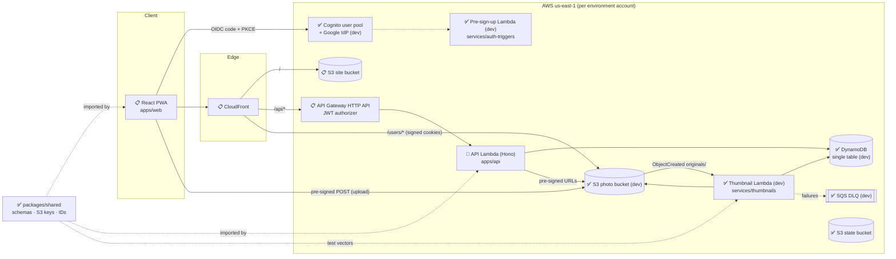
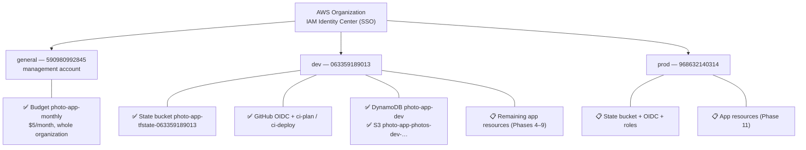
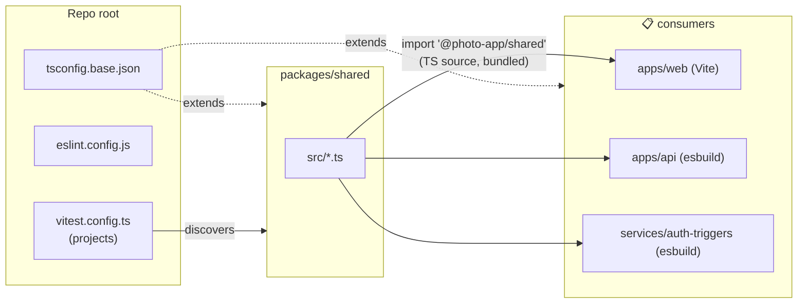
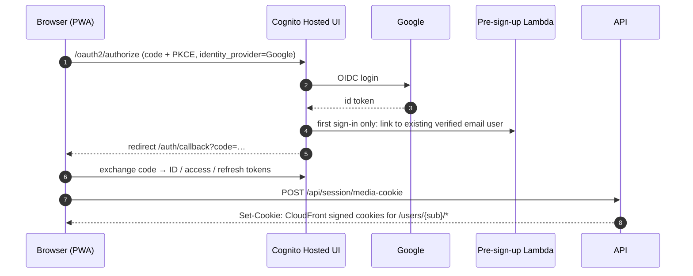
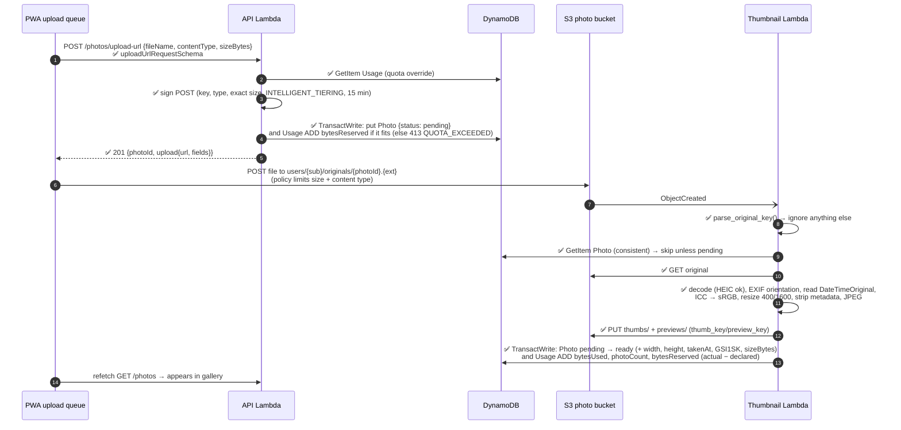
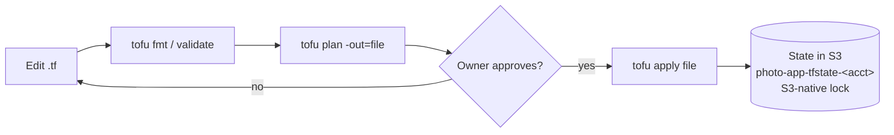

# Photo App — Architecture

> **Living document.** It describes the system **as it is built**, and marks what is still planned.
> - Requirements and the target design live in [`docs/SPECIFICATION.md`](docs/SPECIFICATION.md); task tracking lives in [`PROGRESS.md`](PROGRESS.md).
> - **Update this file in the same change as any implementation:** flip status markers, add the new objects/resources/flows, and add a line to the [changelog](#16-document-changelog).
> - Where the implementation deviates from the spec, say so here and record the decision in `PROGRESS.md`.
>
> Status markers: ✅ implemented · 🚧 partially implemented · 📋 planned (designed, not built)

| | |
|---|---|
| **Last updated** | 2026-10-19 |
| **Reflects** | Phase 0 (repo), Phase 1 (AWS bootstrap: dev + management), Phase 2 (`packages/shared`), Phase 3 (database + storage, deployed in dev), Phase 5.1–5.3 (API skeleton, not deployed), Phase 6.1–6.7 (thumbnail code, not deployed) |

---

## Table of contents

1. [Implementation status at a glance](#1-implementation-status-at-a-glance)
2. [System overview](#2-system-overview)
3. [Technology stack](#3-technology-stack)
4. [AWS accounts & environments](#4-aws-accounts--environments)
5. [Repository structure](#5-repository-structure)
6. [Build & toolchain model](#6-build--toolchain-model)
7. [Shared package — domain objects & contracts](#7-shared-package--domain-objects--contracts)
8. [Data model (storage)](#8-data-model-storage)
9. [API surface](#9-api-surface)
10. [Data workflows](#10-data-workflows)
11. [Security model](#11-security-model)
12. [Infrastructure (OpenTofu)](#12-infrastructure-opentofu)
13. [CI/CD](#13-cicd)
14. [Frontend & PWA](#14-frontend--pwa)
15. [Deviations from the specification](#15-deviations-from-the-specification)
16. [Document changelog](#16-document-changelog)

---

## 1. Implementation status at a glance

| Component | Path | Status | Notes |
|---|---|---|---|
| Monorepo & tooling | root | ✅ | pnpm workspaces, TS base config, ESLint, Prettier, Vitest, ruff/pytest |
| Shared contracts | `packages/shared` | ✅ | Constants, IDs, S3 keys, Zod API schemas, 44 tests |
| AWS bootstrap — dev | `infra/bootstrap` (ws `dev`) | ✅ | State bucket, GitHub OIDC, CI roles |
| AWS bootstrap — management | `infra/bootstrap` (ws `general`) | ✅ | Organization-wide $5/month budget |
| AWS bootstrap — prod | `infra/bootstrap` (ws `prod`) | 📋 | Code ready, plan clean, not applied |
| Environment roots | `infra/envs/{dev,prod}` | 🚧 | Database + storage + auth + thumbnails **deployed in dev**; prod validated only |
| Infra modules: database, storage | `infra/modules/{database,storage}` | ✅ (dev) | Offline `tofu test` suites (7 runs) |
| Infra module: auth | `infra/modules/auth` | ✅ (dev) | User pool, prefix domain (managed login), PKCE web client (4.1), optional Google IdP (4.4), optional pre sign-up trigger Lambda (4.6) + 11 offline test runs; **deployed in dev** (with Google + trigger) |
| Infra module: thumbnails | `infra/modules/thumbnails` | ✅ (dev) | Lambda, IAM, S3 notification, retries + SQS DLQ, logs (6.9) + 4 offline test runs; **deployed in dev** |
| Infra modules: api, frontend | `infra/modules/*` | 📋 | |
| API Lambda | `apps/api` | 🚧 | Skeleton (5.1–5.3) + routes `GET /me`, `POST /photos/upload-url` (incl. retry), `GET /photos`, `GET /photos/{id}`, `GET /photos/{id}/download-url`, `DELETE /photos/{id}`, album CRUD, album photos, sharing, recipient read access and usernames (5.5, 5.6, 5.6a/b, 5.7–5.13, 5.15); 223 tests (incl. DynamoDB Local). Media cookies and signed URLs (Phase 7) not yet; not deployed |
| Thumbnail Lambda | `services/thumbnails` | 🚧 | Handler, image pipeline, S3-key mirror, orphan cleanup + 76 pytest tests (6.1–6.7, 6.12); arm64 package `build.sh` → `dist/` (6.8); not deployed yet (6.9–6.10) |
| Auth trigger Lambda | `services/auth-triggers` | ✅ (dev) | Pre sign-up handler (Google → native account linking, refuses duplicate email sign-ups) + 24 tests (4.5); **deployed in dev** (4.6), linking verified manually |
| Web app / PWA | `apps/web` | 📋 | Folder skeleton only |
| CI/CD workflows | `.github/workflows` | 📋 | AWS-side roles exist (dev); no workflows yet |

---

## 2. System overview

A private, multi-user photo library (in the spirit of Google Photos). Serverless on AWS: no always-on compute, idle cost ≈ storage only. Everything is infrastructure as code.

### 2.1 Target component diagram



### 2.2 Architectural principles

| Principle | How it shows up |
|---|---|
| Photo bytes never pass through the API | Uploads use pre-signed S3 POST; downloads use pre-signed GET; viewing goes through CloudFront |
| Identity only from the token | Backend user ID = Cognito `sub` from the validated JWT, never from path/body |
| One source of truth per contract | S3 key format, API schemas and limits live in `packages/shared`; Python mirrors keys via shared test vectors |
| Async, idempotent processing | Thumbnails generated by an S3-event Lambda that ignores everything except well-formed originals |
| Isolation at every level | Separate AWS accounts per environment, per-user S3 prefix, per-user DynamoDB partition |
| Pay-per-use | Lambda, HTTP API, DynamoDB on-demand, S3; no NAT, no always-on instances |

---

## 3. Technology stack

Versions are what is **installed/locked today**; 📋 rows are chosen but not yet installed.

### 3.1 Languages & runtimes

| Item | Version | Where | Status |
|---|---|---|---|
| Node.js | 22.23 (`.nvmrc` = 22; matches Lambda `nodejs22.x`) | all TS code | ✅ |
| TypeScript | 6.0.3 (pinned `~6.0`, see §15) | all TS code | ✅ |
| Python | 3.13.16 (`.python-version`; matches Lambda `python3.13`) | `services/thumbnails` | ✅ |
| pnpm | 10.18.0 (via corepack, `packageManager`) | workspace manager | ✅ |
| uv | 0.13.1 | Python env/deps (`uv.lock`) | ✅ |
| OpenTofu | 1.13.1 (configs require ≥ 1.10) | `infra/` | ✅ |
| AWS provider | 6.69.1 (constraint `~> 6.0`, lock files committed) | `infra/` | ✅ |
| AWS CLI | 2.38.1 (SSO profiles) | local ops | ✅ |

### 3.2 Libraries

| Library | Version | Used by | Purpose | Status |
|---|---|---|---|---|
| zod | 4.6.7 | `packages/shared` | API request/response schemas, runtime validation | ✅ |
| ulid | 3.0.2 | `packages/shared` | Time-sortable IDs for photos/albums | ✅ |
| Pillow | 13.0.0 | `services/thumbnails` | Image decode/resize/encode, EXIF, ICC → sRGB (LittleCMS) | ✅ |
| pillow-heif | 1.8.1 | `services/thumbnails` | HEIC/HEIF decoding (libheif 1.23, libde265) | ✅ |
| boto3 | 1.43.114 (dev only) | `services/thumbnails` | AWS SDK; provided by Lambda runtime, not packaged | ✅ |
| Hono | 4.13.13 | `apps/api` | Lightweight router inside one Lambda (D-1) | ✅ |
| @hono/aws-lambda | 1.0.0 | `apps/api` | Lambda adapter (API Gateway HTTP API event → Request); replaces the deprecated `hono/aws-lambda` | ✅ |
| AWS SDK v3 (`client-dynamodb`, `lib-dynamodb`) | 3.1155.0 | `apps/api` | DynamoDB via the DocumentClient; bundled (not the runtime copy) | ✅ |
| AWS SDK v3 (`client-cognito-identity-provider`) | 3.1155.0 | `apps/api`, `services/auth-triggers` | API: profile lookup by `sub` (`ListUsers`) for `GET /me`, email lookup for sharing (5.12). Trigger: `ListUsers` by email + `AdminLinkProviderForUser` (4.5) | ✅ |
| AWS SDK v3 (`client-s3`, `s3-presigned-post`, `s3-request-presigner`) | 3.1155.0 | `apps/api` | Pre-signed upload POST (5.6), pre-signed download GET (5.8), `DeleteObjects` (5.9). All `@aws-sdk/*` packages are kept on one version: mixed versions pull in two `@smithy/core` copies and the client types stop matching | ✅ |
| AWS SDK v3 (S3, CloudFront signer) | — | `apps/api` | Pre-signed URLs, signed cookies/URLs | 📋 |
| React + Vite | — | `apps/web` | SPA | 📋 |
| TanStack Router / Query / Virtual | — | `apps/web` | Routing, server state, virtualized grid | 📋 |
| oidc-client-ts | — | `apps/web` | Cognito login with PKCE (D-2, leaning) | 📋 |
| vite-plugin-pwa (Workbox) | — | `apps/web` | Manifest + service worker | 📋 |

### 3.3 Dev tooling

| Tool | Version | Purpose | Status |
|---|---|---|---|
| ESLint (flat config) + typescript-eslint | 10.13 / 8.71 | Lint all TS from the root | ✅ |
| eslint-config-prettier | 10.1 | Turn off formatting rules that clash with Prettier | ✅ |
| Prettier | 3.9 | Formatting (Markdown excluded) | ✅ |
| Vitest | 5.0.5 | Unit tests, one project per package | ✅ |
| ruff | 0.17.1 | Python lint + format | ✅ |
| pytest | 9.1.1 | Python tests | ✅ |
| moto (`s3`, `dynamodb`) | 5.2.4 | In-memory S3/DynamoDB for thumbnail handler tests | ✅ |
| esbuild | 0.28.2 | Bundle Lambdas (`apps/api/build.mjs` → `dist/index.mjs`, ESM, node22, minified + source map) | ✅ (API) |
| DynamoDB Local (Docker `amazon/dynamodb-local:3.3.1`) | 3.3.1 | Repository tests; started by `apps/api/test/dynamodb-local.ts`, or `DYNAMODB_ENDPOINT` | ✅ |
| `tofu test` + `mock_provider` | OpenTofu 1.13 | Offline infra module tests | ✅ |

---

## 4. AWS accounts & environments

### 4.1 Topology ✅



| Aspect | Value |
|---|---|
| Region | `us-east-1` for everything (also where CloudFront requires its ACM cert) |
| Human access | IAM Identity Center SSO, `AdministratorAccess` permission set; CLI profiles `dev`, `prod`, `general` |
| Machine access | GitHub Actions via OIDC roles (§13); no long-lived keys |
| Isolation | dev and prod are separate accounts: separate state, IAM, data and blast radius |
| Management account | Billing only (budget); no workloads |
| Wrong-account protection | Every provider block sets `allowed_account_ids`; bootstrap also checks workspace == environment |

### 4.2 Resource lifecycle policy

| Category | Examples | Lifetime |
|---|---|---|
| Bootstrap (permanent) | State buckets, budget, OIDC provider, CI roles | Kept; state buckets also have `prevent_destroy` |
| App resources during development | Tables, buckets, Lambdas, Cognito… | Created on explicit approval, destroyed after testing |

Creating any AWS resource requires the owner's explicit approval of the plan, per account.

---

## 5. Repository structure

Actual tree (generated files and `.gitkeep` placeholders omitted). Status per folder.

```
Photo-app/
├── ARCHITECTURE.md              ✅ this document
├── PROGRESS.md                  ✅ implementation plan, status, decisions, session log
├── CLAUDE.md                    ✅ working rules for Claude Code sessions
├── README.md                    ✅ quick start, commands, AWS/infra overview
├── package.json                 ✅ workspace root: scripts + dev tooling (type: module)
├── pnpm-workspace.yaml          ✅ apps/*, packages/*, services/auth-triggers
├── pnpm-lock.yaml               ✅
├── tsconfig.base.json           ✅ strict TS settings every package extends
├── eslint.config.js             ✅ single flat config for the whole repo
├── vitest.config.ts             ✅ discovers {apps,packages,services}/*/vitest.config.ts
├── .prettierrc.json / .prettierignore / .editorconfig / .gitignore   ✅
├── .nvmrc (22) / .python-version (3.13)                              ✅
├── .claude/settings.json        ✅ project Claude Code plugins (TS/Python LSP, aws-core, github, security-guidance)
│
├── docs/
│   └── SPECIFICATION.md         ✅ requirements & target design (v0.3)
│
├── packages/
│   └── shared/                  ✅ @photo-app/shared (source-only, see §6)
│       ├── src/
│       │   ├── index.ts         re-exports everything
│       │   ├── constants.ts     limits, content types, TTLs, image sizes
│       │   ├── ids.ts           ULID generation & ID validators
│       │   ├── s3Keys.ts        S3 key builders/parser
│       │   ├── schemas/         Zod: common, errors, photos, albums, account
│       │   └── *.test.ts        Vitest suites
│       └── test-vectors/
│           └── s3-keys.json     cross-language key contract (TS + Python)
│
├── apps/
│   ├── web/                     📋 React PWA (routes/, queries/, components/, upload/, auth/, api/)
│   └── api/                     🚧 API Lambda
│       ├── build.mjs            esbuild bundle → dist/index.mjs (handler `index.handler`)
│       ├── src/index.ts         Lambda entry: config, clients, repositories, routes, @hono/aws-lambda `handle`
│       ├── src/app.ts           Hono app: /api base path, body limit, /health, requireUser, error envelope
│       ├── src/env.ts           Hono env type (Lambda event binding, `userId` variable)
│       ├── src/lib/             auth.ts (JWT sub), errors.ts (AppError, orNotFound), validation.ts (Zod), log.ts, config.ts, users.ts (Cognito directory: profile by sub, user by email), storage.ts (photo bucket: pre-signed POST, pre-signed download GET, object deletes)
│       ├── src/repo/            DynamoDB layer: keys, cursor, db helpers, photos, albums, memberships, shares, usage, usernames
│       ├── src/routes/          index.ts (Deps, registerRoutes), me.ts, photos.ts, albums.ts, shares.ts, access.ts (shared-album access checks), present.ts (record → API object)
│       └── test/                Vitest: app/middleware, cursor, config/directory, repositories and routes on DynamoDB Local, tenant-isolation suite (all routes)
│
├── services/
│   ├── thumbnails/              🚧 Python Lambda
│   │   ├── pyproject.toml       ✅ uv project, ruff + pytest config
│   │   ├── uv.lock              ✅
│   │   ├── build.sh             ✅ package for Lambda (6.8): aarch64 wheels from uv.lock + src → dist/ (git-ignored), ~38 MB unpacked / ~14 MB zipped
│   │   ├── src/thumbnails/      ✅ package
│   │   │   ├── handler.py       Lambda entry `thumbnails.handler.handler` (S3 event → Processor)
│   │   │   ├── processor.py     S3 get/put, DynamoDB status + Usage transaction, error policy
│   │   │   ├── imaging.py       pure pipeline: decode, orient, EXIF date, resize, strip, JPEG
│   │   │   └── s3_keys.py       mirror of packages/shared s3Keys.ts
│   │   └── tests/               ✅ pytest: key vectors, imaging, handler on moto; fixtures generated in conftest.py
│   └── auth-triggers/           ✅ Cognito pre sign-up Lambda (TS): src/index.ts (handler), preSignUp.ts (decisions), directory.ts (Cognito: ListUsers, AdminLinkProviderForUser), log.ts (objects for the Lambda JSON log format); test/; build.mjs (esbuild → dist/index.mjs ~0.5 MB + source map; zipped by the `auth` module)
│
├── infra/
│   ├── bootstrap/               ✅ one-time per-account setup (local state, workspaces)
│   │   ├── main.tf              state bucket + settings
│   │   ├── github-oidc.tf       OIDC provider + CI roles
│   │   ├── budget.tf            organization budget
│   │   ├── {dev,prod,general}.tfvars
│   │   └── README.md
│   ├── envs/
│   │   ├── dev/                 🚧 backend, provider, main.tf (database + storage + auth), env.tfvars; all three deployed
│   │   └── prod/                🚧 same wiring with prod settings; validated only
│   └── modules/
│       ├── database/            ✅ DynamoDB single table (+ tests/)
│       ├── storage/             ✅ photo bucket (+ tests/)
│       ├── auth/                ✅ Cognito user pool, domain, web client, Google IdP, pre sign-up trigger (+ tests/)
│       ├── thumbnails/          ✅ thumbnail Lambda, IAM, S3 notification, DLQ (+ tests/)
│       └── api/ frontend/       📋
│
└── .github/workflows/           📋 ci.yml, deploy.yml
```

---

## 6. Build & toolchain model ✅



| Decision | Detail |
|---|---|
| **Source-only shared package** | `@photo-app/shared` exports `./src/index.ts` directly. No build step: Vite, esbuild and Vitest all compile TS, and every consumer is bundled. |
| **Typecheck per package** | Each package has `tsc` (with `noEmit` from the base config) as `typecheck`; root runs `pnpm -r typecheck`. |
| **Lint/format/test at root** | One ESLint flat config, one Prettier config, one Vitest run with auto-discovered projects (each package adds a `vitest.config.ts` with a `name`). |
| **Module resolution** | `moduleResolution: bundler`, `verbatimModuleSyntax`, extensionless relative imports. |
| **Python** | `services/thumbnails` is an independent uv project (`uv_build` backend, src layout). boto3 is dev-only because the Lambda runtime ships it. Root scripts `lint:py` / `test:py` call uv. Packaging (`build.sh`, root `build:py`): `uv export --frozen --no-dev` → `uv pip install --target dist --python-platform aarch64-manylinux_2_28 --only-binary :all: --require-hashes`, plus `src/thumbnails`, plus hash-based `.pyc` (`compileall --invalidation-mode unchecked-hash`). Only prebuilt wheels, so it builds on any host; `PLATFORM=x86_64-manylinux_2_28` builds a local copy for smoke tests. |
| **IaC** | OpenTofu; provider lock files are committed; `tofu fmt` enforced. |

Root commands: `pnpm lint`, `pnpm format[:check]`, `pnpm typecheck`, `pnpm test`, `pnpm build`, `pnpm lint:py`, `pnpm test:py`, `pnpm build:py`, `pnpm test:infra` (runs `tofu test` in every module with a `tests/` folder; fails on any failure).

---

## 7. Shared package — domain objects & contracts ✅

`packages/shared` is the contract between frontend, API and (via test vectors) the Python service.

### 7.1 Constants (`constants.ts`)

| Constant | Value | Spec ref |
|---|---|---|
| `CONTENT_TYPE_EXTENSIONS` | `image/jpeg→jpg`, `image/png→png`, `image/heic→heic`, `image/heif→heif`, `image/webp→webp` | FR-UP-2 |
| `ALLOWED_CONTENT_TYPES` / `ORIGINAL_EXTENSIONS` | derived from the map above | FR-UP-2 |
| `MAX_UPLOAD_BYTES` | 50 MiB | FR-UP-3 |
| `MAX_FILE_NAME_LENGTH` | 255 | — |
| `PAGE_LIMIT_DEFAULT` / `PAGE_LIMIT_MAX` | 60 / 200 | §9 |
| `MAX_ALBUM_NAME_LENGTH` | 100 | — |
| `MAX_PHOTOS_PER_ALBUM_REQUEST` | 100 | — |
| `USERNAME_MIN_LENGTH` / `USERNAME_MAX_LENGTH` | 3 / 30 | FR-ACC-3 |
| `USERNAME_HOLD_DAYS` | 30 | D-8 |
| `RESERVED_USERNAMES` | admin, administrator, anonymous, api, help, mail, me, null, photo.app, photo_app, photoapp, root, security, support, system, undefined, www | FR-ACC-3 |
| `UPLOAD_URL_TTL_SECONDS` | 900 (15 min) | §9 |
| `DOWNLOAD_URL_TTL_SECONDS` | 300 (5 min) | §9 |
| `SHARED_IMAGE_URL_TTL_SECONDS` | 900 (15 min) | §9 |
| `MEDIA_COOKIE_TTL_SECONDS` | 28 800 (8 h) | §9 |
| `THUMB_MAX_EDGE` / `PREVIEW_MAX_EDGE` | 400 / 1600 px | §10 |

Per-environment settings (e.g. default quota 2 GB dev / 10 GB prod) are deployment config, not shared constants.

### 7.2 Identifiers (`ids.ts`)

| Object | Format | Validator | Generated by |
|---|---|---|---|
| `photoId`, `albumId` | ULID, 26 chars Crockford base32, **uppercase**, first char `0–7` (`ULID_REGEX`) | `isId()` | `newId()`: monotonic ULID, so IDs created in the same millisecond still sort by creation |
| `userId` | Cognito `sub`, **lowercase** UUID (`USER_ID_REGEX`) | `isUserId()` | Cognito |

### 7.3 S3 keys (`s3Keys.ts`)

| Function | Returns | Behaviour |
|---|---|---|
| `originalKey(userId, photoId, ext)` | `users/{userId}/originals/{photoId}.{ext}` | Throws on invalid IDs |
| `thumbKey(userId, photoId)` | `users/{userId}/thumbs/{photoId}.jpg` | Throws on invalid IDs |
| `previewKey(userId, photoId)` | `users/{userId}/previews/{photoId}.jpg` | Throws on invalid IDs |
| `userPrefix(userId)` | `users/{userId}/` | Scope of the user's media cookie |
| `extensionFor(contentType)` | `jpg` / `png` / `heic` / `heif` / `webp` | — |
| `parseOriginalKey(key)` | `{userId, photoId, ext}` or `null` | Strict: anything that is not a well-formed original → `null` (thumbnail loop protection) |

**Cross-language contract:** `test-vectors/s3-keys.json` holds 5 valid key sets and 17 invalid original keys (wrong folder, uppercase UUID, lowercase/invalid ULID, `.jpeg`/`.JPG`, nested paths, leading slash, double extension, empty…). Vitest runs against it now; the Python mirror (📋 task 6.6) must run against the same file.

### 7.4 API schemas (`schemas/`)

All request/response bodies of §9 as Zod schemas with inferred TS types.

**Common (`common.ts`)**

| Schema | Shape |
|---|---|
| `idSchema` | string matching `ULID_REGEX` |
| `userIdSchema` | UUID |
| `isoDateTimeSchema` | ISO-8601 date-time |
| `cursorSchema` | opaque string, 1–2048 chars (encoded DynamoDB `LastEvaluatedKey`) |
| `pageQuerySchema` | `{ cursor?, limit = 60 (coerced, 1–200) }` |
| `pageSchema(item)` / `Page<T>` | `{ items: T[], nextCursor: string \| null }` |

**Errors (`errors.ts`)**: every non-2xx body is `{ error: { code, message } }`.

| `ErrorCode` | Meaning |
|---|---|
| `UNAUTHORIZED` | Missing/invalid token |
| `NOT_FOUND` | Missing **or not yours** (NFR-SEC-2: never 403) |
| `VALIDATION_ERROR` | Request failed schema validation |
| `QUOTA_EXCEEDED` | Upload would exceed quota (FR-UP-7) |
| `UNSUPPORTED_MEDIA_TYPE` | Content type not allowed |
| `PAYLOAD_TOO_LARGE` | Over 50 MB |
| `CONFLICT` | State conflict |
| `SHARE_TARGET_NOT_FOUND` | No registered user with that email or username |
| `USERNAME_TAKEN` | `PUT /me/username`: someone else has the name, or it is held for its former owner (409) |
| `RATE_LIMITED` | Throttled |
| `INTERNAL_ERROR` | Unexpected failure |

**Photos (`photos.ts`)**

| Schema | Shape |
|---|---|
| `photoStatusSchema` | `pending` \| `ready` \| `failed` |
| `contentTypeSchema` | enum of `ALLOWED_CONTENT_TYPES` |
| `photoSchema` / `Photo` | `photoId, status, fileName, contentType, sizeBytes, width\|null, height\|null, takenAt, uploadedAt, thumbUrl\|null, previewUrl\|null`. URLs are null until `ready`. |
| `photoSortSchema` | `taken-desc` (default) \| `taken-asc` |
| `listPhotosQuerySchema` | page query + `sort` |
| `photoPageSchema` | `Page<Photo>` |
| `uploadUrlRequestSchema` | `{ fileName (trimmed, 1–255), contentType, sizeBytes (1 … 50 MiB) }` |
| `uploadUrlResponseSchema` | `{ photoId, upload: { url, fields: Record<string,string> } }` (pre-signed POST) |
| `downloadUrlResponseSchema` | `{ url, expiresAt }` |

**Albums & sharing (`albums.ts`)**

| Schema | Shape |
|---|---|
| `albumSchema` / `Album` | `albumId, name, createdAt, coverPhotoId\|null, coverThumbUrl\|null, photoCount` |
| `albumListSchema` | `{ items: Album[] }` (not paginated) |
| `createAlbumRequestSchema` | `{ name }`, trimmed, 1–100 |
| `updateAlbumRequestSchema` | `{ name?, coverPhotoId?: id \| null }`, at least one field; `null` clears cover |
| `addAlbumPhotosRequestSchema` | `{ photoIds: id[1..100] }` |
| `albumShareSchema` | `{ userId, email\|null, username\|null, sharedAt }`: `email` only for shares made by email (FR-SHR-5), `username` = recipient's current one |
| `albumShareListSchema` | `{ items: AlbumShare[] }` |
| `createShareRequestSchema` | exactly one of `{ email }` (trimmed + lowercased **before** validation) or `{ username }` (strict objects) |
| `sharedAlbumSchema` | `Album` + `ownerId, ownerUsername\|null, sharedAt` |
| `sharedAlbumPageSchema` | `Page<SharedAlbum>` |

**Account (`account.ts`)**

| Schema | Shape |
|---|---|
| `usageSchema` | `{ bytesUsed, photoCount, quotaBytes }` |
| `meResponseSchema` | `{ userId, email, name\|null, username\|null, usage }` |
| `setUsernameRequestSchema` / `setUsernameResponseSchema` | `{ username }` |
| `mediaCookieResponseSchema` | `{ expiresAt }` (cookies themselves via `Set-Cookie`) |

`usernameSchema` (`common.ts`, FR-ACC-3): trimmed, one leading `@` dropped, lowercased, then `^[a-z0-9][a-z0-9._]{1,28}[a-z0-9]$`, no `..`, not reserved. ASCII only (no lookalike letters from other scripts).

### 7.5 Tests

| Suite | Covers |
|---|---|
| `s3Keys.test.ts` | builders and parser against the shared vectors; invalid IDs throw; `extensionFor` |
| `ids.test.ts` | 1000 IDs valid/unique/sorted; embedded timestamp; validators |
| `schemas/schemas.test.ts` | defaults & coercion, limits, pending photo shape, album rules, email normalisation, error envelope |

---

## 8. Data model (storage) 🚧

Key format implemented in `s3Keys.ts`; table and bucket defined in `infra/modules/{database,storage}` (§12.3) and **deployed in dev** (empty; nothing writes to them yet). The API's table access is implemented in `apps/api/src/repo` (keys in `keys.ts` only).

### 8.1 Photo bucket (per environment)

```
users/{userId}/originals/{photoId}.{ext}   untouched upload        INTELLIGENT_TIERING
users/{userId}/thumbs/{photoId}.jpg        ≤ 400 px, no metadata   STANDARD, immutable cache
users/{userId}/previews/{photoId}.jpg      ≤ 1600 px, no metadata  STANDARD, immutable cache
```

Bucket `photo-app-photos-{env}-{account-id}`. The API sets the originals' storage class (INTELLIGENT_TIERING) in the pre-signed POST, because lifecycle filters cannot match `users/*/originals/`.

### 8.2 DynamoDB single table `photo-app-{env}`

On-demand, `PK`/`SK` strings, one GSI `GSI1` (`GSI1PK`/`GSI1SK`, projection ALL), AWS-owned encryption key.

| Entity | PK | SK | GSI1PK | GSI1SK | API object |
|---|---|---|---|---|---|
| Photo | `USER#{userId}` | `PHOTO#{photoId}` | `USER#{userId}` | `TAKEN#{takenAt}#{photoId}` | `Photo` |
| Album | `USER#{ownerId}` | `ALBUM#{albumId}` | — | — | `Album` |
| Album membership | `ALBUM#{albumId}` | `PHOTO#{photoId}` | — | — | — |
| Album share | `ALBUM#{albumId}` | `SHARE#{userId}` | `SHAREDWITH#{userId}` | `ALBUM#{albumId}` | `AlbumShare`, `SharedAlbum` |
| Usage | `USER#{userId}` | `USAGE` | — | — | `Usage` |
| Profile | `USER#{userId}` | `PROFILE` | — | — | `username` in `Me`, `AlbumShare`, `SharedAlbum.ownerUsername` |
| Username claim | `USERNAME#{username}` | `USERNAME` | — | — | — (uniqueness; lookup for sharing) |

Access patterns and the "can user X see photo P" rule: see spec §8.2.

**Photo item lifecycle (contract between API and thumbnail Lambda):**
- API (5.6) puts the item with `status: pending`, `uploadedAt`, and `GSI1PK`/`GSI1SK` using `uploadedAt` as the provisional `takenAt`, so pending photos appear in the gallery (FR-GAL-5).
- Thumbnail Lambda moves it to `ready` (sets `width`, `height`, `takenAt`, `GSI1SK`, actual `sizeBytes`, `processedAt`) or `failed` (`failureReason`, `sizeBytes`, `processedAt`; GSI1SK unchanged).
- **Usage** has two byte counters (task 5.6b). Invariant: `bytesReserved = bytesUsed + declared size of every pending photo`.
  - `bytesUsed`/`photoCount`: stored originals, shown by `GET /me`. Incremented by the thumbnail Lambda, in the same transaction as the final status, once per stored original (`ready` *or* `failed`, because the original occupies storage either way).
  - `bytesReserved`: what the **quota is checked against**. The API adds the declared `sizeBytes` in the same transaction that creates the pending item, conditional on `attribute_not_exists(bytesReserved) OR bytesReserved <= quota − sizeBytes` (DynamoDB conditions can't add, so the API precomputes the limit). The thumbnail Lambda adds `actual − declared` (normally 0, the POST policy pins the size).
  - Deletes (5.9): a pending photo releases its declared size from `bytesReserved`; a counted photo decrements `bytesUsed`, `photoCount` and `bytesReserved` by its `sizeBytes`. The stale-pending sweeper (6.11) will release like a pending delete.
  - `quotaBytes` (optional per-user override) is never written by the app.
- All timestamps use the JS `toISOString()` format.

**Repository layer (✅ `apps/api/src/repo`, task 5.3):**

| Item | Extra attributes written by the API |
|---|---|
| Photo | `entity: "photo"`, `userId`, `photoId`, `originalKey`, `albumIds` (string set: reverse index of album memberships, maintained with each membership change) |
| Album | `entity: "album"`, `ownerId`, `albumId`, `photoCount` (kept by membership transactions), optional `coverPhotoId` (must be a member; album ownership is checked before membership, so the cover check can't reveal another user's album contents) |
| Album membership | `entity: "membership"`, `albumId`, `photoId`, `ownerId`, `addedAt` |
| Album share | `entity: "share"`, `albumId`, `ownerId`, `userId` (recipient), `email` (only when shared by email), `sharedAt`. Created in one transaction with a `ConditionCheck` that the owner's album exists, and only if the share doesn't exist yet (sharing again keeps the first `sharedAt`) |
| Profile | `entity: "profile"`, `userId`, `username`, `usernameChangedAt` |
| Username claim | `entity: "username"`, `username`, `userId`, `claimedAt`; after a rename `releasedAt`, `heldUntil` (= releasedAt + 30 d). Claim and profile change in **one transaction**: put the new claim if `attribute_not_exists(PK) OR userId = :me OR heldUntil < :now`; put the profile if it still has the name read before; on a rename mark the old claim held (`userId = :me`). New-claim condition fails → taken; profile condition fails or `TransactionConflict` → re-read and retry (max 5). A held claim resolves to nobody; its former owner can take it back |
| Usage | API writes only `bytesReserved` (reserve on create, release on delete) and the decrements on delete; `quotaBytes` optional per-user override |

- **Membership changes** are one transaction each over membership + photo `albumIds` + album `photoCount`, with conditions (album exists, photo exists = same owner, not already a member; on removal the membership's `ownerId` must be the caller, since membership keys carry no user), so duplicates and retries never double-count and nobody can add to or remove from another user's album. `listMemberships`/`hasPhoto` are not user-scoped: routes must check album ownership or a share first.
- **Deletes** are ordered children-first and conditional so a retried request finishes an interrupted one: photo = memberships → item + Usage decrement in one transaction (conditioned on the status read, so it can't race the thumbnail Lambda's count); album = unlink photos → memberships + shares → album item.
- **Pagination:** `queryPage` reads `limit + 1` items, so `nextCursor` is null exactly at the end; the cursor is base64url JSON of the last item's key attributes, and decoding rejects anything that isn't exactly those attributes for the caller's own partition.
- Not yet covered: listing an album's photos by date taken (memberships are in upload order), cleanup of `pending` items whose upload never happened (retries reuse the item via 5.6a; abandoned ones need the 6.11 sweeper).

---

## 9. API surface 🚧

Contracts exist (✅ in `packages/shared`). Implemented routes are marked ✅ below; the rest are 📋. Base path `/api`, bearer = Cognito access token.

**Request pipeline (✅, `apps/api/src/app.ts`):** body limit 64 KB → `GET /health` (public) → `requireUser` (JWT `sub` from `event.requestContext.authorizer.jwt.claims`, set by the API Gateway JWT authorizer) → route (`validate(target, schema)` with the shared Zod schemas, repositories, `orNotFound`) → `onError`. Every error leaves as `{error: {code, message}}`: `AppError` as thrown; Hono `HTTPException` by status (400 `VALIDATION_ERROR`, 413 `PAYLOAD_TOO_LARGE`, …); anything else is logged as JSON and returned as a generic 500 `INTERNAL_ERROR`. Unknown routes: 401 for anonymous callers, 404 `NOT_FOUND` for users. Routes are registered through `createApp({ routes: registerRoutes(deps) })`; `Deps` = repositories, a `UserDirectory` (Cognito), a `PhotoStorage` (S3) and `{ defaultQuotaBytes }`, built once per Lambda environment in `index.ts` and faked in tests.

**Runtime configuration (env vars, set by the `api` module in 5.4):** `TABLE_NAME`, `PHOTO_BUCKET`, `USER_POOL_ID`, `DEFAULT_QUOTA_BYTES` (positive integer; e.g. 2 GB dev, 10 GB prod). A missing or invalid value fails the cold start.

**Permissions the `api` role needs (5.4):** `cognito-idp:ListUsers` on the pool; `s3:PutObject` on `users/*/originals/*` (uploads are signed with the Lambda's credentials) and `s3:GetObject` there (downloads, likewise); `s3:DeleteObject` on `users/*/originals/*`, `users/*/thumbs/*`, `users/*/previews/*` (photo delete; `DeleteObjects` checks it per key); table read/write.

**Response conventions (✅):**
- Own image URLs are stable CloudFront paths, `/users/{sub}/thumbs/{photoId}.jpg` and `/users/{sub}/previews/{photoId}.jpg`, and only when `status = ready` (else `null`). Album `coverThumbUrl` is the cover's thumb path under the same rule.
- `GET /me`: email and name come from Cognito (`ListUsers` filtered by `sub`, because access tokens carry neither and Google users' usernames aren't their `sub`); a token whose user is gone from the pool → 401. `quotaBytes` = the Usage item's override, else `DEFAULT_QUOTA_BYTES`.
- `POST /photos/upload-url` → 201 `{photoId, upload: {url, fields}}`. Order: validate (type, 1 B–50 MB, name) → read Usage for the quota → sign → put the `pending` item **and** reserve its size in one transaction (signing is local and comes first, so a failure leaves no item or reservation). `bytesReserved + sizeBytes` must be ≤ quota, else **413 `QUOTA_EXCEEDED`**; pending uploads count, and the conditional write means parallel requests can't overshoot (5.6b). The POST policy pins bucket, exact key `users/{sub}/originals/{photoId}.{ext}`, `Content-Type`, `x-amz-storage-class: INTELLIGENT_TIERING` and `content-length-range` = exactly the declared size; expires after 15 min. The browser must send the returned `fields` (plus `file` last) as multipart form data to `url`.
- **Retry (5.6a):** the same request with `photoId` re-signs the upload for that photo → 200, same key, no new item. Its bytes are already reserved, so the check is `bytesReserved ≤ quota` (only fails if the quota was lowered meanwhile → 413 `QUOTA_EXCEEDED`); nothing is reserved again. Unknown or another user's photo → 404; photo no longer `pending` → 409 `CONFLICT` (a processed original can't be replaced through the API); `contentType`/`sizeBytes` different from the item → 409 `CONFLICT`. `fileName` is kept from the first request. The upload queue stores the `photoId` with the file (8.10).
- `GET /photos/{id}/download-url` → 200 `{url, expiresAt}`: pre-signed GET for the original, 5 min, with `response-content-disposition` = `attachment; filename="<ASCII fallback>"; filename*=UTF-8''<exact name>` (RFC 6266/8187; non-ASCII, `"` and `\` become `_` in the fallback, unpaired surrogates become U+FFFD). The disposition is part of the signature. `pending` → 409 `CONFLICT` (the original may not exist yet); `failed` photos can be downloaded (their original is kept). Owner only until 5.13.
- `DELETE /photos/{id}` → 204. Order: read the item (unknown/foreign → 404) → `DeleteObjects` for original, thumb and preview → `repos.photos.delete` (memberships with album count/cover fixes, then the item and the Usage release in one transaction). Objects go first so a failure part-way leaves a photo that a retry can still find; the reverse order could leave files nobody references. If the item's status changed in between (the thumbnail Lambda finished and wrote thumb/preview after our object delete), the objects are deleted a second time. Concurrently deleted → still 204; deleting again → 404.
- `POST /albums` → 201 with the album. `PATCH` → 200 with the album; a cover that isn't in the album → 400 `VALIDATION_ERROR`. Deletes and `POST /albums/{id}/photos` → 204.
- `POST /albums/{id}/photos` is idempotent (photos already in the album are fine) and checks all photos first: any unknown or foreign photo → 404 `Photo not found` and nothing is added.
- **Sharing (5.12):** `/albums/{id}/shares` routes are owner-only: the album is looked up under the caller's partition first, so recipients and strangers get 404 and can't re-share or revoke (FR-SHR-4). The ownership check also comes **before** the email lookup, so non-owners can't use the route to find out which emails are registered.
  - `POST` → 201 with the new share, 200 with the existing one when already shared (idempotent, first `sharedAt` kept). The email (trimmed + lowercased by the schema) is resolved with Cognito `ListUsers` filter `email = "…"`. Only users that are enabled, not `UNCONFIRMED` and have `email_verified = "true"` count (an unverified address may have been set by its holder to someone else's email); if more than one such user matches, nobody does (never guess). Requires the pool to verify email changes before applying them and Google's `email_verified` to be mapped (4.1/4.4). No match → 404 **`SHARE_TARGET_NOT_FOUND`**; own email → 400 `VALIDATION_ERROR`. Owners can therefore learn whether an email is registered (inherent to share-by-email, FR-SHR-1; throttling in 5.4 limits it).
  - `GET` → `{items}` oldest share first. `DELETE …/shares/{userId}` → 204, not shared → 404.
  - `GET /shared-albums` → GSI1 `SHAREDWITH#{sub}` page (album-ID order), albums read with one BatchGet; a share whose album is gone (album delete removes shares after listing them) is skipped. `coverThumbUrl` is **null** for shared albums until signed URLs (7.4): the owner's thumb path isn't covered by the recipient's media cookie. Shared albums never appear in the recipient's `GET /albums`, and every album mutation stays 404 for them.
- `GET /albums/{id}/photos` lists in photo upload order (memberships are keyed by the photo ULID; ordering by date taken would need another index, §8.2), for the owner or a share recipient.
- **Usernames (5.15, FR-ACC-3, D-8):** `PUT /me/username` → 200 `{username}` (normalised); same name again → 200 without a write; someone else's or held for someone else → **409 `USERNAME_TAKEN`**; invalid/reserved → 400. `GET /me` includes `username` (null until set). A rename holds the old name 30 days for its former owner; shares are by user ID, so they survive renames.
- **Share by username (FR-SHR-5):** `POST /albums/{id}/shares {username}` (with or without `@`, any case) → album ownership first, then the claim lookup; unknown or held name → 404 `SHARE_TARGET_NOT_FOUND`; own name → 400. The share item then has **no email**, and `GET /albums/{id}/shares` returns `email: null` for it, so the owner never learns the recipient's email. Share lists and `GET /shared-albums` (`ownerUsername`) always show **current** usernames (BatchGet of profiles).
- **Recipient access (5.13, `routes/access.ts`)**, the §8.2 rule "can user X see photo P": another user's album or photo is reachable only through a share item `ALBUM#{albumId} / SHARE#{caller}` (consistent read, so a revoke takes effect at once).
  - Album: own album, else share → album under `share.ownerId`. Recipients see only `ready` photos, with `thumbUrl`/`previewUrl` **null** until signed URLs (7.4).
  - Photo: the caller passes the album it is viewing, `GET /photos/{id}/download-url?albumId=…` (photos have no global by-ID lookup). Own photo first; else share for (album, caller) → membership (album, photo) → photo under `share.ownerId`, `ready` only. Any miss → 404. Without `albumId`, recipients get 404.
  - Everything else stays owner-only for recipients: `GET/DELETE /photos/{id}`, album mutations, shares, their own gallery. Originals are downloaded as uploaded, **EXIF/GPS included** (FR-DL-1); only thumbs/previews are stripped (NFR-SEC-5).

| Method | Path | Request schema | Response schema |
|---|---|---|---|
| `POST` | `/session/media-cookie` | — | `mediaCookieResponseSchema` |
| `DELETE` | `/session/media-cookie` | — | none (`204`, expires the cookies; logout, FR-AUTH-5) |
| `GET` | `/me` ✅ | — | `meResponseSchema` (200) |
| `PUT` | `/me/username` ✅ | `setUsernameRequestSchema` | `setUsernameResponseSchema` (200) |
| `POST` | `/photos/upload-url` ✅ | `uploadUrlRequestSchema` | `uploadUrlResponseSchema` (201) |
| `GET` | `/photos` ✅ | `listPhotosQuerySchema` (query) | `photoPageSchema` (200) |
| `GET` | `/photos/{photoId}` ✅ | — | `photoSchema` (200) |
| `GET` | `/photos/{photoId}/download-url` ✅ | — | `downloadUrlResponseSchema` (200) |
| `DELETE` | `/photos/{photoId}` ✅ | — | 204 |
| `GET` | `/albums` ✅ | — | `albumListSchema` (200) |
| `POST` | `/albums` ✅ | `createAlbumRequestSchema` | `albumSchema` (201) |
| `PATCH` | `/albums/{albumId}` ✅ | `updateAlbumRequestSchema` | `albumSchema` (200) |
| `DELETE` | `/albums/{albumId}` ✅ | — | 204 |
| `GET` | `/albums/{albumId}/photos` ✅ (owner only so far) | `pageQuerySchema` (query) | `photoPageSchema` (200) |
| `POST` | `/albums/{albumId}/photos` ✅ | `addAlbumPhotosRequestSchema` | 204 |
| `DELETE` | `/albums/{albumId}/photos/{photoId}` ✅ | — | 204 |
| `GET` | `/albums/{albumId}/shares` ✅ | — | `albumShareListSchema` (200) |
| `POST` | `/albums/{albumId}/shares` ✅ | `createShareRequestSchema` (`{email}` or `{username}`) | `albumShareSchema` (201 new, 200 existing) |
| `DELETE` | `/albums/{albumId}/shares/{userId}` ✅ | — | 204 |
| `GET` | `/shared-albums` ✅ | `pageQuerySchema` (query) | `sharedAlbumPageSchema` (200) |
| `GET` | `/health` ✅ | — | `{status: "ok"}`, no auth |

Errors on every route: `apiErrorSchema`. Success status codes of the 📋 routes are finalised with their handlers.

---

## 10. Data workflows

Status per step is marked inline. ✅ steps are pieces that already exist and will be used by the flow.

### 10.1 Login 📋



**Pre sign-up trigger (`services/auth-triggers`, ✅ deployed in dev 2026-10-24).** Cognito calls it before creating any user; the pool ID comes from the event (no configuration). Keeps one account per verified email (FR-AUTH-3, spec §11.3):

| `triggerSource` | Behaviour |
|---|---|
| `PreSignUp_ExternalProvider` (first Google sign-in) | Only if Google says `email_verified = "true"`: `ListUsers` by the normalised email, keep users that are `CONFIRMED`, enabled and email-verified (native: federated users have status `EXTERNAL_PROVIDER`). Exactly one → `AdminLinkProviderForUser` (destination `Cognito`/native username = `sub`; source `Google`/`Cognito_Subject`/Google's ID from the `Google_<id>` username, prefix matched case-insensitively). None → normal sign-up (new Google user). Several → no link, `WARN` log (never guess). Link failure → error, the sign-in fails rather than creating a second account. Returns the event unchanged |
| `PreSignUp_SignUp` (email/password) | Refused (`EMAIL_TAKEN_MESSAGE`, "…Sign in with Google instead.") when an enabled federated user already has this email verified. Cognito itself rejects duplicate native emails |
| `PreSignUp_AdminCreateUser`, others | Pass through |

Linking makes the Google identity sign in as the native user from then on, so `sub` (and every photo) stays the same. **Verified in dev (4.6):** password sign-up → Google sign-in with the same email linked the identity (`identities` attribute on the native user, no separate `Google_…` user, log "Linked external identity to native user"); the first Google sign-in after linking completed without a retry. Logs: one JSON event per call with our fields under `message` (e.g. `message.provider`); `level`/`timestamp`/`requestId` come from the runtime. Cold start ~0.9 s incl. the first `ListUsers`, warm ~3 ms (Cognito allows 5 s).

### 10.2 Upload & processing 🚧 (contracts ✅, thumbnail code ✅, API ✅, not deployed)



Failure paths: corrupt/unsupported → `status: failed`, no retry; transient → 2 async retries → SQS DLQ.

**Thumbnail Lambda details** (`services/thumbnails`, ✅ code, ✅ deployed in dev 2026-10-24):

| Aspect | Implementation |
|---|---|
| Entry / config | `thumbnails.handler.handler`; env `TABLE_NAME`; bucket and key from the event (key URL-decoded) |
| Loop protection | Only exact original keys are processed; thumbs/previews/anything else → `skipped` |
| Idempotency | Photo item read with `ConsistentRead`; final write is conditional on `status = pending`, so duplicate S3 events and Lambda retries never double-count |
| Decoding | Pillow restricted to `JPEG`, `PNG`, `HEIF`, `WEBP`; JPEG decoded at reduced scale via `draft()` when ≥ 2× the preview size |
| Image rules | EXIF orientation applied; `width`/`height` = displayed size of the original; alpha flattened on white; embedded ICC profile converted to sRGB, then dropped; LANCZOS, never upscaled; JPEG progressive + optimized, q75 thumb / q82 preview |
| `takenAt` | EXIF `DateTimeOriginal` (+ `SubSecTimeOriginal`, `OffsetTimeOriginal` → UTC). No offset → wall-clock time stored as UTC. Invalid, before 1900 or in the future → fallback to the item's `uploadedAt` (then event time). Format = JS `toISOString()` (`YYYY-MM-DDTHH:mm:ss.sssZ`) so GSI1SK sorts as a string |
| Output objects | `image/jpeg`, `Cache-Control: public, max-age=31536000, immutable`, `STANDARD` |
| Permanent failure | Corrupt/truncated/unsupported, > 50 MB (checked from the event before download) or > 100 MP → item `failed` + `failureReason`; returns normally |
| Transient failure | Any S3/DynamoDB error is raised → Lambda async retry (2×) → SQS DLQ via on-failure destination (6.9) |
| Races | Original already deleted → `skipped`. Photo item deleted while processing → derived objects are deleted again (needs `s3:DeleteObject` on `thumbs/`, `previews/`) |
| Orphaned originals (6.12) | No Photo item (consistent read) → the original is deleted, `skipped` / `orphaned original deleted`, warning logged. Safe because the API writes the item before it hands out the upload POST, so a missing item means the photo was deleted (e.g. a pending photo deleted while its 15-min POST was still valid). Idempotent for duplicate events. Needs `s3:DeleteObject` on `originals/` |
| Logs | stdlib `logging` with `extra` fields; JSON via the Lambda JSON log format (6.9). Verified on Lambda: `extra` fields are top-level JSON fields (`key`, `reason`, …) next to `timestamp`/`level`/`logger`/`requestId`. botocore's INFO line "Found credentials in environment variables." also appears once per cold start (root logger at INFO) |
| Package (6.8) | `build.sh` → `dist/`: `thumbnails/` + Pillow 13.0.0 and pillow-heif 1.8.1 as `cp313` `manylinux_2_28_aarch64` wheels (30 native libraries, all aarch64, newest symbol GLIBC_2.27; Lambda `python3.13` = AL2023, glibc 2.34); boto3 from the runtime; precompiled hash-based `.pyc`. ~38 MB unpacked / ~14 MB zipped (limits 250 MB / 50 MB direct upload). manylinux2014 from the task isn't available: current Pillow/pillow-heif ship aarch64 wheels only for 2_28. Verified offline: wheel tags, ELF architecture, an x86_64 build of the same script runs the handler import + JPEG/HEIC pipeline in a clean Python 3.13 with only boto3 added. arm64 run on Lambda: 6.9/6.10 |
| Measured locally | 12 MP JPEG 0.3 s, WebP 0.5 s, PNG 0.6 s, HEIC 1.0 s (x86 laptop) |
| Measured on Lambda (6.10, dev, arm64 1536 MB) | Real pre-signed POST upload, 12 MP test photos with noise (harder to compress than camera output): JPEG 9.7 MB, cold start: init 0.44 s + processing 1.48 s, **ready 3.3 s after the upload finished**; HEIC 13.7 MB, warm: processing 2.74 s, **ready 3.8 s**. Peak memory ~350 MB. The rest (~1 s) is S3 → Lambda event delivery (+ 100 ms polling). Two samples, not a p95. HEIC is the slow path (~2.7× slower than on the laptop): a cold-start HEIC lands near 4.3 s, and larger HEICs (e.g. 48 MP) would exceed 5 s; levers if needed: more memory (= CPU), or preview-first. Thumb ~8 KB, preview ~510 KB; both `image/jpeg`, immutable cache header, `STANDARD`. Usage after both: `bytesUsed` = `bytesReserved` = sum of originals, `photoCount` 2 |

### 10.3 Viewing 🚧 (API ✅, CloudFront 📋)

1. ✅ `GET /api/photos?cursor&limit&sort` returns `Photo` metadata (with `width`/`height` so tiles reserve space) and own image paths once `ready`.
2. 📋 Own images load from CloudFront `/users/{sub}/thumbs|previews/{photoId}.jpg`, authorised by the media cookie, cached at the edge and by the service worker (thumbs only).
3. Images from albums shared with me come back as per-image CloudFront signed URLs (15 min).

### 10.4 Download ✅ (API, not deployed)

`GET /photos/{id}/download-url` → ownership check, or share check with `?albumId=` (share → membership → owner's photo, 5.13) → 5-min pre-signed GET with `Content-Disposition: attachment` and the original file name → browser downloads straight from S3.

### 10.5 Delete ✅ (API, not deployed)

`DELETE /photos/{id}` → ownership check → delete original/thumb/preview objects → delete album memberships, then the Photo item with the Usage decrement → objects again if the thumbnail Lambda finished meanwhile. A `pending` photo deleted while its upload POST is still valid (≤ 15 min) can still receive the original afterwards; the thumbnail Lambda then finds no item and deletes that original (6.12), so nothing unreferenced stays behind.

### 10.6 Albums & sharing 🚧 (API ✅; shared image URLs 📋, 7.4)

Owner creates albums (`Album` item under their partition), adds photos (membership items under the album partition), shares by email (API resolves the email to a Cognito `sub` → share item with `GSI1PK = SHAREDWITH#{sub}`). Recipients list via GSI1 and read an album's `ready` photos and originals through their share (✅); their thumbs/previews will come as signed URLs (📋 7.4). Read-only for recipients.

### 10.7 Infrastructure change flow ✅



Bootstrap uses local state per workspace instead of S3.

---

## 11. Security model

| Control | Status | Implementation |
|---|---|---|
| Environment isolation | ✅ | Separate AWS accounts; providers pinned with `allowed_account_ids` |
| No long-lived CI credentials | ✅ (dev) | GitHub OIDC provider + roles with `aud`/`sub` conditions |
| CI cannot read user data | ✅ (dev) | `ci-plan` explicitly denies `s3:GetObject*` outside the state bucket and DynamoDB item reads |
| State protection | ✅ (dev) | Versioning, SSE-S3, ACLs disabled, public access blocked, TLS-only policy, `prevent_destroy` |
| State client-side encryption | 📋 deferred | Task 12.5 (state will contain the Google client secret) |
| Cost guardrail | ✅ | Organization budget $5/month with email alerts |
| Upload URL constraints (NFR-SEC-6) | ✅ code | Pre-signed POST bound to one key under the caller's prefix, one allowed content type, exact declared size, 15 min |
| Download URLs | ✅ code | Pre-signed GET for one original of the caller's own photo, 5 min, attachment disposition signed in (can't be turned into inline rendering) |
| Strict input validation | ✅ | Zod schemas: allowed types, size cap, ID formats, trimmed names, normalised emails; applied in the API by `validate()`; JSON bodies capped at 64 KB |
| Key-format hardening | ✅ | Builders reject invalid IDs (no path injection); parser accepts only exact originals |
| Tenant isolation (NFR-SEC-1/2) | ✅ code | ✅ `requireUser` takes the user ID only from the authorizer's JWT `sub` (must be a lowercase UUID, else 401); ✅ repositories key every user-owned lookup by that ID, so foreign items read as missing and `orNotFound` → 404; ✅ pagination cursors are bound to the caller's partition; ✅ route tests show other users' photos and albums give the same 404 as missing ones on every implemented route (`/photos/{id}`, its download URL and delete, uploads only ever under the caller's own prefix and quota, all album routes, foreign photos in add-to-album, share management by recipients and strangers, recipients outside their shared albums and after revocation) and foreign cursors are rejected. ✅ **Suite** `test/tenant-isolation.test.ts` (5.14): 28 cases over all 12 routes that take resource IDs (the other 7 are exempt: no IDs, caller-only data), for a stranger and for a share recipient outside his read-only access; each foreign request must return the **identical** status and body as the same request with non-existent IDs (no existence oracle); list routes return only the caller's data; foreign cursors → 400 on all three paginated routes; a final snapshot proves nothing changed and no S3 object was signed or deleted. The suite fails when a registered route has neither a case nor an explicit exemption (checked against `app.routes`). Verified by reintroducing two bugs (missing owner check on revoke; the old cover-membership oracle): both caught |
| Private photo bucket (NFR-SEC-3/4) | ✅ (dev) | Public access block, ACLs off, SSE-S3, TLS-only policy, CORS limited to app origins |
| Data deletion guard | ✅ code (prod settings) | Table deletion protection + no `force_destroy` by default; only dev opts out |
| CloudFront OAC / signed URLs (NFR-SEC-3) | 📋 | Phase 7 |
| Metadata stripping on derived images (NFR-SEC-5) | ✅ code | Output JPEGs carry pixels only (no EXIF/GPS/XMP/ICC); tested for JPEG, PNG, WebP and HEIF sources |
| Decompression-bomb / size limits | ✅ code | Thumbnail Lambda rejects sources > 50 MB or > 100 MP as permanent failures |
| Least-privilege Lambda roles (NFR-SEC-7) | 📋 | |
| Throttling / WAF (NFR-SEC-9) | 📋 | |
| `ci-deploy` least privilege | 📋 | Currently `AdministratorAccess`, restricted by *who* (main / prod env); task 12.6 |

---

## 12. Infrastructure (OpenTofu)

### 12.1 Bootstrap — `infra/bootstrap` ✅ (dev, general) · 📋 (prod)

Local state, one workspace per account (`terraform.tfstate.d/<ws>/`, git-ignored). Toggled per account by tfvars: `create_state_bucket`, `budget`, `github_oidc`.

| Resource (address) | Name in AWS | dev | general | prod |
|---|---|---|---|---|
| `aws_s3_bucket.state` | `photo-app-tfstate-<account-id>` | ✅ | — | 📋 |
| `aws_s3_bucket_ownership_controls.state` | BucketOwnerEnforced (ACLs off) | ✅ | — | 📋 |
| `aws_s3_bucket_public_access_block.state` | all four blocks on | ✅ | — | 📋 |
| `aws_s3_bucket_versioning.state` | Enabled | ✅ | — | 📋 |
| `aws_s3_bucket_server_side_encryption_configuration.state` | AES256 (SSE-S3) | ✅ | — | 📋 |
| `aws_s3_bucket_lifecycle_configuration.state` | old versions expire after 90 d (keep newest 10); abort multipart after 2 d | ✅ | — | 📋 |
| `aws_s3_bucket_policy.state` | deny non-TLS | ✅ | — | 📋 |
| `aws_iam_openid_connect_provider.github` | `token.actions.githubusercontent.com`, aud `sts.amazonaws.com` | ✅ | — | 📋 |
| `aws_iam_role.ci_plan` | `photo-app-ci-plan`; trust `repo:EdgarA28/Photo-app:*` | ✅ | — | 📋 |
| `aws_iam_role_policy_attachment.ci_plan_readonly` | `ReadOnlyAccess` | ✅ | — | 📋 |
| `aws_iam_role_policy.ci_plan` | inline `state-access`: state read, `*.tflock` write, data-read denies | ✅ | — | 📋 |
| `aws_iam_role.ci_deploy` | `photo-app-ci-deploy`; trust dev `ref:refs/heads/main`, prod `environment:prod`; 1 h sessions | ✅ | — | 📋 |
| `aws_iam_role_policy_attachment.ci_deploy_admin` | `AdministratorAccess` (to be scoped down) | ✅ | — | 📋 |
| `aws_budgets_budget.monthly` | `photo-app-monthly`, $5, alerts 80 %/100 % actual, 100 % forecast | — | ✅ | — |

Outputs: `state_bucket`, `ci_plan_role_arn`, `ci_deploy_role_arn`.

Tags on everything: `Project=photo-app`, `Environment=<ws>`, `ManagedBy=opentofu`, `Stack=bootstrap`.

### 12.2 Environment roots — `infra/envs/{dev,prod}` 🚧

| File | Content |
|---|---|
| `versions.tf` | OpenTofu ≥ 1.10, AWS `~> 6.0`, S3 backend: bucket `photo-app-tfstate-<acct>`, key `<env>/terraform.tfstate`, `use_lockfile = true`, `encrypt = true` |
| `providers.tf` | region var (default `us-east-1`), `allowed_account_ids`, default tags (`Project`, `Environment`, `ManagedBy`); credentials from `AWS_PROFILE` locally / OIDC in CI |
| `variables.tf` | `region`; `app_origins` (web app origins → S3 CORS, Cognito callback + sign-out URLs); `google_client_id` (in `env.tfvars`); `google_client_secret` (sensitive, `TF_VAR_google_client_secret`; locally `source ~/.config/photo-app/dev.env`) |
| `main.tf` | `module "database"`, `module "storage"`, `module "auth"` with per-env settings (below); `auth` gets `pre_sign_up_source_dir = services/auth-triggers/dist`, so run `pnpm build` before planning |
| `outputs.tf` | `table_name`, `photo_bucket_name`, `user_pool_id`, `web_client_id`, `cognito_domain_url`, `google_redirect_uri`, `login_url`, `pre_sign_up_function_name` |
| `env.tfvars` | Non-secret settings, committed. Run with `-var-file=env.tfvars` |

| Setting | dev | prod |
|---|---|---|
| Table | `photo-app-dev` | `photo-app-prod` |
| PITR | off | on |
| Table deletion protection | off (disposable) | on |
| Photo bucket | `photo-app-photos-dev-063359189013` | `photo-app-photos-prod-968632140314` |
| Bucket versioning | off (`Suspended`) | on, previous versions expire after 30 d |
| `force_destroy` | on (disposable) | off |
| `app_origins` | `http://localhost:5173` | placeholder until the domain is chosen (D-4) |
| User pool | `photo-app-dev`, deletion protection off | `photo-app-prod`, deletion protection on |
| Cognito domain | `photo-app-dev-063359189013` | `photo-app-prod-968632140314` |
| Google sign-in | on: client `1093239771558-h98qa…apps.googleusercontent.com` (testing mode) | off until 11.3 |
| Pre sign-up trigger | `photo-app-dev-pre-sign-up` | `photo-app-prod-pre-sign-up` (not applied) |
| Thumbnail Lambda + DLQ | `photo-app-dev-thumbnails`, `photo-app-dev-thumbnails-dlq` | `photo-app-prod-thumbnails` (not applied) |

dev: **deployed 2026-10-19** (9 resources) + auth **2026-10-23** (4 resources: pool `us-east-1_vYJcHEj4G`, client `jkfonk4j32kup18bl98jqkr67`, domain `https://photo-app-dev-063359189013.auth.us-east-1.amazoncognito.com`) + pre sign-up trigger **2026-10-24** (5 resources, pool updated in place) + thumbnails **2026-10-24** (8 resources); test resources, destroyed when testing is done. prod: validated with `-backend=false` only.

### 12.3 Modules — `infra/modules`

Each module has `versions.tf`, `variables.tf`, `main.tf`, `outputs.tf` and offline tests in `tests/*.tftest.hcl` (`mock_provider "aws"`).

**`database` ✅**

| Resource | Detail |
|---|---|
| `aws_dynamodb_table.main` | `PAY_PER_REQUEST`; `PK` (hash) / `SK` (range); `GSI1` via `key_schema` blocks (`GSI1PK` HASH, `GSI1SK` RANGE), projection ALL; PITR = `point_in_time_recovery`; `deletion_protection_enabled` = `deletion_protection` (default true); SSE with AWS-owned key |

Inputs: `table_name`, `point_in_time_recovery` (false), `deletion_protection` (true). Outputs: `table_name`, `table_arn`, `gsi1_name`.
Tests: on-demand + key schema + GSI1; safe defaults; PITR when requested.

**`storage` ✅**

| Resource | Detail |
|---|---|
| `aws_s3_bucket.photos` | `photo-app-photos-{env}-{account-id}`, `force_destroy` from input (default false) |
| `aws_s3_bucket_ownership_controls.photos` | BucketOwnerEnforced (ACLs off) |
| `aws_s3_bucket_public_access_block.photos` | all four blocks (NFR-SEC-3) |
| `aws_s3_bucket_server_side_encryption_configuration.photos` | AES256 (NFR-SEC-4) |
| `aws_s3_bucket_versioning.photos` | `Enabled` or `Suspended` |
| `aws_s3_bucket_lifecycle_configuration.photos` | abort incomplete multipart after 2 d; with versioning: expire noncurrent versions after N days + clean expired delete markers |
| `aws_s3_bucket_cors_configuration.photos` | origins = `cors_allowed_origins`; methods POST/GET/HEAD; headers `*`; expose `ETag`; max age 1 h |
| `aws_s3_bucket_policy.photos` | deny non-TLS (CloudFront OAC statement added in Phase 7) |

Inputs: `environment`, `cors_allowed_origins`, `versioning` (false), `noncurrent_version_expiration_days` (30), `force_destroy` (false). Outputs: `bucket_name`, `bucket_arn`, `bucket_regional_domain_name`.
Tests: name format, private + encrypted, `force_destroy` default, CORS origins/methods, versioning off/on with matching lifecycle rules.
Not here by design: the S3 → Lambda event notification (one per bucket; `thumbnails` module) and CloudFront read access (Phase 7).

**`auth` ✅** (4.1, 4.4, 4.6; deployed in dev)

| Resource | Detail |
|---|---|
| `aws_cognito_user_pool.main` | `photo-app-{env}`; tier `ESSENTIALS` (free ≤ 10,000 MAU, needed for managed login); `username_attributes = ["email"]` (Cognito username = `sub` for native users), case-insensitive; email auto-verified with a code; self sign-up on (FR-AUTH-2); `attributes_require_verification_before_update = ["email"]` (sharing trusts verified emails, 5.12); recovery by verified email; password ≥ 12 chars, no character-class rules; MFA off; email via `COGNITO_DEFAULT` (50/day); `deletion_protection` from input (default on) |
| `aws_cognito_user_pool_domain.main` | prefix `photo-app-{env}-{account-id}`, `managed_login_version = 2` (managed login) |
| `aws_cognito_user_pool_client.web` | `photo-app-{env}-web`; public (no secret); OAuth `code` only (PKCE enforced by the client, 8.3); scopes `openid email profile`; IdPs `COGNITO` + the Google IdP when enabled (referenced from the IdP resource so the client waits for it); callbacks `<origin>/auth/callback`, sign-out `<origin>/login` per `app_origins`; `explicit_auth_flows = ["ALLOW_REFRESH_TOKEN_AUTH"]` (sign-in only on the hosted pages); access/ID 1 h, refresh 30 d (FR-AUTH-4); token revocation on; `prevent_user_existence_errors` |
| `aws_cognito_identity_provider.google` | only when `google_client_id` is set (`count`); type/name `Google`; `authorize_scopes = "openid email profile"`; Google's endpoints listed explicitly in `provider_details` (Cognito fills them in otherwise → diff on every plan); mapping `sub`→username, `email`, `email_verified` (needed to receive shares, 5.12), `name`, `picture` (§11.2); precondition: secret must be set (FR-AUTH-1) |
| `aws_cognito_managed_login_branding.web` | Cognito's default style (required for managed login per client) |
| `aws_cognito_user_pool.main` `lambda_config` | `pre_sign_up` = the trigger Lambda (dynamic block, only with a bundle) |
| `data.archive_file.pre_sign_up` | zips `pre_sign_up_source_dir` (`services/auth-triggers/dist`, needs `pnpm build` first) into `<env root>/.build/photo-app-{env}-pre-sign-up.zip` (git-ignored); its SHA-256 is the function's `source_code_hash`, so a rebuilt bundle shows as an in-place update |
| `aws_lambda_function.pre_sign_up` | `photo-app-{env}-pre-sign-up`; Node.js 22, arm64, 256 MB, 5 s timeout (Cognito's trigger limit), `index.handler`, `NODE_OPTIONS=--enable-source-maps`, JSON log format |
| `aws_iam_role.pre_sign_up` + `aws_iam_role_policy.pre_sign_up` | assumed by `lambda.amazonaws.com`; `cognito-idp:ListUsers` + `cognito-idp:AdminLinkProviderForUser` on this pool's ARN only, `logs:CreateLogStream`/`PutLogEvents` on its log group (NFR-SEC-7). The policy is a separate resource, so it can name the exact pool ARN without a pool ↔ Lambda cycle |
| `aws_cloudwatch_log_group.pre_sign_up` | `/aws/lambda/photo-app-{env}-pre-sign-up`, 30 days; created before the function |
| `aws_lambda_permission.pre_sign_up` | `cognito-idp.amazonaws.com`, `source_arn` = this pool |

Inputs: `environment`, `app_origins` (validated: scheme + host, no path), `deletion_protection` (true), `google_client_id` (null = Google off), `google_client_secret` (sensitive; from `TF_VAR_google_client_secret`, never in git), `pre_sign_up_source_dir` (null = no trigger). Providers: `aws`, `archive` (`~> 2.7`). Outputs: `user_pool_id`, `user_pool_arn`, `issuer_url`, `web_client_id`, `domain_url`, `google_redirect_uri`, `login_url` (hosted sign-in page for the first app origin, manual testing; no PKCE), `pre_sign_up_function_name`.
Tests: email sign-in + verification + verified email changes, deletion protection default/off, domain prefix + Google redirect URI + login URL, public code-only client with spec scopes and token lifetimes, callback/sign-out URLs, origin validation, Google off without a client ID, Google IdP scopes + mapping + client providers, secret required, no trigger without a bundle, trigger runtime/arch/timeout/logs/permission/IAM actions and pool `lambda_config`.
Not yet: refresh-token rotation (single-use refresh tokens; revisit with the web client, 8.3).
Verified in dev: `/oauth2/authorize` with PKCE shows the sign-in page; an unlisted redirect URI → `redirect_mismatch`. `email` is stored as entered, but `ListUsers` `email = "…"` matches case-insensitively (`case_sensitive = false`), so the API's lowercased share lookup finds mixed-case addresses.

**`thumbnails` ✅** (6.9; deployed in dev)

| Resource | Detail |
|---|---|
| `data.archive_file.package` | zips `source_dir` (`services/thumbnails/dist`, `pnpm build:py` first) into `<env root>/.build/photo-app-{env}-thumbnails.zip` (~14 MB, uploaded directly, no S3); SHA-256 = `source_code_hash` |
| `aws_lambda_function.thumbnails` | `photo-app-{env}-thumbnails`; `python3.13`, arm64, 1536 MB, 60 s (spec §10), `thumbnails.handler.handler`, env `TABLE_NAME`, JSON log format; created after the role policy |
| `aws_iam_role.thumbnails` + `aws_iam_role_policy.thumbnails` | NFR-SEC-7: `s3:GetObject` + `s3:DeleteObject` on `users/*/originals/*` (read; orphan cleanup 6.12; **no `PutObject`** = loop protection, spec §10); `s3:PutObject` + `s3:DeleteObject` on `users/*/thumbs/*` and `users/*/previews/*` (race cleanup); `dynamodb:GetItem` + `dynamodb:UpdateItem` on the table (the final `TransactWriteItems` contains two `Update`s); `sqs:SendMessage` on the DLQ; own log group |
| `aws_cloudwatch_log_group.thumbnails` | `/aws/lambda/photo-app-{env}-thumbnails`, 30 days |
| `aws_sqs_queue.dlq` | `photo-app-{env}-thumbnails-dlq`; retention 14 days (SQS maximum), SSE-SQS. Nothing consumes it; inspected by hand. Reprocess by re-invoking with a message's `requestPayload` (handler is idempotent) or copying the original onto itself |
| `aws_lambda_function_event_invoke_config.thumbnails` | async: `maximum_retry_attempts = 2`, then **on-failure destination** = the DLQ (record holds the original S3 event plus the last error and `condition` `RetriesExhausted`/`EventAgeExceeded`; the older `dead_letter_config` would keep only the event). Max event age: default 6 h |
| `aws_lambda_permission.s3` | `s3.amazonaws.com`, `source_arn` = photo bucket, `source_account` = this account |
| `aws_s3_bucket_notification.photos` | the bucket's only notification configuration (owned here): `s3:ObjectCreated:*` on prefix `users/` (spec §10). S3 filters can't match `users/*/originals/`, so writing a thumb and a preview causes two short skipped invocations per photo |

Inputs: `environment`, `source_dir`, `bucket_name`, `bucket_arn` (storage), `table_name`, `table_arn` (database). Outputs: `function_name`, `dlq_url`.
Tests: runtime/arch/handler/memory/timeout/`TABLE_NAME`, JSON logs + retention, 2 retries → DLQ destination, DLQ retention + encryption, notification events + prefix, invoke permission scope, IAM per statement (incl. no statement writes originals).
Not yet: alarm on DLQ messages (12.9).
Verified in dev: re-plan clean; direct invoke with a `thumbs/` key on arm64 → `skipped` ("not an original key"), init 415 ms, 110 MB used. End-to-end upload (6.10): see §10.2 "Measured on Lambda".

**Planned 📋**

| Module | Will contain |
|---|---|
| `api` | HTTP API, JWT authorizer, API Lambda, IAM, throttling, logs |
| `frontend` | Site bucket, CloudFront (OAC, behaviors, SPA fallback), key group, ACM, optional WAF |

---

## 13. CI/CD

| Piece | Status | Detail |
|---|---|---|
| AWS roles for GitHub (dev) | ✅ | `arn:aws:iam::063359189013:role/photo-app-ci-plan`, `arn:aws:iam::063359189013:role/photo-app-ci-deploy` |
| AWS roles for GitHub (prod) | 📋 | Applied with prod bootstrap |
| Repo | ✅ | `github.com/EdgarA28/Photo-app`, default branch `main` |
| GitHub secrets / `prod` environment | 📋 | Phase 10 |
| `ci.yml` (lint, typecheck, tests, build, `tofu plan`) | 📋 | Phase 10 |
| `deploy.yml` (build, apply, upload site, invalidate, smoke test) | 📋 | Phase 10 |

---

## 14. Frontend & PWA 📋

Not started. Target design: spec §12 (TanStack Router file routes with an authenticated layout, TanStack Query with an IndexedDB-persisted cache, TanStack Virtual grid, IndexedDB upload queue with 3 concurrent uploads, vite-plugin-pwa with precached shell and CacheFirst thumbnails). Will import all API types and validation from `@photo-app/shared`.

---

## 15. Deviations from the specification

| Topic | Spec | Implementation | Why |
|---|---|---|---|
| Region | was `eu-central-1` | `us-east-1` (spec updated to v0.2) | Owner's choice; also the CloudFront ACM region |
| Accounts | dev/prod separated by state key | Separate AWS accounts + management account | Already existed; stronger isolation |
| State encryption | KMS client-side encryption | Deferred (SSE-S3 only for now) | Owner's decision; task 12.5 |
| Budget | $5 and $20 alerts | One org-wide $5/month budget | Owner's decision |
| TypeScript | latest | Pinned `~6.0` | typescript-eslint 8.x doesn't support TS 7 yet |
| `ci-deploy` permissions | "deploy permissions" | `AdministratorAccess` for now | Resource set not known yet; task 12.6 |
| Account linking (§11.3) | Link Google to an existing native user | Also refuses an email/password sign-up whose email a Google user already has | The reverse link is impossible (the native user doesn't exist yet in pre sign-up); a second account would split photos and break sharing by that email (5.12 never guesses) |

---

## 16. Document changelog

| Date | Change |
|---|---|
| 2026-10-19 | Created: reflects Phases 0, 1 (dev + management) and 2. |
| 2026-10-19 | Phase 3: `database` and `storage` modules (+ offline tests), env wiring and per-env settings; `pnpm test:infra`. Deployed in dev. |
| 2026-10-19 | API skeleton (5.1–5.3): Hono app + middleware, `/health`, DynamoDB repositories, esbuild bundle, DynamoDB Local tests. Libraries, tooling, repo tree, §8.2 repository details, §9 request pipeline, security rows updated. |
| 2026-10-19 | Thumbnail service code (6.1–6.7): handler, processor, imaging pipeline, Python S3-key mirror, 73 tests (moto added). Photo item lifecycle + Usage contract documented (§8.2), Lambda details (§10.2), security rows updated. |
| 2026-10-20 | Album update checks ownership before the cover-membership lookup (closes an existence oracle on other users' albums). |
| 2026-10-20 | Planned route `DELETE /session/media-cookie` (spec v0.3) added to the API surface. |
| 2026-10-20 | Routes 5.5 (`GET /me`), 5.7 (`GET /photos`, `GET /photos/{id}`), 5.10–5.11 (albums CRUD, album photos): `src/routes/`, Cognito `UserDirectory`, config `USER_POOL_ID` + `DEFAULT_QUOTA_BYTES`, response conventions (§9), status of §10.3/§10.6 and tenant-isolation row. Cognito SDK added (bundle now 1.1 MB). |
| 2026-10-21 | Route 5.6 `POST /photos/upload-url`: `lib/storage.ts` (`PhotoStorage`, S3 pre-signed POST), config `PHOTO_BUCKET`, `Deps.storage`, response conventions + quota rule (§9), upload flow (§10.2), NFR-SEC-6 row. S3 SDK added (bundle now 1.3 MB). |
| 2026-10-21 | Test setup: DynamoDB Local started with `-disableTelemetry` (its startup telemetry call could hang the container). |
| 2026-10-21 | 5.6a: `photoId` on `POST /photos/upload-url` re-signs an upload for an existing pending photo (§9 conventions). Quota gap with pending uploads described accurately (unbounded, task 5.6b). |
| 2026-10-21 | Upload retry re-checks the quota (security review: pending photos created while storage was empty could otherwise all be uploaded after the quota filled). |
| 2026-10-22 | 5.6b: quota reservation for pending uploads. Usage `bytesReserved` (§8.2 contract: API reserves on create, Lambda adjusts to actual size, deletes release), upload-url order and retry rule (§9), upload flow (§10.2). Closes the pending-upload quota gap. |
| 2026-10-22 | Routes 5.8 `GET /photos/{id}/download-url` and 5.9 `DELETE /photos/{id}`: `PhotoStorage.createDownloadUrl`/`deleteObjects`, `attachmentDisposition`, response conventions and delete order (§9), `api` role permissions (§9), §10.4/§10.5 status, download-URL security row. `@aws-sdk/s3-request-presigner` added; all AWS SDK packages moved to 3.1155.0. |
| 2026-10-22 | Sharing 5.12: `/albums/{id}/shares` (list, share by email, revoke) and `GET /shared-albums` in `routes/shares.ts`; `UserDirectory.findByEmail` (Cognito `ListUsers` by email), `shares.create` (transaction with album `ConditionCheck`, replaces `put`), `albums.getMany`, `toSharedAlbum`. Conventions (§9), share item (§8.2), §10.6 status, tenant-isolation row. |
| 2026-10-22 | 5.13 recipient read access: `routes/access.ts` (`albumAccess`, `sharedPhoto`), `GET /albums/{id}/photos` for recipients (ready photos, null image URLs, `toSharedPhoto`), `?albumId=` on the download URL (`downloadUrlQuerySchema`). Security review fix to 5.12: email lookup requires `email_verified` and a unique match. §9 conventions, §10.4/§10.6 status, tenant-isolation row. |
| 2026-10-22 | Planned 5.15 (spec v0.4): Profile and Username claim items (§8.2) and `PUT /me/username` (§9) added as 📋. |
| 2026-10-22 | 5.15 implemented: `usernames` repository (claim + profile transaction, holds, conflict retry), `PUT /me/username`, `username` in `GET /me`, share by `{username}` without storing the email, current usernames in share lists and `ownerUsername` in shared albums; shared schemas/constants/error code (§7), items (§8.2), conventions and API table (§9). |
| 2026-10-22 | 5.14 tenant-isolation suite (`test/tenant-isolation.test.ts`); tenant-isolation security row → ✅ code. `createTestApi()` also returns `app`. |
| 2026-10-22 | 6.12: thumbnail Lambda deletes originals without a Photo item (§10.2 row, §10.5 gap closed); IAM needs `s3:DeleteObject` on `originals/` (6.9). |
| 2026-10-23 | 4.1: `auth` module (user pool, prefix domain with managed login, public PKCE web client, default branding) + offline tests; wired into `envs/{dev,prod}` with new outputs. Not applied. |
| 2026-10-23 | 4.2: `auth` applied to dev (IDs in §12.2); email-case behaviour of the Cognito lookup documented. |
| 2026-10-23 | `login_url` output (module + envs): `tofu output login_url` prints the hosted sign-in page. |
| 2026-10-23 | 4.4: optional Google IdP in the `auth` module (mapping incl. `email_verified`, secret as sensitive variable); env variables + dev client ID; applied to dev. |
| 2026-10-23 | 4.5: `services/auth-triggers` pre sign-up Lambda (linking, duplicate-email refusal) + tests; §10.1 trigger table, libraries, repo tree, deviation (§15). |
| 2026-10-24 | 6.10: end-to-end upload check in dev (§10.2 measurements). |
| 2026-10-24 | 6.9: `thumbnails` module (Lambda, IAM, S3 notification, async retries + SQS DLQ destination, logs) + tests; wired into both envs; deployed to dev, arm64 smoke invoke OK (§1, §2, §5, §10.2, §12.2, §12.3). |
| 2026-10-24 | 6.8: thumbnail packaging `services/thumbnails/build.sh` (aarch64 wheels → `dist/`), root `build:py`; §5 tree, §6 Python row + commands, §10.2 package row. |
| 2026-10-24 | 4.6: pre sign-up trigger in the `auth` module (`pre-sign-up.tf`: zip, Lambda, role/policy on the exact pool ARN, log group, permission; pool `lambda_config`), `archive` provider, env wiring + output; deployed to dev and linking verified (§10.1, §12.2, §12.3). Trigger `log.ts` now logs objects for the Lambda JSON log format. |
