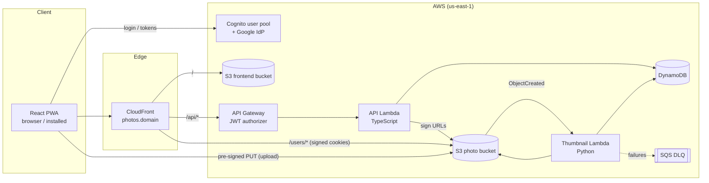

# Photo App — Requirements & Technical Specification

| | |
|---|---|
| **Version** | 0.4 |
| **Date** | 2026-10-22 |
| **Owner** | Edgar |
| **Status** | Draft — architecture agreed, implementation not started |

> Living document. New features go into [§17 Feature backlog](#17-feature-backlog) first, then get a full spec section once they are planned. Record every change in [§19 Changelog](#19-changelog).

---

## Table of contents

1. [Overview](#1-overview)
2. [Scope](#2-scope)
3. [Prerequisites](#3-prerequisites)
4. [Tech stack](#4-tech-stack)
5. [Architecture](#5-architecture)
6. [Functional requirements](#6-functional-requirements)
7. [Non-functional requirements](#7-non-functional-requirements)
8. [Data model](#8-data-model)
9. [API specification](#9-api-specification)
10. [Thumbnail service](#10-thumbnail-service)
11. [Authentication](#11-authentication)
12. [Frontend & PWA](#12-frontend--pwa)
13. [Infrastructure](#13-infrastructure)
14. [CI/CD](#14-cicd)
15. [Repository structure](#15-repository-structure)
16. [Cost estimate](#16-cost-estimate)
17. [Feature backlog](#17-feature-backlog)
18. [Open decisions](#18-open-decisions)
19. [Changelog](#19-changelog)

---

## 1. Overview

A private photo storage and gallery app, similar in spirit to Google Photos, built serverless on AWS.

- Users sign up with Google (or email/password), upload photos, browse them in a fast gallery, organize them into albums, share albums with other users, and download originals.
- It is a **multi-user** app: every user's data is strictly isolated.
- It is delivered as a **Progressive Web App (PWA)**: installable on phones and desktops, works with poor connectivity.
- Design goals: **near-zero running cost** at small scale, **no servers to manage**, everything defined as **infrastructure as code**.

---

## 2. Scope

### 2.1 In scope for v1

- Sign-up / login with Google (OIDC via Cognito) and email/password
- Photo upload (single and multiple), directly from browser to S3
- Automatic thumbnail (400 px) and preview (1600 px) generation, including iPhone HEIC
- Gallery with infinite scroll, sorted by date taken
- Full-screen photo viewer
- Download of original files
- Delete photos
- Albums: create, rename, delete, add/remove photos
- Share albums (read-only) with other registered users
- Per-user storage quota
- PWA: installable, cached app shell, cached thumbnails, resilient upload queue

### 2.2 Out of scope for v1

- Automatic camera-roll backup (not possible in a PWA, see §12.6)
- Video files
- Public share links for people without an account
- Album download as ZIP
- Search, tags, face/object recognition
- Native mobile apps
- Photo editing

---

## 3. Prerequisites

Accounts, tools and decisions needed before implementation.

### 3.1 Accounts & services

| Item | Purpose | Notes |
|---|---|---|
| AWS Organization | Hosting everything | Accounts: **dev**, **prod**, **management** (budget only). Daily access via IAM Identity Center (SSO); MFA on every root user |
| AWS Budgets alert | Cost protection | One organization-wide budget in the management account: $5 / month, email alerts at 80 % and 100 % actual + 100 % forecast |
| GitHub account + private repo | Code + CI/CD | GitHub Actions free minutes are sufficient |
| Google Cloud project | "Sign in with Google" | OAuth client ID (Web application) + consent screen |
| Domain name | `photos.<domain>` | Optional for dev; needed for prod. Can be registered in Route 53 or elsewhere |

### 3.2 Local tools

| Tool | Version |
|---|---|
| Node.js | 22 LTS (matches Lambda runtime `nodejs22.x`) |
| pnpm | latest |
| Python | 3.13 (matches Lambda runtime `python3.13`) |
| uv or pip | Python dependency management |
| OpenTofu | ≥ 1.10 (needed for S3-native state locking) |
| AWS CLI | v2 |
| Docker | Optional — for building Python wheels / local Lambda testing |

### 3.3 One-time setup steps

1. Run `infra/bootstrap/` once per account (see §13.3): **state bucket** + **GitHub OIDC provider** and CI roles (§14.1) in dev and prod; **budget** in the management account.
3. Create the **Google OAuth client** once the Cognito domain is known (see §11.2).
4. (Prod) Request an **ACM certificate** in `us-east-1` for the CloudFront domain.

---

## 4. Tech stack

| Layer | Choice | Notes |
|---|---|---|
| Frontend framework | **React** + **Vite** | Single-page app, built to static files |
| Routing | **TanStack Router** | File-based routes, type-safe search params, `beforeLoad` auth guards |
| Server state | **TanStack Query** | Caching, `useInfiniteQuery` for the gallery, persisted to IndexedDB |
| Large lists | **TanStack Virtual** | Virtualized photo grid |
| Validation | **Zod** | Shared schemas between frontend and API |
| PWA | **vite-plugin-pwa** (Workbox) | Manifest + service worker |
| API | **TypeScript on AWS Lambda** (Node.js 22, arm64) | One API function, bundled with esbuild; lightweight router (e.g. Hono) |
| Thumbnails | **Python on AWS Lambda** (3.13, arm64) | Pillow + pillow-heif |
| Auth | **Amazon Cognito** user pool | Google as federated OIDC provider |
| API entry | **Amazon API Gateway** (HTTP API) | JWT authorizer with Cognito |
| Database | **Amazon DynamoDB** (on-demand) | Single-table design |
| File storage | **Amazon S3** | Intelligent-Tiering for originals, Standard for derived images |
| CDN / hosting | **Amazon CloudFront** | Serves frontend, photos (signed cookies) and routes `/api` |
| IaC | **OpenTofu** | Modules per area, separate dev/prod environments |
| CI/CD | **GitHub Actions** | OIDC to AWS, no long-lived keys |
| Monorepo | **pnpm workspaces** | `apps/`, `packages/`, `services/` |
| Region | **us-east-1** (N. Virginia) | Same region as the CloudFront ACM certificate |

---

## 5. Architecture

### 5.1 Component diagram



### 5.2 Key flows

**Login**
1. User clicks "Sign in with Google" → redirect to Cognito `/oauth2/authorize?identity_provider=Google` (authorization code + PKCE).
2. Google → Cognito → app callback `/auth/callback?code=…`.
3. App exchanges code for ID/access/refresh tokens.
4. App calls `POST /api/session/media-cookie` → API sets CloudFront signed cookies for `/users/{userId}/*`.

**Upload**
1. App requests `POST /api/photos/upload-url` with file name, type, size.
2. API checks quota, creates a `pending` photo item in DynamoDB, returns a pre-signed POST (size + content-type constrained).
3. App uploads the file **directly to S3** at `users/{userId}/originals/{photoId}.{ext}`.
4. S3 triggers the thumbnail Lambda → creates thumb + preview → updates the DynamoDB item to `ready` with dimensions and date taken.
5. App polls / refetches; the photo appears in the gallery.

**Viewing**
1. App fetches `GET /api/photos?cursor=…` (metadata only).
2. Thumbnails/previews load via CloudFront at stable URLs `/users/{userId}/thumbs/{photoId}.jpg`, authorized by signed cookies, cached at the edge and by the service worker.

**Logout** (FR-AUTH-5)
1. App calls `DELETE /api/session/media-cookie` → API expires the three CloudFront cookies (`Max-Age=0`). The cookies are `HttpOnly`, so only a server response can remove them.
2. App clears tokens, the Query cache and IndexedDB, then redirects to the Cognito logout endpoint.

**Download original**
1. App calls `GET /api/photos/{id}/download-url`.
2. API verifies ownership/share, returns a 5-minute pre-signed S3 GET URL with `Content-Disposition: attachment`.
3. Browser downloads directly from S3.

---

## 6. Functional requirements

IDs are stable — reference them in issues, PRs and tests.

### 6.1 Authentication & accounts

| ID | Requirement |
|---|---|
| FR-AUTH-1 | Users can sign up and log in with their Google account. |
| FR-AUTH-2 | Users can sign up and log in with email + password (with email verification). |
| FR-AUTH-3 | A user who signed up with email/password and later uses Google with the same verified email gets **one** linked account, not two. |
| FR-AUTH-4 | Sessions persist across app restarts (refresh token) until the user logs out. |
| FR-AUTH-5 | Users can log out; logout clears tokens, media cookies and cached private data. |
| FR-AUTH-6 | All pages except login and callback require authentication. |

### 6.2 Upload

| ID | Requirement |
|---|---|
| FR-UP-1 | Users can select one or many photos (file picker, drag & drop, or camera on mobile). |
| FR-UP-2 | Supported formats: JPEG, PNG, HEIC/HEIF, WebP. |
| FR-UP-3 | Maximum file size: 50 MB per photo. |
| FR-UP-4 | Uploads go directly from the client to S3; photo bytes never pass through the API. |
| FR-UP-5 | Uploads are queued locally and survive page reloads, app restarts and connection loss; failed uploads retry automatically. |
| FR-UP-6 | The gallery shows queued/uploading photos immediately with progress. |
| FR-UP-7 | An upload is rejected if it would exceed the user's storage quota, with a clear message. |

### 6.3 Gallery & viewer

| ID | Requirement |
|---|---|
| FR-GAL-1 | The gallery shows all of the user's photos as thumbnails, newest "date taken" first. |
| FR-GAL-2 | The gallery loads more photos automatically while scrolling (infinite scroll) and stays smooth with 10,000+ photos. |
| FR-GAL-3 | Gallery filters (album, sort order) are reflected in the URL and bookmarkable. |
| FR-GAL-4 | Clicking a photo opens a full-screen viewer showing the preview image, with next/previous navigation. |
| FR-GAL-5 | Photos still processing show a placeholder; photos that failed processing show an error state. |
| FR-GAL-6 | Correct orientation for all photos (EXIF orientation applied). |

### 6.4 Download & delete

| ID | Requirement |
|---|---|
| FR-DL-1 | Users can download the original file of their own photos and of photos in albums shared with them. |
| FR-DL-2 | Downloads save under the original file name. |
| FR-DEL-1 | Users can delete their own photos; this removes the original, thumbnail, preview and all metadata, and removes it from albums. |
| FR-DEL-2 | Deletion asks for confirmation. |

### 6.5 Albums & sharing

| ID | Requirement |
|---|---|
| FR-ALB-1 | Users can create, rename and delete albums (deleting an album never deletes photos). |
| FR-ALB-2 | Users can add photos to and remove photos from albums; a photo can be in multiple albums. |
| FR-SHR-1 | Album owners can share an album read-only with another registered user by email. |
| FR-SHR-2 | Owners can revoke a share at any time. |
| FR-SHR-3 | Users see albums shared with them in a separate "Shared with me" section. |
| FR-SHR-4 | Recipients can view and download, but not modify, delete or re-share. |
| FR-SHR-5 | Owners can also share with a user by their username instead of their email; sharing by username never reveals the recipient's email to the owner. |

### 6.6 Account & quota

| ID | Requirement |
|---|---|
| FR-ACC-1 | Users can see their storage usage and quota. |
| FR-ACC-2 | Default quota: 10 GB per user (configurable per environment and per user). |
| FR-ACC-3 | Users can choose a unique username (optional, changeable). 3–30 characters `a-z 0-9 . _`, starting and ending with a letter or digit, compared case-insensitively; reserved names are refused. A released username stays held for its former owner for 30 days (D-8). |

### 6.7 PWA

| ID | Requirement |
|---|---|
| FR-PWA-1 | The app is installable on Android, iOS (Add to Home Screen) and desktop Chromium browsers. |
| FR-PWA-2 | When offline, the installed app opens and shows the last loaded photo list and cached thumbnails. |
| FR-PWA-3 | When a new version is deployed, the user sees an "Update available — reload" prompt. |
| FR-PWA-4 | (Android) The app appears in the system share sheet to receive shared photos (`share_target`). |

---

## 7. Non-functional requirements

### 7.1 Security & privacy

| ID | Requirement |
|---|---|
| NFR-SEC-1 | **Tenant isolation:** the user ID is always taken from the validated JWT (`sub`), never from request path/body. Every data access is scoped to it. |
| NFR-SEC-2 | Requests for another user's resources return **404**, not 403 (no existence leaks). |
| NFR-SEC-3 | Both S3 buckets block all public access; photos are reachable only via CloudFront (Origin Access Control) or short-lived pre-signed URLs. |
| NFR-SEC-4 | Encryption at rest for S3 (SSE-S3) and DynamoDB (default); TLS everywhere. |
| NFR-SEC-5 | Derived images (thumbs/previews) have **all metadata stripped**, including GPS. Originals are stored unchanged. |
| NFR-SEC-6 | Upload URLs are constrained by content type (`image/*`) and max size. |
| NFR-SEC-7 | IAM least privilege per function (e.g. thumbnail Lambda can only read `originals/` and write `thumbs/`, `previews/`). |
| NFR-SEC-8 | No long-lived AWS credentials in CI (GitHub OIDC). Secrets (Google client secret) stored outside git. |
| NFR-SEC-9 | API Gateway throttling enabled; AWS WAF rate limiting on CloudFront before public launch. |

### 7.2 Performance

| ID | Requirement |
|---|---|
| NFR-PERF-1 | Thumbnails available ≤ 5 s after upload completes (p95). |
| NFR-PERF-2 | API p95 latency ≤ 300 ms (warm). |
| NFR-PERF-3 | Gallery scrolling at 60 fps with 10,000 photos (virtualization). |
| NFR-PERF-4 | Repeat gallery views load thumbnails from cache (edge + service worker). |

### 7.3 Cost

| ID | Requirement |
|---|---|
| NFR-COST-1 | Idle cost ≈ $0 apart from storage (no always-on resources). |
| NFR-COST-2 | Budget alerts configured in every account. |

### 7.4 Reliability & operations

| ID | Requirement |
|---|---|
| NFR-OPS-1 | Failed thumbnail jobs retry automatically and land in a DLQ for inspection/replay. |
| NFR-OPS-2 | Logs retained 30 days in CloudWatch. |
| NFR-OPS-3 | S3 versioning on the state bucket; consider versioning on the photo bucket in prod (accidental-delete protection). |
| NFR-OPS-4 | All infrastructure reproducible from code; dev and prod fully separate. |

---

## 8. Data model

### 8.1 S3 key layout (photo bucket)

```
users/{userId}/originals/{photoId}.{ext}   ← untouched upload, INTELLIGENT_TIERING
users/{userId}/thumbs/{photoId}.jpg        ← max 400 px, STANDARD
users/{userId}/previews/{photoId}.jpg      ← max 1600 px, STANDARD
```

- `userId` = Cognito `sub` (UUID).
- `photoId` = ULID (unique, time-sortable, URL-safe). Using the ID instead of the original file name avoids encoding issues and collisions; the original name is kept in DynamoDB.
- The key format is defined **once** in `packages/shared/src/s3Keys.ts` and mirrored (with tests) in the Python service.
- Derived images: `Cache-Control: public, max-age=31536000, immutable`.

### 8.2 DynamoDB — single table `photo-app-{env}`

Initial design; refine during implementation.

| Entity | PK | SK | GSI1PK | GSI1SK | Attributes |
|---|---|---|---|---|---|
| Photo | `USER#{userId}` | `PHOTO#{photoId}` | `USER#{userId}` | `TAKEN#{takenAt}#{photoId}` | status (`pending`/`ready`/`failed`), fileName, contentType, sizeBytes, width, height, takenAt, uploadedAt, originalKey |
| Album | `USER#{ownerId}` | `ALBUM#{albumId}` | — | — | name, createdAt, coverPhotoId, photoCount |
| Album membership | `ALBUM#{albumId}` | `PHOTO#{photoId}` | — | — | ownerId, addedAt |
| Album share | `ALBUM#{albumId}` | `SHARE#{userId}` | `SHAREDWITH#{userId}` | `ALBUM#{albumId}` | ownerId, sharedAt |
| Usage | `USER#{userId}` | `USAGE` | — | — | bytesUsed, photoCount, quotaBytes |
| Profile | `USER#{userId}` | `PROFILE` | — | — | username, usernameChangedAt |
| Username claim | `USERNAME#{username}` | `USERNAME` | — | — | userId, claimedAt; when released: releasedAt, heldUntil |

Access patterns:

| Pattern | Query |
|---|---|
| Gallery (by date taken) | GSI1: `GSI1PK = USER#{id}`, descending, paginated |
| Get one photo | `PK = USER#{id}, SK = PHOTO#{photoId}` |
| List my albums | `PK = USER#{id}, SK begins_with ALBUM#` |
| Photos in album | `PK = ALBUM#{albumId}, SK begins_with PHOTO#` |
| Who an album is shared with | `PK = ALBUM#{albumId}, SK begins_with SHARE#` |
| Albums shared with me | GSI1: `GSI1PK = SHAREDWITH#{id}` |
| User by username | `PK = USERNAME#{username}, SK = USERNAME` (ignored while `heldUntil` is set) |
| My username | `PK = USER#{id}, SK = PROFILE` |
| Can user X see photo P? | Owner check, else any share of an album containing P (resolved via album membership + share) |

`takenAt` = EXIF `DateTimeOriginal`, falling back to upload time.

---

## 9. API specification

- Base path: `/api` (via CloudFront → API Gateway HTTP API).
- Auth: `Authorization: Bearer <Cognito access token>` on all routes; validated by the API Gateway JWT authorizer.
- Format: JSON; request/response schemas defined with Zod in `packages/shared`.
- Errors: `{ "error": { "code": "QUOTA_EXCEEDED", "message": "…" } }`.
- Pagination: opaque `cursor` (encoded DynamoDB `LastEvaluatedKey`) + `limit` (default 60, max 200).

| Method | Path | Purpose |
|---|---|---|
| `POST` | `/session/media-cookie` | Set CloudFront signed cookies for `/users/{userId}/*` |
| `DELETE` | `/session/media-cookie` | Expire the media cookies (logout); `204`, idempotent |
| `GET` | `/me` | Profile (incl. `username`), usage and quota |
| `PUT` | `/me/username` | Set or change own username `{username}`; `409 USERNAME_TAKEN` if someone else has it |
| `POST` | `/photos/upload-url` | Body `{fileName, contentType, sizeBytes}` → `{photoId, upload: {url, fields}}`; creates `pending` item, checks quota |
| `GET` | `/photos` | List own photos `?cursor&limit&sort` |
| `GET` | `/photos/{photoId}` | Photo metadata |
| `GET` | `/photos/{photoId}/download-url` | 5-min pre-signed GET with `attachment` disposition |
| `DELETE` | `/photos/{photoId}` | Delete files + metadata + memberships; update usage |
| `GET` | `/albums` | List own albums |
| `POST` | `/albums` | Create album `{name}` |
| `PATCH` | `/albums/{albumId}` | Rename / set cover |
| `DELETE` | `/albums/{albumId}` | Delete album (not photos) |
| `GET` | `/albums/{albumId}/photos` | Photos in album (owner or share recipient) `?cursor&limit` |
| `POST` | `/albums/{albumId}/photos` | Add photos `{photoIds: []}` |
| `DELETE` | `/albums/{albumId}/photos/{photoId}` | Remove photo from album |
| `GET` | `/albums/{albumId}/shares` | List shares (owner only) |
| `POST` | `/albums/{albumId}/shares` | Share with `{email}` or `{username}` |
| `DELETE` | `/albums/{albumId}/shares/{userId}` | Revoke share |
| `GET` | `/shared-albums` | Albums shared with me |

Image URLs in responses:
- Own photos: stable CloudFront paths (`/users/{userId}/thumbs/{photoId}.jpg`), authorized by the media cookie.
- Photos in albums shared with me: **CloudFront signed URLs** per image (the cookie only covers the user's own prefix).

URL / cookie lifetimes:

| Item | Lifetime |
|---|---|
| Upload pre-signed POST | 15 min |
| Download pre-signed GET | 5 min |
| CloudFront signed URLs (shared photos) | 15 min |
| CloudFront media cookie | 8 h, refreshed with tokens |

Media cookie attributes: `Path=/users/{userId}/; Secure; HttpOnly; SameSite=Lax`, served from the same CloudFront domain as the app (first-party). `DELETE /session/media-cookie` sends the same three cookie names with the same `Path` and `Max-Age=0`. Signed cookies cannot be revoked server-side: a copy taken before logout stays valid until its expiry (≤ 8 h), and only for that user's own prefix.

---

## 10. Thumbnail service

`services/thumbnails` — Python 3.13 Lambda, arm64.

| Aspect | Specification |
|---|---|
| Trigger | S3 `ObjectCreated:*` on prefix `users/` |
| Loop protection | Process only keys matching `users/{userId}/originals/{file}`; ignore everything else. IAM: no write access to `originals/` |
| Libraries | Pillow, pillow-heif (HEIC/HEIF decoding) |
| Steps | Download → decode → apply EXIF orientation → read `DateTimeOriginal`, width, height → generate sizes → strip all metadata → encode JPEG → upload → update DynamoDB item to `ready` |
| Sizes | `thumbs/` max edge 400 px, quality 75 · `previews/` max edge 1600 px, quality 82 · never upscale · keep aspect ratio |
| Transparency | Flatten onto white (JPEG has no alpha) |
| Output headers | `Content-Type: image/jpeg`, `Cache-Control: public, max-age=31536000, immutable`, storage class STANDARD |
| Limits | Skip sources > 50 MB; memory 1536 MB; timeout 60 s |
| Errors — permanent (corrupt / unsupported) | Log, set DynamoDB status `failed`, return success (no retry) |
| Errors — transient | Raise → Lambda async retries (2×) → SQS DLQ (14-day retention) |
| Packaging | Native wheels for `manylinux` aarch64 (`pip install --platform manylinux2014_aarch64 --only-binary=:all:`) or Docker build |
| Logs | Structured JSON; 30-day retention |

---

## 11. Authentication

### 11.1 Cognito user pool

- Sign-in: email (username = email), email verification required.
- Identity providers: **Cognito** (email/password) and **Google**.
- App client: public client (no secret), **authorization code grant with PKCE**, scopes `openid email profile`.
- Callback URLs: `https://photos.<domain>/auth/callback`, `http://localhost:5173/auth/callback` (dev).
- Sign-out URLs: `https://photos.<domain>/login`, `http://localhost:5173/login`.
- Domain: Cognito prefix domain (dev); optionally custom `auth.<domain>` (prod).
- Token lifetimes (initial): access/ID 1 h, refresh 30 days.

### 11.2 Google provider

- Google Cloud Console → OAuth client ID, type *Web application*.
  - Authorized JavaScript origin: `https://<cognito-domain>.auth.us-east-1.amazoncognito.com`
  - Authorized redirect URI: `https://<cognito-domain>.auth.us-east-1.amazoncognito.com/oauth2/idpresponse`
- Consent screen scopes: `openid`, `email`, `profile`; **publish** before public launch (testing mode = max 100 test users).
- Attribute mapping: `email → email`, `name → name`, `picture → picture`, `email_verified → email_verified`.
- Client secret: stored in a secret store / CI secret, passed to OpenTofu as a sensitive variable (state is encrypted, §13.3).

### 11.3 Account linking

`services/auth-triggers` — **pre sign-up** Lambda (TypeScript): when a federated Google sign-up arrives and a native user with the same **verified** email exists, call `AdminLinkProviderForUser` to link them (FR-AUTH-3).

### 11.4 Rules

- Backend identity = Cognito `sub` only (never Google's ID, never an email from the request).
- Frontend keeps tokens in memory + refresh token handling via the OIDC client library (e.g. `oidc-client-ts` or Amplify Auth).

---

## 12. Frontend & PWA

`apps/web` — React + Vite + TanStack Router / Query / Virtual.

### 12.1 Routes (TanStack Router, file-based)

| Route | Purpose |
|---|---|
| `/login` | Login page (Google + email) |
| `/auth/callback` | OAuth code exchange |
| `/_authenticated` (layout) | `beforeLoad` guard → redirect to `/login` if no session |
| `/gallery` | Main gallery; search params `album`, `sort` (Zod-validated) |
| `/photos/$photoId` | Full-screen viewer |
| `/albums` | My albums + shared with me |
| `/albums/$albumId` | Album view |
| `/upload` | Upload page / queue status |
| `/settings` | Usage, quota, logout |

### 12.2 Data fetching (TanStack Query)

- Route loaders call `queryClient.ensureQueryData(...)` so data loads during navigation.
- Gallery: `useInfiniteQuery` with the API `cursor`.
- `staleTime` ≈ 10 min (must stay below URL lifetimes, §9).
- Mutations (upload complete, delete, album changes) invalidate affected queries.
- Query cache persisted to IndexedDB for offline viewing (FR-PWA-2); cleared on logout.

### 12.3 Gallery rendering (TanStack Virtual)

- Virtualized grid of rows; only visible rows rendered.
- API returns `width`/`height` so tiles reserve space before images load (no layout shift).
- `fetchNextPage()` triggered when approaching the end.

### 12.4 Upload queue

- Selected files stored in IndexedDB with status (`queued`/`uploading`/`done`/`failed`).
- Worker loop: request upload URL → POST to S3 with progress → mark done → invalidate gallery.
- Retries on `online` event and on app start; Background Sync where supported (Chromium only).
- Concurrency: 3 parallel uploads.

### 12.5 PWA configuration (vite-plugin-pwa)

- Manifest: `name`, `short_name`, `display: standalone`, `start_url: /gallery`, theme/background colors, icons 192/512 + maskable, `share_target` (Android).
- `registerType: 'prompt'` + update toast (`useRegisterSW`).
- `navigateFallback: /index.html`, denylist `/api/*` and `/users/*`.

Caching strategies:

| Content | Strategy |
|---|---|
| App shell (JS/CSS/HTML/icons) | Precache |
| Thumbnails (`/users/*/thumbs/*`) | CacheFirst, max ~3,000 entries / 30 days |
| Previews / originals | Not cached (future: "available offline" albums) |
| API (`/api/*`) | NetworkOnly in SW; offline handled by persisted Query cache |

### 12.6 Known platform limitations

- No background access to the device photo library → **no automatic camera-roll backup** in a PWA (future: Capacitor, §17).
- iOS: installation only via Share → Add to Home Screen; storage may be evicted for unused sites; Web Push only for installed PWAs; no `share_target`.
- **Test Google/Cognito login in installed (standalone) mode on iOS early.**

---

## 13. Infrastructure

OpenTofu, region `us-east-1`. AWS Organization with separate accounts: **dev**, **prod**, and the **management** account (billing/budget only), accessed via IAM Identity Center (SSO).

### 13.1 Modules (`infra/modules/`)

| Module | Resources |
|---|---|
| `storage` | Photo bucket: public access block, SSE-S3, CORS (app origins only), lifecycle (abort incomplete multipart uploads after 2 days), optional versioning |
| `thumbnails` | Python Lambda, IAM role (least privilege), S3 notification + Lambda permission, SQS DLQ, log group (30 days) |
| `api` | API Gateway HTTP API, JWT authorizer, API Lambda, IAM, throttling, log group |
| `auth` | Cognito user pool, domain, Google IdP, app client, pre-sign-up trigger |
| `database` | DynamoDB table (on-demand, PITR in prod), GSI1 |
| `frontend` | Site bucket, CloudFront distribution (OAC; behaviors for `/`, `/api/*`, `/users/*`), SPA error fallback (403/404 → `/index.html`, 200), CloudFront key group for signed cookies/URLs, ACM cert, optional WAF |

All resources tagged `Project=photo-app`, `Environment={env}`, `ManagedBy=opentofu`.

### 13.2 Environments (`infra/envs/`)

| | dev | prod |
|---|---|---|
| Domain | CloudFront default domain or `dev.photos.<domain>` | `photos.<domain>` |
| Quota default | 2 GB | 10 GB |
| DynamoDB PITR | off | on |
| Photo bucket versioning | off | on (with noncurrent-version expiry) |
| WAF | off | on |
| State key | `dev/terraform.tfstate` | `prod/terraform.tfstate` |

### 13.3 State

- Remote **S3 backend** in a dedicated state bucket per account (`photo-app-tfstate-<account-id>`), created once by `infra/bootstrap/` (local state).
- `use_lockfile = true` (S3-native locking, no DynamoDB lock table).
- State bucket: versioning on, public access blocked, encryption on, access limited to admin + CI roles.
- **OpenTofu client-side state encryption** (state contains the Google client secret): **deferred** to the end of the project; S3 server-side encryption and restricted bucket access apply until then.
- `*.tfstate`, `.terraform/`, `terraform.tfvars` are git-ignored.

---

## 14. CI/CD

GitHub Actions.

### 14.1 AWS access

- GitHub OIDC identity provider in AWS.
- Created by `infra/bootstrap/` in each account. Two IAM roles per environment:
  - `photo-app-ci-plan` — `ReadOnlyAccess` + state read/lock, explicitly denied reading photo objects and DynamoDB items; assumable from any branch or pull request of the repo.
  - `photo-app-ci-deploy` — deploy permissions (AdministratorAccess initially, to be scoped down before launch); dev: only the `main` branch; prod: only jobs in the `prod` GitHub environment (required approval). Max session 1 h.

### 14.2 Workflows

**`ci.yml`** — on every push / pull request
1. Install (pnpm, uv/pip), with caching
2. Lint + typecheck (TypeScript), lint (Python, e.g. ruff)
3. Unit tests (Vitest for TS, pytest for Python)
4. Build web + Lambdas
5. `tofu fmt -check`, `tofu validate`, `tofu plan` (dev) → plan posted as PR comment

**`deploy.yml`** — on merge to `main` (dev), manual/tag with approval (prod)
1. Build web (Vite), API + auth trigger (esbuild), thumbnails (arm64 wheels)
2. `tofu apply`
3. Upload web build to site bucket:
   - `assets/*` (hashed): `Cache-Control: public, max-age=31536000, immutable`
   - `index.html`, `sw.js`, `manifest.webmanifest`: `Cache-Control: no-cache`
4. CloudFront invalidation for `/index.html`, `/sw.js`, `/manifest.webmanifest`
5. Smoke test (health endpoint, homepage loads)

---

## 15. Repository structure

```
photo-app/
├── package.json                  # pnpm workspace root
├── pnpm-workspace.yaml
├── README.md
├── docs/
│   └── SPECIFICATION.md          # this document
│
├── apps/
│   ├── web/                      # React SPA + PWA
│   │   ├── public/icons/
│   │   ├── src/
│   │   │   ├── routes/           # TanStack Router (file-based)
│   │   │   ├── queries/          # TanStack Query hooks
│   │   │   ├── components/       # PhotoGrid (Virtual), PhotoViewer, UploadDropzone…
│   │   │   ├── upload/           # IndexedDB upload queue
│   │   │   ├── auth/             # OIDC client, token handling
│   │   │   ├── api/client.ts
│   │   │   └── main.tsx
│   │   └── vite.config.ts        # incl. vite-plugin-pwa
│   └── api/                      # API Lambda (TypeScript)
│       ├── src/{handlers,lib}/
│       └── test/
│
├── packages/
│   └── shared/                   # types, Zod schemas, S3 key helpers
│
├── services/
│   ├── thumbnails/               # Python Lambda
│   │   ├── src/thumbnails/handler.py
│   │   ├── tests/
│   │   └── pyproject.toml
│   └── auth-triggers/            # Cognito pre-sign-up (TypeScript)
│
├── infra/
│   ├── bootstrap/                # state bucket (run once)
│   ├── modules/{storage,thumbnails,api,auth,database,frontend}/
│   └── envs/{dev,prod}/
│
└── .github/workflows/
    ├── ci.yml
    └── deploy.yml
```

---

## 16. Cost estimate

Indicative AWS list prices (us-east-1, 2026). Small scale (≈ 10 users, ≈ 100 GB photos).

| Item | Estimate / month |
|---|---|
| S3 storage — originals (Intelligent-Tiering, ~100 GB) | ~$1.30–2.50 |
| S3 storage — thumbs + previews (~5–10 GB, Standard) | ~$0.15–0.25 |
| S3 requests | < $0.10 |
| Lambda (free tier: 1M requests, 400k GB-s) | $0 |
| API Gateway HTTP API | < $0.10 |
| DynamoDB on-demand | < $0.10 |
| Cognito (free tier for MAUs) | $0 |
| CloudFront (always-free tier: 1 TB out, 10M requests) | $0 |
| CloudWatch logs | < $0.50 |
| Route 53 hosted zone (if used) | $0.50 |
| **Total** | **≈ $2–4** |

Main cost driver: storage, growing roughly linearly with photos. Risks: egress of originals beyond free tiers, WAF (≈ $5+/month when enabled), CloudWatch log volume.

---

## 17. Feature backlog

Add new ideas here first. When a feature is planned, give it requirement IDs and spec sections.

| # | Feature | Notes | Status |
|---|---|---|---|
| B-1 | Album download as ZIP | Lambda streams ZIP to S3, returns pre-signed URL; Step Functions + email for large albums | Idea |
| B-2 | Native app wrapper (Capacitor) | Enables automatic camera-roll backup; reuses the React app | Idea |
| B-3 | Push notifications | Web Push, e.g. "album shared with you"; iOS only for installed PWA | Idea |
| B-4 | More login providers | Apple, Microsoft — no backend changes needed | Idea |
| B-5 | "Available offline" albums | Cache previews of selected albums in the service worker | Idea |
| B-6 | Public share links | Time-limited CloudFront signed URLs for people without an account | Idea |
| B-7 | Video support | Needs transcoding (e.g. MediaConvert) and different storage/egress planning | Idea |
| B-8 | Search & metadata | Date ranges, places, tags | Idea |
| B-9 | On-the-fly image resizing | Only if many sizes are needed; current fixed sizes are simpler | Idea |
| | | | |

---

## 18. Open decisions

| # | Question | Options | Current lean |
|---|---|---|---|
| D-1 | API routing inside the Lambda | One Lambda + router (Hono) · one Lambda per route | One Lambda + Hono |
| D-2 | OIDC client library | `oidc-client-ts` · Amplify Auth | `oidc-client-ts` (lighter) |
| D-3 | UI component / styling library | Tailwind · shadcn/ui · Mantine · … | Open |
| D-4 | Domain name | — | Open |
| D-5 | Default prod quota | 5 / 10 / 20 GB | 10 GB |
| D-6 | Photo bucket versioning in prod | On (safer, costs more) · off | On, noncurrent versions expire after 30 days |
| D-7 | Thumbnail format | JPEG · WebP · AVIF | JPEG (universal); revisit WebP later |
| D-8 | Released usernames | Free at once · held 30 days for the former owner | Held 30 days: new shares typed with an old name can't reach a newcomer who grabbed it |

---

## 19. Changelog

| Version | Date | Changes |
|---|---|---|
| 0.4 | 2026-10-22 | Usernames: FR-ACC-3 (unique, optional, changeable), FR-SHR-5 (share by username); Profile + Username claim items and access patterns (§8.2); `PUT /me/username`, `username` in `GET /me`, share by `{username}` (§9); D-8 (held names) |
| 0.3 | 2026-10-20 | `DELETE /session/media-cookie` for logout (FR-AUTH-5: `HttpOnly` cookies can't be cleared by JS); logout flow (§5.2); media cookie attributes and non-revocability (§9) |
| 0.2 | 2026-10-19 | Bootstrap details: one budget for the organization, CI role permissions and trust (§3, §14.1); region changed to us-east-1; separate dev/prod AWS accounts + management account; one state bucket per account; org-wide budget $5/month; client-side state encryption deferred |
| 0.1 | 2026-10-18 | Initial specification: architecture, stack (React + TanStack, TypeScript API, Python thumbnails, OpenTofu, GitHub Actions), multi-user model, Google login, PWA |
