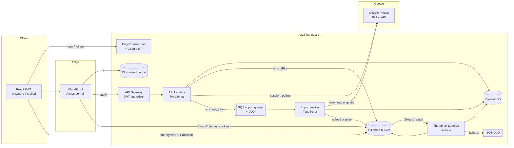

# Photo App — Requirements & Technical Specification

| | |
|---|---|
| **Version** | 0.26 |
| **Date** | 2026-10-31 |
| **Owner** | Edgar |
| **Status** | Draft — architecture agreed, implementation not started |

> Living document. New features go into [§17 Feature backlog](#17-feature-backlog) first, then get a full spec section once they are planned. Record every change in [§19 Changelog](#19-changelog).

---

## Table of contents

1. [Overview](#1-overview)
2. [Scope](#2-scope)
3. [Prerequisites](#3-prerequisites)
4. [Tech stack](#4-tech-stack)
5. [Architecture](#5-architecture)
6. [Functional requirements](#6-functional-requirements)
7. [Non-functional requirements](#7-non-functional-requirements)
8. [Data model](#8-data-model)
9. [API specification](#9-api-specification)
10. [Thumbnail service](#10-thumbnail-service)
11. [Authentication](#11-authentication)
12. [Frontend & PWA](#12-frontend--pwa)
13. [Infrastructure](#13-infrastructure)
14. [CI/CD](#14-cicd)
15. [Repository structure](#15-repository-structure)
16. [Cost estimate](#16-cost-estimate)
17. [Feature backlog](#17-feature-backlog)
18. [Open decisions](#18-open-decisions)
19. [Changelog](#19-changelog)

---

## 1. Overview

A private photo storage and gallery app, similar in spirit to Google Photos, built serverless on AWS.

- Users sign up with Google (or email/password), upload photos, browse them in a fast gallery, organize them into albums, share albums with other users, and download originals.
- It is a **multi-user** app: every user's data is strictly isolated.
- It is delivered as a **Progressive Web App (PWA)**: installable on phones and desktops, works with poor connectivity.
- Design goals: **near-zero running cost** at small scale, **no servers to manage**, everything defined as **infrastructure as code**.

---

## 2. Scope

### 2.1 In scope for v1

- Sign-up / login with Google (OIDC via Cognito) and email/password
- Photo upload (single and multiple), directly from browser to S3
- Automatic thumbnail (400 px) and preview (1600 px) generation, including iPhone HEIC
- Gallery with infinite scroll, sorted by date taken
- Full-screen photo viewer
- Download of original files
- Delete photos
- Albums: create, rename, delete, add/remove photos
- Share albums (read-only) with other registered users
- Per-user storage quota
- PWA: installable, cached app shell, cached thumbnails, resilient upload queue
- Search photos by place (town, region, country from EXIF GPS; owner only) and a map of own photos
- Import photos picked in Google Photos (Google Photos Picker API; photos only, §6.9)

### 2.2 Out of scope for v1

- Automatic camera-roll backup (not possible in a PWA, see §12.6)
- Video files
- Public share links for people without an account
- Album download as ZIP
- Search other than by place (dates, tags), face/object recognition
- Native mobile apps
- Photo editing
- Importing a whole Google Photos library: since 2025-03-31 Google's Library API only reads media the app itself created, and Google Takeout archives aren't read (§6.9)

---

## 3. Prerequisites

Accounts, tools and decisions needed before implementation.

### 3.1 Accounts & services

| Item | Purpose | Notes |
|---|---|---|
| AWS Organization | Hosting everything | Accounts: **dev**, **prod**, **management** (budget only). Daily access via IAM Identity Center (SSO); MFA on every root user |
| AWS Budgets alert | Cost protection | One organization-wide budget in the management account: $5 / month, email alerts at 80 % and 100 % actual + 100 % forecast |
| GitHub account + private repo | Code + CI/CD | GitHub Actions free minutes are sufficient |
| Google Cloud project | "Sign in with Google", import from Google Photos | OAuth client ID (Web application) + consent screen; Google Photos Picker API enabled (§11.5) |
| Domain name | `photos.<domain>` | Optional for dev; needed for prod. Can be registered in Route 53 or elsewhere |

### 3.2 Local tools

| Tool | Version |
|---|---|
| Node.js | 22 LTS (matches Lambda runtime `nodejs22.x`) |
| pnpm | latest |
| Python | 3.13 (matches Lambda runtime `python3.13`) |
| uv or pip | Python dependency management |
| OpenTofu | ≥ 1.10 (needed for S3-native state locking) |
| AWS CLI | v2 |
| Docker | Optional — for building Python wheels / local Lambda testing |

### 3.3 One-time setup steps

1. Run `infra/bootstrap/` once per account (see §13.3): **state bucket** + **GitHub OIDC provider** and CI roles (§14.1) in dev and prod; **budget** in the management account.
3. Create the **Google OAuth client** once the Cognito domain is known (see §11.2).
4. (Prod) Request an **ACM certificate** in `us-east-1` for the CloudFront domain.

---

## 4. Tech stack

| Layer | Choice | Notes |
|---|---|---|
| Frontend framework | **React** + **Vite** | Single-page app, built to static files |
| Routing | **TanStack Router** | File-based routes, type-safe search params, `beforeLoad` auth guards |
| Server state | **TanStack Query** | Caching, `useInfiniteQuery` for the gallery, persisted to IndexedDB |
| Large lists | **TanStack Virtual** | Virtualized photo grid |
| Map | **MapLibre GL JS** + **OpenFreeMap** tiles | Photo map (FR-SRCH-5); free vector tiles, no key |
| UI / styling | **Tailwind CSS** + **shadcn/ui** | Utility CSS; accessible components (Radix) copied into the repo (D-3) |
| Validation | **Zod** | Shared schemas between frontend and API |
| PWA | **vite-plugin-pwa** (Workbox) | Manifest + service worker |
| API | **TypeScript on AWS Lambda** (Node.js 22, arm64) | One API function, bundled with esbuild; lightweight router (e.g. Hono) |
| Thumbnails | **Python on AWS Lambda** (3.13, arm64) | Pillow + pillow-heif |
| Auth | **Amazon Cognito** user pool | Google as federated OIDC provider |
| API entry | **Amazon API Gateway** (HTTP API) | JWT authorizer with Cognito |
| Database | **Amazon DynamoDB** (on-demand) | Single-table design |
| File storage | **Amazon S3** | Intelligent-Tiering for originals, Standard for derived images |
| CDN / hosting | **Amazon CloudFront** | Serves frontend, photos (signed cookies) and routes `/api` |
| IaC | **OpenTofu** | Modules per area, separate dev/prod environments |
| CI/CD | **GitHub Actions** | OIDC to AWS, no long-lived keys |
| Monorepo | **pnpm workspaces** | `apps/`, `packages/`, `services/` |
| Region | **us-east-1** (N. Virginia) | Same region as the CloudFront ACM certificate |

---

## 5. Architecture

### 5.1 Component diagram



### 5.2 Key flows

**Login**
1. User clicks "Sign in with Google" → redirect to Cognito `/oauth2/authorize?identity_provider=Google` (authorization code + PKCE).
2. Google → Cognito → app callback `/auth/callback?code=…`.
3. App exchanges code for ID/access/refresh tokens.
4. App calls `POST /api/session/media-cookie` → API sets CloudFront signed cookies for `/users/{userId}/*`.

**Upload**
1. App requests `POST /api/photos/upload-url` with file name, type, size and its queue ID for the file (`uploadId`; a repeated request gets the same photo).
2. API checks quota, creates a `pending` photo item in DynamoDB, returns a pre-signed POST (size + content-type constrained).
3. App uploads the file **directly to S3** at `users/{userId}/originals/{photoId}.{ext}`.
4. S3 triggers the thumbnail Lambda → creates thumb + preview → updates the DynamoDB item to `ready` with dimensions and date taken.
5. App polls / refetches; the photo appears in the gallery.

**Import from Google Photos** (§6.9, §10.1, §11.5)
1. User taps "Import from Google Photos" (Settings) → the app redirects to Google's consent for the scope `photospicker.mediaitems.readonly` (authorization code + PKCE, `state` and verifier kept in `sessionStorage`).
2. Google → `/import/google/callback?code=…&state=…` → the app checks `state` and calls `POST /api/imports/google` with the code and verifier.
3. API exchanges the code for a Google access token (client secret, ~1 h, no refresh token), creates a Picker session, stores an Import item (`picking`, with the token) and returns `{importId, pickerUri}`.
4. User taps "Choose photos in Google Photos" → `window.open(pickerUri + "/autoclose")` → picks photos in Google's picker → Done.
5. App polls `GET /api/imports/{importId}`; the API asks Google about the session (at most once per its `pollInterval`). When the user is done (`mediaItemsSet`), a conditional update moves the import to `listing` and sends one `list` message to the import queue.
6. Import worker (`list`): pages the picked items, skips videos and other types, sends one `copy` message per photo, moves the import to `copying`.
7. Import worker (`copy`, up to 3 at a time): downloads the original (`baseUrl=d`) from Google, checks size and quota, creates the `pending` photo (as `POST /photos/upload-url`), streams it to `users/{userId}/originals/{photoId}.{ext}`.
8. The thumbnail Lambda processes it like any upload (step 4 of Upload); the photo appears in the gallery by date taken.
9. The last copy closes the import (`done`), deletes the Picker session and the token; the app shows the summary.

**Viewing**
1. App fetches `GET /api/photos?cursor=…` (metadata only).
2. Thumbnails/previews load via CloudFront at stable URLs `/users/{userId}/thumbs/{photoId}.jpg`, authorized by signed cookies, cached at the edge and by the service worker.

**Logout** (FR-AUTH-5)
1. App calls `DELETE /api/session/media-cookie` → API expires the three CloudFront cookies (`Max-Age=0`). The cookies are `HttpOnly`, so only a server response can remove them.
2. App clears tokens, the Query cache and IndexedDB, then redirects to the Cognito logout endpoint.

**Download original**
1. App calls `GET /api/photos/{id}/download-url`.
2. API verifies ownership/share, returns a 5-minute pre-signed S3 GET URL with `Content-Disposition: attachment`.
3. Browser downloads directly from S3.

---

## 6. Functional requirements

IDs are stable — reference them in issues, PRs and tests.

### 6.1 Authentication & accounts

| ID | Requirement |
|---|---|
| FR-AUTH-1 | Users can sign up and log in with their Google account. |
| FR-AUTH-2 | Users can sign up and log in with email + password (with email verification). |
| FR-AUTH-3 | A user who signed up with email/password and later uses Google with the same verified email gets **one** linked account, not two. |
| FR-AUTH-4 | Sessions persist across app restarts (refresh token) until the user logs out. |
| FR-AUTH-5 | Users can log out; logout clears tokens, media cookies and cached private data. |
| FR-AUTH-6 | All pages except login and callback require authentication. |

### 6.2 Upload

| ID | Requirement |
|---|---|
| FR-UP-1 | Users can select one or many photos (file picker, drag & drop, or camera on mobile). |
| FR-UP-2 | Supported formats: JPEG, PNG, HEIC/HEIF, WebP. |
| FR-UP-3 | Maximum file size: 50 MB per photo. |
| FR-UP-4 | Uploads go directly from the client to S3; photo bytes never pass through the API. |
| FR-UP-5 | Uploads are queued locally and survive page reloads, app restarts and connection loss; failed uploads retry automatically. |
| FR-UP-6 | The gallery shows queued/uploading photos immediately with progress. |
| FR-UP-7 | An upload is rejected if it would exceed the user's storage quota, with a clear message. |

### 6.3 Gallery & viewer

| ID | Requirement |
|---|---|
| FR-GAL-1 | The gallery shows all of the user's photos as thumbnails, newest "date taken" first. |
| FR-GAL-2 | The gallery loads more photos automatically while scrolling (infinite scroll) and stays smooth with 10,000+ photos. |
| FR-GAL-3 | Gallery filters (album, sort order) are reflected in the URL and bookmarkable. |
| FR-GAL-4 | Clicking a photo opens a full-screen viewer showing the preview image, with next/previous navigation. |
| FR-GAL-7 | The viewer zooms: pinch, double tap and drag on touch; wheel or trackpad pinch, double click, drag and + / − / 0 on a computer. Zoomed past the preview's detail, the full-resolution original loads and replaces it (where the browser can show its format). |
| FR-GAL-5 | Photos still processing show a placeholder; photos that failed processing show an error state. |
| FR-GAL-6 | Correct orientation for all photos (EXIF orientation applied). |

### 6.4 Download & delete

| ID | Requirement |
|---|---|
| FR-DL-1 | Users can download the original file of their own photos and of photos in albums shared with them. |
| FR-DL-2 | Downloads save under the original file name. |
| FR-DEL-1 | Users can delete their own photos; this removes the original, thumbnail, preview and all metadata, and removes it from albums. Since v0.19 a delete first moves the photo to the trash (FR-DEL-3); this full removal happens when it leaves the trash. |
| FR-DEL-2 | Deletion asks for confirmation (moving to the trash, deleting from the trash, emptying it). |
| FR-DEL-3 | Deleted photos go to a trash for 15 days: out of the gallery, albums (also shared ones), places and the map, but still counted in the quota. In the trash the owner can restore a photo (back in the gallery, its places and the albums it was in that still exist) or delete it for good, one by one or all at once ("Empty trash"). After 15 days a daily job deletes it for good (FR-DEL-1). Uploads that never finished (`pending`) have nothing to restore and are deleted at once. |

### 6.5 Albums & sharing

| ID | Requirement |
|---|---|
| FR-ALB-1 | Users can create, rename and delete albums (deleting an album never deletes photos). |
| FR-ALB-2 | Users can add photos to and remove photos from albums; a photo can be in multiple albums. |
| FR-SHR-1 | Album owners can share an album read-only with another registered user by email. |
| FR-SHR-2 | Owners can revoke a share at any time. |
| FR-SHR-3 | Users see albums shared with them in a separate "Shared with me" section. |
| FR-SHR-4 | Recipients can view and download, but not modify, delete or re-share. They can save a copy to their own gallery (FR-SHR-10). |
| FR-SHR-5 | Owners can also share with a user by their username instead of their email; sharing by username never reveals the recipient's email to the owner. |
| FR-SHR-6 | A new share is an invitation: the recipient sees the album's name, photo count and who shared it, and gets access only after accepting it. Owners see which shares are not accepted yet. |
| FR-SHR-8 | Owners can make a **public link** to their own processed photos: one photo (Share link button next to Download in the viewer) or up to 100 picked in the gallery's select mode (Share link next to Delete). For 15 minutes anyone with the link, without an account, sees the photos (one full screen, several as a grid that opens each one large) and can download each original under its file name (with its EXIF data, location included). Photos still processing or in the trash are left out (the owner is told); a photo deleted or trashed later drops out of the link; after 15 minutes, or with nothing left, the link shows "expired". Each press makes a new link; links can't be revoked early. |
| FR-SHR-7 | Recipients can decline an invitation, or remove an accepted shared album from their albums; access ends at once. The owner's album is unchanged; the person simply drops off the owner's share list (no "declined" state), and the owner can share again, which sends a new invitation. |
| FR-SHR-10 | Recipients can **save photos of an album shared with them to their own gallery**: "Save to my gallery" next to Download in the viewer, and for several photos in the shared album's select mode. The backend copies the original (bytes never pass through the device); the copy is processed like an upload (date taken, place), becomes the recipient's own photo, independent of the owner's (it stays when the owner deletes theirs or stops sharing) and counts against the recipient's quota (FR-UP-7: photos that don't fit are not saved). Only processed photos can be saved. Saving the same photo again saves nothing new and says "already in your gallery" (or "in your trash"); once the copy is deleted for good it can be saved anew. The app sums up the result (e.g. "Saved 8 photos · 1 already saved · 1 didn't fit in your storage"). |

### 6.6 Account & quota

| ID | Requirement |
|---|---|
| FR-ACC-1 | Users can see their storage usage and quota. |
| FR-ACC-2 | Default quota: 10 GB per user (configurable per environment and per user). |
| FR-ACC-3 | Users can choose a unique username (optional, changeable). 3–30 characters `a-z 0-9 . _`, starting and ending with a letter or digit, compared case-insensitively; reserved names are refused. A released username stays held for its former owner for 30 days (D-8). |

### 6.7 PWA

| ID | Requirement |
|---|---|
| FR-PWA-1 | The app is installable on Android, iOS (Add to Home Screen) and desktop Chromium browsers. |
| FR-PWA-2 | When offline, the installed app opens and shows the last loaded photo list and cached thumbnails. |
| FR-PWA-3 | When a new version is deployed, the user sees an "Update available — reload" prompt. |
| FR-PWA-4 | (Android) The app appears in the system share sheet to receive shared photos (`share_target`). |

### 6.8 Search by place

| ID | Requirement |
|---|---|
| FR-SRCH-1 | Photos with EXIF GPS get the nearest town (1,000+ inhabitants, within 50 km), its region and country, looked up offline when they are processed. |
| FR-SRCH-2 | Users can search their places by name (case- and accent-insensitive) and see a place's photos by date taken, like an album. |
| FR-SRCH-3 | The viewer shows where an own photo was taken (town, country). |
| FR-SRCH-4 | Places are the owner's only: share recipients see no place. Photos carry place names only; coordinates leave the backend only for the owner's map (FR-SRCH-5). |
| FR-SRCH-5 | A map shows the user's own photos with GPS as thumbnail pins, clustered with a count; tapping a cluster zooms in (or lists its photos when they were taken at one spot), tapping a photo opens the viewer on its town's photos (prev/next as after searching that town). Coordinates are sent rounded to 3 decimals (~100 m), to the owner only. Map tiles come from OpenFreeMap (no key), which sees the area viewed but no photo coordinates. |

### 6.9 Import from Google Photos

| ID | Requirement |
|---|---|
| FR-IMP-1 | Users can import photos from their Google Photos library: they choose the photos in Google's own picker (Google Photos Picker API), and the app copies the originals into their library. Access to Google Photos is asked for only when an import starts, separately from login, so it also works for email/password accounts. |
| FR-IMP-2 | Only the photos the user picks are read (scope `photospicker.mediaitems.readonly`), at most 500 per import. Importing the whole library is out of scope (§2.2). |
| FR-IMP-3 | Imported photos follow the upload rules: formats of FR-UP-2 (anything else, including videos, is skipped and counted), 50 MB per photo (FR-UP-3) and the quota (FR-UP-7: photos that don't fit are not imported). |
| FR-IMP-4 | The copy runs in the backend: photo bytes go from Google to S3, never through the user's device. The user can close the app and the import goes on. Imported photos show as processing tiles, then by date taken; a photo without an EXIF date uses its Google creation time. |
| FR-IMP-5 | The app shows the import's progress and a summary (e.g. "Imported 48 photos · 2 videos skipped · 1 not imported: storage full"). The user can cancel an import; photos already copied stay. |
| FR-IMP-6 | A retried copy never creates a second photo or counts its bytes twice. Photos imported again in a later import are new photos (no dedupe in v1). |

---

## 7. Non-functional requirements

### 7.1 Security & privacy

| ID | Requirement |
|---|---|
| NFR-SEC-1 | **Tenant isolation:** the user ID is always taken from the validated JWT (`sub`), never from request path/body. Every data access is scoped to it. Exception by design: public photo links (FR-SHR-8) are found by an unguessable 128-bit token and expose only that one photo. |
| NFR-SEC-2 | Requests for another user's resources return **404**, not 403 (no existence leaks). |
| NFR-SEC-3 | Both S3 buckets block all public access; photos are reachable only via CloudFront (Origin Access Control) or short-lived pre-signed URLs. |
| NFR-SEC-4 | Encryption at rest for S3 (SSE-S3) and DynamoDB (default); TLS everywhere. |
| NFR-SEC-5 | Derived images (thumbs/previews) have **all metadata stripped**, including GPS. Originals are stored unchanged. GPS read for places (FR-SRCH-1) is stored on the photo item; the API returns it only rounded (~100 m) to the owner's map (FR-SRCH-5). |
| NFR-SEC-6 | Upload URLs are constrained by content type (`image/*`) and max size. |
| NFR-SEC-7 | IAM least privilege per function (e.g. thumbnail Lambda can only read `originals/` and write `thumbs/`, `previews/`). |
| NFR-SEC-8 | No long-lived AWS credentials in CI (GitHub OIDC). Secrets (Google client secret) stored outside git. |
| NFR-SEC-9 | API Gateway throttling enabled; AWS WAF rate limiting on CloudFront before public launch. |
| NFR-SEC-10 | Google Photos import (FR-IMP-1): the narrowest scope (`photospicker.mediaitems.readonly`); the Google access token is obtained and kept in the backend only (never sent to the browser), has no refresh token (~1 h) and is deleted when the import ends; the OAuth redirect is protected by `state` and PKCE; the Google client secret is read from SSM; neither the token nor Google's download URLs are logged. |

### 7.2 Performance

| ID | Requirement |
|---|---|
| NFR-PERF-1 | Thumbnails available ≤ 5 s after upload completes (p95). |
| NFR-PERF-2 | API p95 latency ≤ 300 ms (warm). |
| NFR-PERF-3 | Gallery scrolling at 60 fps with 10,000 photos (virtualization). |
| NFR-PERF-4 | Repeat gallery views load thumbnails from cache (edge + service worker). |

### 7.3 Cost

| ID | Requirement |
|---|---|
| NFR-COST-1 | Idle cost ≈ $0 apart from storage (no always-on resources). |
| NFR-COST-2 | Budget alerts configured in every account. |

### 7.4 Reliability & operations

| ID | Requirement |
|---|---|
| NFR-OPS-1 | Failed thumbnail jobs retry automatically and land in a DLQ for inspection/replay. |
| NFR-OPS-2 | Logs retained 30 days in CloudWatch. |
| NFR-OPS-3 | S3 versioning on the state bucket; consider versioning on the photo bucket in prod (accidental-delete protection). |
| NFR-OPS-4 | All infrastructure reproducible from code; dev and prod fully separate. |

---

## 8. Data model

### 8.1 S3 key layout (photo bucket)

```
users/{userId}/originals/{photoId}.{ext}   ← untouched upload, INTELLIGENT_TIERING
users/{userId}/thumbs/{photoId}.jpg        ← max 400 px, STANDARD
users/{userId}/previews/{photoId}.jpg      ← max 1600 px, STANDARD
```

- `userId` = Cognito `sub` (UUID).
- `photoId` = ULID (unique, time-sortable, URL-safe). Using the ID instead of the original file name avoids encoding issues and collisions; the original name is kept in DynamoDB.
- The key format is defined **once** in `packages/shared/src/s3Keys.ts` and mirrored (with tests) in the Python service.
- Derived images: `Cache-Control: public, max-age=31536000, immutable`.

### 8.2 DynamoDB — single table `photo-app-{env}`

Initial design; refine during implementation.

| Entity | PK | SK | GSI1PK | GSI1SK | Attributes |
|---|---|---|---|---|---|
| Photo | `USER#{userId}` | `PHOTO#{photoId}` | `USER#{userId}`; `TRASH` while in the trash | `TAKEN#{takenAt}#{photoId}`; `PURGE#{purgeAt}#{userId}#{photoId}` while in the trash | status (`pending`/`ready`/`failed`), fileName, contentType, sizeBytes, width, height, takenAt, uploadedAt, originalKey, originalETag, latitude, longitude, place `{city, region, country, countryCode}`, placeIds; in the trash: trashedAt, purgeAt, trashedAlbumIds |
| Album | `USER#{ownerId}` | `ALBUM#{albumId}` | — | — | name, createdAt, coverPhotoId, photoCount |
| Album membership | `ALBUM#{albumId}` | `PHOTO#{photoId}` | `ALBUM#{albumId}` | `TAKEN#{takenAt}#{photoId}` (the photo's) | ownerId, addedAt |
| Photo link | `LINK#{token}` | `LINK` | — | — | ownerId, photoIds (≤ 100, newest first), createdAt, expiresAt, ttl (epoch seconds, DynamoDB TTL) |
| Album share | `ALBUM#{albumId}` | `SHARE#{userId}` | `INVITED#{userId}` while pending, `SHAREDWITH#{userId}` once accepted | `ALBUM#{albumId}` | ownerId, email (shares by email only), status (`pending`/`accepted`; absent = accepted, shares from before v0.17), sharedAt, acceptedAt |
| Usage | `USER#{userId}` | `USAGE` | — | — | bytesUsed, photoCount, quotaBytes |
| Upload claim | `USER#{userId}` | `UPLOAD#{uploadId}` | — | — | photoId, ttl (7 days). Imports use `uploadId = gp-{importId}-{mediaItemId}`. A saved shared photo (FR-SHR-10) uses `uploadId = shared-{photoId}` (the owner's photo ID) **without ttl**: it remembers the copy; released once the copy is deleted for good |
| Import | `USER#{userId}` | `IMPORT#{importId}` | — | — | source (`google-photos`), status (`picking`/`listing`/`copying`/`done`/`cancelled`/`expired`), sessionId, pickerUri, pollIntervalSec, lastPolledAt, accessToken (removed when the import ends), tokenExpiresAt, total, done, failed, skipped, failedReasons (`{code: count}`), createdAt, ttl (7 days) |
| Profile | `USER#{userId}` | `PROFILE` | — | — | username, usernameChangedAt |
| Place (list entry) | `USER#{userId}` | `PLACE#{placeId}` | — | — | kind (`city`/`region`/`country`), name, context, photoCount, trashedCount (its photos in the trash, so the entry survives for a restore) |
| Place photo | `PLACE#{userId}#{placeId}` | `PHOTO#{photoId}` | `PLACE#{userId}#{placeId}` (removed while the photo is in the trash) | `TAKEN#{takenAt}#{photoId}` | ownerId, placeId |
| Username claim | `USERNAME#{username}` | `USERNAME` | — | — | userId, claimedAt; when released: releasedAt, heldUntil |

Access patterns:

| Pattern | Query |
|---|---|
| Gallery (by date taken) | GSI1: `GSI1PK = USER#{id}`, descending, paginated |
| Get one photo | `PK = USER#{id}, SK = PHOTO#{photoId}` |
| List my albums | `PK = USER#{id}, SK begins_with ALBUM#` |
| Photos in album (by date taken) | GSI1: `GSI1PK = ALBUM#{albumId}`, descending (or ascending), paginated |
| Who an album is shared with | `PK = ALBUM#{albumId}, SK begins_with SHARE#` |
| Albums shared with me (accepted) | GSI1: `GSI1PK = SHAREDWITH#{id}` |
| My invitations | GSI1: `GSI1PK = INVITED#{id}` |
| My trash | `PK = USER#{id}, SK begins_with PHOTO#`, filter `attribute_exists(trashedAt)` (bounded by the quota) |
| Trashed photos due for the purge (all users) | GSI1: `GSI1PK = TRASH`, `GSI1SK` between `PURGE#` and `PURGE#{now}~` |
| My places (search) | `PK = USER#{id}, SK begins_with PLACE#` |
| Photos at a place (by date taken) | GSI1: `GSI1PK = PLACE#{id}#{placeId}`, descending (or ascending), paginated |
| User by username | `PK = USERNAME#{username}, SK = USERNAME` (ignored while `heldUntil` is set) |
| My username | `PK = USER#{id}, SK = PROFILE` |
| One import | `PK = USER#{id}, SK = IMPORT#{importId}` |
| Can user X see photo P? | Owner check, else an accepted share of an album containing P (resolved via album membership + share) |

`takenAt` = EXIF `DateTimeOriginal`, falling back to Google's creation time for imported photos (§10), then to upload time. Imported photos also carry `importId`.

---

## 9. API specification

- Base path: `/api` (via CloudFront → API Gateway HTTP API).
- Auth: `Authorization: Bearer <Cognito access token>` on all routes except `/health` and the public link routes `GET /links/*` (FR-SHR-8); validated by the API Gateway JWT authorizer.
- Format: JSON; request/response schemas defined with Zod in `packages/shared`.
- Errors: `{ "error": { "code": "QUOTA_EXCEEDED", "message": "…" } }`.
- Pagination: opaque `cursor` (encoded DynamoDB `LastEvaluatedKey`) + `limit` (default 60, max 200).

| Method | Path | Purpose |
|---|---|---|
| `POST` | `/session/media-cookie` | Set CloudFront signed cookies for `/users/{userId}/*` |
| `DELETE` | `/session/media-cookie` | Expire the media cookies (logout); `204`, idempotent |
| `GET` | `/me` | Profile (incl. `username`), usage and quota |
| `PUT` | `/me/username` | Set or change own username `{username}`; `409 USERNAME_TAKEN` if someone else has it |
| `POST` | `/photos/upload-url` | Body `{fileName, contentType, sizeBytes}` → `{photoId, upload: {url, fields}}`; creates `pending` item, checks quota |
| `GET` | `/photos` | List own photos `?cursor&limit&sort` |
| `GET` | `/photos/{photoId}` | Photo metadata; with `?albumId=` a photo of an album shared with the caller, with signed image URLs |
| `GET` | `/photos/{photoId}/download-url` | 5-min pre-signed GET with `attachment` disposition |
| `DELETE` | `/photos/{photoId}` | Move to the trash (FR-DEL-3): out of gallery, albums and places, files and usage stay; a `pending` upload is deleted at once (files + metadata + usage) |
| `POST` | `/imports/google` | Start an import (FR-IMP-1): body `{code, codeVerifier, redirectUri}` (Google authorization code) → `201 {importId, pickerUri, expiresAt}`; exchanges the code server-side and creates the Picker session; `400 GOOGLE_AUTH_FAILED` when Google rejects the code |
| `GET` | `/imports/{importId}` | `{status, total, done, failed, skipped, failedReasons}`; while `picking` it checks the Picker session (at most once per `pollInterval`) and starts the copy when the user is done (FR-IMP-5) |
| `DELETE` | `/imports/{importId}` | Cancel (FR-IMP-5): queued copies are dropped, the Picker session and the token deleted, photos already copied stay; `204` |
| `POST` | `/links` | Public link `{photoIds}` (1–100 own photos; not ready / trashed / foreign left out), 15 min → `{token, path: /s/{token}, expiresAt, photoCount}`; none of the caller's → 404, none shareable → 409 (FR-SHR-8) |
| `GET` | `/links/{token}` | **No login.** `{photos: [{photoId, thumbUrl, previewUrl, width, height}], expiresAt}`, newest first, images as CloudFront signed URLs valid until the link expires; 404 when unknown, expired or no photo left (FR-SHR-8) |
| `GET` | `/links/{token}/photos/{photoId}/download-url` | **No login.** 5-min pre-signed GET of that original (only photos of the link), `attachment` with its file name; same 404 rule (FR-SHR-8) |
| `GET` | `/trash` | Own photos in the trash (with `trashedAt`, `purgeAt`), most recently deleted first, one response (FR-DEL-3) |
| `POST` | `/trash/{photoId}/restore` | Restore a photo from the trash; returns the photo (FR-DEL-3) |
| `DELETE` | `/trash/{photoId}` | Delete a trashed photo for good (FR-DEL-1/3) |
| `DELETE` | `/trash` | Empty the trash (FR-DEL-3) |
| `GET` | `/places` | Own places with photo counts, most photos first (FR-SRCH-2) |
| `GET` | `/places/map` | Own ready photos with GPS as map pins: `photoId`, `lat`/`lon` rounded to 3 decimals, `takenAt`, `thumbUrl`, `placeId` (its town, or null); newest first, one response (FR-SRCH-5) |
| `GET` | `/places/{placeId}/photos` | Photos at an own place by date taken `?sort&cursor&limit`; 404 for a place the caller doesn't have |
| `GET` | `/albums` | List own albums |
| `POST` | `/albums` | Create album `{name}` |
| `PATCH` | `/albums/{albumId}` | Rename / set cover |
| `DELETE` | `/albums/{albumId}` | Delete album (not photos) |
| `GET` | `/albums/{albumId}/photos` | Photos in album by date taken (owner or share recipient) `?sort&cursor&limit`, like `/photos` |
| `POST` | `/albums/{albumId}/photos` | Add photos `{photoIds: []}` |
| `DELETE` | `/albums/{albumId}/photos/{photoId}` | Remove photo from album |
| `GET` | `/albums/{albumId}/shares` | List shares (owner only) |
| `POST` | `/albums/{albumId}/shares` | Share with `{email}` or `{username}`: creates a pending invitation (FR-SHR-6) |
| `DELETE` | `/albums/{albumId}/shares/{userId}` | Revoke share |
| `GET` | `/shared-albums` | Albums shared with me (accepted) |
| `GET` | `/share-invitations` | Invitations I haven't answered `?cursor&limit` (FR-SHR-6) |
| `POST` | `/shared-albums/{albumId}/accept` | Accept an invitation (FR-SHR-6) |
| `DELETE` | `/shared-albums/{albumId}` | Decline an invitation or remove an accepted shared album (FR-SHR-7) |
| `POST` | `/shared-albums/{albumId}/save` | Save photos of an accepted shared album to my gallery `{photoIds}` (1–10; the app sends more in batches) → `200 {items: [{photoId, result: saved / already-saved / unavailable / quota-exceeded, savedPhotoId, inTrash}]}` in request order; server-side S3 copy into `users/{me}/originals/`, then processed like an upload; not shared with me (or only invited) → 404 (FR-SHR-10) |

Image URLs in responses:
- Own photos: stable CloudFront paths (`/users/{userId}/thumbs/{photoId}.jpg`), authorized by the media cookie.
- Photos in albums shared with me: **CloudFront signed URLs** per image (the cookie only covers the user's own prefix).

URL / cookie lifetimes:

| Item | Lifetime |
|---|---|
| Upload pre-signed POST | 15 min |
| Download pre-signed GET | 5 min |
| CloudFront signed URLs (shared photos) | 15 min |
| CloudFront media cookie | 8 h, refreshed with tokens |
| Google token / Picker `baseUrl` (import) | ~1 h each (set by Google) |

Media cookie attributes: `Path=/users/{userId}/; Secure; HttpOnly; SameSite=Lax`, served from the same CloudFront domain as the app (first-party). Signatures use SHA-256, so there are four cookies (`CloudFront-Policy`, `-Signature`, `-Key-Pair-Id`, `-Hash-Algorithm`). `DELETE /session/media-cookie` sends the same four cookie names with the same `Path` and `Max-Age=0`. Signed cookies cannot be revoked server-side: a copy taken before logout stays valid until its expiry (≤ 8 h), and only for that user's own prefix.

---

## 10. Thumbnail service

`services/thumbnails` — Python 3.13 Lambda, arm64.

| Aspect | Specification |
|---|---|
| Trigger | S3 `ObjectCreated:*` on prefix `users/` |
| Loop protection | Process only keys matching `users/{userId}/originals/{file}`; ignore everything else. IAM: no write access to `originals/` |
| Libraries | Pillow, pillow-heif (HEIC/HEIF decoding) |
| Steps | Download → decode → apply EXIF orientation → read `DateTimeOriginal`, width, height → generate sizes → strip all metadata → encode JPEG → upload → update DynamoDB item to `ready` |
| Sizes | `thumbs/` max edge 400 px, quality 75 · `previews/` max edge 1600 px, quality 82 · never upscale · keep aspect ratio |
| Transparency | Flatten onto white (JPEG has no alpha) |
| Output headers | `Content-Type: image/jpeg`, `Cache-Control: public, max-age=31536000, immutable`, storage class STANDARD |
| Limits | Skip sources > 50 MB; memory 1536 MB; timeout 60 s |
| Errors — permanent (corrupt / unsupported) | Log, set DynamoDB status `failed`, return success (no retry) |
| Places | EXIF GPS → nearest town (population-weighted, ≤ 50 km) from a bundled GeoNames list (CC BY 4.0), with region and country; written in the `ready` transaction: coordinates and place on the photo, place list counts, place photo items (FR-SRCH-1) |
| Album order | Once `ready`, the photo's album memberships get its final takenAt in `GSI1SK` (they were sorted by the upload time while pending) |
| Replaced original | The item stores the processed bytes' ETag (`originalETag`). If the original is overwritten after processing (the upload POST is valid 15 min), the photo becomes `failed` and its thumb/preview are deleted, so recipients can't download other bytes than they were shown |
| Errors — transient | Raise → Lambda async retries (2×) → SQS DLQ (14-day retention) |
| Packaging | Native wheels for `manylinux` aarch64 (`pip install --platform manylinux2014_aarch64 --only-binary=:all:`) or Docker build |
| Logs | Structured JSON; 30-day retention |
| Date fallback (imports) | Imported originals carry `x-amz-meta-taken-at` (Google's `createTime`); used when EXIF has no `DateTimeOriginal`, before the upload time (FR-IMP-4) |

### 10.1 Import worker (FR-IMP-*)

TypeScript Lambda, arm64, in `apps/api` (same bundle as the API, own handler and IAM role).

| Aspect | Specification |
|---|---|
| Trigger | SQS queue `photo-app-{env}-imports`, batch size 1, event source **maximum concurrency 3** (keeps Lambda capacity for the API and thumbnails, 12.3a); DLQ after 5 receives, 14-day retention |
| `list` message | `{userId, importId}`: pages the Picker media items (100 per page), keeps `PHOTO` items with a FR-UP-2 type, sends one `copy` per photo (`SendMessageBatch`, 10 per call), sets `total`, `skipped`, status `copying` |
| `copy` message | `{userId, importId, mediaItemId, baseUrl, fileName, contentType, createTime}` |
| Copy steps | Upload claim `gp-{importId}-{mediaItemId}` (a redelivered message reuses its photoId, FR-IMP-6) → `GET {baseUrl}=d` with the Bearer token, streamed → ≤ 50 MB → quota check + `pending` Photo item in one transaction (as `POST /photos/upload-url`) → multipart upload to `users/{userId}/originals/{photoId}.{ext}` with `taken-at` metadata → `done += 1` → the thumbnail Lambda takes over |
| Errors — permanent | Too large, over quota, gone at Google (404): no photo (or the pending one set `failed`), `failed += 1` with a reason (`TOO_LARGE`, `QUOTA_EXCEEDED`, `NOT_FOUND`), message deleted |
| Errors — transient | Google 429/5xx, DynamoDB `TransactionConflict`: throw → SQS redelivers after the visibility timeout; after 5 receives → DLQ. An import still `copying` when its token has expired is closed by `GET /imports/{id}`: the rest count as failed (`EXPIRED`) |
| Finish | The update that makes `done + failed = total` (conditional) sets `done`, deletes the Picker session and removes `accessToken` |
| Cancel | `DELETE /imports/{id}` sets `cancelled`; queued `copy` messages see it and are dropped |
| Limits | Timeout 120 s, memory 512 MB (everything streamed), visibility timeout 720 s; 500 photos ≈ 3 min with 3 workers, well within the token's hour |
| Logs | Structured JSON; 30-day retention; never the token or `baseUrl` |

---

## 11. Authentication

### 11.1 Cognito user pool

- Sign-in: email (username = email), email verification required.
- Identity providers: **Cognito** (email/password) and **Google**.
- App client: public client (no secret), **authorization code grant with PKCE**, scopes `openid email profile`.
- Callback URLs: `https://photos.<domain>/auth/callback`, `http://localhost:5173/auth/callback` (dev).
- Sign-out URLs: `https://photos.<domain>/login`, `http://localhost:5173/login`.
- Domain: Cognito prefix domain (dev); optionally custom `auth.<domain>` (prod).
- Managed login (the email/password, sign-up and reset pages) styled like the app: its neutral colours, light/dark following the device, the app icon as logo and favicon, no AWS background. "Continue with email" opens only the email form (`identity_provider=COGNITO`), since Google has its own button on the app's login page.
- Token lifetimes (initial): access/ID 1 h, refresh 30 days.

### 11.2 Google provider

- Google Cloud Console → OAuth client ID, type *Web application*.
  - Authorized JavaScript origin: `https://<cognito-domain>.auth.us-east-1.amazoncognito.com`
  - Authorized redirect URI: `https://<cognito-domain>.auth.us-east-1.amazoncognito.com/oauth2/idpresponse`
- Consent screen scopes: `openid`, `email`, `profile`; **publish** before public launch (testing mode = max 100 test users).
- Attribute mapping: `email → email`, `name → name`, `picture → picture`, `email_verified → email_verified`.
- Client secret: stored in a secret store / CI secret, passed to OpenTofu as a sensitive variable (state is encrypted, §13.3).

### 11.3 Account linking

`services/auth-triggers` — **pre sign-up** Lambda (TypeScript): when a federated Google sign-up arrives and a native user with the same **verified** email exists, call `AdminLinkProviderForUser` to link them (FR-AUTH-3). Optional **sign-up allowlist** (`ALLOWED_EMAILS`, from `TF_VAR_allowed_emails`, kept out of git): when set, email/password and Google sign-ups for any other email are refused ("Sign-up is by invitation only."); admin-created users and existing accounts are unaffected. Used while the app isn't public.

### 11.4 Rules

- Backend identity = Cognito `sub` only (never Google's ID, never an email from the request).
- Frontend keeps the access and ID tokens in memory; only the refresh token is stored, in IndexedDB, so sessions survive restarts (FR-AUTH-4) and the service worker can refresh tokens for Background Sync uploads (§12.4). IndexedDB rather than `localStorage` because service workers can't read `localStorage`; the exposure is the same (readable by scripts on the app's origin only). Refresh token handling via `oidc-client-ts` (D-2). The refresh token is revoked on logout.

### 11.5 Google Photos access (import, FR-IMP-1)

- Not through Cognito: Cognito doesn't hand out the Google tokens it receives, and asking for Photos at login would show that consent to every user. A separate Google consent is asked for when an import starts.
- Same Google OAuth client as §11.2, with extra redirect URIs `https://photos.<domain>/import/google/callback`, the dev CloudFront domain's, and `http://localhost:5173/import/google/callback`.
- Google Cloud project: **Google Photos Picker API** enabled; consent screen scope `https://www.googleapis.com/auth/photospicker.mediaitems.readonly` (testing mode: the listed test users only; Google's verification before public launch).
- Web: authorization code + PKCE, `access_type=online` (no refresh token), optional `login_hint`; `state` and the verifier in `sessionStorage`. The code goes to `POST /imports/google`, which exchanges it with the client secret (SSM SecureString), so the browser never holds the Google token (NFR-SEC-10).
- Picker: opened with `window.open(pickerUri + "/autoclose")` from a tap (popup blockers), never embedded; on Android it can open in the Google Photos app.
- The Library API isn't used: since 2025-03-31 it only reads media the app itself created.

---

## 12. Frontend & PWA

`apps/web` — React + Vite + TanStack Router / Query / Virtual.

### 12.1 Routes (TanStack Router, file-based)

| Route | Purpose |
|---|---|
| `/login` | Login page (Google + email) |
| `/auth/callback` | OAuth code exchange |
| `/_authenticated` (layout) | `beforeLoad` guard → redirect to `/login` if no session |
| `/gallery` | Main gallery; search params `album`, `place` (not both), `sort` (Zod-validated); place search box at the top (FR-SRCH-2) |
| `/photos/$photoId` | Full-screen viewer |
| `/albums` | Invitations (accept / decline) + my albums + shared with me |
| `/albums/$albumId` | Album view |
| `/map` | Map of own photos with GPS (FR-SRCH-5); MapLibre, loaded only with this page |
| `/upload` | Upload page / queue status |
| `/import/google/callback` | Return from Google's consent (§11.5): checks `state`, starts the import, shows "Choose photos in Google Photos", then progress and the summary (FR-IMP-1/5). Started from Settings |
| `/settings` | Usage, quota, link to the trash, logout |
| `/s/$token` | Public photo link (FR-SHR-8), no login, no app shell: one photo full screen, or a grid ("N shared photos") whose tiles open the photo large with prev/next; "Link works until …", Download original per photo; "expired" message |
| `/trash` | Trash (FR-DEL-3): trashed photos with days left; pick to restore or delete forever; empty trash |

### 12.2 Data fetching (TanStack Query)

- Route loaders call `queryClient.ensureQueryData(...)` so data loads during navigation.
- Gallery: `useInfiniteQuery` with the API `cursor`.
- `staleTime` ≈ 10 min (must stay below URL lifetimes, §9).
- Mutations (upload complete, delete, album changes) invalidate affected queries.
- Query cache persisted to IndexedDB for offline viewing (FR-PWA-2); cleared on logout.

### 12.3 Gallery rendering (TanStack Virtual)

- Virtualized grid of rows; only visible rows rendered.
- API returns `width`/`height` so tiles reserve space before images load (no layout shift).
- `fetchNextPage()` triggered when approaching the end.
- Month sections, as in Google Photos but by month only: a heading ("October 2026", local time) above each month of date taken, in the gallery and in albums; a row never mixes months.
- Select mode (several photos at once: delete, add to / remove from an album), as in Google Photos: entered with the header's Select button or by pressing and holding a photo; sliding the finger on without lifting picks every photo up to the one under it (starting on a picked photo unpicks), scrolling the page near the screen edges. In select mode the Select button reads "Unselect all" (same place, so nothing moves), and Back (Android's back gesture) leaves select mode instead of the page.

### 12.4 Upload queue

- Selected files stored in IndexedDB with status (`queued`/`uploading`/`done`/`failed`).
- Worker loop: request upload URL → POST to S3 with progress → mark done → invalidate gallery.
- Retries on `online` event and on app start; Background Sync where supported (Chromium only): the service worker uploads the stored queue once online, even with the app closed, using the stored refresh token (§11.4).
- Concurrency: 3 parallel uploads.

### 12.5 PWA configuration (vite-plugin-pwa)

- Manifest: `name`, `short_name`, `display: standalone`, `start_url: /gallery`, theme/background colors, icons 192/512 + maskable, `share_target` (Android).
- `registerType: 'prompt'` + update toast (`useRegisterSW`).
- `navigateFallback: /index.html`, denylist `/api/*` and `/users/*`.

Caching strategies:

| Content | Strategy |
|---|---|
| App shell (JS/CSS/HTML/icons) | Precache |
| Thumbnails (`/users/*/thumbs/*`) | CacheFirst, max ~3,000 entries / 30 days |
| Previews / originals | Not cached (future: "available offline" albums) |
| API (`/api/*`) | NetworkOnly in SW; offline handled by persisted Query cache |

### 12.6 Known platform limitations

- No background access to the device photo library → **no automatic camera-roll backup** in a PWA (future: Capacitor, §17).
- iOS: installation only via Share → Add to Home Screen; storage may be evicted for unused sites; Web Push only for installed PWAs; no `share_target`.
- **Test Google/Cognito login in installed (standalone) mode on iOS early.**
- **Location can be removed before upload** (FR-SRCH-1): sharing a photo directly from Google Photos (Android) sends a copy with the GPS fields blanked (seen 2026-10-27: tags present, values 0/0, empty refs); downloading it first and sharing the file keeps the location, and so does taking the photo with the camera from the app (FR-UP-1). Some photos picked on the phone arrived with no GPS tags at all. Such photos simply get no place; the app can't recover it.
- **Imported photos probably have no location** (FR-IMP-1): Google documents that the `=d` download keeps EXIF "except location metadata" (Library API docs; to check for the Picker during 13.5). Such photos get no place (FR-SRCH-1).

---

## 13. Infrastructure

OpenTofu, region `us-east-1`. AWS Organization with separate accounts: **dev**, **prod**, and the **management** account (billing/budget only), accessed via IAM Identity Center (SSO).

### 13.1 Modules (`infra/modules/`)

| Module | Resources |
|---|---|
| `storage` | Photo bucket: public access block, SSE-S3, CORS (app origins only), lifecycle (abort incomplete multipart uploads after 2 days), optional versioning |
| `thumbnails` | Python Lambda, IAM role (least privilege), S3 notification + Lambda permission, SQS DLQ, log group (30 days) |
| `api` | API Gateway HTTP API, JWT authorizer, API Lambda, IAM, throttling, log group; trash purge Lambda (same bundle, own role) run daily by an EventBridge rule (FR-DEL-3); import worker Lambda (same bundle, own role) + SQS import queue and DLQ + Google client secret in SSM (§10.1) |
| `auth` | Cognito user pool, domain, Google IdP, app client, pre-sign-up trigger |
| `database` | DynamoDB table (on-demand, PITR in prod), GSI1, TTL on `ttl` (photo links) |
| `frontend` | Site bucket, CloudFront distribution (OAC; behaviors for `/`, `/api/*`, `/users/*`), security headers with a strict Content-Security-Policy on the site (self only, plus Cognito, the photo bucket and the OpenFreeMap tiles for `connect-src`), SPA fallback (CloudFront Function on the default behavior: extension-less paths → `/index.html`; no distribution-wide error responses, so API/image 403/404 stay real), CloudFront key group for signed cookies/URLs, ACM cert, optional WAF |

All resources tagged `Project=photo-app`, `Environment={env}`, `ManagedBy=opentofu`.

### 13.2 Environments (`infra/envs/`)

| | dev | prod |
|---|---|---|
| Domain | CloudFront default domain or `dev.photos.<domain>` | `photos.<domain>` |
| Quota default | 2 GB | 10 GB |
| DynamoDB PITR | off | on |
| Photo bucket versioning | off | on (with noncurrent-version expiry) |
| WAF | off | on |
| State key | `dev/terraform.tfstate` | `prod/terraform.tfstate` |

### 13.3 State

- Remote **S3 backend** in a dedicated state bucket per account (`photo-app-tfstate-<account-id>`), created once by `infra/bootstrap/` (local state).
- `use_lockfile = true` (S3-native locking, no DynamoDB lock table).
- State bucket: versioning on, public access blocked, encryption on, access limited to admin + CI roles.
- **OpenTofu client-side state encryption** (state contains the Google client secret): **deferred** to the end of the project; S3 server-side encryption and restricted bucket access apply until then.
- `*.tfstate`, `.terraform/`, `terraform.tfvars` are git-ignored.

---

## 14. CI/CD

GitHub Actions.

### 14.1 AWS access

- GitHub OIDC identity provider in AWS.
- Created by `infra/bootstrap/` in each account. Two IAM roles per environment:
  - `photo-app-ci-plan` — `ReadOnlyAccess` + state read/lock, explicitly denied reading photo objects and DynamoDB items; assumable from any branch or pull request of the repo.
  - `photo-app-ci-deploy` — deploy permissions (AdministratorAccess initially, to be scoped down before launch); dev: only the `main` branch; prod: only jobs in the `prod` GitHub environment (required approval). Max session 1 h.

### 14.2 Workflows

**`ci.yml`** — on every push / pull request
1. Install (pnpm, uv/pip), with caching
2. Lint + typecheck (TypeScript), lint (Python, e.g. ruff)
3. Unit tests (Vitest for TS, pytest for Python)
4. Build web + Lambdas
5. `tofu fmt -check`, `tofu validate`, `tofu plan` (dev) → plan posted as PR comment

**`deploy.yml`** — on merge to `main` (dev), manual/tag with approval (prod)
1. Build web (Vite), API + auth trigger (esbuild), thumbnails (arm64 wheels)
2. `tofu apply`
3. Upload web build to site bucket:
   - `assets/*` (hashed): `Cache-Control: public, max-age=31536000, immutable`
   - `index.html`, `sw.js`, `manifest.webmanifest`: `Cache-Control: no-cache`
4. CloudFront invalidation for `/index.html`, `/sw.js`, `/manifest.webmanifest`
5. Smoke test (health endpoint, homepage loads)

---

## 15. Repository structure

```
photo-app/
├── package.json                  # pnpm workspace root
├── pnpm-workspace.yaml
├── README.md
├── docs/
│   └── SPECIFICATION.md          # this document
│
├── apps/
│   ├── web/                      # React SPA + PWA
│   │   ├── public/icons/
│   │   ├── src/
│   │   │   ├── routes/           # TanStack Router (file-based)
│   │   │   ├── queries/          # TanStack Query hooks
│   │   │   ├── components/       # PhotoGrid (Virtual), PhotoViewer, UploadDropzone…
│   │   │   ├── upload/           # IndexedDB upload queue
│   │   │   ├── auth/             # OIDC client, token handling
│   │   │   ├── api/client.ts
│   │   │   └── main.tsx
│   │   └── vite.config.ts        # incl. vite-plugin-pwa
│   └── api/                      # API Lambda (TypeScript)
│       ├── src/{handlers,lib}/
│       └── test/
│
├── packages/
│   └── shared/                   # types, Zod schemas, S3 key helpers
│
├── services/
│   ├── thumbnails/               # Python Lambda
│   │   ├── src/thumbnails/handler.py
│   │   ├── tests/
│   │   └── pyproject.toml
│   └── auth-triggers/            # Cognito pre-sign-up (TypeScript)
│
├── infra/
│   ├── bootstrap/                # state bucket (run once)
│   ├── modules/{storage,thumbnails,api,auth,database,frontend}/
│   └── envs/{dev,prod}/
│
└── .github/workflows/
    ├── ci.yml
    └── deploy.yml
```

---

## 16. Cost estimate

Indicative AWS list prices (us-east-1, 2026). Small scale (≈ 10 users, ≈ 100 GB photos).

| Item | Estimate / month |
|---|---|
| S3 storage — originals (Intelligent-Tiering, ~100 GB) | ~$1.30–2.50 |
| S3 storage — thumbs + previews (~5–10 GB, Standard) | ~$0.15–0.25 |
| S3 requests | < $0.10 |
| Lambda (free tier: 1M requests, 400k GB-s) | $0 |
| API Gateway HTTP API | < $0.10 |
| DynamoDB on-demand | < $0.10 |
| Cognito (free tier for MAUs) | $0 |
| SQS import queue (free tier: 1M requests) | $0 |
| CloudFront (always-free tier: 1 TB out, 10M requests) | $0 |
| CloudWatch logs | < $0.50 |
| Route 53 hosted zone (if used) | $0.50 |
| **Total** | **≈ $2–4** |

Main cost driver: storage, growing roughly linearly with photos. Risks: egress of originals beyond free tiers, WAF (≈ $5+/month when enabled), CloudWatch log volume.

---

## 17. Feature backlog

Add new ideas here first. When a feature is planned, give it requirement IDs and spec sections.

| # | Feature | Notes | Status |
|---|---|---|---|
| B-1 | Album download as ZIP | Lambda streams ZIP to S3, returns pre-signed URL; Step Functions + email for large albums | Idea |
| B-2 | Native app wrapper (Capacitor) | Enables automatic camera-roll backup; reuses the React app | Idea |
| B-3 | Push notifications | Web Push, e.g. "album shared with you"; iOS only for installed PWA | Idea |
| B-4 | More login providers | Apple, Microsoft — no backend changes needed | Idea |
| B-5 | "Available offline" albums | Cache previews of selected albums in the service worker | Idea |
| B-6 | Public share links | Time-limited CloudFront signed URLs for people without an account | Idea |
| B-7 | Video support | Needs transcoding (e.g. MediaConvert) and different storage/egress planning | Idea |
| B-8 | Search & metadata | Date ranges, tags (places and map done: §6.8); location off switch | Idea |
| B-9 | On-the-fly image resizing | Only if many sizes are needed; current fixed sizes are simpler | Idea |
| B-11 | SQS queue in front of the thumbnail Lambda | S3 → SQS → thumbnail Lambda with an event source maximum concurrency (e.g. 5), so big upload bursts can't use up the account's Lambda capacity and throttle the API. Only if raising the concurrency quota (12.3a) and reserved concurrency on the thumbnail Lambda aren't enough. Costs: new queue (+ its DLQ replaces the async-invoke DLQ), S3 notification target changes, handler reads SQS records | Idea |
| B-10 | Import from Google Photos | Picker API, backend copy (§6.9, §10.1, §11.5); whole library / Takeout not planned | Planned (13.5) |
| | | | |

---

## 18. Open decisions

| # | Question | Options | Current lean |
|---|---|---|---|
| D-1 | API routing inside the Lambda | One Lambda + router (Hono) · one Lambda per route | One Lambda + Hono |
| D-2 | OIDC client library | `oidc-client-ts` · Amplify Auth | **Decided 2026-10-24:** `oidc-client-ts` |
| D-3 | UI component / styling library | Tailwind · shadcn/ui · Mantine · … | **Decided 2026-10-24:** Tailwind CSS + shadcn/ui |
| D-4 | Domain name | — | Open |
| D-5 | Default prod quota | 5 / 10 / 20 GB | 10 GB |
| D-6 | Photo bucket versioning in prod | On (safer, costs more) · off | On, noncurrent versions expire after 30 days |
| D-7 | Thumbnail format | JPEG · WebP · AVIF | JPEG (universal); revisit WebP later |
| D-8 | Released usernames | Free at once · held 30 days for the former owner | Held 30 days: new shares typed with an old name can't reach a newcomer who grabbed it |

---

## 19. Changelog

| Version | Date | Changes |
|---|---|---|
| 0.11 | 2026-10-26 | Refresh token stored in IndexedDB instead of `localStorage`, so the service worker can upload via Background Sync (§11.4, §12.4) |
| 0.12 | 2026-10-26 | Select mode by press and slide, "Unselect all", Back leaves select mode (§12.3) |
| 0.26 | 2026-10-31 | Save shared photos to my gallery: FR-SHR-10 (FR-SHR-4 note), `POST /shared-albums/{albumId}/save` (§9), permanent upload claim `shared-{photoId}` (§8.2) |
| 0.25 | 2026-10-30 | B-11: optional SQS queue in front of the thumbnail Lambda (§17) |
| 0.24 | 2026-10-30 | Import from Google Photos (planned, 13.5): FR-IMP-1–6 (§6.9), NFR-SEC-10, flow (§5.2), Import item (§8.2), `/imports` routes (§9), import worker + date fallback (§10, §10.1), Google Photos access (§11.5), callback route (§12.1), location note (§12.6), `api` module (§13.1), scope (§2), B-10 |
| 0.23 | 2026-10-28 | `uploadId` on `POST /photos/upload-url` + Upload claim item: an app closed right after the request no longer leaves a pending photo behind (§8.2, §10) |
| 0.22 | 2026-10-28 | FR-SHR-8: several photos per link (gallery select mode, up to 100); `POST /links` replaces `POST /photos/{id}/links`, link page lists the photos, download per photo `/links/{token}/photos/{photoId}/download-url` (§8.2, §9, §12.1) |
| 0.21 | 2026-10-28 | Public photo links: FR-SHR-8 (15 min, see + download original, no login), NFR-SEC-1 exception; link item + table TTL (§8.2, §13.1); `POST /photos/{id}/links`, public `GET /links/{token}` and `/download-url` (§9); `/s/$token` page (§12.1) |
| 0.20 | 2026-10-28 | Managed login styled like the app; email login opens only the email form (§11.1) |
| 0.19 | 2026-10-28 | Trash: FR-DEL-3 (15 days, restore, delete forever, empty, daily purge), FR-DEL-1/2 adjusted; photo trash attributes + `TRASH` GSI1 key, place `trashedCount` (§8.2); `/trash` routes and `DELETE /photos/{id}` moves to the trash (§9); `/trash` page (§12.1); purge Lambda in the `api` module (§13.1) |
| 0.18 | 2026-10-28 | Map view (13.2h): FR-SRCH-5, FR-SRCH-4 and NFR-SEC-5 allow rounded coordinates for the owner's map; `GET /places/map` (§9); `/map` route (§12.1); MapLibre + OpenFreeMap (§4); CSP `connect-src` (§13) |
| 0.17 | 2026-10-27 | Share invitations: FR-SHR-6 (accept), FR-SHR-7 (decline / remove a shared album); share status + `INVITED#` GSI1 key (§8.2); `/share-invitations`, `/shared-albums/{id}/accept`, `DELETE /shared-albums/{id}` (§9); Albums page (§12.1) |
| 0.16 | 2026-10-27 | Viewer zoom, loading the original for deep zoom (FR-GAL-7) |
| 0.15 | 2026-10-27 | §12.6: location removed before upload (Google Photos direct share). Search by place in scope: FR-SRCH-1–4 (§6.8), place items (§8.2), `/places` routes and `place` on photos (§9), place lookup in the thumbnail Lambda (§10), NFR-SEC-5 note |
| 0.14 | 2026-10-27 | Month sections in gallery and albums (§12.3); album photos listed by date taken with `sort` (§9), memberships in GSI1 (§8.2) |
| 0.13 | 2026-10-27 | Security review 12.2: Content-Security-Policy on the site (§13.1 `frontend`); replaced originals fail the photo, `originalETag` on Photo items (§8.2, §10) |
| 0.10 | 2026-10-25 | Optional sign-up allowlist in the pre sign-up trigger (§11.3), limiting FR-AUTH-1/2 to listed emails until launch |
| 0.9 | 2026-10-25 | Shared-album photos: album pages carry signed thumbnails, `GET /photos/{id}?albumId=` the signed preview (§9) |
| 0.8 | 2026-10-25 | Media cookies signed with SHA-256: four cookies incl. `CloudFront-Hash-Algorithm` (§9) |
| 0.7 | 2026-10-25 | SPA fallback via a CloudFront Function on the site behavior instead of distribution-wide error responses (§13.1) |
| 0.6 | 2026-10-24 | Token storage clarified (§11.4): access/ID tokens in memory, refresh token in `localStorage` (FR-AUTH-4); D-2 decided: `oidc-client-ts` |
| 0.5 | 2026-10-24 | D-3 decided: Tailwind CSS + shadcn/ui (§4, §18) |
| 0.4 | 2026-10-22 | Usernames: FR-ACC-3 (unique, optional, changeable), FR-SHR-5 (share by username); Profile + Username claim items and access patterns (§8.2); `PUT /me/username`, `username` in `GET /me`, share by `{username}` (§9); D-8 (held names) |
| 0.3 | 2026-10-20 | `DELETE /session/media-cookie` for logout (FR-AUTH-5: `HttpOnly` cookies can't be cleared by JS); logout flow (§5.2); media cookie attributes and non-revocability (§9) |
| 0.2 | 2026-10-19 | Bootstrap details: one budget for the organization, CI role permissions and trust (§3, §14.1); region changed to us-east-1; separate dev/prod AWS accounts + management account; one state bucket per account; org-wide budget $5/month; client-side state encryption deferred |
| 0.1 | 2026-10-18 | Initial specification: architecture, stack (React + TanStack, TypeScript API, Python thumbnails, OpenTofu, GitHub Actions), multi-user model, Google login, PWA |
